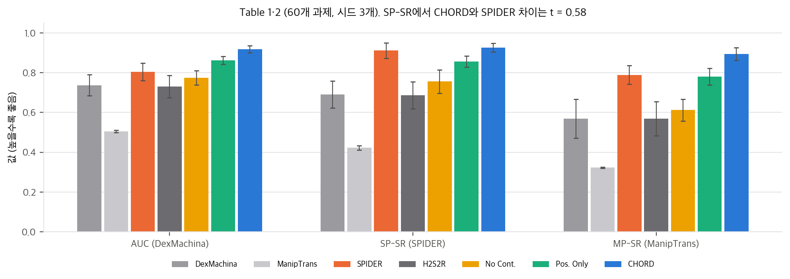

# 01. 논문 분석: CHORD (arXiv:2607.00033)

- 제목: *Learning Dexterous Manipulation Using Contact Wrench Guidance From Human Demonstration* (CHORD: Contact Wrench Guidance from Human Demonstration in Robotic Dexterous Manipulation)
- 저자: Xinghao Zhu\*‡, Zixi Liu\*, Shalin Jain\*, Chenran Li†, Milad Noori†, Michael Andres Lin† 외 15명, Yan Chang‡ (NVIDIA). \* 공동 1저자, † core contributor, ‡ 프로젝트 리드·교신저자
- 공개: arXiv v1 2026-06-22, **v2 2026-08-14 (분석 대상)** · 프로젝트 페이지 https://nvidia-isaac.github.io/video_to_data/chord/ (CoRL 2026으로 표기) · 코드 https://github.com/nvidia-isaac/video_to_data 의 `robotic_grounding/` (확인 커밋 `9cad120`, 2026-11-02)
- 라이선스: arXiv abs 페이지는 **CC BY 4.0**입니다. PDF 첫 쪽 아래에는 "© 2026 NVIDIA. All rights reserved."가 있습니다. 표기가 충돌하므로 thinkworld와 같이 보수적으로 판단해 **논문 그림은 개인용 리포트·PPT에만** 넣었습니다.
- 원문 대조: 프로젝트 페이지의 `chord.pdf`(42.1 MB)와 arXiv v2(41.8 MB)는 단어 12,075개 중 머리글 날짜(2026-8-14 vs 2026-8-17)와 arXiv 세로 도장만 다릅니다. 본문은 같습니다.
- 분석 범위: 본문 12쪽, 부록 A–G(24쪽까지), 프로젝트 페이지, 공식 코드(Isaac Lab PPO 경로와 FlashCHORD 경로). v1 ↔ v2 차이는 §5에 정리했습니다.

---

## 1. Abstract (한 줄 요약과 주장)

**한 줄 요약:** 사람 시연의 접촉을 **"물체에 줄 수 있는 힘·토크의 집합(wrench space)"**으로 바꾸고, 로봇 접촉이 만드는 집합과 512개 방향의 지지값(support function)으로 비교하는 보상을 만들어, 시연 하나당 정책 하나를 RL로 학습합니다. 접촉 위치가 같아도 미는 방향이 다르면 다른 보상을 받습니다.

논문이 내세우는 기여는 세 가지입니다(Sec. 1).

1. **CHORD:** 물체 중심 접촉 wrench 지도 보상과, 이를 받치는 학습 장치(레퍼런스 위 임의 시점 리셋, 물체 보조 VOC 커리큘럼, 사람 wrench에서 뽑은 교란, 잔차 행동)입니다.
2. **벤치마크:** 모션캡처 데이터 7종과 사내 영상 복원으로 양손 조작 과제 4,739개를 Isaac Lab 환경으로 만들었습니다. 데이터는 Hugging Face에 CC BY 4.0으로 공개되었습니다.
3. **검증:** 1,831개 과제 평균 성공률 82.12%, 전신(G1 + Dex3) 90.77%, 실물(Dexmate + Sharpa 양손) open-loop·closed-loop 전이를 보고합니다.

---

## 2. Method

### 2.1 전체 구조 (Fig. 2, Sec. 3)

```
사람 시연 τ_ref = {x_human_t, x_object_t}  (MANO 손 + 물체 부품 K개의 SE(3) 자세)
   │  QP 미분 IK로 로봇 관절 레퍼런스 x_robot_t (App. D, 프레임당 최대 200회 반복)
   │  프레임마다 손-부품 접촉점 p, 법선 n 추출 → 사람 wrench 행렬 𝒲_h,k (Eq. 1)
   ▼
시퀀스 하나 = 정책 하나 (Isaac Lab, Sharpa Wave 양손, 손목 6-DoF 부유)
   π(a | o_robot, o_object, x_robot_ref, x_object_ref)   잔차 행동: 레퍼런스 + Δ
   보상 r = r_task(+ r_relative) + r_imit + r_contact
            r_contact = r_cws(Eq. 3) − r_unintend − r_miss
   학습 장치: 임의 시점 리셋 + VOC 20스텝 고정 → 커리큘럼 감쇠, 사람 𝒲에서 뽑은 교란 wrench
   ▼
평가: 물체 15 cm / 40° 이탈 시 실패, 완료율 > 0.7이면 과제 성공 (Sec. 4.1)
```

### 2.2 과제·모방 보상 (Sec. 3.1, App. B)

- r_task = exp(−Σ_k ‖x_obj,k ⊖ s_obj,k‖² / var_obj) + r_relative. ⊖는 SE(3) 자세 차이입니다.
- r_relative = m(t)·exp(−e_p·e_R / var_rel)은 두 물체의 상대 자세 보상입니다. 삽입·붓기·뜨기처럼 물체끼리의 기하가 중요한 과제를 위해 넣었습니다. m(t)는 **시연의** 물체 간 거리로만 켜서, 정책이 물체를 떨어뜨려 보상을 피하지 못하게 했습니다(App. B "Relative Task Reward"). 곱 형태라 위치와 회전이 둘 다 맞아야 보상이 높습니다.
- r_imit = exp(−‖x_robot − s_robot‖² / var_imit)는 리타겟된 사람 동작 쪽으로 정규화합니다.

### 2.3 접촉 wrench 행렬과 지지 함수 (Eq. 1–2)

- 부품 k의 사람 접촉점 c개에서 마찰원뿔을 **단위 크기 모서리 d개**의 다면체로 근사합니다. 모서리 힘 f마다 primitive wrench w = [f, p × f] ∈ R⁶를 만들고, 모두 모아 𝒲_h,k ∈ R^(6×cd)를 만듭니다(Eq. 1).
- 사람 손과 로봇 손은 접촉 수와 열 순서가 달라 행렬을 직접 비교할 수 없습니다. 그래서 미리 뽑은 단위 방향 b개 ℬ ∈ R^(6×b)에 대해 **지지 함수 σ = max_col(ℬᵀ𝒲) ∈ R^b**를 계산해 비교합니다(Eq. 2). σ의 각 칸은 "그 방향으로 이 접촉들이 낼 수 있는 최대 wrench 성분"입니다.
- 논문은 μ, d, b를 적지 않았습니다. 코드는 μ = 0.1, d = 8(+ 법선 1개), b = 512, 토크는 물체 경계 구 반지름으로 나눕니다(`04` D4).

### 2.4 접촉 wrench-space 보상과 벌칙 (Eq. 3)

$$r^k_{cws} = \exp\Big(-\frac{\|\max(0,(1-\beta)\sigma_{h,k}-\sigma_{r,k})\|^2}{v_{cws}} - \frac{\|\max(0,\sigma_{r,k}-(1+\beta)\sigma_{h,k})\|^2}{v_{cws}}\Big)$$

- 로봇 지지값이 사람 지지값의 [(1−β), (1+β)] 띠 안에 있으면 벌점이 없습니다. 아래로 벗어나면 "덜 미는 것", 위로 벗어나면 "필요 이상으로 미는 것"입니다.
- exp 커널은 항상 양수라서 접촉 불일치 벌칙을 따로 둡니다. 사람 지지값이 0인데 로봇이 양수이면 r_unintend, 반대면 r_miss입니다.
- v2에 추가된 단서(Sec. 3.1 끝): **물리적으로 정확한 다중 접촉 순 wrench 다면체를 복원하지 않습니다.** 접촉별 방향 능력을 정의하고 지지값을 비교하는 "지도 신호"이며, 실제 구동 가능성은 시뮬레이터가 보장합니다.
- 오른쪽 그림의 상자 뚜껑 예시가 동기입니다. 위치 기반 보상으로 최적화한 접촉은 사람 엄지와 가깝지만 법선이 거의 수직이라 뚜껑을 들지 못합니다. wrench 보상은 같은 물체 운동을 만드는 접촉을 고릅니다. 이 예시를 toy로 다시 만들었습니다(`03` §2).

### 2.5 학습 장치 (Sec. 3.2, App. B)

| 장치 | 내용 | 출처 |
|---|---|---|
| 임의 시점 리셋 | 레퍼런스 위 무작위 프레임에서 시작. 손가락은 레퍼런스 자세와 펼친 자세 사이를 [0, 0.7]로 보간 | App. B Termination and Reset |
| VOC 안정화 창 | 리셋 직후 VOC 배율 1.0으로 20스텝 유지, 그 뒤 커리큘럼 값 | App. B |
| VOC 커리큘럼 | 물체마다 정책 행동 차원이 없는 가상 물체 제어 항이 PD wrench를 걸고, 커리큘럼으로 줄임. DexMachina[1]의 장치 | Sec. 3.2 |
| 교란 | 사람 접촉 wrench 행렬 𝒲_h,k에서 뽑은 wrench로 물체를 밀어, 시연한 접촉 역학과 맞는 교란을 줌 | Sec. 3.2 |
| 잔차 행동 | 손목 위치 0.05 m, 손목 회전 0.15 rad, 손가락 관절 0.15 rad 배율, EMA 0.3. 손목은 힘/토크 추종 제어기 | App. B Action Space, ManipTrans[2] 방식 |
| 관측 | 손목 자세·속도, 손가락 관절, 모든 물체 자세, 손목·손가락·물체 명령 delta, 이전 행동, **손목 좌표계의 접촉 위치·힘 방향** | App. B Observation Space |
| 종료 | 시간 초과, 손목 이탈, 물체 위치·회전 이탈 | App. B |

관측 잡음은 대규모 실험에서는 끄고, 실물 closed-loop 정책 학습에서만 켰다고 적었습니다.

**학습 설정 (App. B "Training Details", v2에서 추가):** FlashSAC, 환경 2,048개, 시퀀스별 정책을 L40S 한 장에서 약 2시간에 학습합니다. "과제 간 일반화가 아니라 학습 레시피의 확장성"을 보인 것이라고 스스로 한정했습니다. 비교로 DexMachina, ManipTrans, Spider는 과제당 약 10, 20, 4시간이 걸린다고 적었습니다. 이 단락은 v1에 없습니다(§5).

### 2.6 잡음 있는 시연: 축소 force-closure 보상 (Sec. 3.2)

영상 복원처럼 손-물체 정렬이 부정확하면 사람 wrench를 그대로 맞추는 것이 위험합니다. 이때는 r_fc = (1/B) Σ_b 1[σ_r,k,b > ε]로 바꿉니다. 로봇 지지값이 모든 기저 방향에서 양수가 되도록 장려하고, "최대화하면 force closure와 같다"고 적었습니다. 이 동치는 방향이 촘촘할 때만 성립합니다. 512개 무작위 방향에서는 force closure가 아닌 두 점 집기도 r_fc = 1이 됩니다(`03` §4).

### 2.7 전신 확장 (Sec. 3.2, App. E)

- **손만 있는 시연(자기중심 영상):** 손목 궤적에서 전신 동작을 만드는 inpainting 모듈을 MotionBricks[37] 구조로 BONES Seed 데이터에 학습합니다. 그 전신 레퍼런스를 SONIC[20] 전신 제어기로 추종하고, CHORD가 그 위에 잔차를 배웁니다(비손가락 관절 배율 0.5, 손가락 0.15).
- **전신 시연(3인칭 영상, TPV):** 전신은 있지만 손가락 복원이 부정확해서[38] r_fc를 씁니다.
- 리셋 때 G1 어깨 yaw 관절을 0.5만큼 벌려 팔을 물체에서 떼어 두고, 정책이 물체 쪽으로 회복하게 합니다. 전신 관측에서는 접촉 관측을 뺐습니다.

### 2.8 벤치마크 구성 (Sec. 3.3, App. D)

- **원천:** ARCTIC, TACO, HOT3D, OakInk2, DexYCB, GRAB, H2O의 MANO 손과 물체 6-DoF 궤적을 통일된 형식(손목 자세, MANO 관절 21개, 링크별 접촉, 물체 자세)으로 변환합니다.
- **HOT3D 분할:** 긴 자기중심 녹화를 손끝-물체 거리 2 cm 기준으로 접촉 구간을 나누고, 15프레임 이하의 끊김은 잇고, 프레임별 다수결로 주 물체를 정합니다. 약 294개 녹화가 약 4,045개 클립이 됩니다. **4,739개 중 약 85%가 HOT3D**입니다(`04` C1).
- **품질 검사:** 손을 캡슐로 모델링해 손-물체(볼록 껍질 기준), 손-손 침투가 어느 프레임에서든 2 cm를 넘으면 버립니다. 볼록 껍질/메쉬 부피비가 3을 넘는 오목한 물체(머그, AR 안경)는 손-물체 검사에서 뺍니다. Isaac Lab에서 300스텝 재생이 끝나고 영상이 저장되어야 통과합니다.
- **통계(Fig. 3):** 시간 길이, 접촉 이벤트 수, Ferrari–Canny ε를 DexMachina·ManipTrans·Spider 과제 묶음과 비교합니다. ε는 512개 기저 방향 지지값의 최솟값으로 계산합니다. 이 값은 진짜 ε의 상한입니다(`03` §4).

---

## 3. Experiments

### 3.1 평가 설정 (Sec. 4.1)

- 로봇은 Sharpa Wave 양손이고 시뮬레이터는 Isaac Lab입니다. 모든 과제에서 VOC 이득, 커리큘럼, 보상 가중치를 같게 썼습니다.
- rollout이 물체 위치 15 cm 또는 회전 40°를 넘지 않고 끝나면 성공입니다. 완료율(성공 rollout / 전체 rollout)이 0.7을 넘으면 과제 성공으로 셉니다. 0.7은 경험적 기준이라 세밀한 차이를 다 담지 못한다고 v2에서 덧붙였습니다.
- 코드의 종료 임계값은 논문과 다릅니다(PPO 경로 물체 0.2 m / 0.7 rad, FlashCHORD 경로 물체 0.10 m / 0.50 rad, 손목 0.15 m). 완료율 0.7 규칙은 공개 코드에서 찾지 못했습니다(`04` D3).

### 3.2 1,831개 대규모 평가 (Fig. 5 왼쪽)

| 데이터 | 종류 | n | 성공률 (그림 숫자) |
|---|---|---|---|
| HOT3D-1Obj | 강체 | 1,131 | 0.772 ± 0.012 |
| OakInk2-1Obj | 강체 | 147 | 0.786 ± 0.132 |
| OakInk2-2Obj | 강체 | 130 | 0.746 ± 0.038 |
| ARCTIC | 관절 | 196 | 0.814 ± 0.028 |
| TACO | 다물체 | 77 | 0.935 ± 0.028 |
| HOT3D-2Obj | 다물체 | 150 | 0.753 ± 0.035 |

- n의 합은 정확히 1,831입니다. **n 가중 평균은 0.781**이고 단순 평균은 0.801입니다. 둘 다 초록의 82.12%가 아닙니다. 막대는 완료율 평균이고, 82.12%는 "완료율 > 0.7인 과제 비율"로 읽어야 맞습니다. 그런데 82.12% × 1,831 = 1,503.6이라 과제 수로 나누어떨어지지 않습니다. 시드 3개(5,493)로 보면 4,511/5,493 = 82.123%가 맞습니다. 집계 방식은 논문에 없습니다(`04` C1).
- 평가 과제의 70%(1,281개)가 HOT3D입니다.
- 어려운 과제일수록 VOC를 줄이기 전에 접촉 wrench 보상이 먼저 수렴해야 안정적이라고 적었습니다.

### 3.3 기준선 비교 (Table 1, v2에서 새로 만듦)

60개 과제(강체 17, 관절 24, 다물체 19), 시드 3개입니다. 기준선은 모두 Sharpa 손으로 다시 구현했습니다(App. G).

| 방법 | AUC ↑ | SP-SR ↑ | MP-SR ↑ | JPE (°) ↓ | RPE (cm) ↓ | MPPE (cm) ↓ |
|---|---|---|---|---|---|---|
| DexMachina | 0.737 ± 0.053 | 0.690 ± 0.068 | 0.569 ± 0.097 | 13.10 ± 2.31 | 9.92 ± 1.64 | 15.88 ± 0.70 |
| ManipTrans | 0.506 ± 0.006 | 0.423 ± 0.011 | 0.323 ± 0.003 | 30.07 ± 0.61 | 9.91 ± 0.42 | 21.24 ± 6.19 |
| SPIDER | 0.804 ± 0.044 | 0.911 ± 0.039 | 0.789 ± 0.047 | 41.35 ± 2.44 | 6.99 ± 1.56 | 14.28 ± 2.79 |
| Human2Sim2Robot | 0.730 ± 0.056 | 0.686 ± 0.068 | 0.569 ± 0.085 | 11.80 ± 1.50 | 9.78 ± 1.03 | 16.59 ± 0.51 |
| **CHORD** | **0.918 ± 0.018** | **0.926 ± 0.022** | **0.894 ± 0.032** | **4.34 ± 0.25** | **5.14 ± 0.54** | **5.11 ± 0.39** |



해석 (재계산은 `04` C3):

- **SPIDER 지표에서는 사실상 동률입니다.** SP-SR 0.926 vs 0.911, Welch t = 0.58(p = 0.60, 시드 3개)입니다. 차이가 뚜렷한 것은 AUC(t = 4.2), MP-SR(t = 3.2), 관절 오차 JPE(t = −8.5), MPPE(t = −5.6)입니다. SP-SR은 위치를 궤적 평균으로 중심화하는 관대한 지표라서(`flashdexretarget/04` D3) 차이가 묻히는 것과 맞습니다.
- SPIDER는 물체는 잘 따라가지만 관절 오차가 41°로 가장 큽니다. 샘플링 최적화가 사람 손 모양과 무관한 자세를 찾는다는 뜻입니다. CHORD는 4.3°입니다.
- 기준선 재현은 공정성을 신경 썼습니다. DexMachina는 변형 4개 × 시드 5개 중 가장 좋은 것(원래 이득 + hybrid 행동)을, ManipTrans는 Inspire 손에서 원 논문 경향(한 손 64.1%, 양손 29.7%)을 먼저 재현한 뒤 Sharpa로 옮겼습니다. SPIDER는 CHORD의 IK를 썼습니다. 공동 1저자 Zixi Liu는 SPIDER의 공저자이기도 합니다.
- 다만 App. G는 DexMachina와 SPIDER를 **시드 5개**로 돌렸다고 쓰고, Table 1 캡션은 시드 3개라고 씁니다. 어느 쪽이 표에 들어갔는지 확인할 수 없습니다.

### 3.4 접촉 지도 ablation (Table 2)

| 변형 | AUC | SP-SR | MP-SR | JPE | RPE | MPPE |
|---|---|---|---|---|---|---|
| CHORD (wrench) | 0.918 | 0.926 | 0.894 | 4.34 | 5.14 | 5.11 |
| Position Only (DexMachina식 위치 보상) | 0.862 ± 0.019 | 0.856 ± 0.028 | 0.780 ± 0.042 | 6.41 ± 0.44 | 7.81 ± 0.64 | 7.63 ± 0.06 |
| No Contact | 0.774 ± 0.036 | 0.756 ± 0.059 | 0.612 ± 0.055 | 9.81 ± 0.73 | 10.91 ± 1.24 | 14.38 ± 2.23 |

- 세 변형은 접촉 보상 형태만 다르고 나머지 보상은 같습니다. CHORD 행은 Table 1과 숫자가 같으므로 같은 실행을 다시 쓴 것입니다.
- SP-SR 기준으로 접촉 보상이 없을 때 대비 이득 0.170 중 위치 보상이 0.100, wrench로 바꾼 몫이 0.070(41%)입니다. Position Only 대비 모든 지표에서 p < 0.03입니다(Welch, 시드 3개).
- 캡션은 "시드당 환경 4,096개"라고 씁니다. App. B의 FlashSAC 2,048개와 다릅니다(`04` D6).

### 3.5 보상-성공 상관 (Fig. 6)

1,831개 실행에서 정규화한 CWS 보상과 완료율의 Pearson r = 0.798(데이터별 0.76–0.89)입니다. r² = 0.637이라 "분산의 약 2/3"와 맞습니다. 관계가 단조지만 포화형이라 직선 적합(y = 1.112x + 0.057)은 높은 보상 구간을 과소평가한다고 스스로 적었습니다. 직선은 x = 0.85에서 1에 닿습니다. 이 상관은 같은 정책이 보상과 성공을 함께 만든 결과라서, 보상이 원인이라는 증거는 아닙니다. 쉬운 과제가 둘 다 높을 수 있습니다.

### 3.6 긴 시퀀스 (Fig. 7)

DexMachina ADD-AUC로 시퀀스별 추적 정확도를 시간 길이에 따라 그렸습니다. CHORD는 40–48초 시퀀스에서도 대부분 0.85–0.98을 유지하고, DexMachina와 ManipTrans는 길이가 늘수록 떨어집니다. 시드 최대 5개의 평균입니다. 코드의 `motion_speed`가 0.5라서 정책은 시연을 절반 속도로 재생합니다(`04` D9). 그림의 초가 원본 시간인지 재생 시간인지는 적혀 있지 않습니다.

### 3.7 전신 (Fig. 5 오른쪽, Table 3, Fig. 8)

| 범주 | n | CHORD | Position Only |
|---|---|---|---|
| 강체 | 4 | 0.994 ± 0.008 | 0.460 ± 0.487 |
| 관절 | 4 | 0.914 ± 0.107 | 0.000 ± 0.000 |
| 다물체 | 4 | 0.866 ± 0.129 | 0.192 ± 0.166 |
| 전체 | 12 | 0.925 ± 0.104 | 0.217 ± 0.333 |

- 초록의 90.77%는 손만 있는 12개와 TPV 5개(0.867)를 합친 17개의 가중 평균과 정확히 맞습니다. Table 3은 TPV를 뺀 12개입니다(`04` C2).
- Position Only가 무너지는 폭(0.925 → 0.217)이 손 시뮬레이션(0.926 → 0.856)보다 훨씬 큽니다. 다섯 손가락 사람 손 → 세 손가락 Dex3처럼 형태가 다르면 위치 대응이 성립하지 않고, wrench는 "물체에 미치는 효과"로 비교하므로 형태 차이를 넘는다는 해석입니다. 저자 주장의 가장 강한 근거입니다. 다만 과제당 4개, 시드 4개라 표본이 작습니다.
- Fig. 5와 Table 3은 같은 과제인데 표준편차가 다릅니다(강체 0.038 vs 0.008). 하나는 과제 간, 하나는 시드 간일 가능성이 큽니다.

### 3.8 실물 (Sec. 4.6, App. F)

- Dexmate 로봇 + Sharpa 양손, Vicon으로 로봇과 물체 자세를 추적합니다. 61차원 관절 벡터를 20 Hz ONNX 정책으로 냅니다.
- open-loop 행동 청크 실행: 그릇 건네기 5/5, 손 안 접시 회전 3/5, 그릇-접시 쌓기 5/5, 믹서 열고 닫기 5/5, 캡슐 머신 집어 놓기 5/5. 합계 23/25(Wilson 95% [0.75, 0.98])입니다.
- 상자 집어 놓기는 open-loop 6/7, closed-loop 7/7입니다(Fisher p = 1). closed-loop 정책도 고정된 시연 레퍼런스를 따라가며 다시 계획하지 않는다고 분명히 했습니다.
- 실패 원인은 초기 물체 배치와 접촉 전환에서의 sim-to-real 차이입니다.

### 3.9 원격조종 비교 (Sec. 4.7)

같은 과제를 원격조종으로 재현하는 소규모 정성 연구입니다. 상자 들기가 특히 어려웠고, 원인으로 IK가 손가락 배치를 보존하지 못함, 촉각·접촉 피드백 부재, 관절 토크를 직접 제어할 수 없음을 들었습니다. 믹서와 와플 기계는 연습하면 물체 궤적은 비슷해지지만 접촉이 달라 쥐는 힘이 약했다고 합니다. 수치는 없습니다.

### 3.10 부록 실험

- **시연 잡음 (App. A, Fig. 10):** 손목 위치 10–60 mm, 회전 5–30°, 접촉 위치 5–30 mm, 법선 5–30°의 random walk 잡음 6단계(Table 4). AUC가 1단계에서도 0.5–0.6이라 Table 1의 0.918보다 훨씬 낮습니다. 과제 묶음이 적혀 있지 않고, 잡음 없는 기준점도 없습니다. 그림에서 읽으면 손 잡음만 있을 때 0.60 → 0.54, 손+접촉 잡음 0.61 → 0.33(5단계) → 0.48, force-closure 보상 0.52 → 0.50으로 띠가 크게 겹칩니다. "높은 잡음에서는 force closure가 낫지만 정교함이 줄어든다"는 결론은 경향 수준입니다.
- **사람 영상 끝단 검증 (App. C):** 단안 RGB + 물체 이름으로 MoGe(깊이), Grounding DINO·SAM2·SAM3D(물체), FoundationPose(추적), ViPE + Dyn-HaMR(손), Gaussian splat + DROID-SLAM(공동 정제)을 거쳐 붓 과제 하나를 복원하고 AUC 0.647을 얻었습니다. 과제 하나의 결과입니다.

---

## 4. Limitations

### 4.1 저자가 밝힌 한계 (Sec. 6)

1. 실물 배포가 상태 기반 관측(Vicon)에 의존합니다.
2. 접촉 지도에는 비교적 깨끗한 시연이 필요합니다. 잡음이 크면 force closure 가정에 기대야 합니다.
3. 물체 자세 오차는 불완전한 평가 지표입니다. 어떤 과제는 정확한 배치가 필요 없고, 어떤 과제는 작은 오차로도 기능이 실패합니다.

### 4.2 분석하며 확인한 한계

1. **대규모 수치와 학습 레시피의 시점이 어긋납니다.** 82.12%, 90.77%와 Fig. 5–9의 그림 파일은 v1과 v2가 바이트 단위로 같습니다. FlashSAC로 2시간에 학습한다는 단락은 v2에만 있고, FlashSAC 코드(FlashCHORD)는 2026-09-23에야 공개되었습니다. 1,831개 평가가 어느 레시피로 학습되었는지 논문은 밝히지 않습니다(`04` D2).
2. **Eq. 3과 코드 보상이 다른 함수입니다.** 논문은 512방향 오차 제곱합의 exp이고, 코드는 방향별 exp의 평균이며 양쪽 지지값이 모두 양수인 칸만 셉니다. toy에서 Eq. 3은 법선 오차 10°에서 0이 되지만 코드 보상은 0.95입니다(`03` §2).
3. **"force closure와 동치"는 512개 무작위 방향에서 성립하지 않습니다.** 두 점 집기는 축 둘레 토크를 못 만들어 force closure가 아닌데, 표본 최솟값은 0.053이고 r_fc = 1입니다(`03` §4). App. D의 ε 통계도 상한입니다.
4. **wrench 보상은 힘의 크기를 보지 않습니다.** 코드는 접촉력의 방향만 쓰고 모서리를 단위 길이로 만듭니다. "힘·토크로 비교한다"는 설명과 달리, 실제로는 접촉 위치와 법선(방향 능력)만 비교합니다(`03` §3, `04` D7).
5. **위치 오차에는 오히려 둔감합니다.** 법선이 맞으면 접촉점이 2 cm 밀려도 코드 보상은 0.94입니다(위치 보상은 0.37). 토크를 경계 구 반지름으로 나누기 때문입니다. wrench 보상은 위치 보상보다 "엄격한" 것이 아니라 "다른 축을 보는" 보상입니다.
6. **SPIDER와의 차이는 SPIDER 지표에서 유의하지 않습니다**(SP-SR t = 0.58).
7. **설정값이 논문과 코드에서 다릅니다.** 종료 임계값, 환경 수(2,048 vs 4,096), 시드 수(3 vs 5), μ = 0.1 미기재, 시연 절반 속도 재생(`04` D3–D9).
8. **시퀀스 하나에 정책 하나입니다.** 저자도 "과제 간 일반화가 아니다"라고 했습니다. 4,739개를 다 쓰려면 4,739번 학습해야 합니다. FlashDexRetarget이 정확히 이 지점을 공략했습니다(`02` §3).
9. **평가가 HOT3D에 쏠려 있습니다.** 1,831개 중 70%, 4,739개 중 85%입니다. HOT3D 분할 클립은 짧은 원자 상호작용이 많습니다.
10. **실물 표본이 작습니다.** 과제당 5회, 상자 open/closed-loop 비교는 7회씩입니다.

---

## 5. v1 ↔ v2 차이

| 항목 | v1 (2026-06-22) | v2 (2026-08-14) |
|---|---|---|
| Table 1 | 기준선마다 자기 과제 묶음·자기 지표. DM 묶음 AUC 0.232 vs 0.687, MT 묶음 MT-SR 0.428 vs 0.639, SP 묶음 SP-SR 0.333 ± 0.488 vs 0.359 ± 0.482, 자체 9개 과제(Ours-1·2)에서 DM AUC 0.211 vs 0.895, SP-SR 0.133 vs 0.999, 0.533 vs 0.982 | 60개 과제 × 시드 3개, 지표 6개를 모든 방법에 같이 적용. Human2Sim2Robot 추가 |
| Table 2 | ARCTIC 두 시퀀스: box grab 0.702 / 0.334 / 0.384, mixer use 0.894 / 0.624 / 0.423 (CHORD / 위치 / 없음) | 60개 과제, 지표 6개 |
| 학습 설정 | 없음 | "FlashSAC, 환경 2,048개, L40S 한 장 약 2시간", 기준선 10/20/4시간 |
| 방법 단서 | 없음 | "정확한 순 wrench 다면체를 복원하지 않는다" |
| 평가 단서 | 0.7 기준만 | 0.7이 세밀한 차이를 담지 못한다는 단서, "Evaluation Tasks" 단락 |
| 실물 | 정성 서술 위주 | 과제별 시도 수(5/5, 3/5 …), 상자 6/7 vs 7/7 |
| 그 밖 | — | 참고문헌을 등장 순서로 재번호, 저자 목록 조정(Mrinal Verghese 추가, Michael Andres Lin †), H2S2R 인용 [43] 추가 |
| 변하지 않은 것 | 초록 수치 82.12%, 90.77%, 4,739, 1,831 | 같음. **본문 2–12쪽의 래스터 그림 11개가 바이트 단위로 같음**(Fig. 2, 4–9) |

v1의 Table 1은 SP 묶음에서 0.359 vs 0.333(표준편차 0.48)처럼 사실상 차이가 없는 비교를 "matching or outperforming"으로 묶었습니다. v2는 비교를 통일해 훨씬 해석 가능해졌습니다. 다만 그림과 초록 수치가 그대로라서, v2의 새 학습 설정 단락이 대규모 결과에도 적용되는지는 알 수 없습니다.
