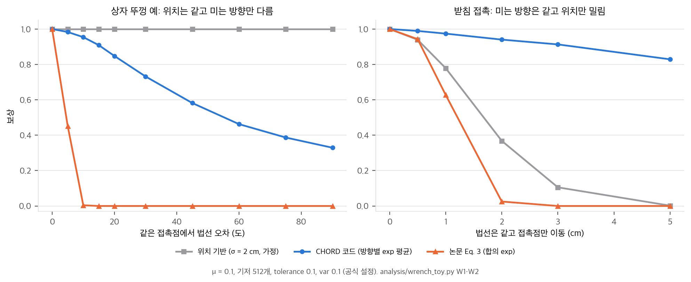
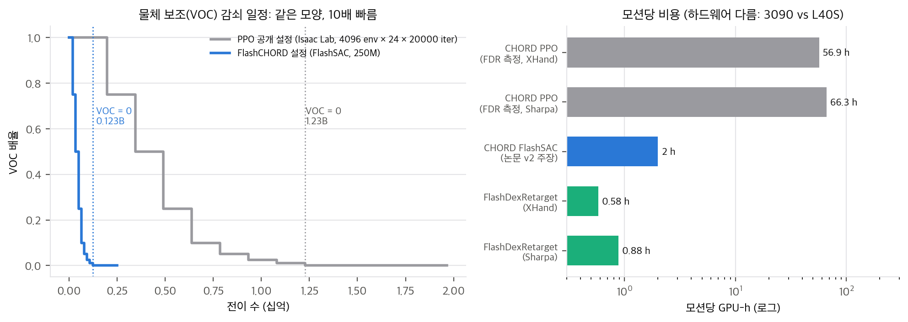

# 03. 유도와 재계산: 지지 함수, 보상 식, force closure, 예산

수치는 `analysis/wrench_toy.py`(→ `wrench_toy_results.json`)와 `analysis/table_check.py`(→ `table_check_results.json`)가 만듭니다. 둘 다 numpy·scipy, 단일 스레드, 1초 안에 끝납니다. toy는 공식 코드 `video_to_data @ 9cad120`의 함수를 그대로 옮겼습니다(`04` §1).

## 1. 지지 함수가 비교하는 것

wrench 행렬 𝒲의 열 w_j는 접촉 하나의 마찰원뿔 모서리 하나가 만드는 [f, p × f / r_c]입니다(코드는 토크를 물체 경계 구 반지름 r_c로 나눔). 지지 함수 σ(b) = max_j bᵀw_j는 **열들의 볼록 껍질 conv(𝒲)의 지지 함수**와 같습니다. 여기서 몇 가지가 바로 나옵니다.

1. **열 순서와 개수에 무관합니다.** 사람 손(접촉 c_h개)과 로봇 손(c_r개)을 같은 길이 b의 벡터로 비교할 수 있는 이유입니다. 논문이 지지 함수를 쓴 동기(Sec. 3.1)와 맞습니다.
2. **접촉을 더하면 지지값은 줄지 않습니다.** max에 열이 추가될 뿐입니다. 그래서 로봇이 사람보다 많이 닿으면 σ_r > (1 + β)σ_h인 방향이 생기고, too_large 항이 이를 깎습니다(§2.4).
3. **0 아래는 잘립니다**(코드 `clamp(min=0)`). 원점이 conv(𝒲) 밖에 있으면 일부 방향의 지지값이 음수인데, 이를 0으로 만들어 "그 방향으로는 못 민다"로 통일합니다.
4. **크기가 없습니다.** 열은 단위 모서리이므로 σ는 "어느 방향으로 밀 수 있는가"의 기하만 담습니다. 힘의 크기는 들어가지 않습니다(§3).
5. **원점이 conv(𝒲) 내부에 있으면 force closure이고**, 그때 모든 방향의 σ는 양수입니다. min_b σ(b)는 원점에서 껍질 면까지의 최단 거리, 즉 Ferrari–Canny ε입니다. 단, **모든** 단위 방향에 대한 최솟값일 때만 그렇습니다(§4).

## 2. Eq. 3과 코드 보상

### 2.1 두 식

- **논문 Eq. 3:** r = exp(−(‖max(0, (1−β)σ_h − σ_r)‖² + ‖max(0, σ_r − (1+β)σ_h)‖²) / v). 512개 방향의 위반을 **모두 더한 뒤** exp를 씌웁니다.
- **코드** `contact_wrench_support_reward_jit`: 방향마다 loss_b = (위반)²를 계산하고, r = (1/N_cmd) Σ_b 1[σ_h,b > 10⁻³ ∧ σ_r,b > 10⁻³] · exp(−loss_b / v). **방향별 exp의 평균**이고, 로봇 지지값이 0인 방향은 0점, 사람 지지값이 0인 방향은 아예 세지 않습니다. 그 뒤 body 평균, 손 평균을 냅니다.

β = 0.1, v = 0.1(코드 기본값)에서 두 식은 전혀 다르게 움직입니다. Eq. 3은 지수 안의 합이 위반 방향 수에 비례해 커지므로, 몇 도만 틀려도 거의 0이 되는 사실상 이진 보상입니다. 코드 보상은 "띠 안에 들어온 방향의 비율"에 가까운 완만한 보상입니다.

### 2.2 상자 뚜껑: 같은 위치, 법선만 회전 (W1)

Sec. 3.1 오른쪽 그림을 그대로 만들었습니다. 상자(반치수 10 × 7.5 × 5 cm, r_c = 13.5 cm)의 앞면 위쪽, 뚜껑 턱 아래에 사람 엄지가 위로 밉니다(법선 +z). 로봇은 같은 점에서 법선을 앞면 안쪽(−x) 방향으로 돌립니다.

| 법선 오차 | 위치 보상 (σ = 2 cm 가정) | 코드 보상 | Eq. 3 | 놓친 방향 비율 |
|---|---|---|---|---|
| 0° | 1.00 | 1.00 | 1.00 | 0.00 |
| 5° | 1.00 | 0.98 | 0.45 | 0.01 |
| 10° | 1.00 | 0.95 | 0.004 | 0.03 |
| 20° | 1.00 | 0.85 | 0.00 | 0.08 |
| 45° | 1.00 | 0.58 | 0.00 | 0.17 |
| 90° | 1.00 | 0.33 | 0.00 | 0.42 |

- 위치 보상은 법선을 전혀 보지 못합니다. 논문이 말한 실패 방식이 정확히 재현됩니다.
- 코드 보상은 90°(완전히 다른 방향으로 미는 접촉)에서도 0.33을 줍니다. 단일 접촉의 지지값은 6차원 방향의 절반 남짓에서 양수이고, 그중 상당수는 법선을 바꿔도 비슷하기 때문입니다. 놓친 방향 비율 0.42는 r_miss(가중치 −1)로 따로 벌합니다.

### 2.3 법선은 같고 위치만 이동 (W2)

| 이동 | 위치 보상 | 코드 보상 | Eq. 3 |
|---|---|---|---|
| 0.5 cm | 0.94 | 0.99 | 0.94 |
| 1 cm | 0.78 | 0.97 | 0.63 |
| 2 cm | 0.37 | 0.94 | 0.03 |
| 5 cm | 0.00 | 0.83 | 0.00 |

토크 성분이 p × f / r_c라서 1 cm 이동은 토크를 약 0.074만 바꿉니다. **코드 보상은 위치 오차에 위치 보상보다 훨씬 관대합니다.** wrench 보상은 위치 보상을 "더 엄격하게" 만든 것이 아니라, 법선에 민감하고 위치에 둔감한 **다른 축의 보상**입니다. 위치는 손 keypoint·관절 추적 보상과 물체 추적 보상이 따로 붙잡습니다. Table 2에서 Position Only가 위치 오차(RPE, MPPE)까지 CHORD보다 나쁜 것은, 위치 보상이 위치를 직접 맞춰도 물체가 맞게 움직이지 않으면 물체 오차가 커진다는 뜻으로 읽힙니다.

### 2.4 오차가 여러 방향에 퍼질 때와 추가 접촉 (W5, W8)

- 양쪽 면을 잡는 두 손가락 집기에서 두 법선을 같은 각도로 틀면, 2°에서 이미 15%의 방향이 띠를 벗어납니다. Eq. 3은 5°에서 0.07, 10°에서 0이고, 코드는 0.995, 0.96입니다. **논문 식 그대로 구현하면 학습 초기에 보상이 거의 항상 0이라 신호가 없었을 것입니다.** 코드가 방향별 평균으로 바꾼 것은 합리적이지만 논문에 적혀 있지 않습니다(`04` D1).
- 사람이 아랫면 하나만 받치는데 로봇이 옆면에도 닿으면, 사람 지지값이 0인 138개 방향(27%)에서 로봇 지지값이 생깁니다. 코드는 이 방향을 세지 않습니다. 사람 활성 방향에서 (1+β)배를 넘는 부분만 too_large로 깎여 0.87이 됩니다. Eq. 3은 0입니다. 코드의 r_unintend는 **사람 접촉이 없는 body**에만 걸리므로, 같은 물체 위의 추가 접촉은 약하게만 벌합니다.

### 2.5 마찰계수 (W4)

코드는 μ = 0.1(원뿔 반각 5.7°)입니다. 논문에는 값이 없습니다. μ를 1.0(45°)까지 올려도 법선 30° 오차에서 코드 보상은 0.73 → 0.84로 조금 관대해질 뿐입니다. 보상 모양은 μ보다 접촉 기하에 더 크게 좌우됩니다. μ = 0.1은 사실상 "법선 방향으로만 미는 접촉"을 가정한 것이라, 실제 마찰로 버티는 집기를 사람 쪽에서 과소평가합니다(내 판단).

## 3. 힘 크기 불변성 (W3)

로봇 쪽 "법선"은 시뮬레이터 접촉력의 방향입니다(`wrench_preprocess_jit`). `compute_wrench_space`가 이를 정규화하므로, 접촉력을 0.1배, 1배, 10배로 바꿔도 지지값 차이는 최대 1.1 × 10⁻¹⁶입니다. 즉 CHORD 보상은 **접촉 위치와 미는 방향**만 비교합니다. 논문 초록의 "forces and torques they can induce"는 크기가 아니라 방향 능력입니다. 쥐는 힘이 약해 물체가 미끄러지는 실패는 물체 추적 보상과 종료 조건이 막아야 합니다. DexForce와의 차이(`02` §4)가 여기서 나옵니다.

## 4. 512개 표본 방향과 force closure (W6, W9)

App. D는 Ferrari–Canny ε를 "512개 기저 방향 지지값의 최솟값"으로 계산하고, Sec. 3.2는 r_fc = (1/B) Σ 1[σ_b > ε]를 "최대화하면 force closure와 같다"고 썼습니다.

- **반례:** 마찰 있는 점접촉 두 개로 양쪽 면을 집으면(antipodal), 두 점을 잇는 x축 둘레 토크를 만들 수 없습니다(p × f의 x성분이 모든 열에서 정확히 0). 진짜 ε는 0이고 force closure가 아닙니다. 그런데 512개 무작위 방향의 최솟값은 **0.053**이고 **r_fc = 1.0**입니다. 순수 τ_x 방향에서 가장 가까운 표본 방향까지 15.8° 떨어져 있어서, 그 표본은 다른 성분 덕분에 양수 지지값을 얻습니다.
- **덮는 정도:** 6차원 단위 구에서 512개 무작위 방향은 임의의 방향에서 가장 가까운 표본까지 중앙값 22.1°, 95% 분위 29.8°, 최대 38°입니다(시험 방향 20,000개). 얇은 축 하나가 빠진 집합을 잡아내기에는 성깁니다.
- **결과:** App. D의 ε 통계(Fig. 3)는 진짜 ε의 상한이고, r_fc = 1은 force closure의 필요조건일 뿐입니다. μ = 0.1에서 면 중앙 4개 접촉의 표본 ε는 0.103, 6개는 0.157입니다. 표본 방향을 늘리거나, 방향 대신 LP로 원점 포함 여부를 직접 검사하면 고칠 수 있습니다.
- **코드의 r_fc는 손마다 따로입니다.** body 축을 amax로 합치고, 손 하나의 지지값만으로 비율을 계산합니다(`rewards.py: force_closure_reward`). 양손으로 잡아야 force closure가 되는 큰 물체는 손별 r_fc가 1에 닿지 못할 수 있습니다. 기본 가중치는 0(꺼짐)이고 TPV 전신 과제에서만 켭니다.
- 기저 표본 seed에 따른 흔들림은 작습니다. 같은 장면에서 seed 20개의 코드 보상 표준편차는 0.013(30° 법선 오차), 0.005(집기 10°)입니다(W7).

## 5. 학습 예산 산술 (C7)

| 항목 | PPO 공개 경로 (Isaac Lab) | FlashCHORD 경로 (FlashSAC) |
|---|---|---|
| 병렬 환경 | 4,096 | 4,096 (논문 App. B는 2,048) |
| 총 전이 | 4,096 × 24 × 20,000 = 19.66억 | 2.50억 |
| VOC = 0 시작 | iteration 12,500 = 12.29억 | 1.229억 (PPO의 정확히 1/10) |
| 물체 keypoint 가중치 | 0 → 0.1 → … → 1 → 20 (커리큘럼) | 처음부터 20 |
| 마지막 단계 | — | 2.0억부터 리셋의 절반을 첫 프레임에서 시작 |
| 모션당 시간 | FDR 측정 56.9 h(XHand), 66.3 h(Sharpa), RTX 3090 | 논문 약 2 h, L40S |
| 역산 처리량 | 9.6k·8.2k 전이/s (20,000 iteration 가정) | 34.7k 전이/s |

- FlashCHORD 임계값 처음 9개는 PPO 일정 × 98,304 / 10과 정확히 같습니다(`table_check.py`의 `flash_first9_thresholds_equal_ppo_div10 = true`).
- 커리큘럼은 `bisect_right`라서 VOC가 0이 되는 것은 표의 9번째 값(14,000)이 아니라 8번째 값(12,500)부터입니다. 처음 정리할 때 14,000으로 잘못 읽었다가 코드를 다시 보고 고쳤습니다.
- FDR 50개 모션의 비교 함의는 `02` §3에 정리했습니다.

## 6. 표 수치 재계산 요약

| # | 대상 | 결과 |
|---|---|---|
| C1 | 82.12% (1,831개) | Fig. 5 n 합 = 1,831 ✅. 그림 막대의 n 가중 평균은 0.781로 82.12%와 다름 → "과제 성공 비율"로 읽어야 함. 1,831로는 정수 불가, 시드 3개면 4,511/5,493 = 82.12% |
| C2 | 90.77% (전신) | Fig. 5 오른쪽 17개 가중 평균 = 0.9077 ✅. Table 3 전체 0.925 = 손만 12개 평균 ✅ |
| C3 | Table 1 | CHORD vs SPIDER: SP-SR t = 0.58(유의하지 않음), AUC t = 4.2, MP-SR t = 3.2, JPE t = −8.5, RPE t = −1.9(유의하지 않음) |
| C4 | Table 2 | Position Only 대비 6개 지표 모두 p < 0.03. SP-SR 이득의 41%가 wrench로 바꾼 몫 |
| C5 | 실물 | 23/25, Wilson [0.75, 0.98]. 상자 6/7 vs 7/7, Fisher p = 1 |
| C6 | Fig. 6 | r² = 0.637 ≈ "약 2/3" ✅ |
