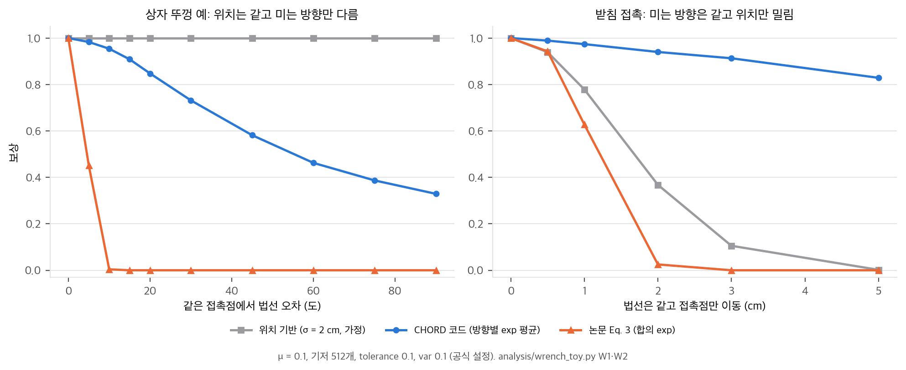
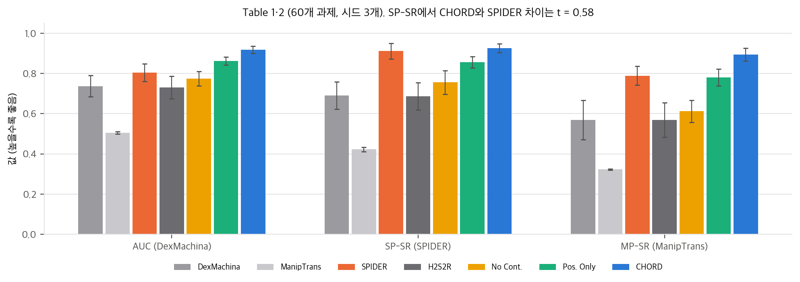
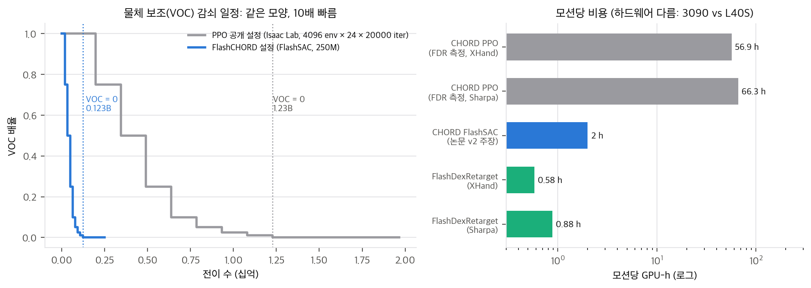

> **논문:** Zhu, Liu, Jain 외. *Learning Dexterous Manipulation Using Contact Wrench Guidance From Human Demonstration.* arXiv:2607.00033v2 (2026). NVIDIA. CoRL 2026.
> arXiv 라이선스는 CC BY 4.0이지만 PDF에 "© 2026 NVIDIA. All rights reserved." 문구가 함께 있어 논문 그림은 싣지 않았습니다. 그림과 영상은 [프로젝트 페이지](https://nvidia-isaac.github.io/video_to_data/chord/)에서 볼 수 있습니다. 이 글의 그래프는 논문 수치와 공식 코드(video_to_data @ `9cad120`)의 보상 함수로 직접 그렸습니다.

## 한 줄 요약

사람 손이 물체에 닿은 점과 법선으로 마찰원뿔을 만들고, 그 원뿔들이 물체에 줄 수 있는 힘·토크(wrench)의 집합을 512개 방향의 **지지 함수(support function)**로 요약합니다. 로봇 접촉도 같은 방식으로 요약해 두 벡터가 비슷할수록 보상을 줍니다. 시연 하나당 정책 하나를 RL로 학습하고, 4,739개 과제 벤치마크 중 1,831개에서 82.12%, 전신(G1 + Dex3) 17개에서 90.77%를 보고합니다.

지지 함수는 접촉 개수와 순서에 무관한 고정 길이 벡터입니다. 그래서 손가락 수가 다른 사람 손과 로봇 손의 접촉을 같은 공간에서 비교할 수 있습니다. 전신 실험에서 위치 기반 접촉 보상은 0.217로 무너지고 wrench 보상은 0.925를 지켰습니다(Table 3). 다섯 손가락에서 세 손가락으로 옮길 때 위치 대응이 성립하지 않는다는 점을 보여 주는, 이 논문의 가장 강한 결과입니다.

## 1. 보상이 실제로 보는 것

논문 Sec. 3.1의 상자 뚜껑 예시를 공식 코드의 함수(마찰계수 0.1, 모서리 8개 + 법선, 방향 512개, tolerance 0.1, var 0.1)로 다시 만들었습니다.

- **같은 점에서 미는 방향만 틀리면** 위치 보상은 1.00 그대로입니다. 공식 코드 보상은 법선 45°에서 0.58, 90°에서 0.33으로 떨어집니다. 논문이 말한 위치 보상의 실패가 정확히 재현됩니다.
- **미는 방향이 같고 위치만 밀리면** 반대입니다. 2 cm 이동에서 위치 보상은 0.37이지만 코드 보상은 0.94입니다. 토크를 물체 경계 구 반지름(여기서 13.5 cm)으로 나누기 때문에, 1 cm 이동은 토크 성분을 0.07 정도만 바꿉니다.
- **힘의 크기는 보지 않습니다.** 로봇 쪽 "법선"은 시뮬레이터 접촉력의 방향이고 코드가 이를 정규화합니다. 접촉력을 0.1배에서 10배로 바꿔도 지지값은 같습니다(차이 ≤ 10⁻¹⁶).

따라서 wrench 보상은 위치 보상을 더 엄격하게 만든 것이 아닙니다. **법선에 민감하고 위치·크기에 둔감한, 다른 축의 보상**입니다. 실제로 공식 코드는 손 keypoint, 관절, 물체 추적 보상을 함께 켭니다.

## 2. 논문 식과 코드 식이 다르다

논문 Eq. 3은 512개 방향의 띠 이탈량을 모두 제곱해 더한 뒤 exp를 씌웁니다. 공식 코드(`contact_wrench_support_reward_jit`)는 방향마다 따로 exp를 계산해 평균하고, 사람과 로봇 지지값이 모두 양수인 칸만 셉니다.

| 상황 | 논문 Eq. 3 | 공식 코드 |
|---|---|---|
| 뚜껑, 법선 5° 오차 | 0.45 | 0.98 |
| 뚜껑, 법선 10° 오차 | 0.004 | 0.95 |
| 두 손가락 집기, 두 법선 5° 오차 | 0.07 | 0.995 |
| 같은 물체 옆면에 접촉 하나 추가 | 0.00 | 0.87 |

논문 식은 몇 도만 틀려도 0이 되는 사실상 이진 보상입니다. 그대로 구현하면 학습 초기에 보상이 거의 항상 0이라 신호가 없었을 것입니다. 코드가 방향별 평균으로 바꾼 것은 합리적이지만 논문에는 적혀 있지 않습니다. 재구현한다면 코드 쪽을 따라야 합니다. 코드는 사람 지지값이 0인 방향을 세지 않고, 의도하지 않은 접촉 벌칙도 사람 접촉이 없는 물체(body)에만 겁니다. 그래서 같은 물체 위의 추가 접촉은 약하게만 벌합니다.

## 3. "force closure와 동치"는 512개 방향에서 성립하지 않는다

잡음이 많은 시연(3인칭 영상 등)에는 r_fc = (양수 지지값을 가진 방향의 비율)을 쓰고, 논문은 "최대화하면 force closure와 같다"고 적었습니다(Sec. 3.2). 벤치마크 통계의 Ferrari–Canny ε도 512개 방향 지지값의 최솟값으로 계산합니다(App. D).

- 마찰 있는 점접촉 두 개로 양쪽 면을 집으면, 두 점을 잇는 축 둘레 토크를 만들 수 없습니다. 모든 primitive wrench에서 그 토크 성분이 정확히 0이라 force closure가 아닙니다.
- 그런데 512개 무작위 방향의 최솟값은 **0.053**이고 **r_fc = 1.0**입니다. 순수 축 토크 방향에서 가장 가까운 표본 방향이 15.8° 떨어져 있어, 그 방향은 다른 성분 덕분에 양수 지지값을 얻습니다.
- 6차원 단위 구에서 512개 무작위 방향은 임의의 방향에서 가장 가까운 표본까지 중앙값 22°, 최대 38° 떨어져 있습니다. 얇은 축 하나가 빠진 집합을 잡아내기에는 성깁니다.

표본 최솟값은 진짜 ε의 상한이고, r_fc = 1은 force closure의 필요조건일 뿐입니다. 방향을 늘리거나, 원점이 wrench 볼록 껍질 안에 있는지 LP로 직접 검사하면 고칠 수 있습니다.

## 4. 헤드라인 수치 다시 계산하기

- **90.77%는 정확히 맞습니다.** Fig. 5 오른쪽 17개(손만 12 + 3인칭 5)의 가중 평균이 0.9077입니다. Table 3의 0.925는 3인칭 5개를 뺀 12개 평균입니다.
- **82.12%는 집계 방식이 적혀 있지 않습니다.** Fig. 5 왼쪽의 n은 합이 정확히 1,831인데, 막대의 n 가중 평균은 0.781입니다. 막대가 완료율 평균이고 82.12%는 "완료율 > 0.7인 과제 비율"로 읽어야 합니다. 그런데 82.12% × 1,831 = 1,503.6이라 과제 수로 나누어떨어지지 않습니다. 시드 3개(5,493)로 보면 4,511/5,493 = 82.12%가 맞습니다. 평가 과제의 70%는 HOT3D입니다.
- **기준선 비교에서 SPIDER 지표는 사실상 동률입니다.**

60개 과제, 시드 3개에서 SP-SR은 CHORD 0.926, SPIDER 0.911이고 Welch t = 0.58(p = 0.60)입니다. 차이가 뚜렷한 것은 AUC(t = 4.2), MP-SR(t = 3.2), 관절 오차(4.3° vs 41°)입니다. SPIDER의 성공 지표는 양손 모드에서 궤적 평균을 빼는 관대한 지표라 차이가 묻힙니다. 위치 기반 접촉 보상(Position Only) 대비로는 6개 지표 모두 p < 0.03입니다.
- **실물:** open-loop 다섯 과제 23/25(Wilson 95% [0.75, 0.98]), 상자 집어 놓기 open-loop 6/7, closed-loop 7/7(Fisher p = 1)입니다.

## 5. FlashDexRetarget이 돌린 CHORD와 논문의 CHORD

FlashDexRetarget(arXiv:2610.01849)은 CHORD를 주 기준선으로 삼아 "계산량 약 100배 적고 성공률 44%p 높다"고 보고했습니다. XHand 50개 모션에서 CHORD는 2,847 GPU-h(RTX 3090), SPIDER 기준 성공률 0.46이었습니다. 두 논문을 공식 코드와 함께 맞춰 보면 이렇습니다.

- **FlashDexRetarget이 돌린 것은 PPO 공개 경로입니다.** 공개 설정은 4,096 환경 × 24스텝 × 20,000 iteration = 약 19.7억 전이이고, 물체 보조(VOC)는 12.3억 전이부터 0입니다. 첫 학습 코드는 2026-08-14에 PPO 경로만으로 공개되었습니다.
- **CHORD v2가 주장하는 것은 FlashSAC 경로입니다.** App. B는 "FlashSAC, L40S 한 장, 과제당 약 2시간"이라고 적었고, 이 경로(FlashCHORD)는 2026-09-23에 공개되었습니다. 설정은 2.5억 전이이고 VOC 임계값 9개가 PPO 일정을 정확히 1/10로 줄인 값입니다.
- **모션당 57–66 GPU-h와 2시간의 차이(28–33배)는** 전이 수 7.9배와 하드웨어·시뮬레이터 처리량 차이로 설명됩니다. 같은 FlashSAC 경로로 50개를 돌린다고 가정하면 약 100 GPU-h이고, FlashDexRetarget의 29–44 GPU-h와는 2–3배 차이입니다(하드웨어가 달라 참고값).
- **다만 82.12%와 본문 그림은 v1(2026-06-22)과 바이트 단위로 같습니다.** FlashSAC 학습 단락은 v2에서 처음 나옵니다. 대규모 결과가 어느 레시피로 학습되었는지 논문은 밝히지 않습니다.
- **성공률은 옮겨 쓸 수 없습니다.** 같은 Sharpa 손, 같은 SPIDER 지표에서도 0.926(CHORD 자체 60개)과 0.50(FlashDexRetarget 50개)입니다. 과제 묶음, 학습 레시피, 판정 방식이 모두 다릅니다.

정리하면 두 논문은 모순되지 않지만, FlashDexRetarget의 "100배"는 "CHORD의 PPO 공개 경로 대비"로 읽어야 합니다. 공정한 비교는 FlashCHORD 경로로 같은 50개 모션을 돌리는 것입니다.

## 6. 공개 코드에서 논문과 다른 점

| 항목 | 논문 | 공개 코드 |
|---|---|---|
| 접촉 보상 식 | 방향 합의 exp (Eq. 3) | 방향별 exp의 평균, 양쪽 활성 칸만 |
| 성공 판정 | 물체 15 cm / 40°, 완료율 > 0.7 | PPO 0.2 m / 0.7 rad, FlashCHORD 0.10 m / 0.50 rad. 완료율 규칙은 찾지 못함 |
| 마찰계수, 방향 수 | 적혀 있지 않음 | μ = 0.1(원뿔 반각 5.7°), 512개 |
| 다물체 상대 자세 보상 | 삽입·붓기의 핵심으로 설명 | 함수만 있고 어떤 설정에도 등록되지 않음 |
| 시연 재생 속도 | 적혀 있지 않음 | 절반 속도(`motion_speed 0.5`) |
| 병렬 환경 | 2,048 (App. B) / 4,096 (Table 2 캡션) | 4,096 |
| 시드 | 3 (Table 1) / 5 (App. G) | 설정 인자 |

코드는 Apache-2.0이고, 4,739개 과제 라이브러리는 Hugging Face에 CC BY 4.0으로 공개되어 있습니다. 공개 코드를 그대로 돌리면 논문 수치가 나온다고 기대하기보다, 위 항목을 먼저 맞춰야 합니다.

## 7. 구현할 수 있는가

- **공식 재현:** NVIDIA GPU가 필요합니다. Isaac Lab 경로는 Docker와 NVIDIA 드라이버 580을, FlashCHORD 경로는 Linux와 48 GiB GPU(여유 46,000 MiB 이상)를 요구합니다. 논문 기준 과제당 약 2 L40S-h이면 Table 1(60개 × 시드 3)이 약 360 GPU-h입니다. Apple Silicon 맥에서는 어느 경로도 돌릴 수 없습니다.
- **아이디어 재구현:** 쉽습니다. 마찰원뿔 → wrench 행렬 → 지지 함수 → 보상·벌칙은 numpy로 약 80줄이고, 접촉점과 접촉력 방향만 있으면 어느 시뮬레이터에도 붙일 수 있습니다. 논문 식이 아니라 코드 식을 쓰고, μ·방향 수·토크 정규화를 명시하고, force closure는 LP로 확인하는 것을 권합니다.

## 8. 정리

CHORD의 핵심은 "사람과 로봇의 접촉을 물체에 미치는 효과의 공간에서 비교한다"는 생각이고, 손 형태가 크게 다른 전신 실험에서 그 장점이 가장 분명하게 드러납니다. 다만 구현된 보상은 접촉의 **방향 능력**을 비교하는 것이지 힘의 크기를 비교하지는 않고, 논문의 Eq. 3과 force closure 동치 주장은 공식 코드와 512개 표본에서는 그대로 성립하지 않습니다. 계산량 비교는 PPO 경로와 FlashSAC 경로를 구분해서 읽어야 합니다.

분석 문서, 재계산 스크립트, 리포트 PDF는 함께 공개한 저장소에 있습니다. 스크립트는 모두 CPU에서 1초 안에 다시 돌릴 수 있습니다.

## 자료

- [통합 리포트 PDF](report/report_public.pdf)
- [01. 논문 분석: CHORD (arXiv:2607.00033)](analysis/01_paper_analysis.md)
- [02. 선행연구와 관련 연구](analysis/02_prior_work.md)
- [03. 유도와 재계산: 지지 함수, 보상 식, force closure, 예산](analysis/03_analysis.md)
- [04. 코드 검증: 논문 ↔ 구현 대조, 수치 재계산, 구현 가능성](analysis/04_code_verification.md)
