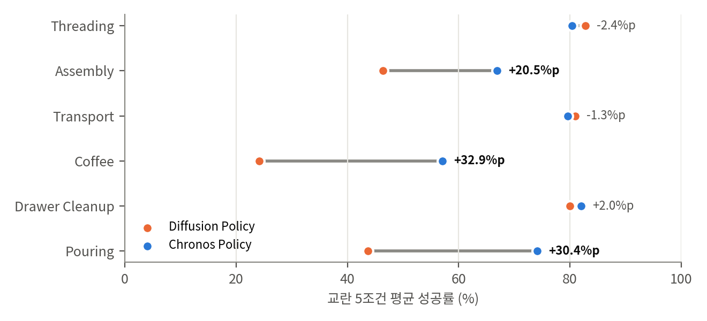

# 03. 재계산과 해석

GPU 없이 공개된 수치와 numpy toy로 검증했습니다.
- `analysis/table_check.py` → `table_check_results.json` (표·웹 데이터 대조, 본문 주장, 시드 역산, 검정)
- `analysis/timing_toy.py` → `timing_toy_results.json` (RoPE 성질, 시간 커널, 학습/평가 시간 범위)
- `analysis/plot_headline.py` → `report/figures/headline_ablation.png`, `standard_tasks.png`, `timing_coverage.png`

---

## 1. time-aware RoPE가 계산하는 것 (V1)

RoPE는 2차원 좌표쌍마다 각도 ω_k·t만큼 회전합니다. 회전행렬은 R(a)ᵀR(b) = R(b − a)를 만족하므로 다음이 성립합니다.

> (R(t_i) q)ᵀ (R(t_j) k) = qᵀ R(t_j − t_i) k

- **확인:** 무작위 q, k(32차원 = 16쌍)와 시각 1,000쌍으로 계산하면 두 식의 최대 오차는 7.8×10⁻¹⁴입니다. 모든 시각을 ±100 s 옮겨도 내적은 최대 7.4×10⁻¹²만큼만 변합니다. 즉 Eq. 6과 "시계 원점에 불변"이라는 서술은 정확합니다.
- **부분 회전으로 보입니다.** 부록 A.2는 "16개 query-key 좌표쌍을 회전한다"고 씁니다. 폭 512, head 8개면 head 차원은 64 = 32쌍입니다. 따라서 head마다 **절반은 시간으로 회전하고 절반은 회전하지 않는** 구성으로 보입니다(GPT-NeoX의 부분 rotary와 같은 형태). 회전하지 않는 절반은 시간과 무관하게 내용만으로 attention 점수를 만듭니다.
- **AddTime과의 차이에 대한 해석(가설):** AddTime은 시간 특징을 MLP에 통과시켜 토큰 자체에 더합니다. 그래서 학습 때 보지 못한 시간 차이에서는 토큰 내용이 예측할 수 없게 바뀝니다. RoPE는 내적의 시간 의존 부분만 바뀌고, 회전하지 않는 절반은 그대로입니다. 저자들의 "내용과 시간의 분리"가 구조적으로는 이 절반 채널로 구현된 것으로 보입니다. 다만 AddTime 결과 자체가 불안정해서(§5.3) 이 비교의 근거는 약합니다.

## 2. 시간 커널: 해상도와 되풀이 (V2)

16개 주기(0.1–2 s, 로그 간격)가 만드는 시간 유사도 s(Δt) = mean_k cos(ω_k Δt)를 계산했습니다(`timing_coverage.png` (b)).

| 항목 | 값 | 의미 |
|---|---|---|
| s가 0.5로 떨어지는 Δt | **45 ms** | 행동 간격(50 ms)과 비슷합니다. 인접 행동 토큰이 attention에서 구별됩니다 |
| \|Δt\| ≥ 0.5 s에서 \|s\| 최대 | 0.34 | 멀리 떨어진 시각이 가까운 시각처럼 보이는 강한 되풀이는 없습니다 |
| 가장 느린 성분이 한 바퀴 도는 Δt | 2 s | 토큰 쌍 간격이 2 s를 넘으면 이 성분은 되풀이됩니다 |
| 간격이 2 s를 넘는 샘플 비율 | Wide 0.5%, Combined 0.8% | 되풀이는 성능 저하의 주원인이 아닙니다 |

처음에는 "Wide 조건에서 오래된 관측이 2 s 주기를 넘어 RoPE가 되풀이되기 때문에 성능이 떨어진다"는 가설을 세웠습니다. 계산해 보니 그런 샘플이 1% 미만이라 **이 가설은 기각합니다.** 주기 범위 선택은 이 실험의 시간 범위에 맞게 되어 있습니다.

## 3. 학습 때와 평가 때의 시간 범위 (V3)

부록 B.2(학습)와 Table 2(평가)의 설정을 시뮬레이션했습니다. 스트림마다 위상이 무작위인 균일 샘플링, 요청 시각까지 도착한 측정 중 최신 n개를 쓴다고 가정했습니다. 이 가정은 논문에 명시되지 않은 부분입니다.

| 조건 | 가장 오래된 이미지 나이 p99 / 최대 | 연속 이미지 간격 p99 | 학습 최대 간격(80 ms)을 넘는 비율 | 이미지 → 마지막 행동 간격 최대 |
|---|---|---|---|---|
| 학습 | 0.17 / 0.21 s | 79 ms | 0% | 1.05 s |
| Nominal | 0.10 / 0.10 s | 50 ms | 0% | 0.85 s |
| **Small obs.** | 0.17 / 0.21 s | 79 ms | **0%** | 0.96 s |
| Wide sensors | 1.06 / 2.06 s | 666 ms | **23.6%** | 2.81 s |
| Delay 0–200 ms | 0.10 / 0.10 s | 50 ms | 0% | 1.05 s |
| Combined | 1.06 / 2.06 s | 675 ms | 23.6% | 2.93 s |

여기서 세 가지가 나옵니다.

1. **Small obs.는 Chronos에게 학습 분포 그 자체입니다.** 주기 12.5–33.33 Hz와 지연 0–50 ms가 학습 무작위화 범위와 같습니다. 웹 데이터도 이 조건을 `sensor_id`라고 부릅니다. 그러므로 "Small에서 DP 15.6 vs Chronos 77.6"(Conveyor)은 **같은 분포로 학습했는지의 차이**가 대부분입니다. 시각 정보의 기여는 같은 무작위화로 학습한 DP와 비교해야 합니다: Conveyor 60.9 → 77.6(+16.7), Pivoting 30.0 → 64.9(+34.9).
2. **Wide와 Combined는 모든 방법에게 분포 밖입니다.** 샘플의 23.6%는 학습 때 보지 못한 관측 간격(최대 약 1 s)을 갖고, 관측 나이는 학습 최대의 10배까지 늘어납니다. 이 조건에서 Chronos도 크게 떨어지는 것(Conveyor 77.6 → 45.6)은 ① 1 Hz 영상이 정보 자체를 잃는 것과 ② RoPE가 학습 범위 밖 시간차로 외삽하는 것이 겹친 결과로 보입니다. 둘을 나누려면 학습 무작위화를 1–50 Hz로 넓힌 실험이 필요합니다.
3. **Delay 0–200 ms도 절반은 분포 밖입니다.** 학습 때 행동 시작 지연은 최대 100 ms였으므로, U(0, 200 ms)에서 뽑힌 지연의 절반이 학습 범위를 넘습니다. 그래도 Conveyor에서 83.1 → 76.4로 비교적 덜 떨어집니다. 행동 토큰 시각의 외삽은 0.85 s → 0.95 s 정도로 작기 때문입니다.

**힘/토크 이력:** 학습 때 힘/토크를 1–100 Hz로 뽑고 32개를 쓰면, 이력 길이의 중앙값은 0.61 s이고 p99는 15.6 s입니다(1 Hz에서는 31 s). 에피소드 길이보다 길 수 있으므로 실제로는 잘라 내거나 채우는 처리가 있었을 텐데, 논문에 적혀 있지 않습니다.

## 4. 시간 정보가 없는 정책은 무엇을 틀리나 (V4)

Conveyor 직관을 수치로 옮겼습니다.

- **속도 추정 배율:** 학습 때 이미지 간격이 항상 50 ms였던 정책이, 실제 간격 g로 찍힌 두 영상을 보면 물체 속도를 (g / 50 ms)로 나눈 값만큼 틀리게 해석합니다. 그 배율의 p1–p99 범위는 Small에서 0.60–1.57배, Wide에서 0.40–13배입니다. 속도를 ±40–60% 잘못 보면 벨트 위 물체를 놓치기 쉽습니다. 이것이 DP의 Small 성능 붕괴(73.1 → 15.6)와 맞습니다.
- **추론 지연:** 지연 d_t를 모르면 목표 위치가 v·d_t만큼 어긋납니다. 벨트 속도는 논문에 없으므로 0.1 m/s를 예로 들면, 0–200 ms 지연에서 평균 1 cm, 최대 2 cm입니다. 컵 받침이나 컨베이어 위 물체를 잡는 데는 충분히 큰 오차입니다.

## 5. 통계: 무엇이 확실하고 무엇이 약한가

### 5.1 시드별 성공 횟수 역산과 과분산 (S1)

웹 데이터에는 Table 3·4의 평균과 SD가 반올림 전 값으로 들어 있습니다. 시드당 에피소드 수(Conveyor·Pivoting 150, 표준 과제 50)로 나누어 떨어지는 성공 횟수 세 개를 찾으면 **132개 칸 모두 해가 있고**, 90개는 해가 유일합니다. 즉 표의 숫자는 보고한 실험 설계와 정확히 일치합니다.

역산한 시드별 값을 보면 시드 간 차이가 큽니다.

| 칸 | 시드별 성공 수 | 시드별 성공률 |
|---|---|---|
| Pivoting, DP, nominal | 78, 88, 111 / 150 | 52%, 59%, 74% |
| Pivoting, AddTime, nominal | 56, 61, 110 / 150 | 37%, 41%, 73% |
| Pouring, DP, nominal | 23, 46, 50 / 50 | 46%, 92%, 100% |
| Conveyor, Chronos, Wide | 58, 61, 86 / 150 | 39%, 41%, 57% |

관측 SD를 같은 성공률의 이항 SD(시드당 에피소드 수 기준)로 나눈 과분산 비율은 중앙값 1.29(IQR 0.89–2.33)이고, Pivoting에서는 2–3배입니다. 즉 **에피소드를 늘려도 줄지 않는 학습 시드 간 편차가 결과를 좌우**합니다. 그래서 검정의 단위는 에피소드(450회)가 아니라 학습 시드(3개)여야 합니다. 에피소드 단위 Fisher 검정은 p를 크게 과소평가합니다.

### 5.2 Conveyor: 확실함 (S2)

| 비교 (Chronos vs) | 시드 단위 Welch p |
|---|---|
| DP | nominal 0.15, **교란 5조건 모두 < 0.02** |
| RoPE, 무작위화 없음 | Small 0.016, Wide 0.050, Combined 0.020, 나머지 > 0.05 |
| AddTime | Combined 0.010, Wide 0.066, 나머지 0.16–0.49 |

동적 과제에서 시간 정보가 강건성을 크게 높인다는 결론은 시드 3개로도 분명합니다. RoPE가 AddTime보다 낫다는 결론은 Combined에서만 유의합니다.

### 5.3 Pivoting: 방향은 같지만 유의하지 않음 (S3)

- Chronos vs DP: 6개 조건 모두 시드 단위 p = 0.24–0.92입니다. Combined 38.4 vs 19.6도 p = 0.24입니다.
- Chronos vs AddTime: 6개 조건 모두 p = 0.13–0.31입니다. AddTime은 nominal에서 시드 하나만 73%이고 둘은 37–41%입니다. 이 패턴은 표현 방식의 차이보다 **학습 불안정**에 가깝습니다.
- Chronos vs RoPE 무작위화 없음: Wide에서만 p = 0.03입니다.
- 반면 DP + 무작위화가 Pivoting을 해친다는 결과(nominal 61.6 → 29.8)는 효과가 커서 방향이 분명합니다.

따라서 "다중 감각 과제에서 시간 정보가 강건성을 높인다"(§4.2)와 "RoPE가 AddTime보다 낫다"(Pivoting 부분)는 **시드를 늘려 확인해야 할 주장**입니다.

### 5.4 표준 6과제: 이득이 세 과제에 몰림 (S4)

| 묶음 | DP 교란 평균 | Chronos 교란 평균 |
|---|---|---|
| 6과제 전체 (§4.4) | 59.7 | 73.4 |
| Assembly, Coffee, Pouring | 38.1 | 66.0 |
| Threading, Transport, Drawer Cleanup | **81.2** | **80.7** |

- 이득은 DP가 Wide·Combined에서 무너지는 세 과제(Assembly Wide 13.3, Coffee Combined 2.7, Pouring Wide 2.0)에서 나옵니다. 이 칸들은 시드 단위로도 유의합니다(p 0.0001–0.014).
- 나머지 세 과제에서는 차이가 없고, 36칸 중 14칸에서는 Chronos가 더 낮습니다. Threading Combined는 77.3 → 63.3입니다(p = 0.08).
- 표준 과제에는 DP + 무작위화 기준선이 없습니다. Conveyor에서 무작위화만으로 교란 평균이 6.3 → 26.9로 올랐다는 점을 생각하면, 이 세 과제의 이득 중 상당 부분이 데이터 증강 효과일 수 있습니다.
- 평가 잡음도 큽니다. Coffee에서 Chronos는 Combined(60.0)가 nominal(51.3)보다 높습니다. 시드 3개 × 50회로는 ±10%p 안팎의 차이를 구분하기 어렵습니다.

### 5.5 실제 로봇: 과제별로 합치면 유의함 (S5)

시행 점수(1, 0.5, 0)로 조건 내 permutation 검정을 했습니다.

| 과제 | vs DP: 차이(점), p | vs DP+RTC: 차이(점), p |
|---|---|---|
| Dynamic Cup (40회씩) | +27.5, 0.018 | +22.5, 0.041 |
| Peg Insertion (40회씩) | +16.2, 0.088 | +25.0, 0.013 |
| Pivoting (80회씩) | +28.1, 0.0002 | +20.0, 0.0075 |

- 조건별(10회 또는 20회) 비교 24개 중 p < 0.05는 Pivoting 추론 지연 vs DP(p = 0.022) 하나뿐입니다. 각 칸의 "최고 점수"는 잡음 범위 안의 차이입니다.
- 4개 조건을 합치면 6개 비교 중 5개가 유의합니다. 실제 로봇에서도 Chronos가 낫다는 결론은 과제 단위로는 지지됩니다.
- 다만 실제 기준선(DP, RTC)도 시간 무작위화 없이 학습한 것으로 보여, §5.4와 같은 교란 요인이 남습니다.

## 6. 정리: 각 비교가 실제로 분리하는 것

| 비교 | 분리하는 요인 | 결과의 강도 |
|---|---|---|
| DP vs Chronos (Small) | 무작위화 + 시각 정보 + 분포 안/밖 | 강함. 다만 대부분 "학습 분포" 효과 |
| DP + 무작위화 vs Chronos | **시각 정보만** | Conveyor·Pivoting에서 큼(+16.7, +34.9). 이 저장소에서 가장 깨끗한 비교 |
| RoPE 무작위화 없음 vs Chronos | 무작위화만 (시각 있음) | Conveyor에서 유의, Pivoting은 Wide에서만 |
| AddTime vs RoPE | 시간 표현 방식만 | Conveyor Combined에서만 유의. AddTime 학습 불안정 |
| 표준 과제, 실제 로봇 | 무작위화와 시각 정보가 섞임 | 크지만 원인 분리 불가 |
