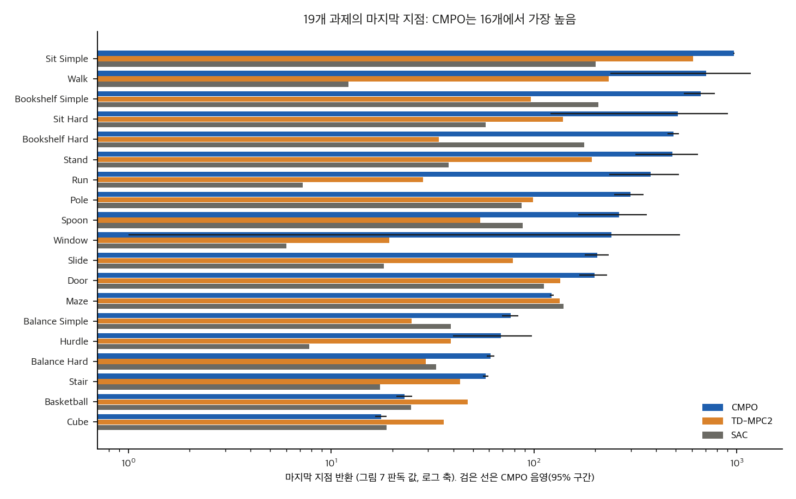
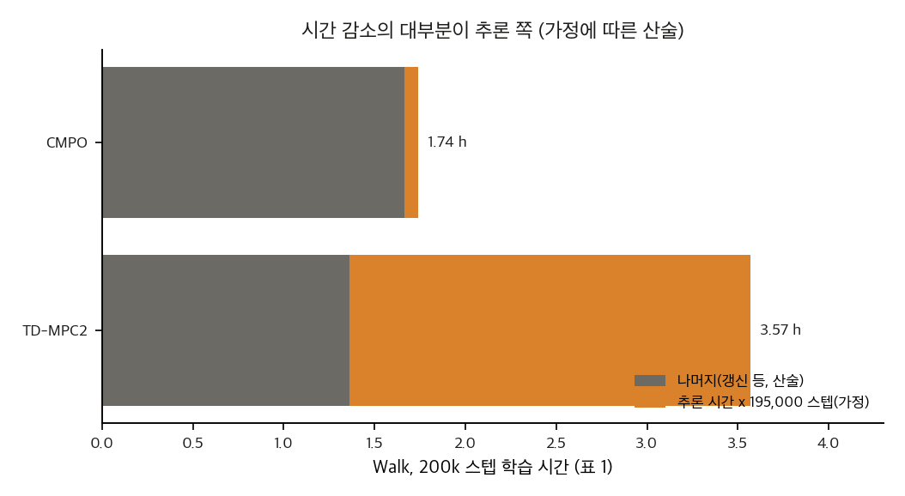
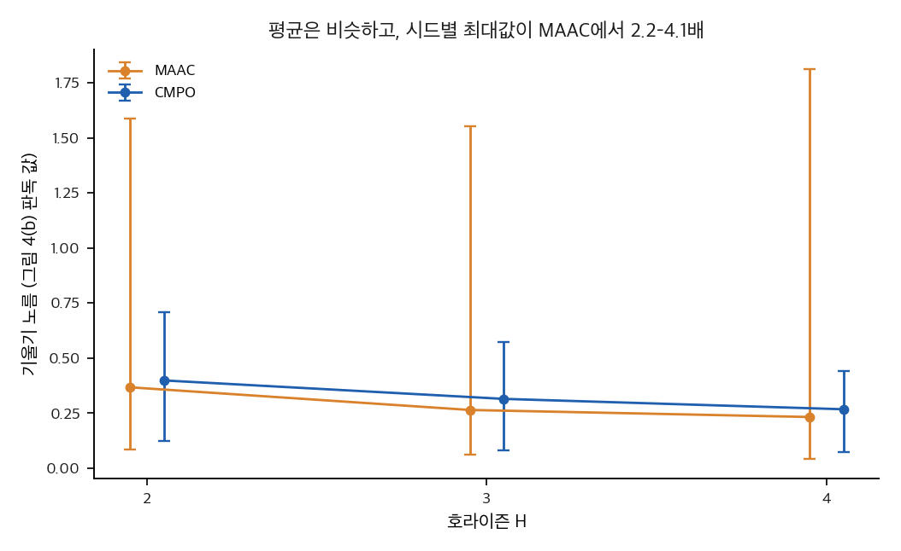
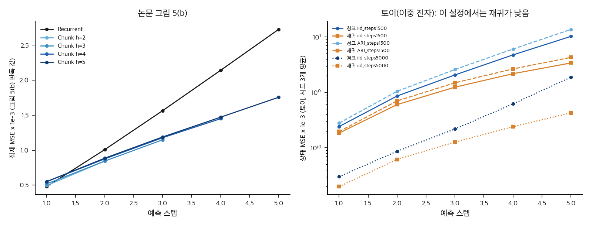

> **논문:** Weixi Song, Donglin Wang, Yong-Lu Li. *Chunk-wise Model-based Policy Optimization.* CoRL 2026 스포트라이트, arXiv:2610.14564 (v1, 2026-10-10, 유일한 버전).
> 공식 코드(MIT, song-wx/CMPO)는 정적으로만 읽었고 실행하지 않았습니다. 논문 그림은 싣지 않고, 우리가 만든 그래프만 씁니다. 그림 곡선 값은 PDF 벡터 경로를 눈금에 맞춰 읽은 값(그림 판독 값)이며 원 데이터가 아닙니다.

## 논문이 묻는 것

모델 기반 RL은 한 스텝 잠재 모델을 H번 재귀 호출해 가상 궤적을 만듭니다. 모델 기울기 방식은 이 궤적을 통해 역전파하므로 호출이 O(H)번이고 기울기가 곱으로 쌓입니다. 이 논문은 정책도 월드 모델도 청크 단위로 두자고 제안합니다. 정책이 행동 H개를 한 번에 내고, 청크 월드 모델이 잠재 H개를 한 번에 냅니다. 그러면 (H−1)스텝 가치 확장을 모델 호출 한 번으로 계산하고, 그 행동 기울기로 정책을 갱신할 수 있습니다. 배포할 때는 청크의 첫 행동만 실행하고 계획은 하지 않습니다.

HumanoidBench 19과제(행동 61차원)에서 TD-MPC2, SAC, DreamerV3, PPO와 비교하고, Unitree Go2의 두 발 서기를 실물로 옮겼습니다. 주 실험은 호라이즌 H = 3입니다.

## 이 글에서 확인한 것

**평균 우위는 분명합니다.** 그림 7 판독 값에서 마지막 지점은 19과제 중 16과제에서 CMPO가 가장 높습니다. 아닌 과제는 Basketball, Cube, Maze입니다. 평균은 306 대 TD-MPC2 109이고, 과제별 최고값 대비로 정규화해도 0.94 대 0.46입니다. 원점수 평균은 값이 큰 몇 과제가 좌우하지만 정규화 뒤에도 방향은 같습니다.

**유의한 과제 수는 구간 정의에 달려 있습니다.** 음영이 평균 ± t·SE라고 가정하면(시드 3개 가정) 최고인 16과제 중 13개가 Welch p < 0.05이고, ±1.96·SE라고 가정하면 7개입니다. 음영이 서로 겹치지 않는 과제는 11개입니다. 구간 계산법이 캡션에 없어 두 경우를 모두 계산했습니다.

**학습 시간 절감은 추론 쪽 몫이 큽니다.** 표 1의 학습 시간은 0.487배, 추론은 29–30배로 본문과 맞습니다. 다만 추론 시간을 학습 중 매 스텝(195,000 스텝)에 곱하는 산술(평가 시간은 제외한다는 가정)을 하면 TD-MPC2의 3.57시간 중 약 2.2시간이 추론이고, 나머지(갱신 등)는 CMPO가 1.22배 큽니다. 본문은 절감을 가상 롤아웃 생성과 계획 제거의 합으로 설명하는데, 이 표만으로는 갱신 쪽 이득이 분리되지 않습니다. 단계별 시간 분해가 있으면 확정할 수 있습니다.

**기울기 노름 그림은 평균이 아니라 최대값이 다릅니다.** 그림 4b 판독 값에서 평균 기울기 노름은 두 방법이 비슷하고(MAAC가 CMPO의 0.84–0.92배), 시드별 최대값은 MAAC가 2.2–4.1배입니다. MAAC의 평균은 H = 2에서 4로 가며 37% 줄고 최대값은 14% 늘어납니다. 그림 4a는 두 곡선의 세로 축이 다릅니다(CMPO 0–0.7, MAAC 0–3.5). "호라이즌이 커질수록 BPTT 기울기가 커진다"는 서술은 이 세 점의 평균으로는 보이지 않고, 변동(최대값)에서 약하게 보입니다.

**호라이즌 1에서도 TD-MPC2의 약 2배입니다.** 그림 5a는 과제 이름이 없지만, TD-MPC2 기준선 값과 H = 3 곡선의 마지막 지점이 그림 7의 Walk(233.7, 705.5)와 일치해 Walk로 읽힙니다. 판독 값으로 H = 1은 약 468, H = 2는 865, H = 3은 706, H = 4는 870, H = 5는 508, TD-MPC2는 약 234입니다. H = 1은 모델 롤아웃 없이 비평가 기울기만 쓰는 설정으로 읽히므로, TD-MPC2 대비 향상 중 일부는 청크 이전의 요소(계획 제거, 정책 기울기 갱신)에서 올 수 있습니다. 한 과제의 판독 값이므로 일반화하지는 않습니다. 공식 코드는 H < 2를 거부해서 이 곡선을 코드로 재현할 수 없습니다.

**표 2의 값이 그림 7의 곡선 최댓값보다 큽니다.** CMPO Walk 954.1 대 곡선 최댓값 약 758, Run 629.2 대 약 380입니다(그림 판독 값). 캡션의 "Best average performance"가 시드별 최고값의 평균 같은 다른 집계라면 설명될 수 있습니다. 정의가 적혀 있지 않아 저자 확인이 필요합니다.

**실로봇 7/10 대 4/10은 방향만 보여 줍니다.** 피셔 정확검정 양측 p = 0.37이고, 같은 비율이면 팔당 약 42회가 필요합니다. 비교 대상은 SAC이고(TD-MPC2는 배포 인터페이스와 맞지 않아 제외), 시행 조건과 학습 시드 수는 적혀 있지 않습니다.

## 작은 토이: 청크 모델 대 재귀 모델

그림 5b는 청크 모델의 다중 스텝 오차가 재귀 롤아웃보다 느리게 늘어난다고 보입니다(5스텝에서 1.55배, 1스텝은 청크가 15% 높음). 같은 질문을 이중 진자에서 확인했습니다. 상태 6차원, 은닉 128의 MLP 두 개(청크 하나, 한 스텝 모델을 5스텝 펼친 손실로 학습), 시드 3개입니다. 이 설정에서는 모든 예측 스텝에서 청크 모델의 오차가 더 컸습니다(재귀÷청크가 0.23–0.76). 설정이 논문과 다르므로 그림 5b의 반증은 아니고, 청크 모델이 한 스텝 모델보다 항상 낫지는 않을 수 있다는 정도로 읽습니다.

또 하나는 청크 동역학이 구조상 z_1을 예측할 때 미래 행동에도 의존할 수 있다는 점입니다(참 동역학에서는 의존하지 않음). 토이에서 이 의존은 현재 행동 효과의 0.4–3.4%였고, 행동이 시간 상관을 가질 때 더 컸습니다. 정책 갱신의 기울기가 이 경로를 지나므로 실제 CMPO 모델에서의 크기는 확인할 가치가 있습니다.

## 공식 코드와 맞춰 본 것

식 8의 항 수와 첨자(보상 H−1개, 종료 Q(z_{H−1}, a_{H−1}))는 코드와 일치합니다. §3.3 본문 식의 종료 항 Q(z_{t+H−1}, a_{t+H})는 식 8과 달라, 논문 안의 표기 차이로 보입니다. 코드에는 논문에 없는 세부가 있습니다. 정책 손실의 가치 항은 분위 기반 규모 추정으로 나뉘고 엔트로피 계수는 1e-4이며, 할인은 에피소드 길이 휴리스틱으로 0.995입니다. 코드 기본 호라이즌은 5이고 README의 학습 예시 명령은 호라이즌을 지정하지 않아 H = 5로 돕니다(논문 주 실험은 3). 절제 변형(H = 1, 청크 제거)과 기준선, 실로봇 코드는 저장소에 없습니다.

## 구현 가능성

알고리즘의 구현은 가능하고 논문 수치의 재현은 이 맥(Apple M4 Pro, 24 GiB, CUDA 없음)에서 불가능합니다. 표 1에서 산술하면 RTX 4090 기준 19과제 × 3시드 × 1M 스텝이 약 500 GPU-시간입니다. 공식 코드는 `cuda:0`과 CUDA 그래프에 묶여 있고 의존성(mujoco 3.1.6 등)이 고정되어 있어 맥에서는 포팅이 필요합니다. 핵심 알고리즘은 약 700줄이라 torch로 다시 쓸 수 있습니다.

## 저자에게 확인하고 싶은 것

표 2 집계 정의와 시드 수, 그림 4와 5a의 과제와 기울기 노름의 정의, MAAC 기준선의 설정, H = 1과 청크 제거 변형의 구현, 신뢰구간 계산법과 19과제 선택 기준, 실로봇 시행 조건과 학습 시드 수, 표 1 시간 측정 범위입니다.

## 자료

- [통합 리포트 PDF](report/report_public.pdf)
- [01. 논문 분석: Chunk-wise Model-based Policy Optimization (CMPO)](analysis/01_paper_analysis.md)
- [02. 선행연구와 계보](analysis/02_prior_work.md)
- [03. 수치 재계산, 일관성 검사, 토이](analysis/03_analysis.md)
- [04. 논문과 공식 코드의 대조, 구현 가능성](analysis/04_code_verification.md)
