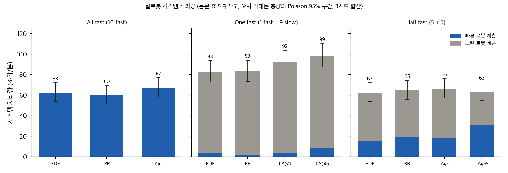
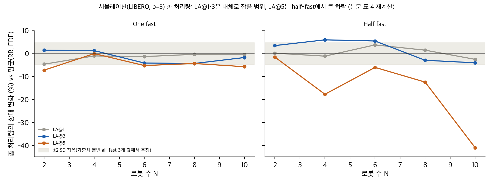
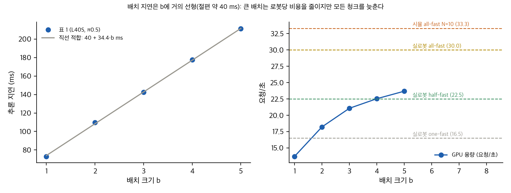
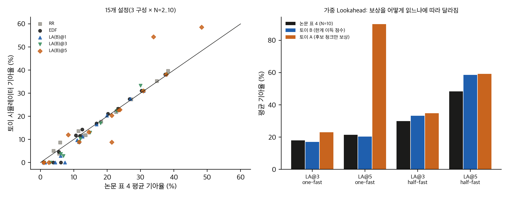

> **논문:** Rohan Bansal*, David He*, Nadun Ranawaka Arachchige, Zhenyang Chen, Soobum Kim, Kexin Rong, Danfei Xu. *Action Chunk Scheduling for Batched Robot Policy Serving.* CoRL 2026 포스터, arXiv:2608.00337 (v1, 2026-07-31).
> 공식 코드는 GitHub GaTech-RL2/armory(Apache-2.0)에 있습니다. 이 글의 그래프는 모두 논문의 표를 다시 계산해 그린 것이고, 논문의 그림은 넣지 않았습니다.

## 논문이 묻는 것

VLA 같은 큰 정책을 로봇마다 돌리기는 무겁습니다. 원격 GPU 한 장에 여러 로봇을 붙이면 배치로 효율을 얻지만, 배치가 커질수록 모든 청크가 늦게 도착합니다. 로봇이 청크를 다 쓰고도 다음 청크가 오지 않으면 **기아(starvation)** 가 생기고, 과제에 따라 이 비용이 다릅니다. 움직이는 물체를 다루는 "빠른" 로봇은 청크를 빨리 소모하고 오래된 청크에 민감합니다.

저자들은 이를 **닫힌 루프 스케줄링 문제**로 봅니다. 서버가 각 로봇의 행동 큐, 진행 중인 청크, 네트워크 지연을 거울처럼 따라가며(Armory), 다음 배치에 넣을 로봇을 고릅니다. 비교 대상은 Round Robin(RR), Earliest Deadline First(EDF), 그리고 한 단계 앞을 시뮬레이션해 GPU 시간당 점수가 높은 배치를 고르는 Lookahead(LA)입니다. 빠른 로봇 계층에는 가중치 w를 줍니다(LA@w).

## 확인한 것

**1. 표는 서로 맞습니다.** 실로봇 표 5의 11개 칸은 계층별 값에 로봇 수를 곱해 합친 총량과 ±0.04 안으로 맞고, 시드 3개로 환산하면 정수 조각 수가 됩니다(예: one-fast LA@5는 25 + 271 = 296조각). 원문 그림 4의 막대도 표 5와 0.06 이내입니다.

*그래프는 우리가 그렸습니다. 막대의 파란색은 빠른 로봇 계층, 회색은 느린 계층입니다.*

**2. "최대 18%"는 한 칸의 값입니다.** one-fast에서 LA@5는 EDF보다 +18.9%(296 대 249), RR보다 +18.4%(296 대 250)입니다. 총 조각 수를 Poisson으로 보면 p = 0.049와 0.054입니다. 그림 4의 오차 막대가 SD인지 SEM인지 신뢰구간인지 캡션에 없어서, 같은 막대로 Welch 검정을 하면 p가 0.003에서 0.10까지 갈립니다. 같은 LA@5가 half-fast에서는 총량이 같습니다(190 대 188).

**3. 이득의 큰 몫은 가중치 없는 LA@1에서 옵니다.** one-fast에서 EDF 대비 느린 9대가 +33조각, 빠른 로봇이 +14조각 늘었는데, 가중치 없는 LA@1이 이미 느린 계층에서 +28조각을 냅니다. 가중치를 5로 올린 효과는 +19조각(p = 0.45)입니다. 부록 A.8도 LA가 청크를 인덱스 0에서 시작하게 편향시키는 것이 원인일 수 있다고 쓰지만, 이를 가르는 대조 실험은 없습니다.

**4. 재분배는 확실합니다.** half-fast에서 LA@5는 빠른 계층 92 대 47조각(p = 0.0002), 느린 계층 98 대 141조각(p = 0.0065)입니다. 이질 구성에서 가중치가 처리량의 몫을 옮긴다는 주장은 지지됩니다.

**5. 시뮬레이션에는 총 처리량 이득이 없습니다.** all-fast에서 LA@1, 3, 5는 같은 알고리즘이라 표 4의 세 값 차이가 실행 간 잡음입니다(처리량 상대 SD 2.4%). 이 기준으로 보면 LA@1은 모든 칸이 잡음 안이고, LA@5는 half-fast에서 N = 4에 −17.7%, N = 10에 −41%입니다. 부록 A.7도 "핵심 기여는 총 처리량이 아니라 계층 간 재분배"라고 씁니다.

*그래프는 우리가 그렸습니다. one-fast(왼쪽)와 half-fast(오른쪽).*

## 지연 곡선이 말해 주는 것

표 1의 L40S 지연은 배치 크기 b에 거의 선형입니다(39.6 + 34.4·b ms, 잔차 최대 1.4 ms). 로봇당 비용은 b = 1에서 73 ms, b = 5에서 42 ms로 줄지만 b = 3이 이미 절감의 83%를 얻습니다. 지연이 이렇다면 GPU 용량(요청/초)과 로봇의 수요(f_c / H_max의 합)로 기아의 하한이 나옵니다. 시뮬레이션 all-fast N = 10에서 수요는 33.3 요청/초이고 b = 3의 용량은 21.1이라서 하한이 36.8%인데, 논문 표 4는 37.4%입니다. 즉 기아의 큰 몫은 "GPU가 모자란다"는 용량 문제이고, 스케줄러가 건드릴 수 있는 몫은 이용률이 1 근처 이하인 구간에 있습니다.

*그래프는 우리가 그렸습니다. 점선은 구성별 요청 수요입니다.*

## 점수의 정의가 식과 코드에서 다릅니다

식 10의 보상은 한 전이 동안 모든 로봇의 비기아 스텝 합이고, 새 청크는 전이가 끝난 뒤에 도착합니다. 그러면 L = 1에서 보상은 어떤 로봇을 고르는지와 무관하게 배치 크기에만 의존합니다. 부록 A.1은 실제 점수가 "1초 창 안의 실행 시간"이라고 밝히고, 공식 코드를 읽으면 후보 배치가 만드는 청크가 실행하는 스텝만 세도록 되어 있습니다. 이 점수를 그대로 쓰는 독립 토이는 w = 5에서 느린 계층이 완전히 굶고, "후보 청크가 늘리는 한계 이득"으로 바꾸면 표 4와 맞았습니다. 코드를 실행하지 않고 읽은 것이라 코드를 잘못 읽었거나 실험 당시 코드와 달랐을 가능성이 있습니다.

## 독립 토이 시뮬레이터

논문의 거울 모델과 표 1의 지연만으로 폐루프 큐 시뮬레이터를 numpy로 다시 짰습니다(약 15초). 정책과 과제 성공은 모델링하지 않았고 기아율만 비교합니다.

- RR, EDF, 가중치 없는 LA의 기아율이 표 4와 평균 1.1–1.8 %p 오차 안에서 맞습니다(15개 설정).
- LA가 고르는 배치 크기는 평균 3.38, 중앙값 3이고, 논문 그림 7은 평균 3.3, 중앙값 3입니다. 배치 상한을 키우면 EDF와 RR의 기아율이 38%에서 60%로 오르고 LA는 36–38%로 평평합니다.
- EDF와 RR의 평균 배치 크기는 토이가 10, 논문이 4.6–4.7로 다릅니다. 토이가 H_min 미달과 중복 요청 필터를 느슨하게 모델링한 탓으로 보입니다.

*그래프는 우리가 그렸습니다. 오른쪽의 "토이 A"는 후보 청크가 만든 스텝만 세는 읽기, "토이 B"는 한계 이득 읽기입니다.*

## 코드와 구현 가능성

공식 코드는 서빙 엔진, 스케줄러, LIBERO 평가를 담고 Apache-2.0입니다. 거울, EMA 지연 추정, 지연 프로파일(표 1, 2의 값과 동일), 1초 창, L = 1, 처리량 정의는 논문과 맞습니다. 다른 점은 이렇습니다. 코드에는 EDF가 둘(단순 채움, 지연 적합)이고 기본값이 후자이며, 가중치 스윕(LA@3, LA@5)을 만드는 설정과 실로봇 클라이언트가 `main`에 없습니다. 후보 배치는 가중치 계층별 EDF 접두 조합이라, 가중치가 모두 같은 LA는 "EDF에 배치 크기 선택을 더한 것"과 같습니다.

논문 수치를 CPU만으로 재현하기는 어렵습니다. 실로봇 10대와 L40S 서빙, LIBERO 다중 클라이언트가 필요합니다. 스케줄링 로직의 독립 재구현은 가능하고 이 글의 토이가 그 일부입니다. 공식 mock 모드(CPU)는 새 설치와 코드 실행이 필요해 시도하지 않았습니다.

## 읽고 나서

- 이 논문의 확실한 기여는 **서버 쪽 로봇 큐 거울**과 **계층별 재분배**입니다. 총 처리량 +18%는 3시드의 한 칸이고, 시뮬레이션은 총량 이득이 없습니다.
- 가중치 w는 운영 노브라고 하나 w = 5에서 느린 계층이 크게 희생되고(시뮬 half-fast) 값 선택 지침이 없습니다.
- 평가 보고에서 시드별 원자료와 오차 막대의 정의가 있었다면 판정이 훨씬 분명했을 것입니다.

## 자료

- [통합 리포트 PDF](report/report_public.pdf)
- [01. 논문 분석: Action Chunk Scheduling for Batched Robot Policy Serving](analysis/01_paper_analysis.md)
- [02. 선행연구와 관련 자료: Action Chunk Scheduling (Armory)](analysis/02_prior_work.md)
- [03. 수치 재계산, 일관성 검사, 토이 시뮬레이터](analysis/03_analysis.md)
- [04. 공식 코드 대조 (GaTech-RL2/armory)](analysis/04_code_verification.md)
