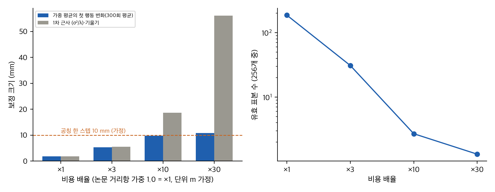
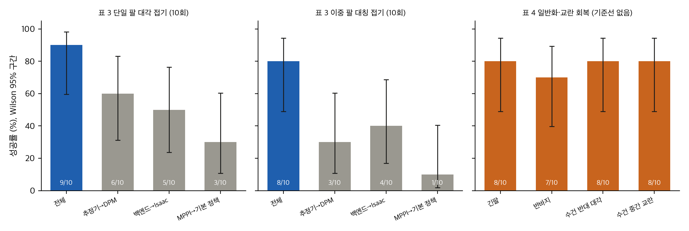
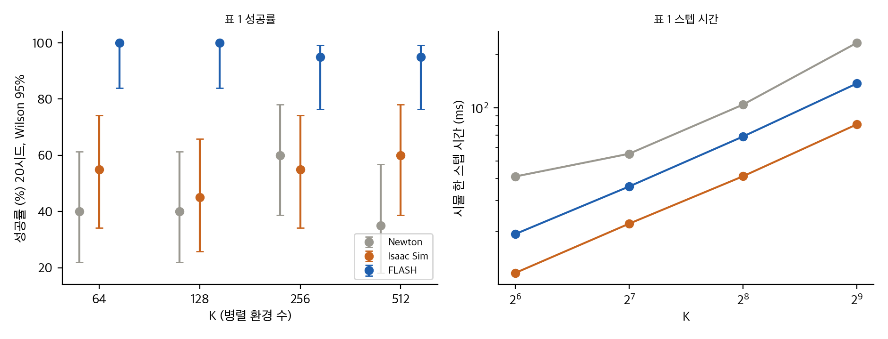

# 03. 수치 재계산과 일관성 검사

논문 표와 본문의 값을 `analysis/recompute.py`에 옮겨 적어 다시 계산했습니다(결과는 `recompute_results.json`, 수 초). 코드와 데이터가 없어 새 실험은 하지 않았고, 작은 CPU 토이 하나(`toy_mppi_refine.py`, 1초 미만)만 돌렸습니다. 검사 번호는 V1, V2, ...입니다.

**가정 (논문에 없는 값).** 표 1의 "±"는 20시드의 표준편차로 읽었습니다(부록 B.1은 시드 20개만 밝힘). 표 3, 4, D.1의 분모는 본문의 "ten trials"(10회)입니다. 표 2의 ±는 검증 분할 프레임 간 SD로 읽었고 분할 크기가 논문에 없어 검정은 하지 않았습니다. 평가 단위(시도)가 독립이라는 가정 아래 Wilson 구간, Fisher 정확 검정, 층별 정확 검정(두 과제를 합침)을 썼습니다.

## 1. 시뮬레이터 비교 (표 1, 4.1절, B.1)

### V1. 정수 가능성과 비율

- 표 1의 SR 12개 값(35, 40, 45, 55, 60, 95, 100 %)은 모두 20시드로 정수 성공 횟수가 됩니다(7, 8, 9, 11, 12, 19, 20). 20 미만 분모에서는 설명되지 않는 값이 없습니다.
- 시드 20개 기준 Wilson 95% 구간은 FLASH 100%가 [83.9, 100], 95%가 [76.4, 99.1]이고 Isaac 55%가 [34.2, 74.2], Newton 40%가 [21.9, 61.3]입니다.
- 같은 K에서 FLASH 대 Isaac Sim의 SR(Fisher): K = 64에서 20/20 대 11/20 p = 0.0012, 128에서 20/20 대 9/20 p = 0.00015, 256에서 19/20 대 11/20 p = 0.008, 512에서 19/20 대 12/20 p = 0.020. KP 오차 평균의 Welch 검정은 모두 p < 0.004입니다. 대 Newton은 K = 256에서 p = 0.020, 나머지는 p ≤ 0.0001입니다. **네 K 모두에서 FLASH 우위는 20시드에서도 뚜렷합니다.** 합산 성공 횟수는 FLASH 78/80, Isaac 43/80, Newton 35/80입니다.
- 20시드에서 같은 초기 자세를 모든 시뮬레이터에 재생했다고 하므로(B.1) 시드 간 짝지어진 비교가 가능하지만 시드별 값이 없어 짝 검정은 못 했습니다.

### V2. 본문 비율과 부록 B.1 서술의 대조

| 서술 (위치) | 표 1에서 계산한 값 | 판정 |
|---|---|---|
| Isaac Sim이 한 스텝 1.5–1.9배 빠름 (4.1절) | FLASH/Isaac 1.62, 1.66, 1.68, 1.70 (평균 1.67배) | 부록의 "constant ~1.7×"와는 맞고 본문의 범위 1.5–1.9가 표 값보다 넓음 |
| Newton이 Isaac보다 2.5–3.5배 느림 (B.1 (i)) | 2.48, 2.54, 2.88, 3.50 | 일치 |
| FLASH와 Isaac은 K에 거의 선형 (B.1 (i)) | K 8배에 스텝 시간 7.1배(FLASH), 6.9배(Isaac) | 일치 |
| MSE와 EMD가 "약 한 자릿수" 낮음 (4.1절) | 평균 MSE 비 Isaac/FLASH 5.9–21.7배, Newton/FLASH 10.6–23.7배. 길이 단위(RMS)로는 2.4–4.7배 | MSE는 제곱 단위라서 길이 비율로는 2.4–4.7배. EMD 비율은 표 1에 없음 |
| Newton·Isaac "median MSE 30–300 cm²", "EMD 5–10 cm"; FLASH "median MSE 3–4 cm², EMD 1.5–2.5 cm" (B.1 (iii)) | 아래 설명 | 표 1·그림 B.1·프로젝트 페이지 표와 맞지 않음 |

**부록 B.1 (iii)의 중앙값 서술을 표 1과 대조.** 음이 아닌 변수의 중앙값은 평균의 2배를 넘을 수 없습니다(마르코프 부등식). 표 1의 평균 MSE는 Newton이 최대 92.3, Isaac이 최대 67.4 cm²이므로 중앙값은 각각 184.6, 134.8 cm²를 넘을 수 없습니다. 서술의 "30–300"의 윗부분은, 표 1과 같은 지표·같은 20시드라면 중앙값으로 나올 수 없고, 그림 B.1에서 읽은 중앙값(그림 판독 값)은 Newton 약 25–35, Isaac 약 9–21, FLASH 약 2–3 cm²입니다. EMD는 프로젝트 페이지의 확장 표 1(cm)에 평균 Newton 1.52–1.97, Isaac 1.16–1.56, FLASH 0.66–1.02로 적혀 있고 그림 B.1에서 EMD 상자는 대체로 2 cm 아래에 놓여 있습니다(그림 판독 값, 오른쪽 축 눈금 0–7 cm). 서술의 "EMD 5–10 cm"와 "FLASH 1.5–2.5 cm"는 이 값들과 달라, 단위(mm 대 cm)나 다른 집계 방식이 섞인 것일 가능성이 있어 저자 확인이 필요합니다. 프로젝트 페이지의 EMD 비는 Isaac 대 FLASH 1.1–2.4배로 "한 자릿수 낮음"이 EMD에는 적용되지 않습니다.

### V1b. 표 1의 "시간" 열 일관성

MPPI 한 번의 시간을 한 스텝 시간으로 나누면 Newton 20.6–20.7, FLASH 20.6–20.8, Isaac 22.2–22.5 스텝입니다. B.1은 H = 6, 행동 간격 40 ms, 시뮬 10 ms(행동당 4 스텝)라고 적어 24 스텝이 예상되는데 보고 값은 그보다 8–14% 적습니다. 정확한 이유는 논문에 없습니다(측정 구간 정의 차이 가능성). 이 차이는 결론에 영향을 주지 않습니다.

## 2. 상태 추정 (표 2, 4.2절)

### V3. 값 변환과 순위

- 순위: 두 천 모두에서 Ours가 MSE, CD, EMD, 지연 네 열에서 가장 낮습니다(4.2절 "lowest on both assets across all three metrics while maintaining the fastest inference"와 일치).
- RMS 변환: 수건 √2.33 = 1.53 mm, 셔츠 √24.23 = 4.92 mm로 본문의 "about 4.9 vs. 1.5 mm in RMS"와 맞습니다.
- DPM 대비 MSE 개선은 수건 3.1배, 셔츠 1.9배이고 DeFM 대비는 수건 18.6배, 셔츠 1.8배입니다. 셔츠에서 Ours와 DeFM의 MSE 비 1.8은 SD(11.49, 22.02)에 비해 작습니다. 변동계수는 0.31–0.80이며, 표본 크기가 없어 유의성은 말할 수 없습니다.
- **CD가 RMS보다 큰 행이 있습니다.** 수건 Ours는 RMS 1.53 mm에 CD 1.94 mm, 수건 DPM은 2.68 mm에 3.89 mm입니다. 정점 대응 거리의 평균(한쪽 방향 샴퍼)은 대응 거리의 RMS 이하이므로, 이 두 행의 CD는 양쪽 방향 합이거나 다른 정의일 가능성이 있습니다. 본문은 CD의 정의를 [18]을 따른다고만 하고 적지 않습니다(`04` C7).
- 표 2의 수건 Ours 값(2.33 ± 1.21, 1.94 ± 0.41, 1.98 ± 0.45)은 표 D.1 단일 팔 "on" 행과 같습니다. 양팔 "on" 행의 MSE 3.59 ± 2.08은 표 2에 없는 수치(양팔 과제의 수건 검증 분할)입니다.
- 지연: Ours 7.4 ms(수건), 12.4 ms(셔츠)는 DPM의 1/43, 1/41입니다. B.3의 실투시뮬 추론 8.5 ms(464 정점)는 표 2의 수건 7.4 ms와 1 ms쯤 다르며, 배포 경로 측정 범위의 차이일 수 있습니다.

## 3. 실로봇 성공률 (표 3, 4, D.1, B.3)

### V4. 표 3의 요소 교체 비교

| 과제 | 전체 | 비교 행 | Fisher p | 비교 행 Wilson 95% (%) |
|---|---|---|---|---|
| 단일 팔 | 9/10 | DPM 6/10 | 0.30 | 31–83 |
| | | Isaac 5/10 | 0.14 | 24–76 |
| | | 기본 정책 3/10 | 0.020 | 11–60 |
| 양팔 | 8/10 | DPM 3/10 | 0.070 | 11–60 |
| | | Isaac 4/10 | 0.17 | 17–69 |
| | | 기본 정책 1/10 | 0.0055 | 2–40 |

두 과제를 하나의 층별 정확 검정으로 합치면(17/20 대 비교 행) DPM은 9/20, p = 0.017, Isaac은 9/20, p = 0.020, 기본 정책은 4/20, p = 0.0001입니다(두 과제의 효과 방향이 같다는 가정). 전체 파이프라인의 성공률 Wilson 구간은 단일 팔 60–98%, 양팔 49–94%, 합산 17/20은 64–95%입니다.

**해석.** "하나만 바꿔도 떨어진다"는 방향이 여덟 비교 모두에서 일관되고, 기본 정책과의 격차는 과제마다 따로도 유의합니다. DPM과 Isaac은 과제별로는 유의하지 않고(p = 0.07–0.30) 합쳐서야 p ≈ 0.02입니다. 이 표에는 FLASH 대신 학습 동역학 모델(예: [18])을 순방향 모델로 쓴 행이 없습니다. "시뮬레이터 대 학습 동역학"이라는 서론의 논지(§1)는 이 표로는 검정되지 않습니다.

### V5. 표 4

네 설정은 8, 7, 8, 8/10으로 Wilson 95% 구간이 49–94, 40–89, 49–94, 49–94%이고 합산 31/40은 62–88%입니다. 단일 팔 대각 9/10과의 차이(예: 긴팔 8/10 p = 1.0, 반바지 7/10 p = 0.58)는 구분되지 않습니다. 표 4에는 기준선 행이 없어 교란 회복(8/10)에서 MPPI 정제의 이득은 비교할 수 없습니다. "일반화한다"는 서술은 7–8/10이 나온다는 뜻으로는 맞습니다. 다른 방법과의 우열은 이 표로 정할 수 없습니다.

### V6. 증강 소거 (표 D.1)

단일 팔 9/10 대 6/10 p = 0.30, 양팔 8/10 대 5/10 p = 0.35이고 두 과제를 합치면 17/20 대 11/20, p = 0.082(층별 정확 검정 0.085)입니다. 방향은 일관되지만 5% 수준에서는 유의하지 않습니다. 합성 검증 오차는 증강을 끈 쪽이 단일 팔에서 오히려 낮습니다(MSE 1.85 대 2.33, CD 1.72 대 1.94, EMD 1.74 대 1.98). 즉 이 표는 "합성 검증 오차가 실로봇 성공률을 예측하지 못한다"는 점도 함께 보입니다(`04` C14).

### V7. 표본 크기와 검정력

10 대 10 Fisher 정확 검정의 검정력(5% 수준)은 90% 대 60%에서 0.15, 80% 대 50%에서 0.13, 90% 대 30%에서 0.67, 80% 대 30%에서 0.43입니다. 80% 검정력에 필요한 시도 수(한 군당)는 90% 대 60%에서 40회, 90% 대 30%에서 15회, 80% 대 30%에서 20회(구간 확인은 15, 20, 25, 30, 40 격자)입니다. 표 3에서 기본 정책 대비 격차(약 60%p)만 10회로 충분히 검출되고, 요소 교체(차이 30%p 안팎)는 한 군당 약 40회가 필요합니다.

### V8. 파지 성공과 종단 성공 분해 (B.3)

전체 파이프라인 행의 파지는 단일 팔 10/10, 양팔 9/10, 교란 10/10이고 종단 성공은 9/10, 8/10, 8/10입니다. 파지 성공 조건부 정렬 성공은 단일 팔 9/10, 양팔 8/9(0.89), 교란 8/10입니다. 실패 시도 수는 단일 팔 1, 양팔 2(파지 1 + 정렬 1), 교란 2(모두 정렬)입니다. 기준선 행(DPM, Isaac, 기본 정책)의 파지 성공은 보고되지 않아 요소 교체 실패가 파지 단계에서 나는지 정렬 단계에서 나는지 알 수 없습니다.

## 4. 시뮬 폐루프와 지연 (C.1–C.3, B.3)

### V9. 폐루프 수치 (C.3)

- 시작 오차 42.2 ± 0.2 cm는 30 cm 정사각 수건의 대각선 42.43 cm와 맞습니다. 이동 상한 20 mm/스텝(B.1)이면 최소 ⌈42.2/2⌉ = 22 스텝이 필요한데 보고된 스텝 수 22–31과 하한이 정확히 맞습니다. 즉 배포 제어기도 이 상한에서 도는 것으로 보입니다.
- 18/20 = 90%의 Wilson 95% 구간은 [70, 97]%로 실제 단일 팔 9/10([60, 98]%)과 구분되지 않습니다(Fisher p = 1.0).
- 0.8 ± 0.1 cm는 "18개 시드가 도달한 값"으로 읽힙니다. 도달하지 못한 2개 시드의 최종 오차는 보고되지 않습니다.

### V10. 표 C.1의 정수 가능성과 하한

20개 시드의 회복 스텝 수가 정수라면 보고 평균과 SD(소수 첫째 자리 반올림)를 만드는 분포가 존재합니다. 6 cm의 4.0 ± 0.0은 20개 모두 4 스텝인 분포 하나뿐이고, 9 cm의 4.1 ± 0.7은 스텝 2–7 범위에서 6개, 12 cm의 6.0 ± 1.0은 2–8 범위에서 68개 분포가 가능합니다(탐색 범위 2–8 스텝). 정수 가능성에는 문제가 없습니다.

20 mm/스텝 상한에서 밀린 만큼(6, 9, 12 cm)을 오차 방향으로 되돌리는 최악의 경우 최소 스텝은 3, 5, 6입니다. 6 cm에서 20시드 모두 정확히 4(SD 0)이고 9 cm의 평균이 4.1로 5보다 작은 점은, 밀림 방향이 시드마다 무작위(C.3)여서 최악의 경우보다 가볍거나 "교란 전 수준 아래로 돌아옴"의 정의(예: 기준 스텝 계산 방식)가 영향을 줄 가능성이 있습니다. 회복 시간의 정의가 본문에 없습니다(`04` C12).

### V11. 한 스텝 지연 산술 (B.3)

수건 한 스텝: 95.8(분할) + 8.5(실투시뮬) + 0.5(쓰기) + 970(MPPI, H = 5) = 1074.8 ms(0.93 Hz). MPPI가 90.2%입니다. 반바지는 분할과 쓰기를 같게 보면 2657.9 ms(0.38 Hz)입니다. MPPI 시간은 정점 수 비 2.49배(1156/464)에 2.63배(2550/970)로 대략 정점 수에 비례합니다. 22–31 제어 스텝의 수건 접기는 계산만 약 24–33 초입니다. 다음은 확인 사항입니다.

- 표 1의 FLASH K = 256, H = 6 MPPI는 1.42 s입니다. H = 5로 비례 환산하면 1.18 s이고 B.3의 0.97 s보다 큽니다. 표 1의 한 스텝 68.9 ms로 나누면 970 ms는 시뮬 약 14 스텝에 해당하는데 H = 5, 행동당 4 스텝이면 20 스텝입니다. 배포 설정의 행동당 시뮬 스텝 수나 정점 수는 본문에 없습니다(`04` C17).
- B.3은 제어 한 스텝에 분할 95.8 ms가 든다고 적지만, §3.3은 SAM 2를 자산(메시) 구축 단계에서만 언급하고 추정기는 RGB 한 장만 받는다고 적습니다. 온라인 분할이 어디에 쓰이는지 본문에 없습니다(제어 스텝의 약 9%).

### V12. 크기와 매개변수 어림

패치 토큰은 (392/14)² = 784개이고 시퀀스 길이는 수건 1248, 반바지 1940, 셔츠 2163입니다. 정점 토큰 매개변수는 정점 수 × 256으로 118,784, 295,936, 353,024개입니다. 전체 학습 매개변수는 어림 3.8–4.0 M(FFN 은닉폭 4d 가정, 논문은 "standard"라고만 씀)이고 정점 수가 늘어도 DINOv2(동결)가 대부분이라 학습 대상은 작은 모델입니다. 식 5의 합성 이미지 수 M과 에포크당 예시 수는 논문 어디에도 없어 "약 12시간 학습"(§6)과 "합성 데이터로만"의 데이터 양은 확인할 수 없습니다(`04` C22).

### V13. 판본 간 표 대조

v1과 v2의 표 1, 2, 3, 4와 D.1(v1은 C.5) 값은 문자열 단위로 같습니다. v2에만 있는 문구: "no trial was discarded or re-run", "closed-loop correction", 부록 C의 분석과 준정적 한계 문구. v1에만 있는 문구: "stronger robustness". 자세한 목록은 `01` §0에 있습니다.

## 5. 토이 T1: 한 스텝에 MPPI가 얼마나 고칠 수 있나

**묻는 것.** 부록 A.2의 하이퍼파라미터(K = 256, H = 5, σ = 5 mm, λ = 0.08)에서 식 10–13의 가중 평균이 첫 행동을 얼마나 바꿀 수 있는가. 이 크기가 "정제"의 상한을 정합니다.

**설정.** 천 시뮬레이터 없이 말단점을 3차원 운동학 점으로 두고, 비용을 표 A.2의 도달 단계 항(거리 + 종단 거리 + 속도 벌점 10‖a‖²)으로 구성합니다. 비용 단위는 미터로 가정했습니다(논문에 없음). 공칭 행동은 목표 방향에서 30도 틀어진 10 mm/스텝(가정)이고 목표는 20 cm 앞입니다. 비용 배율 c를 1, 3, 10, 30으로 바꿨습니다(논문의 거리항 가중 1.0이 c = 1).

| 비용 배율 | 첫 행동 변화 (mm, 300회 평균) | 해석적 근사 (σ²/λ)·기울기 (mm) | 유효 표본 수 (256 중) | 필요 방향 성분 (mm) |
|---|---|---|---|---|
| ×1 | 1.86 | 1.82 | 186.7 | 0.64 |
| ×3 | 5.38 | 5.57 | 30.9 | 1.83 |
| ×10 | 9.77 | 18.7 | 2.7 | 2.91 |
| ×30 | 10.86 | 56.1 | 1.3 | 3.23 |

30도 틀어진 공칭 행동을 목표 방향으로 되돌리는 데 필요한 보정은 5.2 mm입니다. 표본 256개 중 최대 잡음 노름의 평균은 19.1 mm(σ = 5 mm 3차원)이므로 어떤 가중치로도 한 스텝 보정은 약 19 mm를 넘지 못합니다.

**읽는 법.** (1) 비용이 m 단위이고 가중 1.0이면 가중치는 거의 균등(유효 표본 187/256)해서 보정은 약 2 mm로 해석적 근사 (σ²/λ)·기울기와 일치합니다. 이 영역에서는 정제가 느리게 누적되는 수정입니다. (2) 비용 배율이 커지면 가중치가 한두 표본에 쏠려 보정이 잡음에 의해 포화됩니다(×30에서 유효 표본 1.3). 즉 σ와 λ만으로는 정제 강도가 정해지지 않고 비용 규모가 정합니다. 논문은 비용의 단위와 총 규모를 적지 않습니다. (3) 이 토이는 천을 모르는 운동학 점이므로 **천 접촉에서 정제가 실제로 얼마나 큰지는 보이지 않습니다.** 결과는 "논문의 정제가 잘 작동한다/안 한다"가 아니라 "정제 크기는 비용 규모에 크게 의존하며, 논문이 그 값을 공개하지 않는다"는 점을 보입니다. 식 13이 가중 평균이므로 정제가 사전 정책 주변 몇 mm 안에서만 일어난다는 점은 σ = 5 mm에서 확인됩니다.

그래프: 토이 T1. 비용 배율에 따른 MPPI 첫 행동 변화(왼쪽, 점선은 가정한 공칭 한 스텝 10 mm)와 유효 표본 수(오른쪽). 우리가 만든 그래프입니다.

## 6. 그래프

그래프: 표 3과 4의 실로봇 성공률과 Wilson 95% 구간(분모 10회 가정). 우리가 논문 표 값으로 다시 그렸습니다.

그래프: 표 1의 시뮬레이터별 성공률(20시드, Wilson 95% 구간)과 한 스텝 시간. 우리가 논문 표 값으로 다시 그렸습니다.

## 7. 재계산 요약

| ID | 검사 | 결과 |
|---|---|---|
| V1 | 표 1 정수 가능성, FLASH 대 Isaac·Newton 검정 | 정수 가능. 네 K 모두 p ≤ 0.02 (SR), 합산 78/80 대 43/80 대 35/80 |
| V2 | 본문·부록 서술 대 표 1 | 속도비 일치(범위 약간 넓음), MSE 길이 단위 2.4–4.7배, 부록 B.1 중앙값·EMD 서술은 표 1·그림 B.1과 맞지 않음 |
| V3 | 표 2 변환 | RMS 일치, 모든 열에서 Ours 최저, 일부 행 CD > RMS (정의 미기재) |
| V4 | 표 3 | 기본 정책 대비 두 과제 모두 p < 0.05, DPM·Isaac 대비는 과제별 p = 0.07–0.30, 합쳐서 p ≈ 0.02 |
| V5 | 표 4 | 구간 40–94%, 기준선 없음 |
| V6 | 표 D.1 | 합쳐서 p = 0.08, 합성 오차는 실 SR을 예측하지 못함 |
| V7 | 검정력 | 요소 교체 비교에는 군당 약 40회 필요 |
| V8 | 파지 분해 | 일치 (기준선 행은 보고 없음) |
| V9 | 폐루프 수치 | 42.2 cm 대각선, 최소 22 스텝과 일치 |
| V10 | 표 C.1 | 정수 가능, 회복 시간 정의 없음 |
| V11 | 지연 | 1.07 s/스텝(수건), MPPI 90%, 표 1과 약 14 스텝 차이 |
| V12 | 크기 | 학습 대상 약 4 M, 데이터 양 미기재 |
| V13 | 판본 | 표 값 같음, 서술 변경 |
| T1 | 토이 | 정제 크기는 비용 규모가 정함 |
