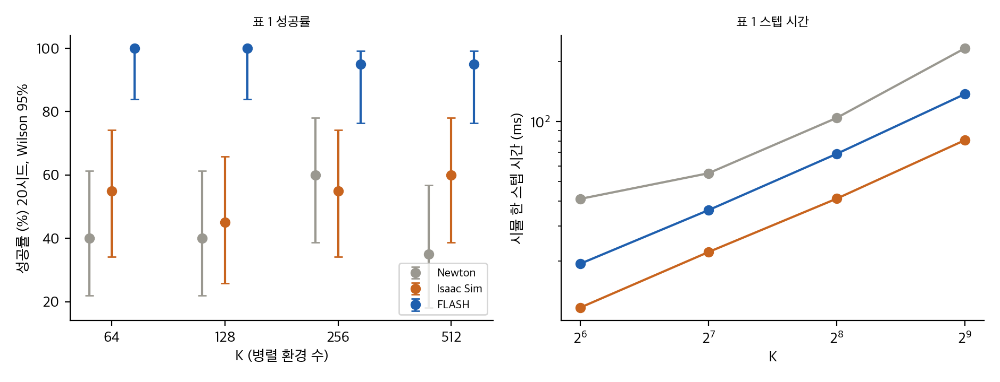
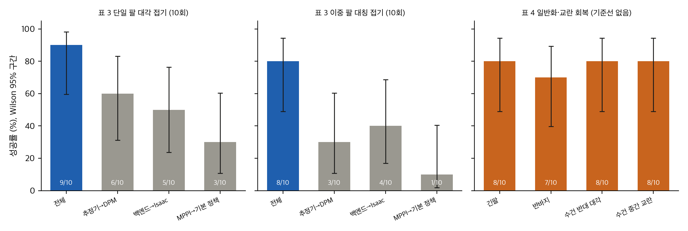
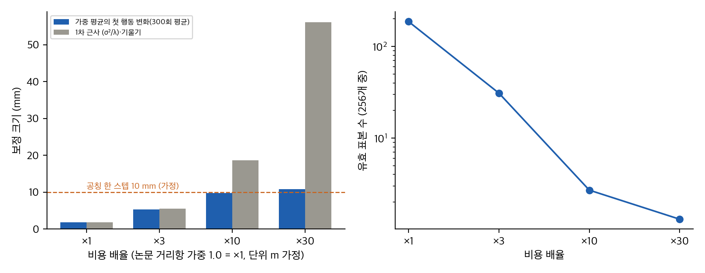

> **논문:** Xin Liu, Yulin Li 외 8명 (National University of Singapore, Shanghai Jiao Tong University). *Enabling Robust Cloth Manipulation via Inference-Time Simulator-in-the-Loop Refinement.* CoRL 2026 스포트라이트, arXiv:2606.24552 (v2, 2026-09-24).
> 공식 코드 저장소는 2026-11-26에 확인하지 못했습니다. 이 글의 수치는 논문 표와 본문에서 옮겨 다시 계산한 것이고, 논문 그림은 쓰지 않았습니다(arXiv 라이선스가 CC BY가 아니라서). 그래프는 우리가 논문 표 값으로 다시 그린 것입니다.

## 논문이 묻는 것

모방학습 정책은 배포 중 자기 오차를 고치지 못합니다. 논문은 천 접기에서 **물리 시뮬레이터를 순방향 모델로 직접 쓰는** 해법을 제안합니다. 한 장의 RGB에서 시뮬레이터 호환 메시 상태를 복원하고(동결 DINOv2 + 정점마다 학습 토큰), 병렬 변형체 시뮬레이터 FLASH로 후보 행동열을 굴려, 미리 증류한 정책의 행동 주변을 MPPI로 고친 뒤 첫 행동만 실행합니다. 기본 설정은 K = 256 후보, 수평선 H = 5, 잡음 σ = 5 mm, 온도 λ = 0.08입니다(부록 A.2).

## 시뮬레이터 비교는 격차가 뚜렷합니다

표 1은 같은 천, 같은 MPPI, 같은 비용으로 네 시뮬레이터를 K = 64–512에서 20시드씩 비교합니다. FLASH의 성공은 100, 100, 95, 95%이고 Isaac Sim은 55, 45, 55, 60%, Newton은 40, 40, 60, 35%입니다. 모두 20시드 정수 비율로 설명됩니다. 같은 K에서 FLASH 대 Isaac Sim의 Fisher 검정은 네 K 모두 p ≤ 0.02이고(예: K = 256에서 19/20 대 11/20, p = 0.008), 합산 성공은 78/80 대 43/80입니다.

*그래프: 표 1의 시뮬레이터별 성공률(20시드, Wilson 95% 구간)과 한 스텝 시간. 우리가 논문 표 값으로 다시 그렸습니다.*

본문의 서술과 표를 맞춰 보면 다음이 보입니다.

- 한 스텝 시간은 FLASH가 Isaac Sim보다 1.62–1.70배 깁니다(표 값). 본문은 "1.5–1.9배"라고 적고 부록은 "약 1.7배"라고 적습니다.
- 정점 MSE는 "약 한 자릿수" 낮다고 적습니다. 표 1 평균 MSE의 비는 5.9–21.7배인데, MSE는 제곱 단위라서 길이로 환산하면 2.4–4.7배입니다.
- 부록 B.1은 Newton과 Isaac Sim의 "median MSE 30–300 cm², EMD 5–10 cm", FLASH의 "median MSE 3–4 cm², EMD 1.5–2.5 cm"라고 적습니다. 음이 아닌 변수의 중앙값은 평균의 2배를 넘을 수 없으므로(마르코프 부등식), 표 1과 같은 지표라면 Newton의 중앙값 상한은 평균 최대 92.3의 2배인 약 185 cm²입니다. 그림 B.1에서 읽은 EMD 상자는 대체로 2 cm 아래에 있고(그림 판독 값), 프로젝트 페이지의 확장 표 1은 EMD 평균을 Newton 1.52–1.97 cm, Isaac Sim 1.16–1.56 cm, FLASH 0.66–1.02 cm로 적습니다. 단위나 집계 방식이 섞였을 가능성이 있어 저자 확인이 필요합니다.

## 실로봇: 방향은 일관되고, 시도 수가 10회입니다

표 3은 전체 파이프라인에서 한 요소씩 바꾼 행을 보입니다(분모 10회, 본문의 "ten trials"로 가정).

*그래프: 표 3과 4의 실로봇 성공률과 Wilson 95% 구간(분모 10회 가정). 우리가 논문 표 값으로 다시 그렸습니다.*

단일 팔 대각 접기는 9/10(전체), 6/10(추정기를 DPM으로), 5/10(백엔드를 Isaac Sim으로), 3/10(MPPI 없이 기본 정책)입니다. 양팔 대칭 접기는 8/10, 3/10, 4/10, 1/10입니다. 전체 대 기본 정책은 과제마다 Fisher p = 0.020, 0.0055입니다. 전체 대 DPM·Isaac Sim은 과제별로 p = 0.07–0.30이고, 두 과제를 하나의 층별 정확 검정으로 합치면 p ≈ 0.02입니다(두 과제의 효과 방향이 같다는 가정). "하나만 바꿔도 떨어진다"는 방향은 여덟 비교 모두에서 같습니다. 개별 비교를 5% 수준에서 검출하려면 한 군당 약 40회가 필요합니다(90% 대 60% 가정, 검정력 80%).

표 4의 일반화·교란 회복 네 설정은 8, 7, 8, 8/10이고 Wilson 95% 구간은 40–94%입니다. 이 표에는 기준선 행이 없어, 교란 회복에서 MPPI 정제가 얼마나 기여하는지는 이 표로 비교할 수 없습니다. 시뮬레이션 20시드의 오차 곡선(부록 C.3)에서도 정제를 끈 곡선이 없어, 오차가 줄어드는 것이 정제의 효과인지 정책이 원래 목표로 수렴하는 것인지를 분리하지 못합니다. 이 곡선에서 시작 오차 42.2 cm와 최소 22 스텝은 스텝당 20 mm 이동 상한(부록 B.1)과 정확히 맞습니다.

## 제어 한 스텝이 약 1초입니다

부록 B.3의 지연을 더하면 수건(464 정점)은 분할 95.8, 실투시뮬 8.5, 쓰기 0.5, MPPI 970 ms로 합계 약 1.07초(0.93 Hz)이고 MPPI가 90%입니다. 반바지(1156 정점)는 MPPI만 2550 ms입니다. 정점 수가 2.49배일 때 MPPI는 2.63배입니다. 한계 절이 적은 "준정적 조작에 한정"과 짝을 이룹니다. 표 1(H = 6)에서 H = 5로 비례 환산한 값은 1.18초로 보고값 0.97초와 다르며, 배포 설정(행동당 시뮬 스텝 수)이 본문에 없습니다.

## 토이: 정제 크기는 비용 규모가 정합니다

논문의 하이퍼파라미터(K = 256, H = 5, σ = 5 mm, λ = 0.08)에서 식 10–13의 가중 평균이 첫 행동을 얼마나 바꿀 수 있는지 numpy로 확인했습니다(1초 미만). 천은 쓰지 않고, 말단점을 3차원 운동학 점으로 두고 표 A.2의 거리항과 속도항으로 비용을 만들었습니다. 비용 단위는 미터로 가정했습니다(논문에 없음).

*그래프: 비용 배율에 따른 MPPI 첫 행동 변화(왼쪽, 점선은 가정한 공칭 한 스텝 10 mm)와 유효 표본 수(오른쪽). 우리가 만든 토이의 결과입니다.*

논문의 거리항 가중 1.0(×1)에서는 가중치가 거의 균등(유효 표본 187/256)하고 한 스텝 보정은 약 1.9 mm이며 1차 근사 (σ²/λ)·기울기와 일치합니다. 비용 규모를 키우면 가중치가 한두 표본에 쏠려(×10에서 유효 표본 2.7, ×30에서 1.3) 보정이 약 10 mm에서 포화합니다. 즉 σ와 λ만으로는 정제 강도가 정해지지 않고 비용의 단위와 규모가 정합니다. 논문은 비용의 단위와 총 규모를 적지 않습니다. 이 토이는 천 접촉을 다루지 않으므로, 정제가 실제 천에서 얼마나 큰지는 보이지 않습니다.

## 판본 차이와 프로젝트 페이지

v2는 초록을 "stronger robustness"에서 "closed-loop correction under mid-fold perturbations"로 바꾸고, "real-time robot control budget" 문구를 삭제했으며, 실제 천 궤적 대조(부록 C.1, 13.6 mm, 측정 하한 5.2 mm)와 파지·종단 성공 분해(부록 B.3)를 더했습니다. 표 1–4와 D.1의 수치는 v1과 같습니다. 2026-11-26에 확인한 프로젝트 페이지의 초록은 v1 문구를 유지하고 있고, "MPPI 롤아웃에서 자기충돌을 끈다"는 문장이 있지만 논문 본문에서는 같은 문장을 찾지 못했습니다.

## 재현 가능성

공식 코드는 2026-11-26에 확인하지 못했습니다. 핵심 의존성인 FLASH(arXiv:2604.17513)도 해당 논문이 공개를 예정이라고 적습니다. 실로봇(AIRBOT Play, ZED 2i)과 RTX급 GPU가 필요해 Apple M4 Pro 환경에서 논문 수치를 재현할 수는 없습니다. 표 재계산과 통계 검정, 정제 크기 토이는 CPU로 끝냈고, 소형 재구현(MuJoCo 천 + 사전 정책 증류 + 사전 안내 MPPI)은 가능하며 3–5주(추정, 측정 전)로 봅니다.

## 저자에게 확인하고 싶은 것

- 부록 B.1의 median MSE와 EMD 수치의 단위와 집계 방식
- 표 C.1 회복 스텝의 정의, 도달하지 못한 2개 시드의 최종 오차, 정제를 끈 기본 정책의 오차 곡선
- 표 2 검증 분할 크기, ±의 의미, CD의 정의(수건 Ours와 DPM 행에서 CD가 RMS보다 큼)
- 배포 MPPI의 행동당 시뮬 스텝 수, 비용의 단위와 규모, 합성 이미지 수 M
- 코드와 FLASH의 공개 계획

## 자료

- [통합 리포트 PDF](report/report_public.pdf)
- [01. 논문 분석](analysis/01_paper_analysis.md)
- [02. 선행연구와 관련 자료](analysis/02_prior_work.md)
- [03. 수치 재계산과 일관성 검사](analysis/03_analysis.md)
- [04. 주장 검증 (공식 코드를 확인하지 못함)](analysis/04_claim_verification.md)
