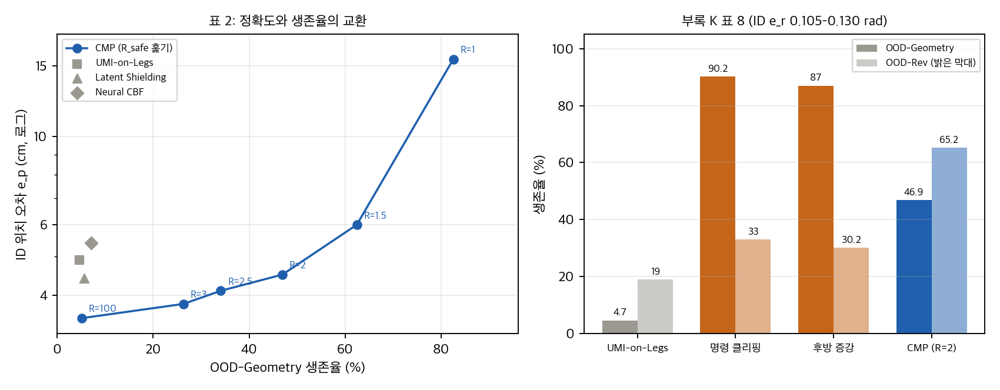
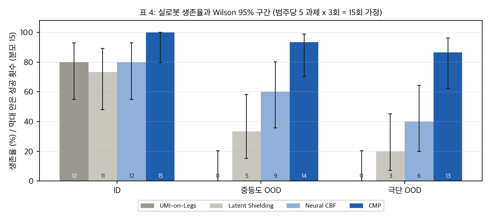
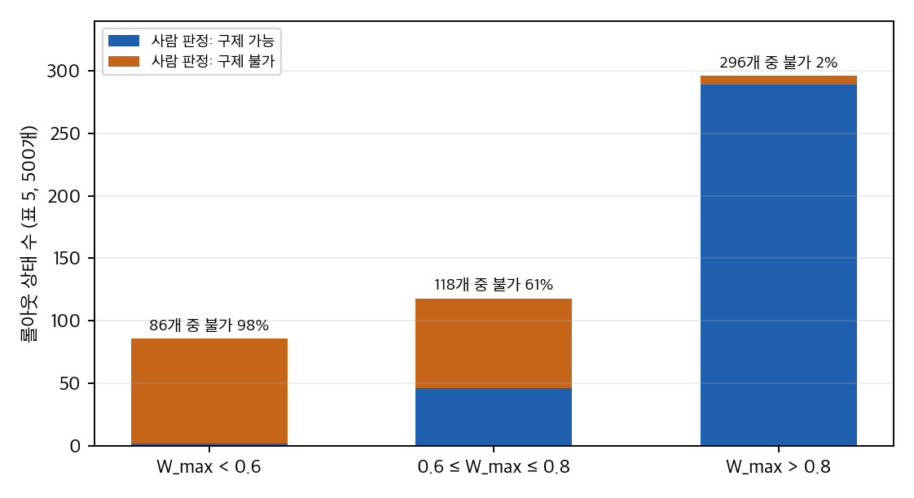
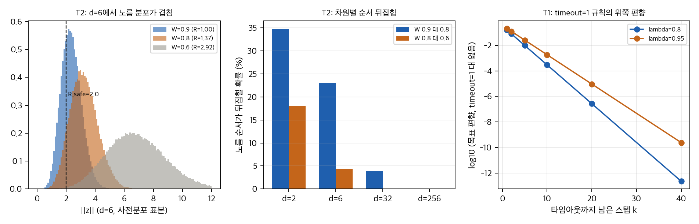

> **논문:** Ziyang Cheng, Haoyu Wei, Hang Yin, Xiuwei Xu, Bingyao Yu, Jie Zhou, Jiwen Lu. *CMP: Robust Whole-Body Tracking for Loco-Manipulation via Competence Manifold Projection.* CoRL 2026 스포트라이트, arXiv:2604.07457 (v2, 2026-10-12).
> 공식 저장소(GitHub Shepherd1226/CMP)는 2026-11-26 기준 README와 라이선스 파일만 있고 "Code coming soon"이라고 적혀 있습니다. 이 글의 그림은 우리가 그린 그래프입니다. 논문 그림은 싣지 않았습니다.

## 논문이 묻는 것

다리 달린 매니퓰레이터(Unitree Go2와 6축 팔)가 말단 목표 궤적을 따라가는 정책은 정면 작업 공간에서 잘 학습됩니다. 그러나 뒤쪽 목표나 시각 관성 오도메트리(VIO) 드리프트처럼 정책이 숙달하지 못한 명령이 들어오면 넘어집니다. 흔한 대응은 두 가지입니다. 추론 때 안전 필터를 돌리거나(느립니다), 이상 입력을 감지해 멈추는 것입니다(작업이 끊깁니다).

CMP는 이 두 가지를 학습 구조로 옮깁니다. 목표 궤적을 6차원 잠재 명령 z로 인코딩하고, "이 명령을 지금 실행하고 이후 최적으로 고르면 영원히 안전할 확률" W(s, z)를 TD(λ)로 학습하는 안전 추정기를 함께 둡니다. 인코더의 KL 사전분포 분산을 W로 정해 "안전할수록 z의 노름이 작게" 만들고(ILS), 실행 때는 ‖z‖가 반지름 R_safe를 넘으면 노름만 잘라 줍니다. 안전 추정기는 실행 때 필요 없고 계산은 노름 한 번입니다.

## 이 글에서 확인한 것

표 2, 4, 5와 부록 K의 표 8을 다시 계산했습니다. 시행 수를 논문이 적지 않은 곳은 문장 안에 가정을 밝혔습니다.

**1. "10배"는 UMI-on-Legs에 대한 값이고, 부록의 단순 클리핑은 한 장면에서 더 높습니다.** OOD-Geometry(뒤쪽 목표) 생존율은 46.9% 대 4.7%로 9.98배입니다. 그런데 부록 K의 표 8에서 학습 없는 명령 클리핑은 같은 ID 방향 오차(0.107 대 0.106 rad)로 90.2%, 후방 증강은 87.0%입니다. 반대로 궤적을 뒤집는 OOD-Rev에서는 CMP가 65.2%로 클리핑 33.0%의 1.98배입니다. 본문 표 2의 기준선 세 개에는 클리핑이 없습니다.

**2. "ID 추적 저하 10% 미만"은 어느 기준과 비교하느냐에 따라 달라집니다.** UMI-on-Legs 대비 위치 오차는 오히려 8.2% 줄고 방향 오차는 1.0% 늘어납니다. Latent Shielding 대비 방향 오차는 10.4% 늘고, 투영이 일어나지 않는 R_safe = 100과 비교하면 위치 오차 +28.6%, 방향 오차 +23.3%입니다. R_safe = 100의 ID 성능이 이미 UMI-on-Legs보다 좋으므로(생존율 +9.6%p, 위치 오차 −28.6%) ID 개선은 구조에서, OOD 개선은 투영에서 오는 것으로 읽힙니다.

*그래프 (우리가 그림). 왼쪽은 표 2, 오른쪽은 표 8입니다. 표 8의 ID 방향 오차는 0.105–0.130 rad입니다.*

**3. 실로봇 우위는 UMI-on-Legs와 Latent Shielding에 대해서는 분명하고 Neural CBF에 대해서는 15회로 확정하기 어렵습니다.** 범주당 5 과제 × 3회 = 15회로 읽고(과제별 결과가 없어 독립 시행 가정) Fisher 검정을 했습니다. 중등도 OOD에서 CMP 14/15 대 Neural CBF 9/15는 p = 0.080, 극단 OOD에서 13/15 대 6/15는 p = 0.021이고, 9개 비교를 Holm으로 보정하면 0.32와 0.10입니다. ID의 15/15 대 12/15는 p = 0.22이고, 구별하려면 팔당 약 76회가 필요합니다. 두 OOD 범주를 합친 27/30 대 15/30은 p = 0.0015입니다.

*그래프 (우리가 그림). 막대 안 숫자는 성공 횟수입니다(분모 15).*

또 그림 5는 결과를 "과제 성공"(초록)과 "정확도가 낮아도 생존"(파랑)으로 나눕니다. CMP는 앞 방향 3개와 옆으로 밀기에서 성공, 나머지 OOD 5개 과제에서 생존으로 표기되어 있습니다. 표 4의 OOD 수치는 생존율이고 과제 성공 횟수는 따로 보고되지 않았습니다. OOD-Geometry에서 생존한 칸의 위치 오차는 69–102 cm입니다(표 2).

**4. 안전 추정기와 사람 판단의 일치 97.7%, 97.6%는 두 극단 구간의 값입니다.** 부록 D.2의 표 5(500개 상태, 5명 투표)를 개수로 되돌리면, 추정값 W_max < 0.6 구간(86개)에서 사람이 "구제 불가"로 본 비율이 97.7%, > 0.8 구간(296개)에서 "구제 가능"으로 본 비율이 97.6%입니다. 중간 구간 118개(전체의 23.6%)에서는 61%가 "구제 불가"입니다. 라벨 집계 방식과 평가자 간 일치도는 논문에 없습니다.

*그래프 (우리가 그림). 표 5의 비율에 500을 곱해 개수로 되돌린 값입니다.*

**5. 지연은 보호가 없는 기준선과 거의 같습니다.** CMP 2.99 ms는 보호가 없는 UMI-on-Legs 2.97 ms와 0.02 ms 차이이고, Latent Shielding은 +0.92 ms, Neural CBF는 +2.39 ms입니다. 측정 횟수, 하드웨어, 제어 주기는 논문에 없습니다.

## 논문의 논리를 작은 설정에서 확인하기

두 가지 토이를 만들었습니다. 실행은 각각 수 초이고 논문 수치와는 무관하며, 논문의 논리만 검사합니다.

- **토이 T1: 부록 C의 하한 증명.** 상태 30개의 작은 MDP에서 W의 고정점을 풀고 TD(λ) 목표를 정확히 계산했습니다. 이상적인 V*를 쓰면 P^(n)이 단조 비증가이고 λ 목표가 W 이하라는 증명이 수치로 확인됩니다. 식 3의 "타임아웃이면 1" 규칙은 V*를 1로 바꾸므로 에피소드 끝 2–3스텝에서 목표가 W를 넘고, 영향은 λ^(k−1)로 줄어듭니다(제어 주파수를 50 Hz로 읽으면 끝 0.2–0.4초). 원점 값 근사와 추정 잡음(SD 0.1 이하)은 이 토이에서 하한을 깨지 않았습니다.
- **토이 T2: "고차원 가우시안은 얇은 셸에 몰린다".** 식 6 아래의 이 성질은 차원이 클 때 점근적으로 성립합니다. 논문의 인코더 출력은 6차원입니다. 사전분포 N(0, R²I)의 표본으로 보면 노름의 상대 SD는 29%이고, 이웃한 안전 수준(W 0.9 대 0.8)의 23%에서 노름 순서가 뒤집힙니다. d = 32에서는 3.9%입니다. 안전 확률 크기를 읽는 눈금이 아니라 "대략 안전과 위험을 가르는" 장치로 읽는 것이 맞습니다(안전 ≥ 0.8과 ≤ 0.6을 가르는 AUC는 0.994). 학습된 인코더의 출력이 사전분포 표본이라는 가정은 이 토이의 한계입니다.

*그래프 (우리가 그림). 왼쪽과 가운데는 토이 T2(안전 값 W 0.9, 0.8, 0.6의 사전분포 표본, 배치 평균 W 0.9 가정), 오른쪽은 토이 T1(편향의 상용로그)입니다.*

## 공식 코드

공식 저장소는 README와 MIT 라이선스 파일만 있고 구현은 아직 없습니다. 프로젝트 페이지도 "Code (Coming Soon)"입니다. 그래서 코드 대조 대신 논문 주장 15개를 표와 부록, 토이로 검증했습니다. 코드가 공개되면 확인할 값은 R_min과 R_max(식 5의 클리핑), 상태·목표 입력 차원, 보상 가중치, 롤아웃 길이와 제어 주파수, 시드 수, 명령 클리핑의 규칙, 지연 측정 방법입니다. 논문 본문에는 없는 값입니다. v1과 v2는 표 수치가 같고, v2에서 표 캡션의 "3 Random Seeds"가 빠졌으며 부록 I–M(표 8 포함)이 추가되었습니다.

## 구현 가능성 (Apple M4 Pro, CUDA 없음)

- **시뮬레이션과 실로봇 재현: 불가.** 환경이 Isaac Gym(NVIDIA GPU)이고 실험은 Go2와 팔이 필요하며 코드도 없습니다.
- **구조의 저차원 구현과 논리 검사: 가능.** 식 3, 5–7은 몇 줄이고 위의 토이 두 개가 그 예입니다. 저차원 환경에서 절제를 되풀이하는 데 1–2주, MuJoCo 사족과 팔 축소판은 4–8주로 추정합니다(측정 전).

이 글은 학습이나 재현 실험을 하지 않았습니다.

## 한계

- 실로봇 시행 수가 범주당 15회라 효과 크기가 작은 차이는 구별되지 않습니다. 과제별 결과가 없어 독립성 가정이 낙관적일 수 있습니다.
- 그림 4, 7, 9는 수치표가 없어 값을 읽지 않았습니다(정상 구간 W_max 약 0.83–0.85는 그림 판독 값).
- 표 2의 굵은 글씨 기준(여유 0.0002 rad)과 부록 K의 방향 오차 반복 실행 SD(약 0.002 rad)는 10배 다릅니다. 표 8의 "own best" 제약, 시드 수도 논문에 없어 저자 확인이 필요합니다.
- 두 토이는 논문 환경이 아닙니다. 하한 증명이 학습된 추정기와 실제 정책에서 얼마나 유지되는지는 보여 주지 못합니다.

## 출처와 라이선스

- 논문: arXiv:2604.07457. arXiv abs 페이지의 라이선스 링크가 비독점 배포 라이선스(arxiv.org/licenses/nonexclusive-distrib/1.0)를 가리키므로 논문 그림은 싣지 않았습니다.
- 표 값은 인용과 재계산을 위해 옮겼습니다. 그래프, 토이, 분석 문서와 스크립트는 이 저장소 작성자가 만들었습니다.
- 공식 저장소와 프로젝트 페이지는 2026-11-26에 확인했습니다. 데이터, 가중치, 다른 저장소의 코드는 받지 않았습니다.

## 자료

- [통합 리포트 PDF](report/report_public.pdf)
- [01. 논문 분석: CMP (arXiv:2604.07457)](analysis/01_paper_analysis.md)
- [02. 선행연구와 관련 저장소](analysis/02_prior_work.md)
- [03. 수치 재계산, 일관성 검사, 토이 실험](analysis/03_analysis.md)
- [04. 주장 검증과 구현 가능성](analysis/04_claim_verification.md)
