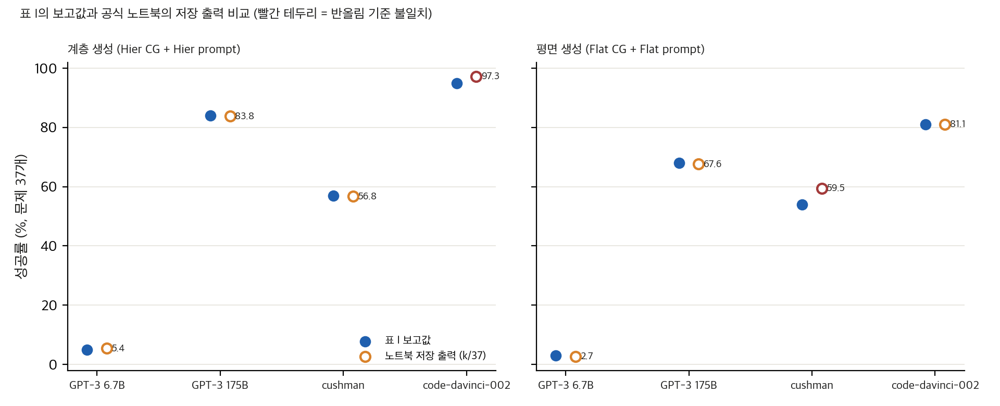
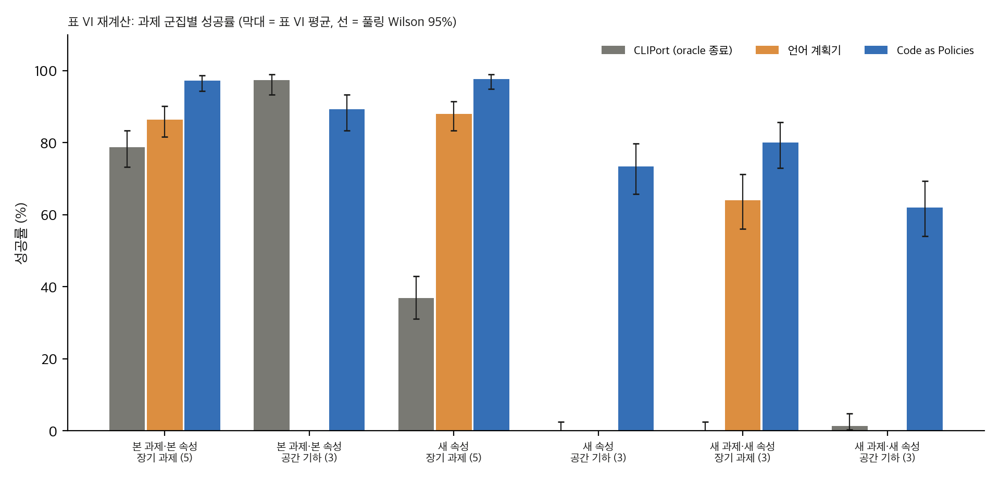

> **논문:** Jacky Liang, Wenlong Huang, Fei Xia, Peng Xu, Karol Hausman, Brian Ichter, Pete Florence, Andy Zeng. *Code as Policies: Language Model Programs for Embodied Control.* ICRA 2023, arXiv:2209.07753 (v4, 2023-05-25).
> 공식 코드(Apache-2.0, google-research 모노레포의 `code_as_policies/`)는 정적으로만 읽었고 실행하지 않았습니다. 이 글의 그래프는 표 값으로 우리가 그린 것이며, 논문 그림은 싣지 않았습니다(arXiv non-exclusive 라이선스).

## 논문이 묻는 것

로봇에게 "빨간 블록을 파란 그릇 옆에 놓아 줘"라고 말하면, 보통은 기술 목록을 미리 정하거나 시연 데이터를 모아 학습합니다. Code as Policies(CaP)는 다른 길을 씁니다. 코드를 잘 쓰는 대형 언어 모델에게 몇 가지 예시(주석으로 된 지시와 그에 맞는 Python 코드)를 보여 주고, 새 지시에 맞는 **정책 코드**를 쓰게 합니다.

이 코드는 지각 결과로 분기하고, 반복문으로 피드백을 만들고, 제어 API의 인자를 정할 수 있습니다. 예를 들어 "물체가 보이면 뒤로 가" 같은 조건과 "조금 더 빠르게" 같은 수치 표현을 프로그램으로 옮깁니다. 저자들은 이 방법에 **계층 함수 생성**을 더합니다. 아직 없는 함수를 만나면 LLM에게 그 함수를 정의하게 하는 방식입니다.

## 이 글에서 확인한 것

**표 I의 계층 생성 이득은 작습니다.** RoboCodeGen 37문제에서 계층 생성은 GPT-3 6.7B에서 1문제, cushman에서 1문제, 175B와 code-davinci-002에서 5–6문제를 더 맞힙니다. 공식 노트북의 cushman 평면 값은 59.5%로, 계층 생성(57%)보다 높습니다. 6.7B 행은 구문 수정 모델을 거쳐 실행된 값입니다. 논문 본문에는 이 단계가 없습니다.

그림: 표 I의 보고값(파랑)과 공식 노트북의 저장 출력 k/37(빈 원). 빨간 테두리는 반올림 기준으로 맞지 않는 셀입니다.

**HumanEval 문장 두 개가 맞지 않습니다.** "164문제 중 6.5%가 계층 생성으로 이어졌다"는 문장은 정수 개수로 되지 않습니다. 44%와 56%도 문제 수가 25의 배수일 때만 가능합니다. "최근 연구보다 높다"는 주장은 계층 생성의 P@1 39.8에만 맞습니다. 평면 생성의 34.9는 code-davinci-001의 36.0보다 낮습니다.

**표 VI의 Total 행은 비교하기 어렵습니다.** 시뮬레이션 14과제에서 NL 계획기는 공간 기하 과제가 N/A라서, Total이 장기 과제만의 평균입니다. CaP의 Total은 전체 평균입니다. 같은 장기 과제로 보면 새 과제와 새 속성에서 NL 계획기 64.0, CaP 80.0입니다. 표에 적힌 71.0 대 64.0은 과제 집합의 차이입니다.

그림: 과제당 50 시행의 과제군별 성공률. 막대는 표 VI에서 다시 계산한 평균, 선은 풀링 Wilson 95% 구간입니다. 공간 기하 과제에서 NL 계획기는 적용되지 않습니다(N/A).

**기준선과 인지 조건이 공정한지는 따져 봐야 합니다.** CLIPort는 시뮬레이터 정보로 성공을 감지하는 oracle 종료 변형이 기준선입니다. 종료 없는 변형은 장기 과제에서 18.4%입니다. 인지도 정답입니다. 공식 노트북의 `get_obj_names()`는 장면의 객체 전체를 돌려줍니다. 기준선 학습 코드와 50 시행 평가 루프는 공개되지 않았습니다.

**표 III의 한 값이 다른 표와 맞지 않습니다.** UA-UI 공간 기하 CLIPort 값은 표 III에서 0.01이지만, 표 VI의 행에서 계산하면 1.33입니다.

## 공식 코드와 논문

공식 저장소는 노트북 8개로 되어 있고 `.py` 파일이 없습니다. 프롬프트 생성, 계층 함수 생성, 실행 검사, RoboCodeGen 37문항, HumanEval 164문항 평가, 표 IV의 공간 추론 과제가 노트북에 있습니다. 시뮬레이션 환경(PyBullet UR5e)도 노트북 안에 있습니다.

없는 것은 실로봇(UR5e 그리기와 픽앤플레이스, Everyday Robots 모바일 조작)의 코드, 시뮬 평가 루프, CLIPort와 NL 계획기 기준선입니다. 실행 검사는 `import`와 `__` 문자열을 막고 exec·eval을 무력화하는 정도라서, 샌드박스로 보면 안 됩니다.

## 구현 가능성

- **방법은 구현할 수 있습니다.** 로컬 코드 LLM과 RoboCodeGen 37문항으로 계층 생성과 평면 생성을 비교하는 실험은 이 맥에서 하루에서 이틀이면 됩니다(추정). 결과는 원래 Codex 값과 다릅니다.
- **시뮬 축소판은 조건부입니다.** PyBullet 환경과 14과제를 쓰되, 평가 루프를 새로 짜야 합니다. 추정 1–2주입니다.
- **논문 수치는 재현할 수 없습니다.** 원래 모델은 OpenAI API에서만 쓸 수 있었고, CLIPort 학습은 GPU가 필요하며, 실로봇 코드는 없습니다.

## 라이선스와 공개 범위

- 논문은 arXiv non-exclusive 라이선스입니다. CC BY가 아니므로 논문 그림은 이 글에 싣지 않았습니다. 그래프 두 장은 표 값으로 우리가 그렸습니다.
- 공식 코드는 Apache-2.0입니다. 실행하지 않고 읽기만 했습니다.
- 이 글의 근거는 `analysis/` 문서에 표 번호와 함께 있습니다. 재계산 스크립트(`recompute.py`)를 포함한 패키지는 같은 폴더에 있습니다.

## 자료

- [통합 리포트 PDF](report/report_public.pdf)
- [01. 논문 분석: Code as Policies](analysis/01_paper_analysis.md)
- [02. 선행연구, 구성 요소의 출처, 자료](analysis/02_prior_work.md)
- [03. 보고 수치 재계산과 일관성 검사](analysis/03_analysis.md)
- [04. 논문 ↔ 공식 코드 정적 대조와 구현 가능성](analysis/04_code_verification.md)
