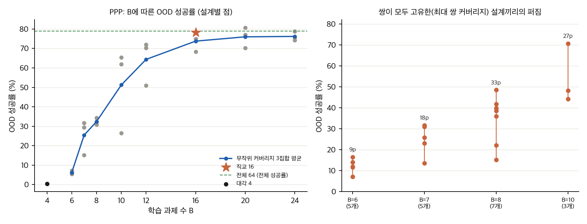
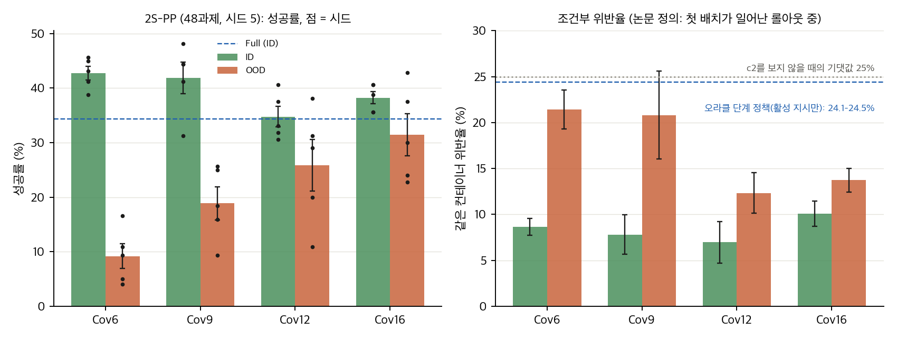
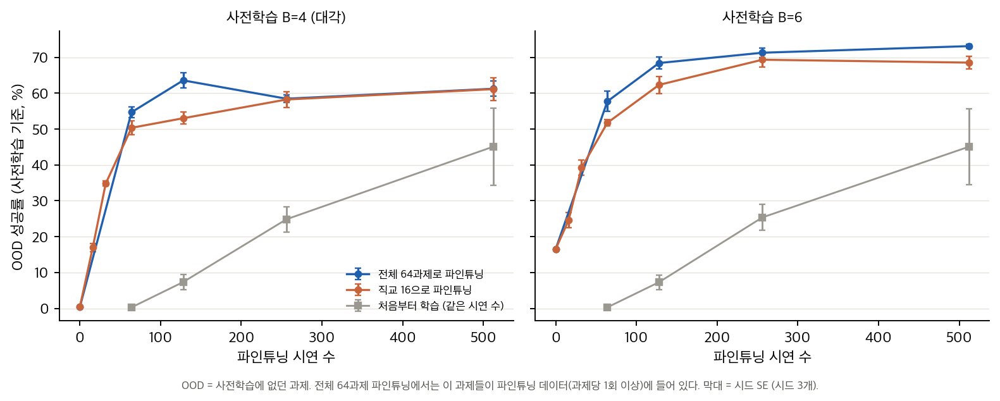
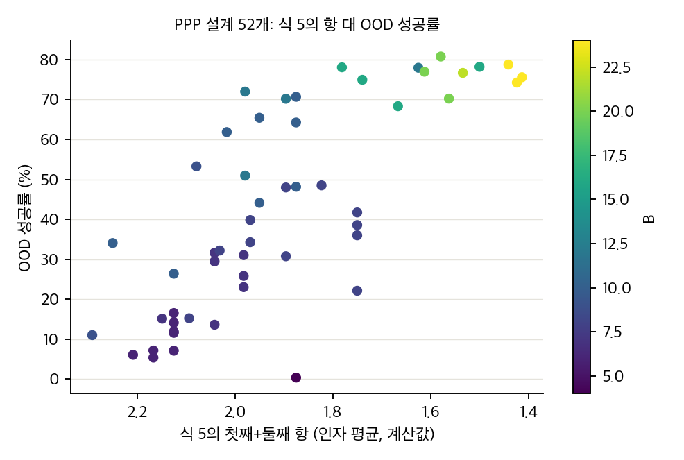

> **논문:** Yixiao Wang, Cheng-En Wu, Lingfeng Sun, Pengcheng Wang, Xiang Ji, Boyuan Liang, Guojian Zhan, Masayoshi Tomizuka. *Diagnosing Compositional Generalization in Sequential Robot Tasks.* CoRL 2026 스포트라이트, arXiv:2607.29687 (v2, 2026-10-15). 이 글의 그림은 모두 직접 그린 그래프입니다. 논문 그림은 arXiv 비독점 배포 라이선스라서 싣지 않았습니다. 수치는 저자의 프로젝트 페이지 저장소가 공개한 집계 파일과 논문 본문, 부록 표에서 가져와 다시 계산했습니다.

## 논문이 묻는 것

순차 조작 지시를 `(객체, 컨테이너, 버튼)`처럼 이산 인자의 순서쌍으로 주면 조합의 수는 인자 수에 대해 지수로 늘어납니다. 모든 조합의 시연을 모을 수 없다면 어느 조합을 모아야 처음 보는 조합에서도 성공할까요. 논문은 일반화 격차를 **주변 지시 이동, 지시 조합 이동, 맥락-행동 이동** 세 항의 상한으로 분해하고(정리 4.1), 시뮬레이션에서 작은 흐름 매칭 정책을 처음부터 학습해 세 질문을 실험합니다.

1. 전체 조합이 필요한가 (Pick-Place-Press, 64과제)
2. 희소하게 학습한 정책이 실패하는 이유는 기술 부족인가 조향 부족인가
3. 한 단계가 다른 단계를 제약하는 의존 지시에서는 어떤 조합을 덮어야 하는가

## 확인된 것

**1. 직교 16과제는 전체 학습과 구분되지 않습니다.** 객체, 컨테이너, 버튼의 모든 쌍 조합을 정확히 한 번씩 담은 16과제(전체의 1/4)로 학습하면 보류 48과제 성공률이 78.2%이고, 전체 64과제 학습은 78.6%입니다. 표시용 데이터의 롤아웃 수로 보면 직교 563/720, 전체 1,264/1,600(전체 79.0%)이고 차이의 Newcombe 95% 구간은 −4.5에서 +2.7포인트입니다. 이 16과제는 `버튼 = 객체 XOR 컨테이너`로 만든 라틴 방진이고, 보류 48과제는 모두 세 쌍을 본 과제입니다. 4수준 3인자에서 모든 쌍을 덮는 최소 크기가 4² = 16이므로 "1/4"은 쌍 커버리지의 최솟값입니다.

**2. 의존 지시에서 쌍 커버리지 효과는 분명합니다.** 두 번째 컨테이너 c2를 볼 수 있어야 첫 번째 컨테이너를 고를 수 있는 2단계 과제(48과제, 시드 5개)에서 (첫 객체, c2) 쌍 커버리지를 6, 9, 12, 16으로 늘리면 보류 과제 성공이 9.2%, 18.9%, 25.9%, 31.4%로 오릅니다. Cov6 대 Cov16은 Welch p = 0.002이고, 쌍 수에 대한 선형 기울기는 2.2포인트/쌍(p = 0.0002)입니다. 쌍이 적을수록 학습 과제 성공이 높아지는 현상(42.8% 대 38.3%, p = 0.029)도 논문의 "쌍당 감독이 촘촘하다"는 설명과 방향이 같습니다.

*그래프 (우리가 그림). 왼쪽: PPP 보류 과제 성공률 대 B(회색 점은 설계별, 파란 선은 무작위 3집합 평균, 별은 직교 16). 오른쪽: 세 종류의 쌍이 모두 B개씩 서로 다른 설계끼리의 성공률 범위. 출처: 프로젝트 페이지 집계 파일.*

**3. 단계별 모듈러 정책의 위반율은 우연 기댓값과 맞습니다.** 활성 지시만 보는 정책은 c2를 볼 수 없습니다. c1의 학습 분포가 c2에 대해 대칭이면 이 정책이 네 컨테이너에 균등하게 놓아 같은 컨테이너 위반이 25%가 됩니다. 관측된 위반율은 24.1%, 24.5%, 24.4%입니다. 전체 지시 정책은 Cov16 보류에서 13.7%입니다(5시드; 단계 정책은 시드 2–3개).

*그래프 (우리가 그림). 48과제 2S-PP(시드 5개)의 Cov6–Cov16 성공률(점은 시드)과 같은 컨테이너 위반율. 파란 점선은 활성 지시만 보는 정책의 위반율, 회색 점선은 c2를 보지 않을 때의 기댓값입니다. 출처: 프로젝트 페이지 집계 파일.*

## 읽을 때 조건이 붙는 것

**쌍 커버리지의 양은 설계의 성공률을 정하지 못합니다.** 같은 B에서 같은 쌍 커버리지(모든 쌍이 고유)인 설계끼리 비교하면 보류 과제 성공이 B = 8에서 15.2%에서 48.5%까지 퍼집니다(7개 설계). B = 10에서는 44.1%에서 70.7%(3개)입니다. 설계별 시드 SD는 1–10포인트입니다. 직교 배열의 부분집합 설계는 같은 B의 무작위 집합 평균과 같거나 낮았습니다(B = 8에서 22.1% 대 32.4%). 같은 B 안의 본 쌍 수와 성공의 순위상관은 B ≤ 12에서 0.3–0.6이지만 B ≥ 16에서는 0.0–0.2입니다. 쌍 커버리지가 필요한 요소 가운데 하나라는 해석과는 맞지만, 설계 규칙으로 "쌍을 모두 덮어라"만 쓰기에는 부족해 보입니다. 어떤 값 조합이 들어갔는지 같은 다른 구조가 영향을 주는지는 내보낸 자료만으로는 가를 수 없습니다.

**0.4% → 54.7%의 읽는 방법.** 대각 4과제로 사전학습한 정책은 사전학습에 없던 60과제에서 0.39%(7/1,800)이고, 64과제에 과제당 1시연(총 64개)으로 파인튜닝하면 54.67%(492/900, Wilson 51.4–57.9%)입니다. 수치는 논문과 같습니다. 다만 평가한 60과제가 이 64시연에 1회씩 들어 있고, 파인튜닝 평가의 롤아웃 수는 기준(1,800)의 절반(900)입니다. "기술은 이미 있고 조향이 없었다"는 해석을 새 과제 1회 시연의 효과와 가르려면 파인튜닝에 없는 과제만 평가한 값이 필요하고, 그런 평가는 16/32시연 실험에 있으며 그 값은 18.6–39.4%입니다. 직교 파인튜닝은 4개 조건 가운데 3개에서 무작위 5집합을 모두 앞서고 나머지 하나에서는 2위이지만, 6개 중 1위의 정확 p의 최솟값이 0.167이라 이 설계로는 0.05에 닿을 수 없습니다.

*그래프 (우리가 그림). 대각 4과제(왼쪽)와 6과제(오른쪽) 사전학습 뒤 파인튜닝. 전체 64과제 또는 직교 16과제로 파인튜닝한 값과 처음부터 학습한 값. 막대는 시드 SE(시드 3개). 사전학습 기준 OOD라서 전체 64과제 파인튜닝에서는 이 과제들이 파인튜닝 데이터에 들어 있습니다.*

**평가 시도 수의 서술과 내보낸 값이 다릅니다.** 논문은 "과제·시드당 30회"라고 쓰지만(v2 §5.1, 부록 B.3), 내보낸 파일에서는 다음처럼 읽힙니다.

- PP: 시드별 성공률 96개는 과제당 25회일 때만 모두 정수 성공 수로 가능합니다(10, 20, 30회로는 18개).
- PPP: 표시용 데이터의 과제별 시드별 성공률이 모두 10의 배수라서 과제·시드당 10회입니다. 3시드 합산이 과제당 30회입니다(v1은 "3시드 합산 과제당 30회"라고 적었습니다).
- PPP 직교 16: 20의 배수라서 과제·시드당 5회, 헤드라인 78.2%는 보류 48과제 × 15회 = 720롤아웃입니다.
- 36과제 2S-PP: 그림 14의 시작 수 360, 720, 1,080은 과제당 30회(3시드 × 10회)입니다.

평가 롤아웃 수에 따라 구간이 달라지므로 저자 확인이 필요합니다. 부록 표 1(평가 시도 수 민감도)의 8칸도 48과제에서 평가 시드 4개를 합산할 때만 정수 성공 수로 나오고, 본문은 이 집합에 시드 5개를 적습니다. 사람 시연 실험의 ID 11.67%는 3시드 × 9과제 × 30회(810롤아웃)에서는 정수 성공 수로 나오지 않습니다(94개면 11.60%, 95개면 11.73%).

**식 5의 둘째 항은 설계를 구분하지 않습니다.** 정리 4.1의 증명은 문제없고(이산 분포 200개에서 분해식과 부등식을 확인), 상한은 분포 이동의 크기를 말합니다. 균형 잡힌 16과제 설계에서는 인자 값 하나당 4과제이므로 둘째 항이 `2(1 − 4/16) = 1.5`로 설계와 무관합니다. 직교 설계와 무작위 설계를 가르는 것은 첫째 항(주변 불균형)이고, "쌍 커버리지가 조합 이동 항을 줄인다"는 §5.2의 서술은 식 5의 계산이 아니라 해석으로 읽는 것이 정확합니다. 52개 설계 전체에서 첫째+둘째 항과 성공률의 순위상관은 −0.79이고, B 단독은 +0.91입니다.

*그래프 (우리가 그림). 설계 52개에서 식 5의 첫째+둘째 항(인자 평균, q는 64과제 균등, p는 학습 과제 균등으로 계산)과 보류 과제 성공률. 색은 B. x축은 값이 작을수록 오른쪽입니다.*

## 공식 코드와 논문의 차이

공식 저장소(RoboPolicy 라이브러리와 `cg` 응용)는 흐름 매칭, 선형 경로, 10 Euler 스텝, 두 카메라와 동결 DINOv2-small, 교차 주의 융합, 트랜스포머 행동 디코더, 배치 64로 논문의 구조와 맞습니다. 단계 지시자의 규칙(연속 2관측 디바운스, 슬립 시 복귀)도 부록 E와 같습니다. 차이는 설정과 범위에 있습니다.

- 릴리스 기준선 4개는 시드 11 하나, 평가 25회입니다. 학습 스텝은 PPP 50k(논문 100k), 2S-PP 100k(논문 150k)입니다.
- 같은 컨테이너 위반율은 전체 롤아웃으로 나눕니다. 논문 v2는 첫 배치를 마친 롤아웃 중입니다. 저장소 문서가 둘이 직접 비교되지 않는다고 적습니다.
- 지시는 슬롯별 범주형 ID 임베딩이고 논문 그림 10은 텍스트 지시 토큰으로 그렸습니다.
- 36과제 평가 집합, 사전학습 기준 OOD 분할, 사람 시연 환경, 오라클 단계 정책의 일반 흐름 매칭 설정은 저장소에 없다고 저장소 감사 문서가 적습니다.
- 라이선스 파일이 없고 사전학습 가중치는 "아직 없음"입니다. 데이터는 Hugging Face에 3개(PP 4.7, PPP 20.7, 2S-PP 17.2 GB, 합계 약 42.6 GB)가 있고 이 글에서는 받지 않았습니다.

## 구현 가능성 (Apple M4 Pro, CUDA 없음)

- **논문 전체 재현: 불가.** 데이터 약 42.6 GB, 참조 환경이 CUDA GPU 두 장과 Linux, 가중치 없음.
- **집계 파일 기반 재계산과 정적 대조: 가능, 완료.** 이 글이 그 결과입니다.
- **공식 파이프라인 스모크 테스트: 조건부.** 새 설치, 4.7 GB 다운로드, 공식 코드 실행 승인이 필요하고 이 맥의 렌더링은 미확인입니다.
- **구조 토이(범주 지시 → 행동): 가능.** 새 설치 없이 1–3일 정도(추정)입니다. 이 글에서는 만들지 않았습니다.

이 글은 학습 재현을 하지 않았습니다. 재계산한 수치는 저자가 공개한 집계 파일에 기대고 있고, 위의 분모 관련 항목은 저자 확인이 필요합니다.

## 자료

- [통합 리포트 PDF](report/report_public.pdf)
- [01. 논문 분석: Diagnosing Compositional Generalization in Sequential Robot Tasks (arXiv:2607.29687)](analysis/01_paper_analysis.md)
- [02. 선행연구와 관련 저장소](analysis/02_prior_work.md)
- [03. 수치 재계산, 일관성 검사, 설계 검사](analysis/03_analysis.md)
- [04. 공식 코드 대조와 구현 가능성](analysis/04_code_verification.md)
