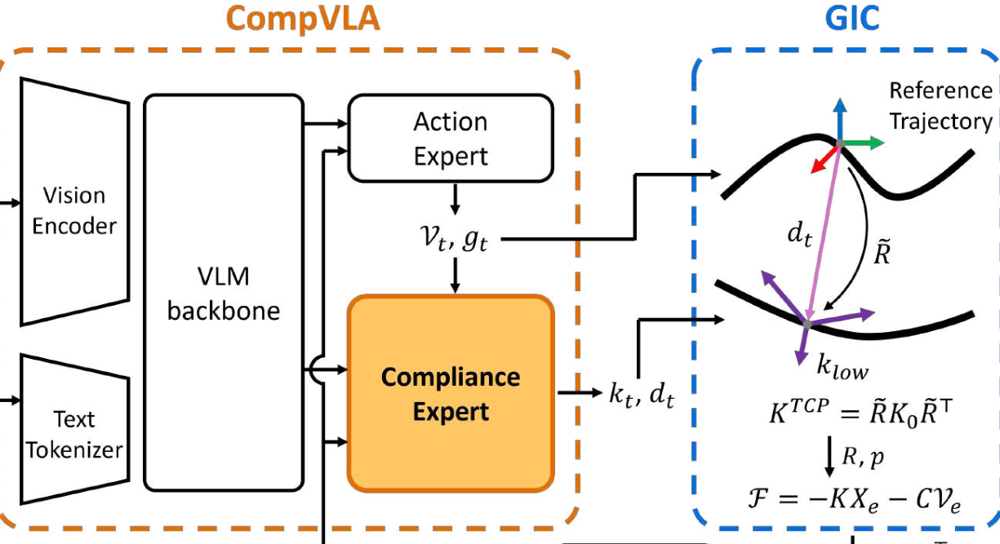
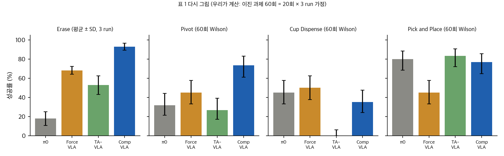
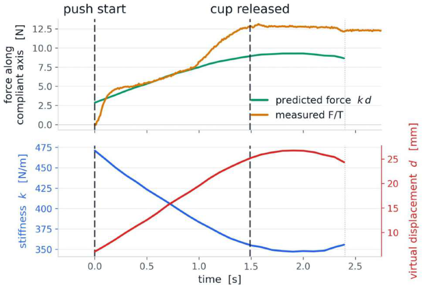
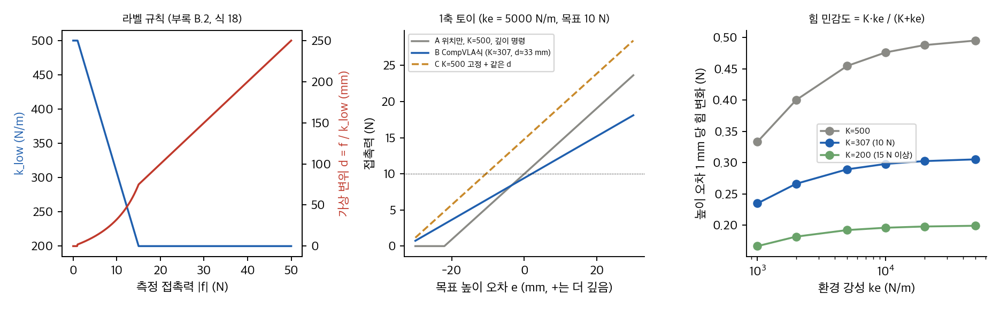

> **논문:** Jongmin Kim, Junsu Ha, Che-Sang Park, Minchang Song, Hyeokju Jeong, Himchan Hwang, Jianlong Fu, Frank C. Park. *CompVLA: A Variable Compliance Vision-Language-Action Model for Contact-rich Manipulation.* CoRL 2026, arXiv:2609.23614 (v2, 2026-11-06).
> 공식 코드는 GitHub compvla/CompVLA(Apache-2.0)에 있습니다. 이 글의 그림은 논문 그림 두 장(출처 표기)과 우리가 그린 그래프 두 장입니다.

## 논문이 묻는 것

VLA는 대개 목표 자세나 속도만 내고, 그 자세를 얼마나 단단하게 추종할지(강성)는 제어기에 맡깁니다. 닦기, 피벗, 버튼 누르기처럼 접촉이 많은 과제에서는 목표가 표면보다 조금만 위나 아래에 있어도 접촉을 잃거나 너무 세게 누릅니다. CompVLA는 π0에 **compliance expert**를 하나 더 달아, action expert가 낸 기준 궤적을 조건으로 시변 대각 강성 k와 가상 변위 d를 함께 예측합니다. 강성이 접촉 방향으로 낮아지는 정도(방향 컴플라이언스)와, 가상 변위가 목표를 표면 속으로 밀어 만드는 누르는 힘(힘 조절)이 이 두 출력에서 나옵니다. 실행은 기하 임피던스 제어(GIC)의 단순화 변형이 맡습니다.

*그림 1 (논문 원문, 로봇 사진 부분을 잘라 낸 도식). © 저자, CC BY 4.0, 출처 arXiv:2609.23614.*

라벨은 손목 힘/토크 센서에서 만듭니다. 힘 크기로 접촉 축 강성 k_low를 500에서 200 N/m까지 줄이고(1 N에서 15 N 구간), 가상 변위는 d = 힘 / k_low로 둡니다. 그래서 k_low · d가 시연의 접촉력과 같아집니다. 센서는 라벨 생성에만 쓰이고 추론에는 쓰이지 않습니다.

## 이 글에서 확인한 것

**1. 평균 우위는 방향이 분명하고, run 3개 검정으로는 확실하지 않습니다.** 접촉 과제 세 개의 평균이 67.1%로 가장 강한 기준선 ForceVLA(54.4%)보다 12.7 %p 높습니다(표 1, 평균 열은 세 과제 평균과 일치합니다). run 3개의 평균±SD로 Welch 검정을 하면 p = 0.072이고, 과제별로는 Erase와 Pivot에서 뚜렷합니다. 이진 과제를 20회 × 3 run = 60회로 보고 합치면(시행 수 60 가정) Pivot은 ForceVLA 대비 p = 0.0028입니다. Cup Dispense에서는 CompVLA(35.0%)가 ForceVLA(50.0%), π0(45.0%)보다 낮은 방향이고 구분되지는 않습니다(p = 0.14, 0.35).

*우리가 그린 그래프. 표 1을 다시 그렸습니다. 이진 과제의 시행 수 60은 "run당 20회, 3 run" 가정이며 구간은 Wilson 95%입니다.*

**2. 표 1의 이진 칸은 run별 성공 횟수로 되돌릴 수 있습니다.** 보고된 SD를 표본 표준편차(n − 1)로 읽으면 12개 칸 모두에서 run별 성공 횟수(예: CompVLA Pivot 13, 14, 17회)가 거의 유일하게 정해집니다(시행 수 20 가정). v1의 π0 Cup Dispense 칸 38.0±12.1은 60회 기준 정수 횟수로 되돌려지지 않고, v2에서 45.0±0.0(9/9/9회)으로 바뀌었습니다. 이 칸이 바뀐 이유는 본문에 서술이 없어 저자 확인이 필요합니다. 어느 쪽 값에서도 "가장 강한 기준선 대비 +12.7 %p"는 같습니다.

**3. 기준선은 모두 최대 강성에 고정된 같은 GIC입니다.** 논문은 일정하게 낮은 강성이 바람직하지 않고 가변 강성이 필요하다고 주장하지만(§1), 낮은 고정 강성이나 강성만 가변인 기준선은 표에 없습니다. 그래서 이득이 가변 강성, 가상 변위, 또는 컴플라이언스 제어기 자체 중 어디서 오는지 이 표만으로는 나눌 수 없습니다.

**4. 절제는 두 과제에서 각각 10 에피소드입니다.** Erase에서 가상 변위나 compliance expert를 빼면 96.0%가 7.0%, 15.3%로 떨어집니다(글자 단위 지우기 비율). 큰 차이이고 방향은 분명합니다. Pivot의 고정 강성 절제는 7/10 대 4/10이고 Fisher p = 0.37입니다(10회가 이진이라는 가정, 70% 대 40%를 80% 검정력으로 구분하려면 팔당 약 42 에피소드가 필요합니다). Cup Dispense에는 절제가 없습니다.

**5. 고정 강성 절제는 강성과 힘 수준이 함께 바뀝니다.** 예측된 d는 k_low에 맞춰 정해진 값이라, 같은 d를 두고 K를 500으로 올리면 K · d가 커집니다. 아래 1축 toy에서는 목표 10 N에 대해 정상 힘이 14.8 N이 되었습니다(이상화 가정). 따라서 40%와 70%의 차이는 강성 변화와 힘 수준 변화가 겹친 것으로 읽는 것이 안전합니다.

**6. Cup Dispense의 병목은 도달이고, 밀기는 개선됩니다.** 단계별 평가(2 run × 20 시행)에서 밀기는 CompVLA 37/40 대 π0 27/40으로 p = 0.010, 도달은 18/40 대 21/40으로 p = 0.66입니다.

**7. 힘 조절의 직접 증거는 에피소드 하나입니다.** 그림 6(b)는 Cup Dispense 한 에피소드에서 예측 힘 k · d가 측정 힘을 따라가는지 보입니다. 그림에서 읽은 값으로는 컵이 풀리는 약 1.5 s에 k ≈ 355 N/m, d ≈ 25.5 mm이고 k · d ≈ 9 N입니다. 같은 시각 측정 힘은 약 12.5–13 N으로 예측보다 3.5–4 N 높습니다(그림 판독 값). 한 에피소드이므로 일반적인 추종 정확도로 읽기는 어렵습니다.

*그림 6(b) (논문 원문, (a)의 화면 캡처는 제외). © 저자, CC BY 4.0, 출처 arXiv:2609.23614.*

## 공식 코드와 논문의 차이

공식 저장소(커밋 8393e22, 2026-11-05)에는 모델, 학습, 원자료 변환 코드가 있고 **임피던스 제어기, 로봇 인터페이스, 기준선, 체크포인트는 없습니다.** 정적으로 읽어 대조한 결과의 요점입니다.

- **일치:** 100,000 스텝, 배치 32, bf16, 학습률 2.5e-5와 웜업 1,000 스텝, 청크 25, denoising 10 스텝, 라벨 상수(500/200 N/m, 1/15 N; 30/10 Nm/rad, 0.1/2.5 Nm), 10 Hz 동기화, 13차원 궤적 조건입니다.
- **궤적 조건의 기본값:** 식 (8)은 물리 단위의 상대 자세로 읽히는데, 코드의 기본값(`traj_condition_space = "normalized"`)은 정규화된 속도를 그대로 적분합니다. `physical` 옵션은 정답 자세와 같은 조건을 만듭니다. 논문 결과가 어느 모드인지는 서술이 없습니다.
- **손실 결합:** 코드는 두 expert의 요소별 오차를 이어 붙여 한 번에 평균하므로 유효 비율이 L_a : L_c = 14 : 19입니다. 식 (12)는 L_a + L_c입니다.
- **논문에 없는 라벨 설정:** 힘/토크 필터(3차, 0.8 Hz, 영위상), 클리핑(50 N, 10 Nm), f < f_min에서 가상 변위를 0으로 두는 규칙입니다. 클리핑과 k_min을 합치면 가상 변위의 상한은 병진 250 mm, 회전 1 rad입니다.
- **시간 샘플링:** 식 (9)–(11)은 τ ~ U(0, 1)이고 코드는 Beta(1.5, 1) 기반(OpenPI 방식)이며 두 expert가 같은 τ를 공유합니다.

## 토이로 본 것

논문 4.1절의 "목표 자세가 접촉 자세와 같으면 강성만으로는 누르는 힘이 안 나오고 가상 변위가 필요하다"를 1축 직렬 스프링 모델로 확인했습니다. 환경 강성 5000 N/m, 목표 10 N에서 다음과 같습니다(준정적 이상화, 논문 실험의 재현이 아닙니다).

*우리가 그린 그래프. 가운데 그림의 A는 위치만 쓰는 기준선(K = 500), B는 CompVLA 규칙(K ≈ 307 N/m, d ≈ 33 mm), C는 K = 500에 B의 d를 쓴 구성입니다.*

- 라벨 규칙은 1–50 N 구간에서 K · d = f를 오차 없이 재현합니다.
- 높이 오차 1 mm당 힘 변화는 A 0.455 N, B 0.289 N입니다. k_min이 k_max의 0.4배이므로 오차에 대한 이득은 최대 약 2.4배입니다.
- C는 정상 힘이 14.8 N으로 올라갑니다(위 5번).
- 식 (5)는 임의의 SPD 행렬에서 식 (3), (4)와 3e-14 잔차로 일치했습니다. 부록 A.2의 분리 오차와 식 (2)의 SE(3) 로그 오차는 회전 오차 0.1 rad에서 병진 성분이 약 4%, 0.3 rad에서 약 12%, 1 rad에서 약 40% 다릅니다(병진 오차 2 cm 기준 상대 차이).
- 단위 유효 관성을 가정한 감쇠 c = 2√k는 유효 병진 관성이 5 kg이면 감쇠비 약 0.45입니다(가정).

## 구현 가능성 (Apple M4 Pro, CUDA 없음)

**논문 결과는 이 맥에서 재현할 수 없습니다. 라벨 규칙, 제어 법칙, 접촉 toy는 구현할 수 있고 일부를 끝냈습니다.** 실로봇 평가는 Franka FR3 두 대와 F/T 센서가 필요하고, 전체 미세조정(4.08B 파라미터)은 README 기준 RTX 5090 32 GB에서 배치 2도 메모리가 부족합니다. 원자료는 5.8 GB(과제당 zip, CC BY 4.0)이며 이 분석에서는 받지 않았습니다. 제어기가 공개되지 않아 이를 식 13–17에서 새로 구현해야 합니다.

## 한계

- 표 1의 시행 수(run당 20회, 3 run)와 이진 성공 정의는 논문 캡션에서 가져온 가정이고, 원자료는 공개되지 않았습니다.
- 세 번의 평가는 같은 학습 모델이라 SD에 학습 시드 변동이 들어 있지 않습니다.
- toy는 1축 준정적 이상화이며 충격, 감쇠, 마찰, 회전을 다루지 않습니다.
- 그림에서 읽은 값은 눈금 판독이라 몇 % 오차가 있습니다.
- 공식 코드는 실행하지 않았고 정적으로만 읽었습니다.

## 출처와 라이선스

- 논문은 arXiv에 CC BY 4.0으로 공개되어 있습니다(abs 페이지의 라이선스 링크 확인, 원문 PDF에 저작권 표기 없음). 논문 그림은 도식과 측정 그래프 두 장만 실었고, 출처와 라이선스를 적었습니다. 로봇 사진과 화면 캡처는 넣지 않았습니다.
- 공식 코드는 Apache-2.0, 원자료는 CC BY 4.0(저장소 README 기준)입니다. 이 글의 분석, 그래프, toy는 작성자가 만들었습니다.

## 자료

- [통합 리포트 PDF](report/report_public.pdf)
- [01. 논문 분석: CompVLA (arXiv:2609.23614)](analysis/01_paper_analysis.md)
- [02. 선행연구와 관련 저장소](analysis/02_prior_work.md)
- [03. 수치 재계산, 일관성 검사, 토이](analysis/03_analysis.md)
- [04. 공식 코드 대조와 구현 가능성](analysis/04_code_verification.md)
