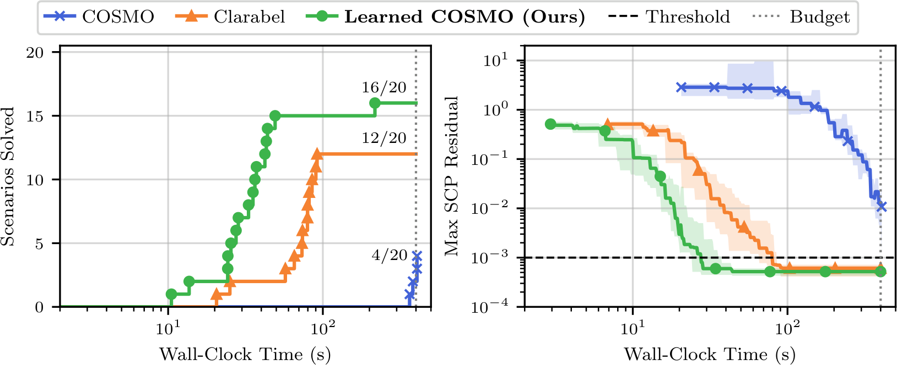
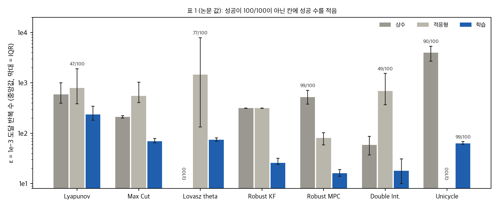
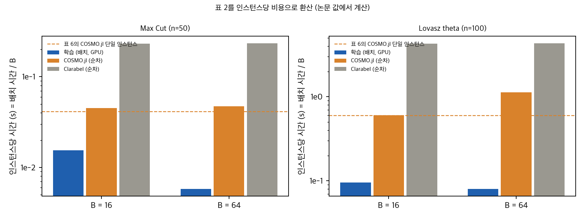
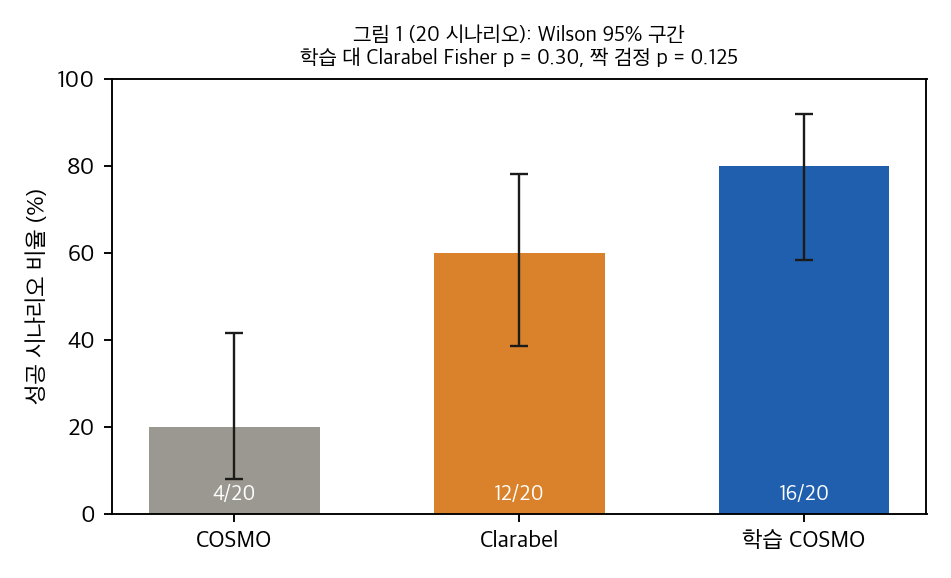
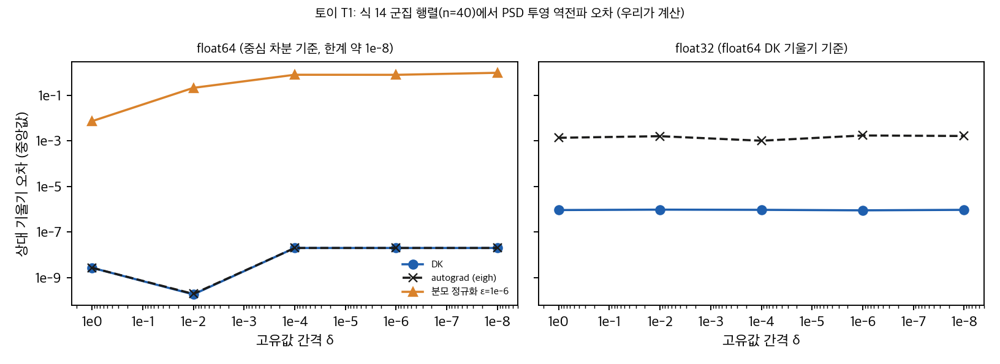
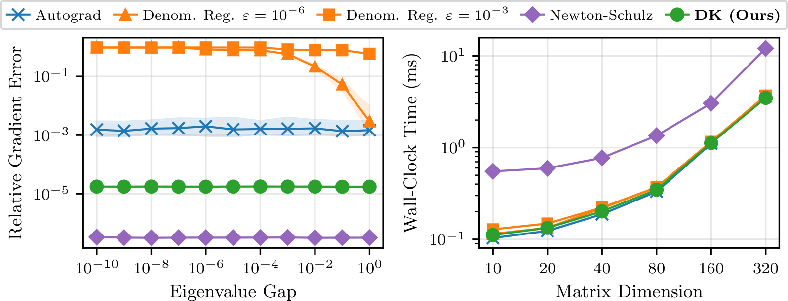
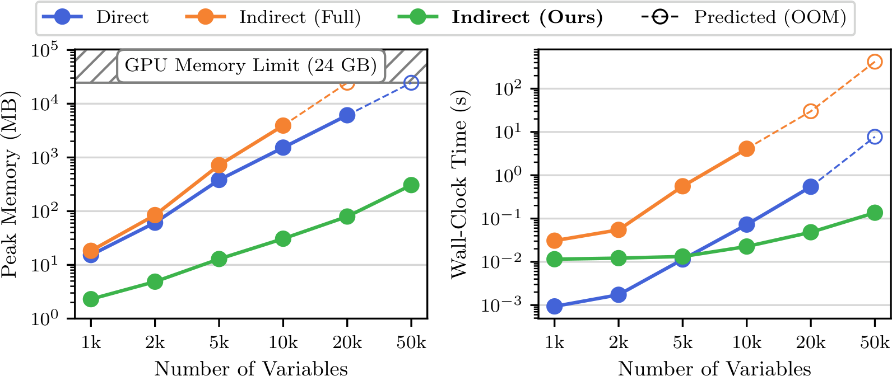
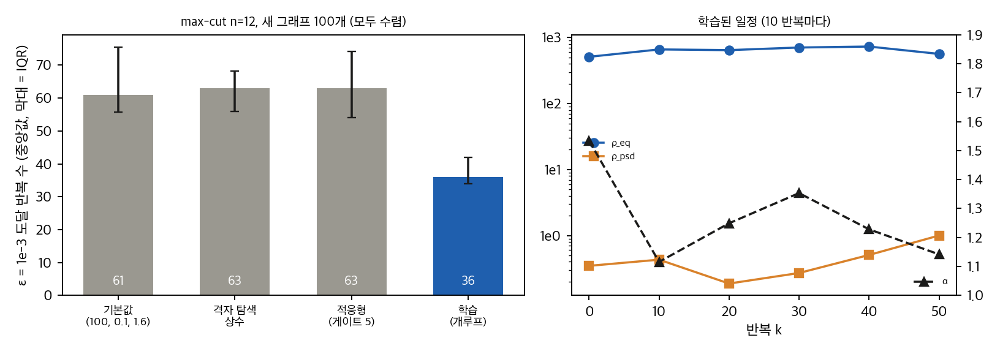

> **논문:** Alex Oshin, Rahul Vodeb Ghosh, Evangelos A. Theodorou. *Scalable Deep Unfolding of Conic Optimizers.* CoRL 2026 스포트라이트, arXiv:2606.13825 (v3, 2026-11-21).
> 공식 코드는 GitHub alexoshin/deep-conic-optimization에 있습니다(Apache-2.0). 이 글의 그림은 논문 그림 세 장(출처 표기)과 우리가 그린 그래프입니다.

## 논문이 묻는 것

ADMM으로 푸는 원뿔 최적화(SDP 포함)는 반복마다 벌점 ρ와 이완 α를 어떻게 잡느냐에 따라 수렴 속도가 크게 달라집니다. 로봇 제어에서 같은 구조의 문제를 계속 풀어야 한다면 이 값들을 데이터로 배우는 것이 자연스럽습니다. 이것이 deep unfolding(DU)입니다. solver를 K번 펼친 뒤 잔차를 줄이도록 ρ와 α(와 시작점)를 역전파로 학습합니다.

큰 SDP로 가면 두 곳에서 막힙니다. 하나는 매 반복의 선형계 풀이를 미분할 때 조밀한 AᵀA가 생겨 메모리가 n²로 자라는 것이고, 다른 하나는 PSD 투영의 고유분해 역전파가 고유값이 겹치면 정의되지 않는 것입니다. 논문은 각각 행렬곱만 쓰는 수반 규칙(∇ρL = (Aλ̃) ⊙ (Ax̃))과 Daleckii–Krein(DK) 규칙으로 해결합니다.

*그림 1 (논문 원문). © 저자, CC BY 4.0, 출처 arXiv:2606.13825.*

## 이 글에서 확인한 것

**1. 반복 수 감소는 크고, 비교 기준은 읽는 방식에 달려 있습니다.** 표 1(100개 시험 인스턴스, 절대 허용오차 1e-3)에서 학습 COSMO는 더 나은 기준선보다 2.5배(Lyapunov)에서 62.8배(Unicycle) 적은 반복으로 수렴합니다. 초록의 "최대 60×"는 Unicycle의 상수 기준선(3954/63)이고 같은 칸의 시간비는 34.5배입니다. 적응형 기준선에 대한 최대는 이중 적분기 38배입니다. 학습 열의 IQR는 더 나은 기준선의 IQR와 일곱 클래스 모두 겹치지 않습니다.

*그래프 (우리가 그림). 표 1을 다시 그렸습니다. 로그 축이고 막대의 선은 IQR입니다.*

**2. 상수 기준선의 튜닝 절차가 문서에 없습니다.** 표 1은 상수를 "best-tuned"라고 부르지만 격자와 목적이 적혀 있지 않고, 공식 설정 파일은 모든 클래스에서 같은 기본값(ρ_eq 100, 나머지 0.1, α 1.6)을 담습니다. Robust KF에서 상수와 적응형의 값이 같다는 점(314 [312, 317])은 이 열이 기본값 설정일 가능성과 맞습니다(가능성이며 저자 확인이 필요합니다).

**3. 성공이 절반 이하인 두 칸의 중앙값은 성공한 인스턴스만의 값으로 읽힙니다.** 적응형 Lyapunov는 47/100, 이중 적분기는 49/100 성공에 중앙값이 788과 684입니다. 실패를 반복 상한 10000으로 세면 두 칸의 중앙값은 10000이어야 합니다. 이 계산 방식은 표 1 캡션에 없고, 공식 벤치마크 도구는 실패를 상한으로 셉니다. 학습 COSMO는 100/100 성공이라 결론의 방향은 바뀌지 않습니다.

**4. 배치 속도비 14배의 기준 시간이 같은 논문의 다른 표와 맞지 않는 칸이 하나 있습니다.** 표 2의 B = 64 Lovász ϑ COSMO.jl은 72.3 s로, 표 6의 단일 인스턴스 중앙값 0.599 s × 64 = 38.3 s의 1.89배입니다. 같은 solver의 B = 16 칸은 표 6과 1.00배로 맞고, Clarabel은 B = 16과 64 모두 1.01배로 맞습니다. 표 6 환산으로 계산하면 B = 64에서 약 7.5배입니다(표 환산이며 원인은 표만으로 알 수 없어 저자 확인이 필요합니다). 학습 solver가 순차 solver보다 크게 빠르다는 방향은 바뀌지 않습니다.

*그래프 (우리가 그림). 표 2를 B로 나누어 환산하고 표 6의 COSMO.jl 단일 인스턴스 값(점선)과 비교했습니다.*

**5. SCP 성공률 16/20 대 12/20은 20개 시나리오로는 구분되지 않지만 풀이 시간 우위는 분명합니다.** 학습 대 Clarabel의 Fisher 검정은 p = 0.30입니다. 부록 H에 따르면 Clarabel은 학습 COSMO가 실패한 4개 시나리오에서도 모두 실패했으므로 짝 검정(정확 McNemar)은 4 대 0에서 p = 0.125입니다. 둘 다 푼 12개 시나리오에서 학습 COSMO는 12개 모두 더 빨랐고(부호 검정 p = 0.0005) 중앙값은 27.9 s 대 76.7 s입니다.

*그래프 (우리가 그림). 그림 1의 성공 수 16, 12, 4를 20개 시나리오 기준 Wilson 구간으로 다시 그렸습니다.*

**6. 시간으로 보면 이득이 있는 문제군이 정해져 있습니다.** 표 6에서 학습 solver(GPU)가 CPU의 COSMO.jl과 Clarabel보다 빠른 것은 Lovász ϑ와 두 공분산 조종 문제입니다. 작은 SOCP(Robust KF, MPC)에서는 Clarabel이 112–425배 빠릅니다. 부록 G가 직접 적은 내용과 같습니다.

## 두 역전파 규칙을 작은 크기로 확인

논문 식만 보고 새로 짠 코드(torch, CPU)로 두 규칙을 확인했습니다.

- **식 5–6.** n = 300, m = 150, A 밀도 5%에서 행렬 없는 규칙의 기울기는 조밀 autograd와 상대 오차 2e-7(논문 훈련 설정의 CG 허용오차), 8.7e-11(허용오차 1e-10)로 맞았습니다. "정확한 기울기"는 CG 허용오차까지 정확하다는 뜻입니다.
- **식 9–10.** 모든 고유값이 같은 입력에서 eigh를 통한 autograd는 NaN을, DK는 유한한 값(대칭화한 입력 기울기와 2e-15)을 냈습니다. 근접한 군집 고유값(n = 40, 논문 그림 4 설정)에서는 float64에서 DK와 autograd가 같은 오차(차분 한계 2e-8)였습니다. float32에서는 autograd 1.4e-3, DK 9e-7이었고, 논문 그림 4의 자릿수(그림 판독 값 autograd 약 1e-3, DK 약 2e-5)와 같습니다. 그림 4의 정밀도는 논문에 적혀 있지 않습니다.

*그래프 (우리가 그림). 간격 δ를 줄이며 식 14의 군집 행렬(n = 40)에서 기울기 오차를 비교했습니다.*

*그림 4 (논문 원문). © 저자, CC BY 4.0, 출처 arXiv:2606.13825.*

## 메모리 그림 읽기

그림 2는 n = 1k–50k 변수(m = n/2, A의 1% 비영, float64)에서 역전파 피크 메모리를 보입니다. 조밀 방식은 n ≈ 20–50k에서 24 GB를 넘고 제안 방식은 50k에서 300 MB 미만입니다. 이 인스턴스군에서 nnz(A) = 0.005n²이므로 O(n + nnz(A))는 n²로 자랍니다. 그림에서 읽은 값(그림 판독 값)의 로그-로그 기울기는 1.26(전체)과 1.43(마지막 세 점)이고, 캡션의 "n에 선형"과는 다르고 O(n + nnz(A))와는 맞습니다. 조밀 행렬 대비 약 100배의 메모리 절감 자체는 그림에서 분명합니다.

*그림 2 (논문 원문). © 저자, CC BY 4.0, 출처 arXiv:2606.13825.*

## 토이: 개루프 ρ·α 일정 학습

논문 식 (3), (13)의 가장 작은 판입니다. 12 노드 max-cut SDP(변수 78개), 정책은 반복마다 로짓 3개를 두는 개루프 일정(논문은 잔차를 보는 MLP), K = 60 펼침, 훈련 100개, Adam 800회, 시드 하나입니다. 새 그래프 100개에서 절대 허용오차 1e-3에 닿는 반복 수의 중앙값은 기본값 61, 36개 격자로 고른 상수 63, 적응형(게이트 5) 63, 학습 일정 36이고 모두 100/100 수렴했습니다. 논문 Max Cut(n = 50)의 상수 212 대 학습 69와 방향이 같고 크기는 작습니다. 이 크기에서는 autograd와 DK의 손실 기울기가 같았습니다(정확히 같은 고유값이 훈련 궤적에 나타나지 않아서입니다).

*그래프 (우리가 그림). 막대는 IQR이고 오른쪽은 학습된 ρ_eq, ρ_psd, α의 10 반복마다의 값입니다.*

## 공식 코드와 논문의 차이

공식 저장소는 논문의 ADMM 갱신식, 두 역전파 규칙(식 5–6, 9–10), 정책과 웜스타트 구조, 표 4·5의 학습 설정, 문제 생성기를 그대로 담고 있습니다. 다음은 서술과 다르거나 저장소에 없는 부분입니다.

- 표 1의 "학습" 팔은 정책과 웜스타트를 함께 학습한 것입니다(설정 파일). 표 1 캡션은 "MLP 정책"이라고 씁니다.
- 이중 적분기 시험 설정은 σ₀를 0.01로 고정하고, 부록 F.1은 시험 σ₀를 U(0.005, 0.02)에서 뽑는다고 씁니다.
- Lyapunov 데이터만 Ruiz 평형화(10회)가 켜져 있고 논문 부록 F.2에는 언급이 없습니다. 같은 절대 허용오차 1e-3이 클래스에 따라 다른 상대 정확도를 뜻할 수 있습니다.
- 그림 1–6과 표 2, 3, 6을 만드는 스크립트, 사전 학습 가중치, 데이터는 저장소에 없습니다. SCP 안에서 학습 solver를 돌리는 코드도 없습니다.
- 코드는 Python ≥ 3.14와 CUDA를 요구하고 모든 설정이 `device: cuda`, float64입니다.

재현하려면 벤치마크에 `--time-limit 60 --cg-eps-abs 1e-4 --cg-eps-rel 0`을 명시해야 논문 프로토콜(§3.2, 부록 D)과 같아집니다.

## 한계와 다음 확인

- 원자료(인스턴스별 반복 수와 시간)가 없어 표 1 칸은 중앙값, IQR, 성공 수로 가능한 검사만 했습니다. 시행 수는 성공 수의 분모 100(표 1), 20(그림 1)이고 표 2는 크기당 10개 배치입니다.
- 그림 5·6(절제와 학습된 ρ), 부록 H의 닫힌 루프 시험은 수치 표가 없거나 코드가 없어 다시 계산하지 못했습니다.
- 표 5의 Lovász ϑ 제약 수 범위(7444–7567)는 간선 수가 Bin(4950, 0.5)일 때 100개 인스턴스의 범위로는 폭이 좁고, 20개 정도 인스턴스의 범위와 맞습니다. 어떤 집합의 범위인지 표에 적혀 있지 않습니다.
- 토이는 12 노드, 개루프 정책, 시드 하나이므로 논문의 효과를 대신 보여 주지 않습니다.

## 자료

- [통합 리포트 PDF](report/report_public.pdf)
- [01. 논문 분석: Scalable Deep Unfolding of Conic Optimizers (arXiv:2606.13825)](analysis/01_paper_analysis.md)
- [02. 선행연구와 관련 저장소](analysis/02_prior_work.md)
- [03. 수치 재계산, 일관성 검사, 토이 실험](analysis/03_analysis.md)
- [04. 공식 코드 대조와 구현 가능성](analysis/04_code_verification.md)
