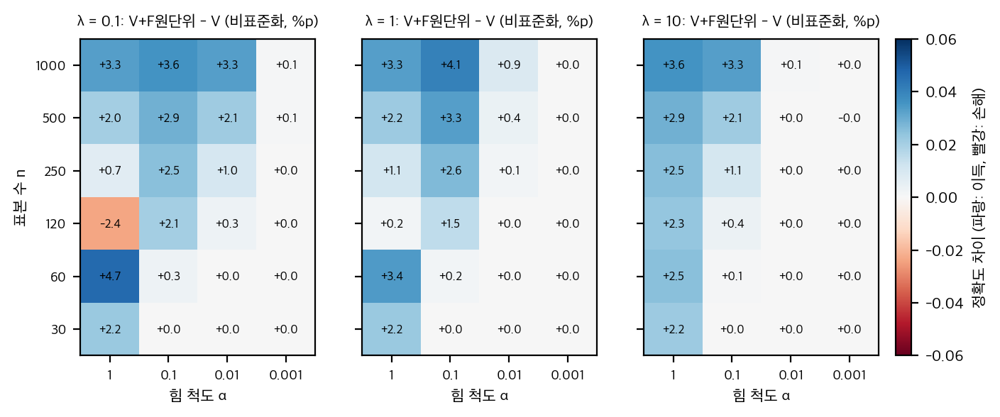
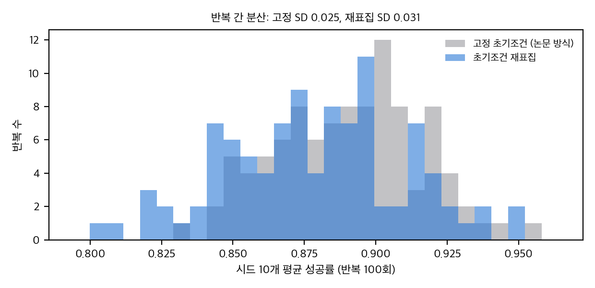

# 03. 재계산, 유의성, 유도, toy

재현 스크립트: `analysis/table_check.py` → `table_check_results.json` (1초 미만), `analysis/concat_toy.py` → `concat_toy_results.json` (약 17초), `analysis/lowdim_toy.py` → `lowdim_toy_results.json` (약 40초). 모두 numpy 1스레드.

## 1. 표 재계산 (T1)

- **평균 재계산:** 시뮬 V/TacRGB/TacFF = 60.54 / 61.18 / 65.0, 실물 = 52.0 / 37.0 / 68.0. Fig. 1 헤드라인(60.5, 61.2, 65.0, 52.0, 37.0, 68.0)과 모두 일치한다.
- **TacFF 최고 여부:** 10과제 모두 TacFF가 칸 최댓값이다. 시뮬 S5만 TacFF 61.9 > V 59.5 > TacRGB 57.8(순위는 `table_check_results.json` `T1_best_per_task`).
- **표본 크기 복원:** 시뮬 1500회에서 % 값 한 칸(0.1 pp)은 1.5회다. 가능한 정수 횟수는 두 개뿐이고(예: 81.7% → 1225 또는 1226), 검정 결과는 바뀌지 않는다.

## 2. 시뮬 유의성 (T3, T6)

### 2.1 논문 가정(1500 독립 rollouts)

| 대조 | 과제별 차이 (pp) | 과제별 p (Fisher-유사 z 검정) | CMH MH 오즈비, p |
|---|---|---|---|
| TacFF − V | S1 +4.8, S2 +7.4, S3 +3.5, S4 +4.2, S5 +2.4 | 0.0003, 4e-5, 0.057, 0.007, 0.18 | 1.24, **2.6e-9** |
| TacRGB − V | +2.7, +0.3, +1.4, +0.5, −1.7 | 0.05, 0.88, 0.44, 0.77, 0.35 | 1.03, 0.40 |
| TacFF − TacRGB | +2.1, +7.1, +2.1, +3.7, +4.1 | 0.10, 8e-5, 0.26, 0.015, 0.023 | 1.20, 2.8e-7 |

TacFF − V의 CMH는 Holm과 무관하게 유의하다. 과제별로는 S1, S2, S4가 Holm 보정 후에도 p < 0.05다(S3 p_Holm ≈ 0.12, S5 ≈ 0.18, `T3`의 `p_holm`에 과제별 값이 있다).

### 2.2 가정을 바꾸면 (n = 150 = 3 seed × 50 초기조건)

시험 초기조건 50개는 **모든 체크포인트·모든 시드·모든 모달리티에서 같다**(`04` D10: `test_start_seed = 100000` 고정). 체크포인트 10개는 같은 학습 실행의 연속 스냅샷이라 강하게 상관되어 있다. 따라서 1500은 독립 표본이 아니다. 최소한 시드 3 × 초기조건 50 = 150 수준으로 보아야 한다.

- **CMH(TacFF − V), n = 150:** MH OR 1.24, p = **0.062**(유의하지 않음). TacFF − TacRGB는 p = 0.13.
- 과제별 n = 150에서 모든 p가 0.19 이상이다(S2 p = 0.195).

### 2.3 seed 수준 상한(3 seed의 t검정)

3 seed로 두 집단을 비교할 때 p < 0.05가 되려면 seed 표준편차가 아래 값 이하여야 한다(독립 두 표본, t(4) = 2.78; 짝지은 표본, t(2) = 4.30). 논문은 seed 표준편차를 보고하지 않는다.

| 과제 | TacFF − V 차이 (pp) | 독립 기준 SD 상한 (pp) | 짝지은 기준 SD 상한 (pp) |
|---|---|---|---|
| S1 | 4.8 | 2.12 | 1.93 |
| S2 | 7.4 | **3.26** | **2.98** |
| S3 | 3.5 | 1.54 | 1.41 |
| S4 | 4.2 | 1.85 | 1.69 |
| S5 | 2.4 | 1.06 | 0.97 |

시뮬 학습에서 seed 표준편차가 1–3 pp 정도라면, S2를 빼고는 개별 과제 차이를 믿기 어렵다. 이 값은 추정이 아니라 **필요 조건**이다. 실제 SD는 논문에서 얻을 수 없다(`04` §3).

## 3. 실물 유의성 (T4)

실물은 과제당 20회다. 칸 값은 정확히 정수 횟수다(16, 11, 8, 14, 3 = V; 18, 6, 3, 1, 9 = TacRGB; 19, 14, 9, 15, 11 = TacFF).

| 대조 | 과제별 p (Holm 보정 후) | 100회 합산 | CMH(과제 층화) |
|---|---|---|---|
| TacFF − V | R1 1.0, R2 1.0, R3 1.0, R4 1.0, R5 **0.094** | 68/100 vs 52/100, 차이 +16 pp, Fisher **p = 0.030**, Newcombe [2.4, 28.8] | p = **0.013** |
| TacRGB − V | R1 0.66, R2 0.47, R3 0.47, R4 **0.0002**, R5 0.33 | 37 vs 52, 차이 −15 pp, p = 0.046 | p = 0.020 |
| TacFF − TacRGB | R1 1.0, R2 0.10, R3 0.25, R4 **0.0001**, R5 1.0 | 68 vs 37, +31 pp, p < 0.0001 | p < 0.0001 |

해석:
- **TacFF의 실물 우위는 합산하면 유의하다(p 0.03–0.01)**. 과제별로는 R5만 Holm 보정 전 p = 0.019였고 보정 후 0.094로 경계에 있다. 즉 "모든 과제에서 일관된 우위"라는 말은 과제별 증거가 아니다.
- **TacRGB는 R4에서 명백히 나쁘다**(1/20 대 14/20, p = 4e-5). 전체 평균을 떨어뜨린 것도 이 과제다. 이는 논문 본문보다 강한 결과다.
- R5에서 TacRGB 45%는 V 15%보다 높지만 Holm 후 0.33이다.

### 3.1 검정력

- 실물, 두 비율 52% 대 68%, 양측 α = 0.05, 검정력 0.8: **칸당 146회**가 필요하다. 과제당 15 pp 차이(55% 대 70%)는 163회다. 20회는 이 차이를 잡지 못한다.
- 시뮬 S2의 7.4 pp 차이는 naive 가정에서도 칸당 691회가 필요하다. 시드 기준으로는 더 많다(§2.3).

## 4. 조명 교란 (T5, Table IV)

R1 어두운 조명에서 하락폭(정상 대 어두움)은 V 55 pp, TacRGB 80 pp, TacFF 70 pp다(Newcombe 95% 구간 V [24, 73], TacRGB [52, 90], TacFF [41, 84]). 본문은 이를 "noticeable decrease"라고 했다(Sec. III-D.1). 실제로는 세 방법 모두 하락이 매우 크다.

R5 어두운 조명: V 15 → 0 pp(하락 15 pp, 구간 [−4, 36]), TacRGB 45 → 40(하락 5), TacFF 55 → 55(하락 0). **세 방법의 하락폭 차이는 유의하지 않다.** 저자가 "Vision Only가 sharply 떨어졌다"고 하는 것은 0/20 대 3/20 차이에 기댄다. 과제 하나, 조명 하나, 20회에서 나온 결론이다.

## 5. 결합 (T5, Table V)

- R3: TacRGB + TacFF 0/20 대 TacFF 9/20: Fisher p = **0.0012**(보정 전). 대 V 8/20: p = 0.0033. 대 TacRGB 3/20: p = 0.23.
- R5: 결합 4/20 대 TacFF 11/20: p = 0.048. 대 TacRGB 9/20: p = 0.18. 대 V 3/20: p = 1.0.

"결합이 둘 중 하나보다 나쁘다"는 R3에서만 강하다. R5에서는 TacRGB보다 낮지만 유의하지 않다. 결합 설정은 **시드 1회 분량(20회 시행)**이다. 시드 변동을 알 수 없다.

## 6. 파생 식과 유도

- **Wilson 구간:** p̂ ± z·√(p̂(1−p̂)/n + z²/4n²) / (1 + z²/n), 중심 보정 포함(구현은 `table_check.py`).
- **Newcombe(1998) 차이 구간:** 두 Wilson 구간의 끝점을 제곱합으로 합친다.
- **MH 오즈비와 CMH:** 층 k의 셀 (a, b, c, d), 층 크기 n_k에 대해 OR_MH = Σ(a_k d_k / n_k) / Σ(b_k c_k / n_k), χ² = (|Σa_k − ΣE_k| )² / ΣV_k (연속성 보정 없음).
- **seed 상한:** 독립 두 표본에서 Δ / (t_crit·√(2/3)) > s 가 기각 조건이다. 짝지은 표본에서는 Δ / (t_crit/√3)다. 3 seed에서 t_crit(df=4) = 2.776, t_crit(df=2) = 4.303.
- **반올림:** 1500회에서 % 값 p는 정수 횟수 k에 대해 |k/1500·100 − p| ≤ 0.05를 만족한다.

## 7. toy A: 중복 모달리티와 척도 불일치 (`concat_toy.py`)

설정(논문에 없는 가정, 설계자가 정함): 잠재 z ∈ R², 라벨 y = sign(z1 + 0.5 z2) 무잡음. 시각 V 64차원(잡음 σ = 2), 촉각 RGB T 512차원(신호 계수 0.1, 과제와 무관한 잠재 50개가 큰 분산으로 섞임), 힘장 F 20차원(잡음 σ = 0.2). 학습기 릿지 λ = 1, 40 seed, 평가 4000개.

| n | 오라클 z | V | V+T(표준화) | V+F(표준화) | V+T+F(표준화) | V+F(원단위 1e-3) |
|---|---|---|---|---|---|---|
| 30 | 0.938 | 0.763 | 0.639 | **0.802** | 0.712 | 0.763 |
| 120 | 0.971 | 0.768 | 0.659 | 0.770 | 0.677 | 0.763 |
| 500 | 0.985 | 0.872 | 0.835 | **0.898** | 0.848 | 0.872 |
| 1000 | 0.989 | 0.895 | 0.865 | **0.929** | 0.877 | 0.895 |

(SE 약 0.005. 시각 차이 대 촉각 차이는 n 전 구간에서 방향이 같다.)

관찰:
1. **V + 촉각 RGB는 모든 n에서 V보다 나쁘다.** 고차원 잡음 입력이 릿지 추정의 분산을 키운다. 논문의 "결합 희석"과 같은 방향이다. 다만 여기 토이의 차원 수와 신호 계수는 설계된 값이다.
2. **힘장(저차원, 표준화)은 n = 30에서도, n = 1000에서도 V를 이긴다.** 조건이 맞을 때 저차원 요약이 도움이 된다.
3. **척도 불일치 효과(E2):** n = 30에서 원단위 힘장(α = 1)은 V+F = 0.788로 이득이 있지만, α ≤ 0.01이면 0.765로 V와 같아진다. 표준화 버전은 α와 무관하게 0.804다. 즉 릿지 λ가 특징 분산에 상대적으로 작용하므로, 힘 단위가 작으면 모델이 그 특징을 무시한다.
4. **E2 주의:** n = 500에서는 원단위 α = 0.1이 0.909로 표준화 0.898보다 높다. 척도와 λ의 상호작용이 비단조적이다. "원단위는 항상 나쁘다"로 읽으면 안 된다. 정확한 결론은 "척도가 λ에 비해 작으면 무시된다"이다.

**시사점:** 논문의 TacFF가 TacRGB보다 나은 이유가 "정보 밀도"인지 "단위·정규화"인지는 이 실험으로 구분되지 않는다. 힘장 단위와 정규화가 정책 학습을 좌우할 수 있다(`04` D14).

## 8. toy B: 저차원 요약과 원시 영상 (`lowdim_toy.py`)

설정: 같은 잠재 z, 라벨 y = sign(z1 + 0.5 z2). 영상 I = tanh(Gz) + 픽셀 잡음 s, 32×32 = 1024픽셀, G 진폭 0.05. 비교: 오라클 z(2차원), 원시 영상 릿지(쌍대형), PCA-2 후 릿지(비지도). 30 seed, 시험 2000개.

| s | PCA 정렬 (n=2000) | 원시 영상 n=40 / 640 | PCA-2 n=40 / 640 | 오라클 n=40 |
|---|---|---|---|---|
| 0.5 | 0.98 | 0.760 / 0.719 | 0.747 / 0.896 | 0.947 |
| 1.0 | 0.89 | 0.604 / 0.650 | 0.530 / 0.768 | 0.947 |
| 2.0 | **0.18** | 0.531 / 0.564 | 0.505 / 0.515 | 0.947 |

관찰:
1. **낮은 차원 요약이 항상 표본 효율이 좋다**(오라클이 상한, PCA-2는 신호 부분공간을 찾을 때만 같이 간다).
2. **숨은 가정:** PCA가 잡은 부분공간은 신호 부분공간과 정렬되어야 한다. s = 2에서 정렬은 0.18로 무너지고 PCA-2는 우연 수준이다. 힘장이 "정보를 담는다"는 주장은 **센서 잡음 대비 신호 분산**이라는 조건을 요구한다.
3. **원시 영상 릿지의 이중하강:** s = 0.5에서 원시 영상은 n ≈ 160에서 최고(0.81)를 찍고 n = 640(픽셀 수 1024에 가까움)에서 떨어진다. 릿지 λ = 1이 작아서 생기는 현상이다. 원시 영상 실험에서 표본 수를 픽셀 수와 비교해 해석해야 한다.

## 9. 가정과 한계

- toy의 차원, 계수, 잡음, λ는 설계자가 정했다. 결과의 크기는 그 값에 의존한다. 방향(결합 희석, 척도 무시, 부분공간 정렬 실패)만 주장으로 쓴다.
- 논문 수치는 % 값만 있다. 시드별 값, 체크포인트별 값, 시험별 결과가 없다. 따라서 짝지은 검정(McNemar)이나 체크포인트 상관 모형은 쓸 수 없다.
- Table III 실행 시간은 성공 시행에 대한 조건부 평균이다. 성공 편향이 있어 TacFF가 "느리다"는 해석은 검정할 수 없다.

## 추가 검증 (2026-11-11)

### 추가 검증 1: 힘장 척도·릿지 λ·표본 수 격자에서 척도 무시 조건과 비단조성

**목적.** §7 toy A의 E2는 원단위 힘 척도 α에 따른 결과가 비단조적이라는 점을 보였다(n = 500에서 α = 0.1이 표준화 버전보다 높았다). 여기서는 릿지 λ와 표본 수 n까지 격자로 넓혀, 힘 척도가 무시되는 조건과 비단조성이 λ 선택에 따라 어떻게 바뀌는지 본다.

**설정.** `analysis/extra_forcefield_grid.py` (numpy, 약 15초, 단일 스레드). `concat_toy.py`의 생성 모델과 릿지 분류기를 그대로 썼다(잠재 2차원, 시각 64차원, 힘장 20차원, 라벨 ±1, 평가 4000개, 시드 40개).
- 격자: α ∈ {1, 0.1, 0.01, 0.001} × λ ∈ {0.1, 1, 10} × n ∈ {30, 60, 120, 250, 500, 1000}.
- 비교 기준: 같은 비표준화 설정의 V 단독(V_raw). 힘장을 원단위로 넣은 효과 = V+F원단위 − V_raw로 잡았다. E2의 기준(표준화 V)과 섞이지 않도록 하기 위해서다.
- 척도 무시 기준(시작 전에 정함): |효과| < 1%p.
- 같은 시드 안에서는 α만 바뀌고 잡음 스트림은 같게 했다(짝지은 비교).

**결과.**
- α ≤ 0.01인 36칸 중 33칸에서 힘장 효과가 1%p 미만이었다. 척도가 무시된 것이다.
- α ≥ 0.1에서는 효과가 대체로 양수였다(n ≥ 250에서 대체로 +1–4%p). 그러나 λ = 0.1과 λ = 1에서 n = 120이면 α = 1의 효과가 −2.4%p와 +0.2%p로 나뉘었다.
- 비단조성: 18개(λ, n) 조합 중 7개에서 α를 1 → 0.001로 줄일 때 효과가 단조 감소하지 않았다. 대표적으로 λ = 1, n = 500에서 효과는 α = 1: +2.2, α = 0.1: +3.3, α = 0.01: +0.4(%p)였다. λ = 1, n = 1000에서도 α = 0.1(+4.1)이 α = 1(+3.3)보다 컸다.
- λ 선택에 따른 부호 뒤집힘: 24개(n, α) 조합 중 6개에서 λ = 0.1, 1, 10에 따라 효과의 부호가 바뀌었다.
- 비교용 V 단독의 정확도도 λ에 따라 움직였다(n = 30에서 λ = 0.1: 0.754, λ = 10: 0.797, 표준화 기준).

직접 그림(추가 검증 1): 세 λ에서 n과 힘 척도 α에 따른 원단위 힘장 효과(V+F − V, 비표준화 기준, %p). 파랑은 이득, 빨강은 손해다.

**결론.**
- 척도가 작으면(α ≤ 0.01) 원단위 힘장은 릿지에서 무시된다는 E2의 설명은 이 격자에서도 맞았다(33/36).
- 그러나 "척도가 작으면 무시"만으로는 부족하다. α가 1에서 0.1로 줄 때 이득이 커지는 조합이 있고(n ≥ 120, λ ≤ 1), 같은 α에서도 λ에 따라 손해와 이득이 바뀐다. 힘장의 척도는 λ와 함께 읽어야 한다. 표준화 대 원단위의 비교 한 칸으로 "원단위는 나쁘다/좋다"고 말할 수 없다.
- 이 결과는 concat toy의 해석을 바꾼다. 힘 단위 효과는 "척도가 λ보다 작으면 무시"라는 단순 규칙이 아니라, α와 λ와 n의 상호작용이다. 실물 힘장에서 단위를 바꾸면 결과가 뒤집힐 수 있으므로, 단위와 정칙화를 함께 보고해야 한다.
- 한계: 토이의 차원과 신호 계수는 설계값이다. 짝지은 차이의 표준오차는 0.1–0.2%p(시드 40개)라서 시드 잡음으로 설명되는 차이는 아니다. 그러나 격자 선택과 생성 모델의 가정에 따라 결과가 달라질 수 있다.

### 추가 검증 2: 시드 분산과 초기조건 분산을 분리한 시뮬레이션 toy

**목적.** §2.2–2.3은 시험 초기조건 50개가 모든 시드에서 고정된다는 점 때문에 1500회 독립 가정이 과대하다고 지적했다. 여기서는 시드 분산과 초기조건 분산을 따로 측정해, 고정 초기조건 설계의 표준오차가 실제 반복 간 변동을 얼마나 과소 추정하는지, 1500 독립 가정의 이항 표준오차가 얼마나 작은지를 본다.

**설정.** `analysis/extra_seed_init_var.py` (numpy, 약 30초, 단일 스레드). 상태 s ∈ [−1, 1]², 참 행동 g(s) = sin(2s₁) + 0.5s₂. 정책은 MLP(2→16→1, tanh)이고 데모 25개(잡음 0.05)로 학습한다(Adam 800스텝). 성공은 |π(s) − g(s)| < 0.10인 초기조건이다. 시드 10개(데모와 초기화가 시드마다 다름), 초기조건 50개, 반복 100회를 돌렸다.
- 고정 프로토콜: 모든 시드가 같은 초기조건 50개(논문 방식).
- 재표집 프로토콜: 반복마다 새 초기조건 50개(시드별 평가 초기조건은 같음).
- 참 SD: 반복마다 시드와 초기조건을 모두 새로 뽑은 10시드 평균의 반복 간 표준편차.
- 보고 SE: 반복 안에서 시드 간 표준편차/√10의 평균(논문이 쓰는 방식).

**결과.** 성공률 평균 0.879.

| 항목 | 값 | 참 SD 대비 |
|---|---|---|
| 참 SD (시드 10 + 초기조건 새로 뽑음) | 0.031 | 1.00 |
| 고정 초기조건: 반복 간 SD (시드만 변함) | 0.025 | 0.80 |
| 고정 초기조건: 보고 SE | 0.024 | 0.78 |
| 재표집: 보고 SE | 0.026 | 0.82 |
| 1500 독립 이항 SE | 0.008 | 0.27 |
| 500 독립 이항 SE | 0.015 | 0.47 |
| 시드 3개만 쓸 때: 고정 보고 SE / 참 SD | 0.041 / 0.047 | 0.87 |

- 고정 초기조건 설계의 보고 SE는 실제 반복 간 변동의 약 78%다. 초기조건 변동을 뺐기 때문에 과소 추정된다.
- 1500 독립 가정의 이항 SE는 참 SD의 약 1/4이었다. 시드와 초기조건이 만드는 변동을 독립 표본으로 보면 표준오차가 크게 작아진다.
- 같은 반복에서 고정 초기조건의 평균 성공률은 재표집보다 평균 1.2%p 높았다(한 개의 고정 초기조건 집합이 특정 방향으로 치우쳐 있을 수 있다).

직접 그림(추가 검증 2): 반복 100회에서 10시드 평균 성공률의 분포. 회색은 고정 초기조건, 파랑은 초기조건 재표집이다.

**결론.**
- 이 toy에서 고정 초기조건 설계의 표준오차는 실제 변동을 약 20% 과소 추정했다. 시드 수를 3개로 줄이면 보고 SE가 실제 SD의 약 87%로, 과소 추정 정도는 비슷했다. 과소 추정은 시드 수보다 초기조건 고정에서 온다.
- 1500 독립 가정은 과소 추정이 훨씬 컸다(약 4배). 논문의 "시뮬 우위는 매우 유의하다"는 결론은 초기조건과 시드의 분산을 넣으면 크게 약해진다. §2.2에서 n = 150으로 본 결과(p ≈ 0.06)와 같은 방향이다.
- 한계: toy의 정책과 과제는 논문 시뮬레이션과 다르다. 성공 기준을 한 스텝 판정으로 단순화했으므로 "정책 성공률의 절대 크기"는 의미가 없다. 비교할 것은 분산 구성의 비율이다. 한 번의 고정 초기조건 집합만 썼으므로, 1.2%p 차이는 그 집합에 특수한 값일 수 있다.
