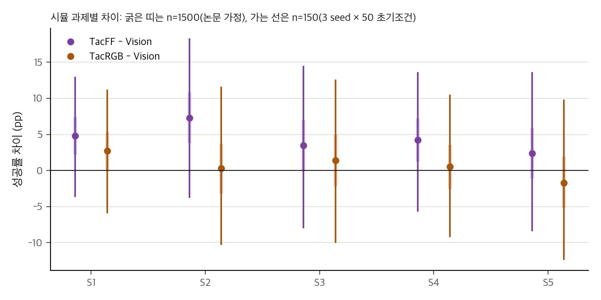
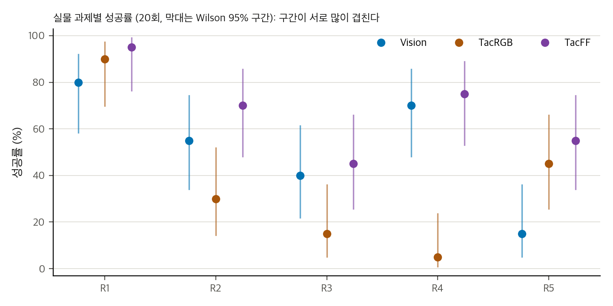
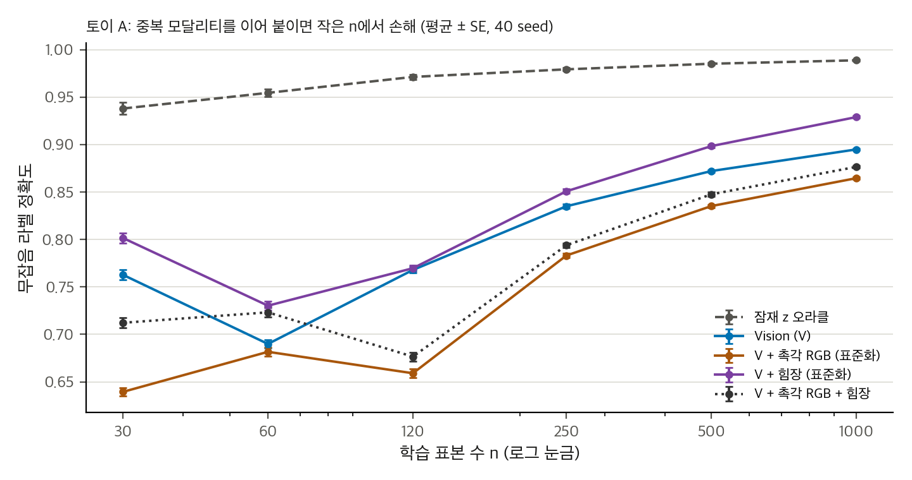
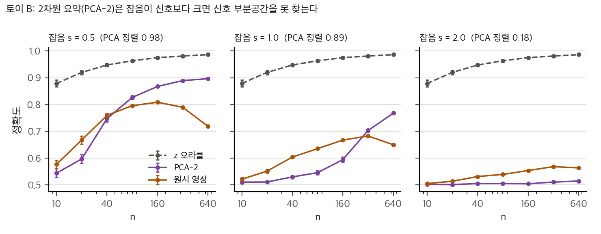

> **논문:** Saka, Hu, Desai, Zhang, Zhang, Luu, Prince, Zheng, She. *CONTACT: CONtact-aware TACTile Learning for Robotic Disassembly.* IROS 2026, arXiv:2603.08560 (v2).
> 논문 그림은 라이선스(arXiv 비독점 배포) 때문에 싣지 않았습니다. 그림과 영상은 [프로젝트 페이지](https://vict0rhu.github.io/CONTACT-Website/)에서 볼 수 있습니다. 이 글의 그래프는 논문 표의 수치와 직접 만든 토이로 그렸습니다.

---

## 논문이 묻는 것

분해 작업은 접촉이 많고 힘에 따라 상태가 바뀝니다. 저자들은 확산 정책에 시각 두 대를 넣고, 촉각을 두 가지 형식으로 더해 비교했습니다. 하나는 GelSight 촉각 영상(TacRGB)이고, 다른 하나는 10×14 격자의 법선·전단 힘장(TacFF)입니다. 과제는 시뮬레이션 5개와 실물 5개입니다.

## 결과 재계산

| 설정 | 시뮬 평균 (1500회) | 실물 평균 (20회 × 5과제) |
|---|---|---|
| Vision | 60.5 | 52.0 |
| Vision + TacRGB | 61.2 | 37.0 |
| Vision + TacFF | 65.0 | 68.0 |

헤드라인 숫자는 표와 맞습니다. 실물에서 TacRGB는 Vision보다 낮습니다. 논문 본문은 이를 "일관된 이득이 없다"로 씁니다.

## 통계는 어디까지 말해 주나

- **시뮬:** 논문은 1500회를 독립 표본으로 봅니다. 이 가정에서는 TacFF의 우위가 매우 유의합니다(CMH p ≈ 3×10⁻⁹). 하지만 시험 초기조건 50개가 모든 체크포인트와 시드에 반복됩니다. 시드 3개 × 초기조건 50, 즉 150을 기준으로 보면 p ≈ 0.06으로 유의하지 않습니다.
- **실물:** TacFF 68/100 대 Vision 52/100, Fisher p ≈ 0.03입니다. 과제별로는 어느 것도 Holm 보정 후 유의하지 않습니다(가장 가까운 것은 R5, p ≈ 0.09). 칸당 20회로는 15 pp 차이를 잡기 어렵고, 약 160회가 필요합니다.
- **TacRGB의 실물 결과:** R4(변형 탭)에서 1/20 대 14/20입니다. 이것은 과제별로도 강하게 유의합니다.

그래프: 시뮬 과제별 차이(pp). 굵은 띠는 1500회 가정, 가는 선은 150 가정의 Newcombe 95% 구간.

그래프: 실물 과제별 성공률과 Wilson 95% 구간(20회).

## 코드를 읽으면 보이는 것

논문과 같은 공식 저장소(MIT, 커밋 d0ad7f5)가 있어 설정을 대조했습니다. 방법은 대체로 맞습니다. 하지만 비교의 통제가 깨진 곳이 있습니다.

- 시뮬 TacFF 학습은 데모를 30개만 씁니다. Vision과 TacRGB는 90개를 씁니다. 에폭 수도 1666 대 555로 다릅니다.
- 추론 스텝은 논문의 DDIM 10이 아니라 설정에서 DDPM 100입니다.
- 시뮬의 성공 기준은 키포인트 거리 0.1 m 이상입니다. 논문이 말하는 "들어 올림"은 확인하지 않습니다.
- 시뮬 TacFF는 시뮬레이터의 접촉 힘이고, 실물 TacFF는 영상에서 추정합니다. 시뮬의 우위를 실물에 그대로 옮기기 어렵습니다.

## 토이 두 개

1. **중복 입력을 이어 붙이면:** 잠재 2차원에 대해, 512차원 촉각 RGB를 더하면 모든 표본 수에서 시각 단독보다 나빴습니다. 표준화한 힘장(20차원)은 이겼습니다. 힘 단위가 1e-3 수준이면 릿지 회귀가 그 특징을 무시해 시각 단독과 같아졌습니다. 토이의 차원과 계수는 설계값입니다. 격자를 λ와 표본 수로 넓히면 척도가 λ보다 작아도 척도 0.1이 1보다 큰 이득을 주는 칸이 있어서, "척도가 작으면 무시된다"는 단순 규칙은 맞지 않았습니다.
2. **낮은 차원 요약의 숨은 가정:** 픽셀 잡음이 신호보다 크면 PCA-2가 신호 부분공간을 찾지 못합니다(정렬 0.98 → 0.18). 힘장이 정보를 담는다는 주장은 센서 잡음 대비 신호 분산을 요구합니다.

토이 A: 표본 수에 따른 정확도(평균 ± SE, 40 seed). 촉각 RGB 결합이 모든 n에서 시각 단독보다 낮습니다.

토이 B: 잡음 세 수준에서 오라클, PCA-2, 원시 영상 릿지의 정확도.

## 구현할 수 있나

- **공식 시뮬 재현:** Linux, CUDA GPU, IsaacGym이 필요합니다. 이 맥에서는 불가능합니다.
- **실물 재현:** 로봇, 촉각 센서 세 종, 과제 소품이 필요합니다. 코드는 공개되지 않았습니다.
- **아이디어 재구현:** 중간 난이도입니다. 확산 정책과 모달리티별 인코더는 공개 구현으로 됩니다.
- **가장 가치 있는 것:** 데모 수를 맞추고 시드를 늘린 통제 실험입니다. 이것은 오프라인 시연 데이터만 있으면 할 수 있습니다.

## 남은 질문

- 실물 TacFF의 단위와 정규화는 무엇인가?
- 시드 표준편차는 얼마인가? 논문은 보고하지 않습니다.
- 구조화된 융합(모달리티별 어텐션 등)은 실제로 결합 손해를 줄이는가? 논문은 제안만 했습니다.

공개 자료: `analysis/`(표 재계산, 토이, 코드 대조 문서)는 게시본 저장소에 있습니다.

## 자료

- [통합 리포트 PDF](report/report_public.pdf)
- [01. 논문 분석: CONTACT (arXiv:2603.08560v2)](analysis/01_paper_analysis.md)
- [02. 선행연구, 가까운 대안, 저장소 대조](analysis/02_prior_work.md)
- [03. 재계산, 유의성, 유도, toy](analysis/03_analysis.md)
- [04. 코드 대조: 논문 ↔ AdeeshDesai/CONTACT (d0ad7f5)](analysis/04_code_verification.md)
