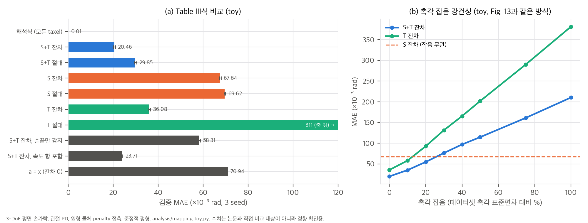
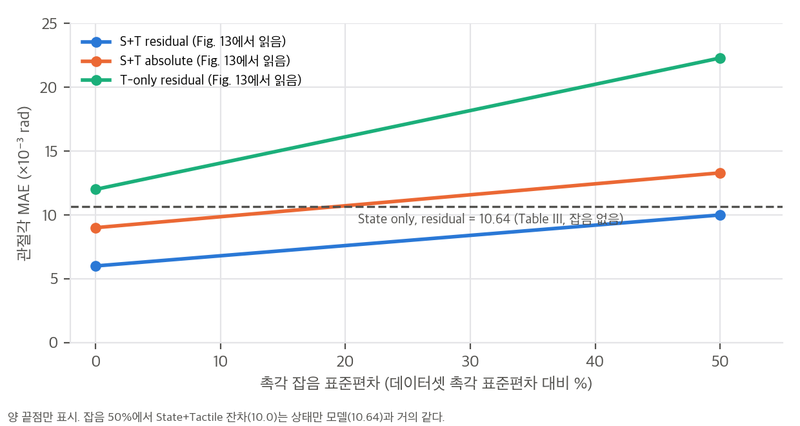

# 03. Contact-consistency mapping의 물리적 의미와 toy 검증

재계산 스크립트는 `analysis/mapping_toy.py`(결과 `mapping_toy_results.json`, CPU 약 2분)와 `analysis/table_check.py`입니다. toy는 논문 Fig. 2와 같은 3-DoF 평면 손가락을 관절 PD로 제어하는 설정입니다. 논문 수치를 재현하려는 것이 아니라 Eq. 1이 무엇을 학습하는지 확인하는 것이 목적입니다.

## 1. Eq. 1 M_φ(x, u) → a는 무엇을 학습하는가

### 1.1 관절 PD 손가락의 준정적 평형
손 관절은 PD 제어기 τ_m = Kp(a − q) − Kd q̇로 구동됩니다(Sec. III-A). 관성을 무시할 만큼 느린 움직임(준정적)이라면 관절 토크 평형은 다음과 같습니다.

```
Kp (a − q) − Kd q̇ + Σ_k J_k(q)ᵀ f_k + Σ_i J_{c,i}(q)ᵀ m_i g = 0
```

- f_k: 접촉점 k에서 물체가 손가락에 가하는 힘, J_k: 그 점의 Jacobian
- J_{c,i}, m_i g: 링크 i 질량중심의 Jacobian과 중력

이를 목표 a에 대해 풀면 다음 식이 됩니다.

```
a = q  −  Kp⁻¹ [ Σ_k J_k(q)ᵀ f_k + τ_g(q) ]  +  Kp⁻¹ Kd q̇
    ───   ─────────────────────────────────     ───────────
    실제    접촉·중력이 만드는 간극 (x, u의 함수)    속도 항 (x에 없음)
```

**해석:**
- 논문의 "잔차 사상"(a = x + Δ)은 이 구조와 정확히 맞습니다. 잔차 Δ는 **강성 역행렬 × 외력 토크**입니다.
- Δ를 정하려면 접촉점 위치와 힘(촉각 u)뿐 아니라 Jacobian, 즉 자세(상태 x)도 필요합니다. 그래서 "상태와 촉각이 둘 다 필요하다"(Table III)는 결과가 나옵니다.
- 접촉이 없으면 Δ = −Kp⁻¹τ_g(q)뿐입니다. 부록 Fig. 12가 "접촉 전 작은 간극은 중력과 마찰에 의한 정상상태 오차"라고 한 것과 같습니다.
- 팔 쪽 작업공간 임피던스 F = K_x(a_x − x) − D ẋ에서도 똑같이 a_x = x + K_x⁻¹F_ext입니다. Fig. 5에서 접시 닦기 때 엔드이펙터 목표-실제 간극이 커지는 것은 스펀지를 누르는 힘이 K_x⁻¹만큼 목표를 밀어 넣은 결과입니다.
- 저자들이 향후 과제로 든 "제어기 이득을 조건으로" 넣는 방향(Sec. VI)도, 이 식에서는 Δ ∝ Kp⁻¹로 구조가 이미 정해져 있습니다.

### 1.2 무엇이 식별을 깨는가
위 식이 정확하려면 세 조건이 필요합니다. 실제 시스템에서는 셋 다 깨질 수 있습니다.

1. **모든 접촉이 감지되어야 합니다.** 손끝 Digit360만 있으면 손가락 마디나 손바닥 접촉의 f_k가 빠집니다.
2. **촉각이 힘을 줘야 합니다.** 시뮬레이션 촉각 배열은 taxel마다 3D 힘을 줍니다. 비전 기반 촉각은 변형 이미지라서 힘과의 관계도 학습해야 합니다.
3. **속도 항이 작아야 합니다.** x에는 관절 속도가 없으므로 Kp⁻¹Kd q̇는 (x, u)로 설명되지 않는 오차 하한이 됩니다. 텔레옵 데이터에서는 이동 중 목표가 실제 상태를 앞서는 성분도 여기에 섞입니다.

## 2. toy 설정

- 3링크 평면 손가락(50 / 35 / 25 mm), 굴곡 방향으로 말림. Kp = [1.5, 1.0, 0.6] N·m/rad, Kd = [0.03, 0.02, 0.012], 링크 질량 [30, 20, 12] g
- 손바닥 쪽 taxel 링크당 6개(총 18개), taxel마다 법선력 측정
- 무작위 목표 a와 무작위 원형 물체(반지름 12–35 mm)를 뽑고, 에너지 ½(q−a)ᵀKp(q−a) + penalty 접촉 + 중력 위치에너지를 최소화해 평형 q를 구함 → (q, u, a) 6,000개. 접촉 표본 73%
- 1:1 학습·검증 분할(논문과 같은 비율), 2층 ReLU MLP(폭 128), 3 seed

## 3. 결과 (`mapping_toy_results.json`)



| 모델 | 검증 MAE (×10⁻³ rad) | 논문 Table III 대응값 |
|---|---|---|
| 해석식 (Kp, 기구학, 모든 taxel 힘을 앎) | **0.008** | 없음 |
| MLP 상태 + 촉각, 잔차 | 20.5 ± 0.4 | 5.94 |
| MLP 상태 + 촉각, 절대 | 29.9 ± 0.6 | 8.80 |
| MLP 상태만, 잔차 | 67.6 ± 0.3 | 10.64 |
| MLP 촉각만, 잔차 | 36.1 ± 0.3 | 12.15 |
| MLP 촉각만, 절대 | 311 ± 0.6 | 35.93 |
| a = x (잔차 0) | 70.9 | **보고 안 됨** |
| MLP 상태 + 촉각, 잔차, **손끝 taxel만 감지** | 58.3 ± 0.5 | 실제 로봇(Digit360)에 해당 |
| 해석식, 손끝 taxel만 감지 | 51.1 | |
| MLP 상태 + 촉각, 잔차, **속도 항 포함** (q̇ ~ N(0, 0.4 rad/s)) | 23.7 ± 0.5 | 하한 6.4 |

**확인된 것:**
1. **Eq. 1의 해석식이 정확히 성립합니다**(오차 0.008, 수치 최적화 허용오차 수준). 이 사상은 "데이터로만 배울 수 있는 암묵적 관계"가 아니라 **기구학과 강성으로 정해지는 관계**입니다. 학습이 필요한 이유는 실제 시스템에서 강성, 마찰, 센서 보정, 감지되지 않는 접촉을 정확히 모르기 때문입니다.
2. **잔차형과 상태·촉각 결합의 이득은 논문과 같은 방향입니다.** 잔차가 절대보다 낫고(20.5 vs 29.9), 촉각만·절대는 자세를 알 수 없어 크게 실패합니다(311).
3. **상태만 모델의 가치는 데이터 분포에 달려 있습니다.** toy에서는 물체 위치와 크기가 무작위라 자세만으로 힘을 알 수 없고, 상태만 모델(67.6)이 잔차 0 기준선(70.9)과 거의 같습니다. 논문에서는 상태만 모델(10.64)이 촉각만(12.15)보다 낫습니다. 파지 데이터에서는 자세가 "얼마나 쥐고 있는가"를 상당 부분 알려 준다는 뜻으로 읽힙니다. 같은 이유로 논문에 잔차 0 기준선이 없으면 5.94가 얼마나 좋은 값인지 판단할 수 없습니다.
4. **학습된 MLP는 해석식보다 2,000배 이상 부정확합니다**(20.5 vs 0.008). 학습 표본 3,000개로는 Jᵀf라는 곱 구조를 배우기 어렵습니다. 기구학을 아는 경우 "해석식 + 학습 잔차" 구조가 데이터 효율 면에서 훨씬 유리할 것입니다.
5. **손끝만 감지하면 식별이 크게 무너집니다.** 표본의 59%에서 감지되지 않는 근위 링크 접촉이 있고, MLP 오차가 58.3으로 잔차 0 기준선(70.9)에 가까워집니다. 해석식도 51.1입니다. 실제 로봇 실험이 손끝 접촉 위주 과제(병뚜껑, 박스 뒤집기)였던 것은 이 한계와 맞물립니다.
6. **속도 항은 하한을 만듭니다.** 하한(Kp⁻¹Kd|q̇|의 평균 6.4)이 생기고, 오차가 20.5 → 23.7로 늘어납니다.

**논문과 다른 것 (촉각 잡음, M5):** toy의 상태+촉각·잔차 모델은 데이터셋 촉각 표준편차의 10%만 잡음을 넣어도 오차가 20 → 35로 오르고, 약 25%에서 상태만 모델보다 나빠집니다. 논문 Fig. 13은 50%에서도 +67%에 그칩니다. 차이의 이유로는 세 가지를 생각할 수 있습니다. toy의 taxel 신호는 대부분 0이어서, 잡음이 "없는 접촉"을 만들어 냅니다. toy는 잡음 없이 학습했습니다. 논문의 ResNet1D 인코더는 공간적으로 매끄러운 특징을 써서 독립 잡음을 평균화합니다. 어느 쪽이든 강건성은 **잡음을 무엇에 상대적으로 정의하는가**와 학습 방식에 크게 좌우되므로, 논문의 "넓은 범위에서 안정적"이라는 표현을 일반화하기는 어렵습니다.

## 4. 논문 Fig. 13 다시 읽기



논문 자체 수치로도, 잡음 50%에서 상태+촉각·잔차 MAE(약 10.0)는 Table III의 상태만 모델(10.64)과 거의 같습니다. 촉각이 주던 이득(10.64 − 5.94 = 4.70) 가운데 남는 것은 약 0.64(14%)입니다. "오차가 안정적"이라기보다 **"촉각이 무의미해질 때까지 점진적으로 나빠진다"**가 정확한 표현입니다. 배포 시 diffusion이 예측한 촉각의 오차 크기가 보고되지 않았으므로, 실제 정책에서 이 곡선의 어느 지점에 있는지는 알 수 없습니다.

## 5. 실행 시간과 피드백 구조 (`04` C8)

CGP는 매 추론마다 16스텝의 (x̂, û)를 만들고 8스텝을 실행합니다. M_φ는 예측값에 적용되므로, 실행 중인 8스텝 동안 실제 촉각은 목표에 반영되지 않습니다. "5 Hz"를 어떻게 읽느냐에 따라 시간 규모가 달라집니다.

| 해석 | 행동 스텝 | 재계획 주기 | 예측 구간 | A100 추론(최대 약 134 ms) |
|---|---|---|---|---|
| 5 Hz = 행동 스텝 주기 | 0.2 s | 1.6 s | 3.2 s | 재계획 주기의 8% |
| 5 Hz = 추론 주기 | 25 ms | 0.2 s | 0.4 s | 주기의 67% |

어느 쪽이든 미끄러짐 같은 빠른 사건에는 제어기의 수동적 순응이 먼저 반응하고, 정책은 다음 재계획에서야 촉각을 봅니다. 청크 안에서 관측 촉각과 예측 촉각의 차이(u_obs − û)로 목표를 보정하면 이 간극을 줄일 수 있습니다.
