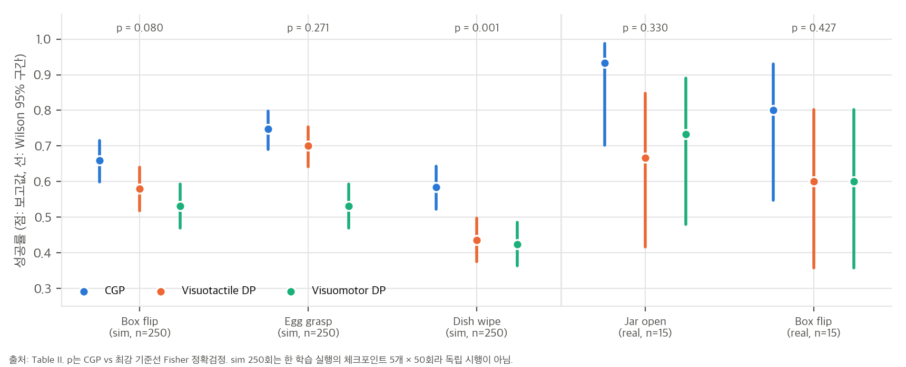

# 04. 주장 검증: 표·그림 수치 재계산, 구현 가능성

- **대상:** arXiv:2603.05687v3 본문 Table II–VI, Fig. 7, 8, 13, 프로젝트 페이지
- **범위:** 공식 코드가 공개되지 않아서(2026-10-28 확인) 코드 대조는 할 수 없습니다. 표 수치를 재계산하고, 그림 값은 눈으로 읽어 근사했으며(±1 눈금), Eq. 1은 CPU toy로 검증했습니다.
- **스크립트:** `analysis/table_check.py` → `table_check_results.json`, `analysis/mapping_toy.py` → `mapping_toy_results.json`

## 1. 주장별 판정

| # | 주장 (출처) | 재계산·근거 | 판정 |
|---|---|---|---|
| C1 | Table II 수치 (sim 250회, real 15회) | 모든 성공률 × 시행 수가 정수(예: 165, 145, 133 / 14, 10, 11) | ✅ 내부 일관 |
| C2 | "CGP가 기준선을 일관되게 앞선다" (Sec. V-A) | 점추정은 다섯 과제 모두 1위. 최강 기준선 대비 Fisher p: 박스(sim) 0.080, 달걀 0.271, 접시 **0.001**, 병뚜껑 0.330, 박스(real) 0.427. sim 묶음 MH p = 2.4×10⁻⁴(비독립 시행이라 낙관적), real 묶음 p = 0.13 | ⚠️ sim 일부만 유의, real은 표본 부족 |
| C3 | 상태와 촉각이 모두 필요하고 잔차형이 낫다 (Table III) | 잔차 기준 상태+촉각은 상태만보다 44%, 촉각만보다 51% 낮음(3 seed Welch p = 3×10⁻⁴, 3×10⁻⁶). 잔차형은 33–66% 감소 | ✅ 단, a = x 기준선과 평균 간극이 없음 |
| C4 | Eq. 1은 접촉 위치·모드나 동역학을 명시하지 않는 암묵적 사상 (Sec. III-B) | toy에서 해석식 a = q − Kp⁻¹(Jᵀf + τ_g)가 오차 0.008×10⁻³ rad로 정확히 성립. MLP는 20.5 | ⚠️ 사상의 구조는 해석적으로 정해짐 (`03` §1) |
| C5 | 매핑은 촉각 잡음에 강건하다 (부록 E, Fig. 13) | 그림에서 읽으면 상태+촉각·잔차 6.0 → 10.0(잡음 50%, +67%). 50%에서 상태만 모델(10.64)과 거의 같아 촉각 이득의 86%가 사라짐. 직선 외삽 시 약 58%에서 같아짐 | ⚠️ "안정적"은 과장 |
| C6 | KL 정규화가 정책 성능을 높인다 (Fig. 7) | 그림에서 읽으면 박스 66 vs 약 62(p ≈ 0.40), 달걀 75 vs 약 64(p ≈ 0.009). 접시 닦기는 보고 안 됨 | ⚠️ 두 과제 중 하나만 유의 |
| C7 | Table IV 복원 지표 | MAE / Active MAE ≤ 활성 taxel 비율 → 박스 ≤ 10%, 달걀 ≤ 12%, 접시 ≤ 23%. KL 제거 시 KL 손실 1.9–6.1배. Fig. 7의 MAE·KL 막대가 Table IV ResNet1D 행과 일치 | ✅ 일관. 촉각 배열은 매우 희소 |
| C8 | Table VI (Digit360) | PSNR로 구한 RMSE가 MAE의 1.8–2.1배(가우시안이면 1.25배) → 오차가 접촉 영역에 몰림. 압축 15,552 → 20 (약 780배) | ✅ 일관 |
| C9 | Table V 차원 | 29 = 3 + 6 + 20, 27 = 3 + 4 + 20, 25 = 3 + 6 + 16, 23 = 3 + 4 + 16 | ✅ |
| C10 | 추론 시간이 기준선과 비슷하다 (Fig. 8) | 그림에서 읽은 총 시간: 촉각 배열 93 / 97 / 112 ms, Digit360 96 / 133 / 134 ms. mapping은 12 ms(배열, 복원·재인코딩 포함)와 3 ms. diffusion 출력 차원은 CGP가 2배(sim), 4배(real) | ✅ 촉각 배열에서는 +15% |
| C11 | 실행 시간 구조 | "5 Hz"가 행동 스텝이면 재계획 1.6 s, 추론 주기이면 행동 스텝 25 ms. 어느 쪽이든 청크 실행 중에는 관측 촉각이 목표에 반영되지 않음 | 논문에 명시 없음 |
| C12 | 평가 프로토콜 | sim: 한 학습 실행의 마지막 5개 체크포인트 × 50회, 학습 seed 반복 없음. real: 연속 15회. 15 대 15에서 p < 0.05가 되려면 대략 14/15 대 8/15(차이 40%p)가 필요 | ⚠️ 통계 검정력 낮음 |
| C13 | 매핑 데이터 규모 | 150 에피소드 / 4,114 프레임(에피소드당 27프레임), 1:1 분할이라 학습은 75 에피소드 | 참고 |

## 2. 보고되지 않아서 확인할 수 없는 것
- 공식 코드, 학습된 가중치, 데이터셋, 시뮬레이터(Meta 내부 FEM + Unreal Engine 플러그인)
- 네트워크 크기(U-Net 채널, VAE 폭), 학습 epoch과 시간, 학습 하드웨어. 추론 시간만 A100으로 보고
- M_φ의 학습 데이터와 시점. 정책 데모로 학습했는지, 별도 파지 데이터로 학습했는지 본문에 명확하지 않음
- 손 관절 PD 이득과 팔 임피던스 이득 값
- 실제 배포 중 diffusion이 예측한 촉각의 오차 크기(Fig. 13 곡선의 어느 지점인지)
- Table III의 a = x 기준선과 접촉 중 평균 |a − x|

## 3. 재계산 결과 요약 그림

## 4. 구현 가능성 판단

### 4.1 공식 코드를 그대로 돌리는 경우

**불가능합니다.** 2026-10-28 기준 코드, 가중치, 데이터가 공개되지 않았습니다. 프로젝트 페이지의 링크는 논문과 영상뿐이고, GitHub `contact-grounded-policy` 계정에는 웹페이지 저장소만 있습니다. 1저자의 GitHub에도 이전 연구(UniT, DiffOG, LeTO 등) 저장소만 있습니다. 시뮬레이션 실험은 Meta 내부 FEM 솔버와 Unreal Engine 플러그인을 쓰므로, 코드가 공개되더라도 시뮬레이션 부분은 그대로 재현하기 어려울 가능성이 큽니다.

### 4.2 이 맥에서 할 수 있는 것 (Apple M4 Pro, CUDA 없음)

| 단계 | 가능 여부 | 근거 |
|---|---|---|
| 표·그림 수치 재계산, Eq. 1 해석과 toy 검증 | ✅ 완료 | `table_check.py`, `mapping_toy.py` (numpy, CPU 약 2분) |
| 공개 시뮬레이터로 매핑 실험(Table III) 재현 | ✅ 가능할 것으로 보임 | MuJoCo는 CPU에서 돌고, 접촉력과 touch 센서를 줍니다. 손 모델과 스크립트 파지로 (x, u, a) 데이터를 만들 수 있습니다. MuJoCo 설치가 필요합니다 |
| CGP 정책 학습(작은 규모) | ⚠️ 조건부 | 구조는 Diffusion Policy + VAE + MLP라 큰 모델이 아닙니다. PyTorch MPS로 작은 저차원 과제는 학습할 수 있을 것으로 보이지만, torch 설치가 필요하고 MPS에서의 학습 속도는 확인하지 않았습니다. 데이터는 직접 만들어야 합니다 |
| 논문 과제 재현(FEM 시뮬레이션, Allegro + Digit360 실물) | ❌ | 시뮬레이터 비공개, 하드웨어 없음 |

### 4.3 아이디어를 다시 구현하는 경우

| 구성 요소 | 난이도 | 메모 |
|---|---|---|
| Diffusion 정책 뼈대 | 낮음 | 공개된 Diffusion Policy 코드에서 출력만 바꿉니다. 행동 대신 [실제 상태, 촉각 잠재]를 예측합니다 |
| 촉각 VAE | 낮음 | 1D ResNet(배열) 또는 2D ResNet(이미지), KL 가중치 1e-5–1e-4(Table V) |
| Contact-consistency mapping | 낮음 | 잔차 MLP. 기구학과 강성을 알면 해석식 Δ = −Kp⁻¹(Jᵀf + τ_g)를 기본값으로 두고 잔차만 학습하는 편이 데이터 효율이 좋습니다(`03` §3) |
| 학습 데이터 (x, u, a 세 쌍) | **높음** | 목표(명령)와 실제 상태, 촉각을 모두 기록한 텔레옵 데이터가 필요합니다. 대부분의 공개 데이터셋은 명령과 실제 상태를 함께 저장하지 않습니다. compliance 제어기 위에서 직접 수집해야 합니다 |
| 촉각이 있는 시뮬레이션 | 중간–높음 | 손 전체 촉각 배열이 필요합니다. 공개 시뮬레이터로 만들 수 있지만, 연성체(스펀지)와 깨지는 달걀 같은 과제 자산은 새로 만들어야 합니다 |
| 실제 로봇 | 높음 | 다지 손 + 손끝 촉각 + compliance 제어기 + 손 추적 텔레옵 |

**요약:** 공식 코드로 재현하는 경로는 없습니다. 알고리즘 자체는 표준 구성 요소(Diffusion Policy, VAE, MLP)라 다시 구현하기 쉽습니다. 어려운 부분은 (실제 상태, 촉각, 목표) 세 쌍을 담은 데이터와 촉각 시뮬레이션입니다. 이 맥에서는 MuJoCo로 매핑 부분을 먼저 검증하고, 필요하면 작은 정책 학습을 MPS로 시도하는 순서가 현실적입니다. 둘 다 패키지 설치가 필요합니다.
