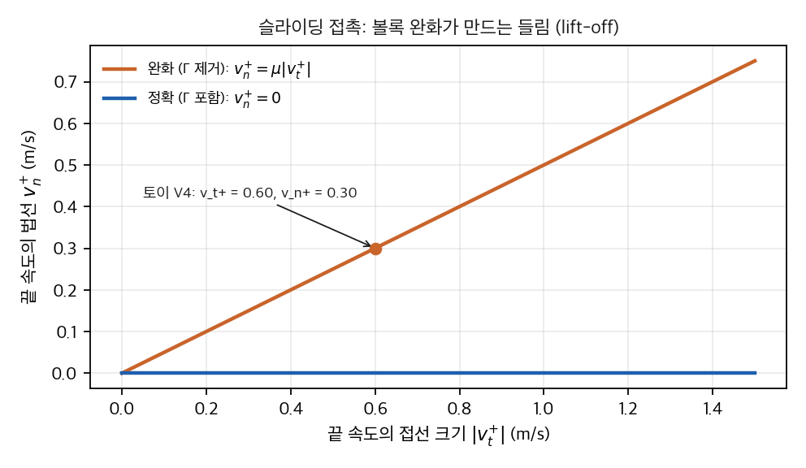
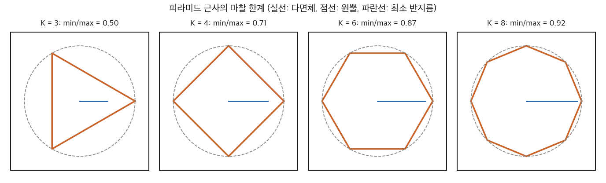
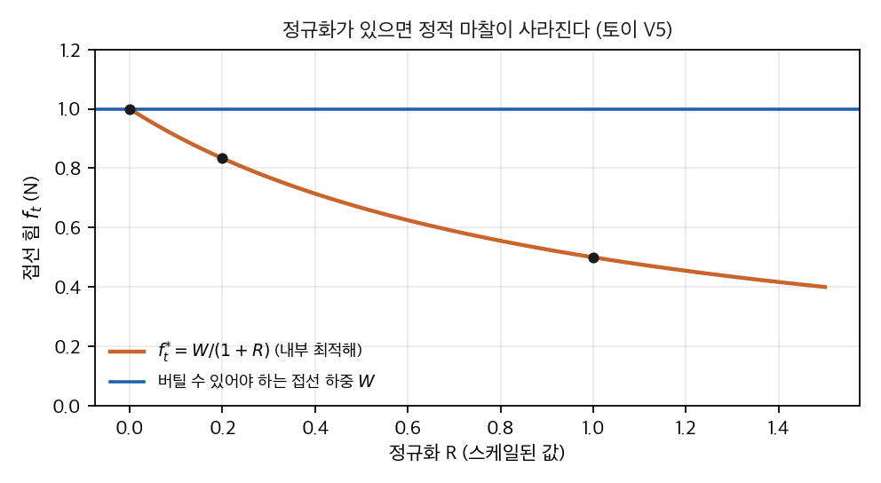
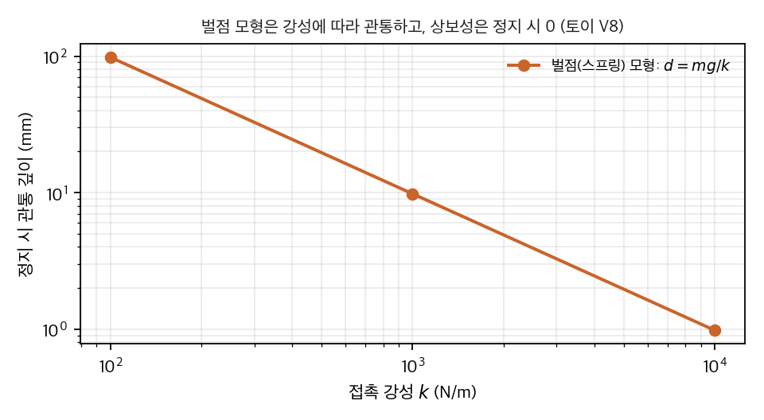

# 03. 핵심 식 재유도와 수치 검증

논문은 튜토리얼이라 보고된 통계 수치가 거의 없습니다(표 1–3은 성질·분류표). 그래서 이 문서의 중심은 **식을 다시 유도하고, 작은 numpy 토이로 주장을 확인하는 것**입니다. 재현(학습·실행)은 하지 않았고, 토이는 모두 CPU에서 몇 초 안에 끝납니다. 스크립트는 `analysis/formulation_checks.py`, 결과는 `analysis/formulation_checks_results.json`입니다. 그래프는 `analysis/plot_figures.py`로 만듭니다.

표기: 논문과 같이 접촉 i의 힘 f = (f_n, f_t), 접촉 속도 v⁺, 마찰 계수 μ, 원뿔 K = {f : ‖f_t‖ ≤ μ f_n}, 쌍대 원뿔 K* = {s : s_n ≥ μ‖s_t‖}입니다. 아래 식 번호는 논문의 번호입니다(예: (39.2)). 내부 검증 라벨은 V1–V10을 씁니다.

## 1. 식 유도 흐름 (논문 §4의 재구성)

### 1.1 Signorini–Coulomb (39)에서 N-CCP (40)–(43)로

Signorini–Coulomb 조건은 세 부분입니다.

- 비관통과 수직 힘: `0 ≤ (d/Δt + v⁺_n) ⊥ f_n ≥ 0` (39.2)
- 마찰 한계와 상보성: `0 ≤ μ f_n − ‖f_t‖ ⊥ ‖v⁺_t‖ ≥ 0` (39.3)
- 최대 소산 방향: `‖v⁺_t‖‖f_t‖ = −f_tᵀ v⁺_t` (39.4)

확인한 대수는 다음과 같습니다. `d/Δt`를 γ_n으로 바꾸면(안정화 항) 식 (40.2)는 `v⁺ + (μ‖v⁺_t‖ + γ_n) n̂ ∈ K*`가 되고, 이것이 K* 안에 있다는 것은 `v⁺_n + γ_n ≥ 0`과 `v⁺_n + γ_n ≥ μ‖v⁺_t‖`를 동시에 뜻하지 않습니다. 논문 본문에 따르면 K*의 성질 `y_n ≥ μ‖y_t‖`를 쓰면 de Saxcé 항이 있을 때 `v⁺_n + γ_n ≥ 0`으로 줄어듭니다. 이 부분은 식의 모양을 대조해 확인했습니다. 나머지 부등식은 논문의 두 줄 계산(`fᵀ[v⁺ + (μ‖v⁺_t‖+γ_n)n̂] = ‖v⁺_t‖(μf_n − ‖f_t‖) + f_n(v⁺_n+γ_n)`)으로 닫힙니다. 이 계산은 손으로 다시 해서 맞았습니다.

결론: de Saxcé 항 Γ(v⁺) = μ‖v⁺_t‖ n̂은 **접촉 속도가 미끄러질 때 법선 속도를 μ‖v⁺_t‖만큼 열어 주는 항**입니다. 이 항이 빠지면 미끄럼 접촉은 `v⁺_n = μ‖v⁺_t‖`로 떨어집니다(§3.4, V4).

### 1.2 Root-finding, C-QCQP, C-QP

- Root-finding (44): SOCFB 잔차 ψ_K(h(f, v⁺+Γ+γ)) = 0. 잔차 함수는 §1.3에서 확인합니다.
- C-QCQP (46)–(54): 접선 방향 t̂_i를 최대 소산 조건(48)에서 고정하고, 보조 변수 σ로 Γ(σ)를 떼어 냅니다. 그러면 고정된 σ에서 (47.2)는 `min ½ fᵀ(GΔt)f + (v_f+Γ(σ)+γ)ᵀ f  s.t. f ∈ K`라는 원뿔 QP의 최적 조건입니다. 식 변형을 따라가 보았고 모순은 찾지 못했습니다(이 단계의 수치 재계산은 하지 않았습니다).
- C-QP (55): 법선 힘과 접선 크기를 각각 상자 QP 두 개로 나눕니다. 두 QP는 선형항(Γ)과 쿨롱 상한 ‖f_t‖ ≤ μf_n으로 서로 묶입니다. 논문이 말하는 "어떤 접촉이 미끄러지고 어떤 접촉이 붙는지 알면 하나의 상자 QP가 된다"는 주장은 식 (55)를 보면 맞습니다.

### 1.3 SOCFB 함수와 자코비안 (27)–(38) — V2

Lorentz 원뿔 L = {x : x_n ≥ ‖x_t‖}에서 `x ∘ y = (xᵀy, x_n y_t + y_n x_t)`, 화살표 행렬 `Arw(x)`를 쓰면 `x ∘ y = Arw(x) y`입니다. SOCFB는 `ψ(x,y) = x + y − √(x∘x + y∘y)`입니다.

- 상보성 쌍 x = (1, (1,0)), y = (1, (−1,0))에서 잔차는 정확히 0입니다.
- 상보성이 없는 쌍(L 안의 두 원소지만 x∘y ≠ 0)에서 잔차는 0.757입니다.
- 자코비안 `∂_x ψ = I − Arw(s)⁻¹ Arw(x)` (식 35)를 유한차분과 비교하면 최대 차이가 9e-11입니다.

따라서 식 (35)–(36)은 맞습니다. 다만 이 식은 s가 L의 내부에 있을 때만 쓸 수 있습니다. 논문도 "bd L에서는 매끄럽지 않다"고 적고 있어서 일관됩니다.

### 1.4 원뿔 투영과 Moreau 분해 (17)–(19) — V1

K = {‖x_t‖ ≤ μ x_n}에서 경계 생성선 ĝ = (1, μt̂)/√(1+μ²)를 쓰면 식 (19)는 `Π_K(x) = x (x∈K), 0 (x∈K°), (ĝᵀx)ĝ (그 밖)`입니다. 300개 무작위 점에서 SLSQP로 구한 최근접점과 비교한 최대 차이는 1.8e-5(최적화 허용 오차 수준)입니다. Moreau 분해 `x = Π_K(x) + Π_{K°}(x)`와 `Π_{K°}(x) = −Π_{K*}(−x)`는 1e-15 수준에서 성립합니다.

### 1.5 완화(relaxation)와 정규화(regularization)

- **완화(§4.2.1)**: de Saxcé 항 Γ를 떼면 L-CCP와 QCQP가 됩니다. 이 QCQP는 볼록입니다. 식 (57)은 `min ½ fᵀ(GΔt)f + (v_f+γ)ᵀ f, f∈K`입니다.
- **정규화(§4.2.1–4.2.2)**: `G → G + R`로 바꿔 강볼록성을 얻습니다. 식 (59)–(68)의 유도를 한 줄씩 다시 했습니다. 식 (63)–(66)에서 `y = a_ref − R f`를 얻고, `Jq̈ − y = (G+R)f + Jq̈_f − a_ref`를 쓰면 최적 조건이 (67)–(68)의 SOCQP가 됩니다. 이 부분은 맞습니다.
- **NLS (60)–(61)와 역동역학 (72)–(74)**: `Π_K(x)`의 제곱노름이 `min_{w∈K*}‖x+w‖²`라는 성질(식 (56))에 기대므로 **R_ii는 접촉마다 스칼라여야 합니다**. 아래 V6에서 접촉마다 2×2 대각 R을 쓰면 힘 `R⁻¹Π_K(·)`가 K를 벗어나 식이 깨졌습니다. 논문 표기 R_ii를 행렬이 아니라 스칼라로 읽어야 한다는 점을 명시하는 것이 좋습니다.

### 1.6 운동에너지 해석 (75) — V7

`½ q̇⁺ᵀM q̇⁺ / Δt² = const + ½ fᵀGf + (v_f/Δt)ᵀ f`가 성립합니다(γ = 0). 수치 잔차는 1.7e-13입니다. 따라서 "완화된 접촉은 운동에너지를 최소화하는 것과 같다"는 해석(§4.3.2)은 식 수준에서 맞습니다.

### 1.7 안정화와 MuJoCo 항 (footnote 7)

- 논문 §4.1.1: γ_n = αd/Δt이면 `d + Δt v⁺_n = (1−α)d`입니다. 정리하면 v⁺_n = −γ_n이므로 맞습니다.
- 각주 7: `a_ref = −bv − k d w(d) n̂`을 `a_ref = Jq̈_f − (v_f+γ)/Δt`와 맞추면 `γ = Δt(bv + k d w) − v`입니다. 두 식을 대입해 다시 계산했고 맞습니다. 다만 이것은 대수 확인이고, MuJoCo 코드와 대조하지는 않았습니다(`04` C7).

## 2. 번역 수준의 주의점

- 논문 본문의 Γ 표기에는 `μ v_t⁺`(노름 기호 없음)로 보이는 곳이 몇 군데 있습니다. PDF 9쪽을 렌더링해 보니 식과 그림에서는 ‖v_t⁺‖로 정확히 적혀 있어서, 텍스트 추출 과정에서 생긴 착오입니다. 논문 자체의 문제는 아닙니다.
- Table 1의 "정규화 후 힘이 유일"이라는 열은 강볼록성에서 바로 나옵니다. 맞습니다.

## 3. 수치 검증 결과 (V1–V10)

모든 검증은 `python3 -I analysis/formulation_checks.py`로 다시 돌릴 수 있습니다. 실행 시간은 약 20초입니다.

| 라벨 | 확인하는 것 | 결과 | 판정 |
|---|---|---|---|
| V1 | 원뿔 투영 (19) 대 SLSQP 최근접점, Moreau 분해 | 최대 차이 1.8e-5, Moreau 1e-15 | 일치 |
| V2 | SOCFB 잔차 0 조건과 자코비안 (35) | 상보 쌍 잔차 0, 비상보 쌍 0.757, 자코비안 차이 9e-11 | 일치 |
| V3 | 피라미드(다면체) 마찰의 최소 반지름 = μcos(π/K) | K=3: 0.50, K=4: 0.707, K=6: 0.866, K=8: 0.924 (최소/최대). 수치와 공식이 소수 14자리까지 일치 | 일치, 이방성 확인 |
| V4 | 볼록 완화에서 들림: v_n⁺ = μ|v_t⁺| | 완화: f=(80,−40), v⁺=(0.30,0.60), v_n⁺−μ|v_t⁺| = 1e-8. 정확: f=(50,−25), v⁺=(0,0.75) | 일치. 들림 0.30 m/s. 접선 감속도 달라짐 (아래 참고) |
| V5 | 정규화 R>0이면 정적 마찰 상실 | R=0: f_t=W=1 (정확히 버팀). R=0.2: 0.833. R=1: 0.5 (=W/(1+R)). P=2, 10, 100 모두 R=1에서 f_t=0.5 | 일치. 누르는 힘과 무관 |
| V6 | NLS (61) 최소해 대 정규화 SOCQP (68)의 힘과 가속도 | 접촉마다 스칼라 R일 때 최대 차이 3e-4 (힘 노름 463). 접촉마다 2×2 R이면 깨짐 | 일치(스칼라 R 조건) |
| V7 | 운동에너지 항등식 (75) | 잔차 1.7e-13 | 일치 |
| V8 | 벌점 모형의 정지 관통 d = mg/k | k=1e2: 98.1 mm, 1e3: 9.8 mm, 1e4: 0.98 mm | 일치(상보성 모형은 0) |
| V9 | 네 모서리 접촉에서 힘의 비유일성 | 3D 상자: rank G = 3, 힘 자유 방향 1개 | 논문 문장과 차이 (아래) |
| V10 | 정규화가 "최소 가중 노름 해를 고른다"는 주장 | ε = 1e-1, 1e-3, 1e-5, 1e-7에서 선택해와의 거리 1.99, 0.072, 7.5e-4, 7e-6 | ε→0에서만 성립 (아래) |

### 3.1 V4 — 완화는 들림만이 아니라 접선 감속도도 바꿉니다

정확 해는 f_t = −25, 완화 해는 f_t = −40입니다. 같은 마찰 계수에서 완화된 모형은 접선 방향 제동을 더 크게 받고, 접선 끝 속도는 0.60이고 정확 해는 0.75입니다. 논문은 들림(법선)만 말하는데, 마찰력과 접선 속도도 같이 바뀐다는 점이 추가로 보입니다. 상자가 "미끄러지면서 뜨는" 효과와 "미끄럼 감속이 달라지는" 효과가 같은 원인에서 나옵니다.

### 3.2 V3 — 피라미드는 방향에 따라 마찰이 다릅니다

Appendix A.2의 다면체 근사에서 마찰 집합은 conv{μ t̂_k}입니다. 최소 반지름은 변의 중점 방향에서 μcos(π/K)이고, 이것이 논문 §6.2의 "anisotropic friction"입니다. K=4(정사각형 피라미드)에서 최소 마찰은 최대 마찰의 0.707배입니다. 쿨롱 원뿔은 방향에 무관하므로 이 차이가 곧 근사 오차의 크기입니다.

### 3.3 V5 — 정규화가 정적 마찰을 없앤다는 주장

논문 §6.2는 "펜을 두 손가락으로 쥐면 누르는 힘과 무관하게 미끄러진다"고 씁니다. 내부 최적해(원뿔이 구속하지 않을 때)는 `f_t* = W/(1+R)`이고 P와 무관합니다. 수치 결과가 이와 같습니다. 원뿔이 구속하는 경우(W > μP)는 토이에 없으므로 논문 주장을 완전히 확인한 것은 아닙니다.

### 3.4 V8 — 벌점 대 상보성

벌점 모형은 정지 시 관통이 mg/k입니다. 강성을 100배 올리면 관통은 100배 줄어들지만 0이 되지는 않습니다. 시간 적분된 상보성 모형은 정지 시 관통을 0으로 만듭니다. 이 차이는 표 1의 "compliant normal response" 행과 같은 말입니다.

### 3.5 V9 — 네 모서리 접촉의 힘 비유일성 (논문 문장과 차이)

§6.1은 "상자가 네 모서리 접촉에 놓이면 네 힘의 합만 유일하게 정해진다"고 씁니다. 상자가 6자유도 강체이고 접촉 법선이 z 방향이면 법선 행은 `[1, y_i, −x_i]`이고 네 행의 랭크는 3입니다. 그러면 운동이 정하는 것은 **합과 두 모멘트(3개)**이고, 힘의 자유 방향은 1개입니다. 자유 방향은 (0.5, −0.5, −0.5, 0.5)입니다. 즉 "합만 유일"이라는 문장보다 **모멘트까지 유일**한 것이 맞습니다. 운동은 유일하다는 결론은 그대로 맞습니다. 논문이 평면 상자를 뜻했다면 랭크는 2가 되고 자유 방향도 2개입니다. 어느 경우든 "합만"이라는 문장은 맞지 않습니다. 저자에게 확인할 항목입니다.

### 3.6 V10 — "최소 가중 노름을 고른다"는 주장

§6.1은 정규화가 비유일 해 가운데 `fᵀRf`가 최소인 것을 "고른다"고 씁니다. 토이에서 정확한 해집합 S = {f ≥ 0 : Gf = b} 안에서 argmin fᵀWf를 1차원으로 정확히 구해 비교했습니다. 정규화 ε가 1e-1이면 거리가 2.0이고, 1e-7이면 7e-6입니다. 즉 **ε→0의 극한에서만 선택 해가 되고**, 유한한 R에서는 다른 해를 줍니다. 논문의 "selects"는 극한 의미로 읽어야 합니다.

## 4. 이 문서가 보여 주지 않는 것

- 논문의 Stewart–Trinkle(1996)과 Anitescu–Potra(1997)의 역사적 차이(Appendix B)는 문헌 서술이라 수치로 확인하지 않았습니다. 다만 두 방법이 "선형화된 간격(d + Δt v_n ≥ 0)"과 "법선 속도"에 비관통을 거는 방식이 다르다는 서술은 §1.1과 같은 기하로 설명됩니다.
- 완화된 해가 존재하는 조건과 Lemke 알고리즘의 유한 종료는 확인하지 않았습니다. 논문 Table 1을 인용합니다.
- 알고리즘 1, 8–14(PGS, Newton, proximal blueprint)의 수렴 속도 주장은 재현하지 않았습니다. §6.4의 "첫차 방법은 진행당 비용이 싸지만 질량비에 약하다"는 정성적 주장입니다.
- 공식 시뮬레이터(MuJoCo, Simple, Newton 등) 구현과의 대조는 하지 않았습니다. 공식 코드가 이 논문과 짝을 이루지 않으므로 `04_claim_verification.md`에서 주장별로 다룹니다.
