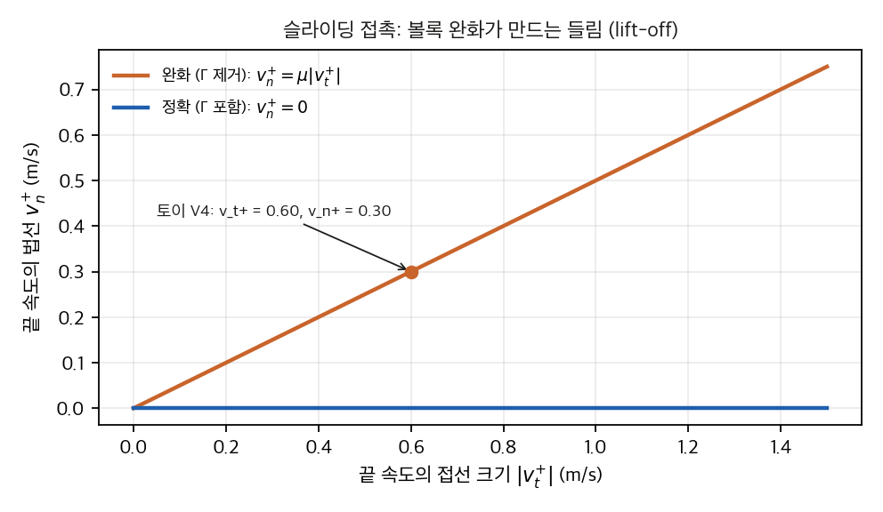
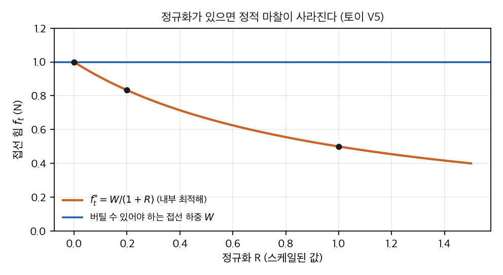
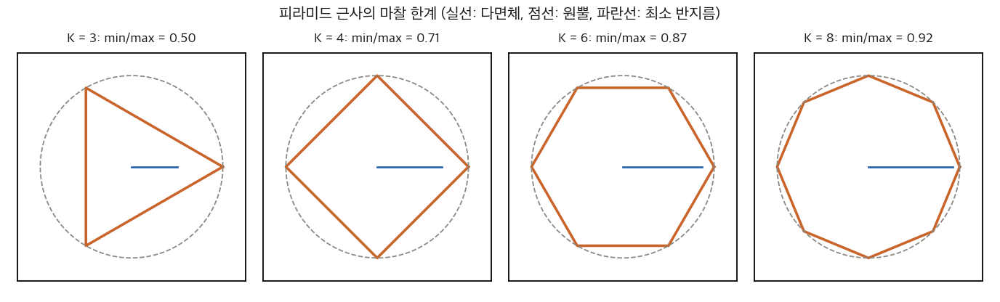
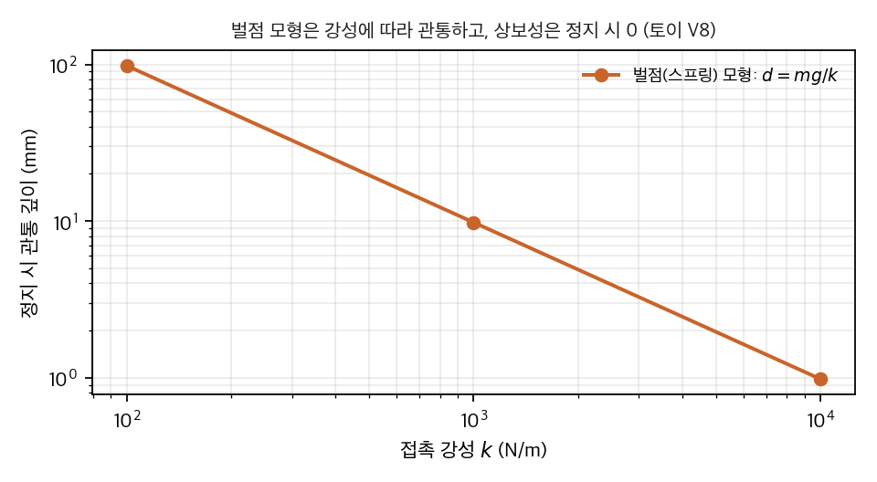

> **논문:** Onur Beker, A. René Geist, Michael Posa, Marc Toussaint, Justin Carpentier, Georg Martius. *A Tutorial on Complementarity-Based Contact Models for Robotics.* arXiv:2611.26600 (v1, 2026-11-19).
> 학회·저널 표기는 없습니다. 공식 코드와 프로젝트 페이지도 찾지 못했습니다. 논문 라이선스는 arXiv non-exclusive라서 논문 그림은 싣지 않고, 우리가 그린 그래프만 씁니다.

## 이 논문이 묻는 것

강체 시뮬레이터 대부분은 접촉을 **상보성 조건**으로 풉니다. 물체가 떨어져 있으면 힘이 0이고, 힘이 있으면 접촉이 닿아 있고, 마찰 힘이 한계보다 작으면 붙고, 한계에 닿으면 미끄러진다는 조건을 식으로 씁니다. 이 식을 쓰는 방법은 여러 가지입니다. 이 튜토리얼은 그 방법들을 한 표기법으로 모으고, 각 방법이 **물리적으로 무엇을 바꾸는지**를 따집니다.

논문은 새 알고리즘이나 실험을 내지 않습니다. 대신 식을 처음부터 끝까지 유도하고, 존재·유일성과 알고리즘 상충을 표로 정리합니다.

## 식의 흐름

Signorini–Coulomb 조건(비관통, 마찰 한계, 최대 소산)을 출발점으로 잡습니다. 이것을 한 식으로 묶으면 N-CCP가 됩니다.

`K ∋ f ⊥ (v⁺ + Γ(v⁺) + γ) ∈ K*`

여기서 Γ(v⁺) = μ‖v_t⁺‖ n̂은 **de Saxcé 항**입니다. 미끄러지는 접촉에서 법선 방향 속도를 μ‖v_t⁺‖만큼 열어 주는 역할을 합니다. 이 항을 빼면 문제가 볼록해지지만, 대가가 있습니다.

정규화(G → G + R)를 더하면 해가 유일해지고 NLS 형식(가속도 공간의 제약 없는 강볼록 문제)으로 쓸 수 있습니다. MuJoCo가 이 형식을 씁니다.

## 우리가 확인한 것

식은 손으로 다시 유도하고, 필요한 곳은 numpy 토이로 확인했습니다. 토이 열 개는 모두 CPU에서 20초 안에 끝납니다.

- **원뿔 투영과 SOCFB 자코비안은 맞습니다.** 투영의 닫힌 형식은 최근접점과 1.8e-5 안에서 일치하고, 자코비안은 유한차분과 9e-11 안에서 일치합니다.
- **볼록 완화는 미끄럼 접촉을 들어 올립니다.** 같은 조건에서 법선 끝 속도는 0.30 m/s이고, 정확 해는 0입니다. 법선 속도가 μ|v_t⁺|와 정확히 같아집니다. 논문은 여기서 멈추지만, 접선 힘도 바뀝니다. 정확 해의 접선 힘은 −25, 완화 해는 −40입니다.
- **정규화는 정적 마찰을 없앱니다.** 접선 하중 W를 버티려면 접선 힘이 W여야 하는데, R>0이면 `W/(1+R)`로 줄어듭니다. 이 값은 누르는 힘과 무관합니다. 두 손가락으로 쥔 펜이 세게 누를수록 덜 미끄러지는 것이 아니라, 누르는 힘과 상관없이 미끄러진다는 뜻입니다.

그림: 슬라이딩 접촉에서 볼록 완화(주황)와 정확 해(파랑)의 법선 끝 속도. 완화된 해는 μ|v_t⁺| 선 위에 있습니다. 우리가 그린 그래프입니다.

그림: 정규화 R에 따른 접선 힘. 내부 최적해는 W/(1+R)입니다. 우리가 그린 그래프입니다.

## 피라미드 근사는 방향에 따라 마찰이 다릅니다

원뿔 대신 다면체(피라미드)로 근사하면 문제가 선형상보성(LCP)이 되어 풀기 쉬워집니다. 대신 마찰의 크기가 미끄럼 방향에 따라 달라집니다. 변의 중점 방향에서 최소 마찰은 μcos(π/K)입니다. 정사각형 피라미드(K=4)에서는 최대 마찰의 0.71배입니다.

그림: 피라미드 근사(K = 3, 4, 6, 8, 실선)와 원뿔(점선)의 마찰 집합. 파란 선은 최소 반지름입니다. 우리가 그린 그래프입니다.

## 벌점 방식과 상보성 방식

벌점(스프링) 방식으로 접촉을 풀면 정지 상태에서도 관통이 생깁니다. 깊이는 mg/k입니다. 강성 k를 100배 올려도 관통은 100배 줄 뿐 0이 되지 않습니다. 상보성 방식은 정지 상태에서 관통을 0으로 맞춥니다.

그림: 벌점 모형의 정지 관통 깊이(mg/k)와 접촉 강성의 관계. 로그-로그 축입니다. 우리가 그린 그래프입니다.

## 과장되었거나 틀린 문장

- **네 모서리에 놓인 상자.** 논문은 "네 접촉력 가운데 합만 유일하게 정해진다"고 씁니다. 6자유도 강체에서 법선 행의 랭크를 세면 3입니다. 그러면 합과 두 모멘트가 운동으로 정해지고, 힘의 자유 방향은 1개만 남습니다. 평면 상자라면 자유 방향은 2개입니다. 어느 쪽이든 "합만"과는 맞지 않습니다.
- **정규화가 "최소 노름 해를 고른다".** 정규화 ε를 1e-1에서 1e-7까지 줄이면 정규화 해는 최소 노름 선택 해에 가까워집니다. 거리는 2.0에서 7e-6이 됩니다. 즉 극한에서만 맞고, 실제로 쓰는 유한한 정규화에서는 다른 해를 줍니다.

## 이 튜토리얼을 어디에 쓰나

- **식을 따라가며 검산하기 좋습니다.** 식 번호가 정리되어 있고, 원뿔 투영과 SOCFB 자코비안은 그대로 구현할 수 있습니다.
- **시뮬레이터를 고를 때 체크리스트로 씁니다.** 표 1은 "이 접촉 모형이 어떤 인공물(들림, 정적 마찰 상실, 이방성, 비유일성)을 허용하는가"를 묻는 데 쓸 수 있습니다.
- **공식 코드가 없습니다.** 튜토리얼의 식을 맞춰 볼 기준은 MuJoCo나 Newton 같은 별도 구현입니다. 그래서 실제 적용 전에는 구현마다 식이 어떻게 바뀌는지 확인해야 합니다.

## 한계

논문에는 실험이 없습니다. 표 2와 표 3의 알고리즘 성능과 시뮬레이터 분류는 문헌을 인용한 정성적 서술입니다. 이 글의 검증은 식과 작은 토이에 한정됩니다. 공식 시뮬레이터에서 들림과 정적 마찰 상실을 실제로 재현하는 것은 다음 단계입니다.

## 자료

- [통합 리포트 PDF](report/report_public.pdf)
- [01. 논문 분석: A Tutorial on Complementarity-Based Contact Models for Robotics](analysis/01_paper_analysis.md)
- [02. 선행 연구, 구성 요소별 출처, 관련 자료](analysis/02_prior_work.md)
- [03. 핵심 식 재유도와 수치 검증](analysis/03_derivations.md)
- [04. 주장 검증 (공식 코드 없음)](analysis/04_claim_verification.md)
