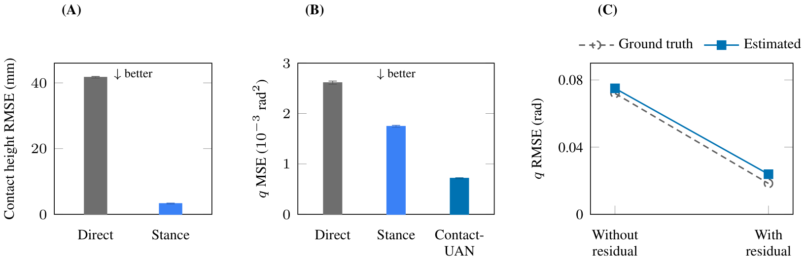
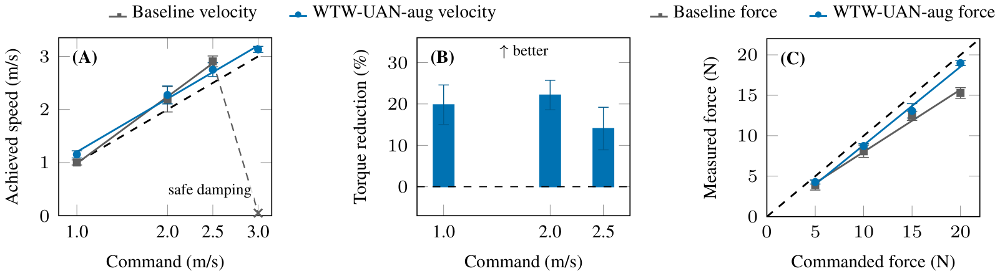
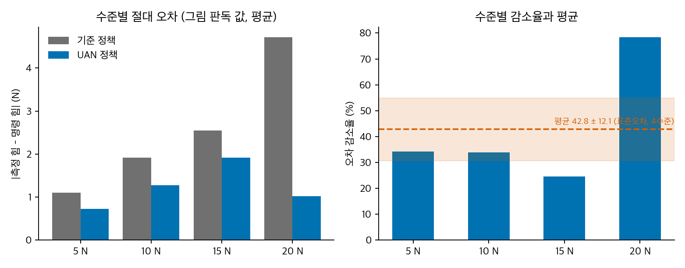
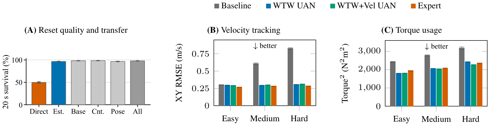
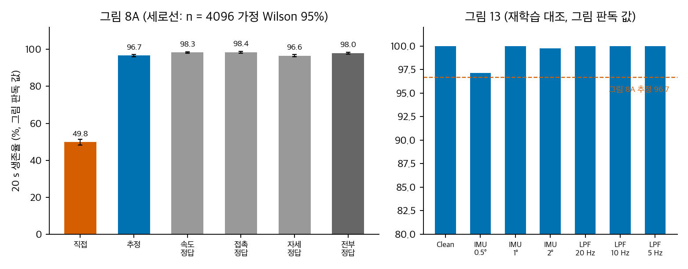

# 01. 논문 분석: Contact-UAN (arXiv:2610.18991)

*Unsupervised Actuator Networks as a Residual World Model for Humanoid Control* (Nolan Fey\*, Khai Nguyen\*, Yash Prabhu, Gabriel B. Margolis, Pulkit Agrawal; MIT Improbable AI Lab, \*공동 1저자). arXiv 제목은 "Contact-UAN: Unsupervised Actuator Networks as a Residual World Model for Humanoid Control"입니다. 쪽 번호와 표·그림 번호는 arXiv v1 PDF(26쪽) 기준입니다. 식, 표, 그림은 논문 번호를 씁니다.

## 0. 판본과 출처

| 항목 | 내용 |
|---|---|
| arXiv | 2610.18991, cs.RO. **v1 하나**(2026-10-13 제출). 분석일 2026-11-26에 abs 페이지와 API에서 확인했고 v2 이상은 없습니다. 비교할 버전 차이가 없습니다 |
| 학회 | CoRL 2026 포스터. corl.org 공식 채택 목록(www.corl.org/program/accepted-papers, 2026-11-26 확인)에 포스터 번호 180으로 제목이 정확히 올라 있습니다. PDF 1쪽에도 "10th Conference on Robot Learning (CoRL 2026), Austin TX, USA"가 적혀 있습니다 |
| 프로젝트 페이지 | https://contact-uan.csail.mit.edu/ . 페이지 머리말에 "Accepted at CoRL 2026", "Best Paper Award at RSS 2026 Workshop on Robot World Models", "Oral Presentation at RSS 2026 Workshop on Closing the Sim2Real Gap"가 있습니다. 두 워크숍 표기는 워크숍 쪽 목록을 확인하지 않았습니다 |
| 공식 코드 | https://github.com/nolie-rolie/contact-uan (Apache-2.0, 별 31, 마지막 push 2026-10-15). 정적으로만 읽었습니다(`04`). 사전학습 정책과 하드웨어 데이터는 포함되어 있지 않다고 README가 적습니다 |
| 라이선스 | arXiv abs 페이지의 "view license" 링크가 `http://creativecommons.org/licenses/by/4.0/`를 가리킵니다(CC BY 4.0). PDF 본문에서 ©, copyright, All rights reserved 표기를 찾지 못했습니다 |
| 선행 논문 | UAN 원 논문은 Fey et al., *Bridging the Sim-to-Real Gap for Athletic Loco-Manipulation* (arXiv:2502.10894, RSS 2025). 본문 6절은 이 논문이 "매니퓰레이터를 단 사족 로봇"에서만 시연되었다고 적습니다 |

## 1. 한 문단 요약

휴머노이드 정책은 시뮬레이션에서 동작의 모양은 옮겨져도 힘의 크기와 타이밍은 옮겨지지 않을 수 있습니다. 논문은 그 원인을 구동기 모델의 차이로 보고, 시뮬레이터는 그대로 두고 **관절 위치 목표에 더해지는 잔차 δq만 학습**하는 UAN(Unsupervised Actuator Network)을 휴머노이드로 확장합니다(식 1–2). 토크 센서 없이 "하드웨어 궤적을 시뮬레이터에서 같은 명령으로 재생했을 때 관절 위치가 맞도록" PPO로 학습합니다. 걷는 중 재생을 시작하는 시뮬레이터 상태가 하드웨어와 같은 접촉력을 내지 않으면 잔차가 구동기 오차가 아니라 리셋 오차를 보정하게 됩니다. 그래서 **고유감각만으로 "접촉이 일관된 리셋 상태"(발 높이, 기울기, 베이스 속도)를 추정하는 상태 추정기**를 두고 이를 핵심 기여로 내세웁니다(2.1절). 6.5분 걷기 데이터로 학습한 UAN 하나를 얼려 두고 달리기, 힘 제어, 점프 정책을 시뮬레이션에서 학습해 Unitree G1에 옮깁니다. 초록은 달리기 토크 20% 감소, 힘 추종 오차 43% 감소, 점프 개선을 주장합니다.

## 2. 문제 설정과 방법

### 2.1 접촉 일관 재생 초기화 (2.1절, 그림 2–3, 식 4–6, 부록 A)

- **왜 필요한가.** 소프트 접촉 시뮬레이터에서는 발이 바닥에 "정확히 닿은" 상태가 아니라 약간 파고든 상태가 하중을 지탱합니다. 그림 3은 MuJoCo 모델에서 루트 높이 +2 mm가 수직항력을 약 50% 줄이고, 피치 −2°가 지지 모멘트를 약 45% 바꾼다고 보입니다(우리 판독 값: 높이 −2/−1/+1/+2 mm에서 약 +16/+10/−28/−50%, 피치 −2/−1/+1/+2°에서 약 −46/−27/+2/+3%).
- **무엇을 추정하나.** K = 3스텝(60 ms) 고유감각 이력(각속도, 투영 중력, 관절 위치·속도, 이전 관절 목표; 입력 93 × 3 = 279)에서 (1) 접촉 확률, (2) 지지 발의 높이, (3) 발 좌표계에서 본 투영 중력(= 기울기), (4) 베이스 선형 속도를 따로 신경망 여섯 개로 회귀합니다(부록 표 1). 시뮬레이션 안에서 학습하고 평탄한 지형, 루트 xy·요 불변 좌표를 가정합니다.
- **핵심 설계 두 가지.** ① 절대 베이스 높이를 입력에서 뺍니다. 하드웨어의 높이가 시뮬레이터에서 같은 힘을 내는 높이와 다를 수 있어서, 높이를 베끼는 지름길을 막으려는 것입니다. ② 자세 회귀는 **접촉 중인 샘플로만** 학습합니다. 유각기 높이의 변동이 손실을 지배하기 때문입니다(그림 5A).
- **융합(식 4–6).** 발 i의 가중치 w_i = p̂_i · 1[p̂_i ≥ p_th]를 정규화(α_i)해 발별 루트 높이 후보 ẑ^(i) = ĥ_i − h^fk_i(z=0)와 투영 중력 후보를 가중 평균합니다. 확신 있는 접촉이 하나도 없는 창은 버립니다. p_th의 값은 본문에 없습니다(`04` D5).
- **쓰임.** 추정기는 오프라인 재라벨링에만 쓰이고 정책 학습과 배포에는 없습니다.

### 2.2 UAN (2.2절, 식 1–3, 부록 B, 표 3, 5, 6)

- **식 1.** min_µ E ‖f(s,a) − f_sim(s, a + µ(o^µ))‖². 시뮬레이터 상태가 아니라 시뮬레이터 **입력**을 보정합니다. 식 2: q^cmd = q^base + δq, δq = µ(o^µ). 학습 중 q^base는 기록된 하드웨어 목표, 정책 학습 중에는 정책 출력입니다.
- **관측(식 3).** 관절마다 (q^base − q)와 q̇의 3스텝 이력 H_µ = 3(60 ms), 즉 관절당 입력 6개입니다.
- **구조.** G1의 29관절을 구동기 계열 5개로 묶어(표 3: 7520_14에 5관절, 7520_22에 4, 5020 2x에 6, 5020에 10, 4010에 4) 계열마다 은닉 (128, 128) ELU MLP를 둡니다. 계열당 6·128+128 + 128·128+128 + 128+1 = 17,537개, 합계 **87,685개 파라미터**(우리 계산, `03` V13).
- **학습.** 재생 환경: 평지, 4,096 환경, 24스텝(480 ms) 롤아웃, 창마다 기록 3스텝으로 관측 이력을 채운 뒤 24개 목표를 재생합니다. PPO 보상 = −1000 · 관절 위치 MSE − 0.1 · 관절 속도 MSE − 0.01 · 잔차 변화율 L2(표 6). 잔차는 ±1.0 rad로 자릅니다. 창은 시작 상태의 접촉 확률이 0.8 이상인 곳에서만 뽑습니다.
- **데이터.** Walk-These-Ways(WTW) 스타일 보행 정책을 하드웨어에서 6.5분 돌리며 보행 주파수 1.0–2.5 Hz와 발 들어올림 높이 0.05–0.1 m 명령을 바꿉니다(부록 C).

### 2.3 정책 학습과 배포 (2.3절, 부록 D)

- UAN 가중치를 고정하고 결정론적 잔차로 끼웁니다. 정책이 내는 관절 위치 목표에 UAN 출력이 더해진 뒤 시뮬레이터의 구동기와 접촉 모델이 적용됩니다.
- UAN 정책은 로봇별 도메인 무작위화를 **쓰지 않습니다**. 지형, 바닥 마찰(0.3–1.2), 밀기만 남깁니다. 기준(no-UAN) 정책은 달리기·힘 제어에서 인코더 편향 ±0.015 rad와 몸통 질량 중심 ±2.5 cm(xy)·±3 cm(z)를 추가로 무작위화합니다(점프는 ±0.01 rad, ±2.5/±5/±5 cm).
- 달리기와 점프는 **토크-속도 포락선**(식 7)으로 목표를 자른 뒤 UAN을 더합니다. 시뮬레이션은 200 Hz, 정책은 50 Hz(감속비 4)입니다.
- 배포에는 정책만 올라갑니다. UAN과 추정기는 로봇에서 돌지 않습니다.

### 2.4 과제 (부록 D)

| 과제 | 설정 요약 |
|---|---|
| 달리기 | mjlab G1 속도 추종 + 변경(속도 관측 제거, 5스텝 이력, 거친 지형, 식 7, 보상 표 7). 명령 곡선: vx (−1,1) → (−1.5, 2.0)(5,000 반복) → (−2.0, 3.0)(10,000 반복) |
| 힘 제어 | 오른쪽 손목에 스프링·댐퍼 가상 힘장(±30 N, 강성 25–400 N/m, 최대 50 N). 정책은 명령 힘을 관측, 20스텝 이력. 이 정책 위에 고유감각 말단 위치 추정기와 PD 외부 루프(Kp = 50 N/m, Kd = 0.2 Kp)로 임피던스 위치 제어 |
| 점프 | CMU 모캡 02_04("jump and balance")를 G1에 리타게팅(200프레임, 앞뒤 1 s 정지 패딩해 300프레임). BeyondMimic 방식 추종 사전학습 → 이륙 질량중심 속도로 추정한 탄도 상승 높이 보너스(가중 5.0)로 미세조정 |

## 3. 실험과 결과

### 3.1 잔차 세계 모델의 정확도 (4.1절, 그림 5–6, 부록 G.1)

그림 5(아래)는 (A) 접촉 높이 RMSE, (B) 하드웨어 WTW 데이터에서 24스텝 관절 위치 MSE, (C) sim-to-sim 24스텝 관절 위치 RMSE입니다.

- **A.** Direct(전 보행 단계를 한꺼번에 회귀) 약 41.7 mm, Stance(접촉 샘플만) 약 3.3 mm. 비 12.7배(그림 판독 값, `03` V3). 본문은 "한 자릿수 이상 낮춘다"고 씁니다.
- **B.** MSE 약 2.61 → 1.75 → 0.72 (×10⁻³ rad²: Direct → Stance → Contact-UAN). **캡션이 "WTW training data"라고 적어, UAN 학습에 쓴 데이터에서의 적합도**입니다(`03` V4).
- **C.** 같은 UAN을 추정 초기화 / 정답 초기화에서 잔차 끔 → 켬: 0.0750 → 0.0239, 0.0720 → 0.0184 rad. 본문은 "정답 초기화에서도 줄어들므로 리셋 보상이 아니라 구동기 모델링의 개선"이라고 해석합니다(`03` V2).
- **그림 6C(보류한 달리기 데이터).** 명령 토크 사용량 U = Σ|τ| 의 시뮬–하드웨어 상대 불일치가 No UAN 약 0.170에서 UAN 약 0.052로 줄어 **69.2%** 감소합니다(`03` V1). 이것이 논문에서 학습에 쓰지 않은 하드웨어 데이터에 대한 유일한 정량 지표입니다.

그림: 논문 그림 5 (접촉 높이 RMSE, 하드웨어 관절 위치 MSE, sim-to-sim RMSE). © 저자, CC BY 4.0, 출처 arXiv:2610.18991 (v1).

### 3.2 하드웨어 전이 (4.2절, 그림 7, 9, 10, 1)

- **달리기.** 명령 1.0/2.0/2.5 m/s에서 정책마다 5회, 30 ft(9.14 m) 코스. 달성 속도는 통과 시간에서 계산합니다. 두 정책의 달성 속도가 비슷하다는 것이 "효율 향상이지 과제 수행 저하가 아니다"의 근거입니다. 토크 감소율(그림 7B 판독): 약 19.8, 22.2, 14.1%. UAN 정책은 3.0 m/s 명령에서 3.13 ± 0.06 m/s를 냅니다. 같은 명령에서 기준 정책은 몇 초 뒤 모터 과열 보호가 작동해 안전 감쇠 모드에 들어갑니다.
- **힘 제어.** 동력계에 운동 밴드로 연결, 명령 힘 5 N 간격(그림 7C는 5–20 N), 수준마다 4회. 힘 추종 오차 **42.8 ± 12.1%** 감소(그림 7C 캡션). 0 N에서는 몸이 눌려 주는 "극단적 순응"(그림 1C), 위의 임피던스 위치 제어는 반지름 0.3 m 원 궤적을 외부 센서 없이 추종합니다(그림 10).
- **점프.** 두 참조 추종 정책은 모두 전이되지만 UAN이 더 잘 추종하고 더 높이 뜁니다. 높이를 키우는 미세조정 뒤 기준 정책은 착지에서 실패하고, UAN 정책은 더 높이 뛰고 밀기에도 버팁니다(그림 9, 1E). **점프 높이의 수치와 시도 수는 본문에 없습니다.**

그림: 논문 그림 7 (달성 속도, 토크 감소율, 측정 힘). © 저자, CC BY 4.0, 출처 arXiv:2610.18991 (v1).

그래프: 우리가 그린 그래프. 그림 7C의 마커 좌표에서 읽은 힘 수준별 절대 오차와 오차 감소율. 수준별 감소율의 평균 ± 표준오차가 캡션의 42.8 ± 12.1과 맞습니다(그림 판독 값, `03` V5).

### 3.3 sim-to-sim (4.3절, 그림 8, 11, 13, 표 12, 15, 부록 E–G)

- **대상.** 댐핑, 마찰 손실, 행동 지연, 인코더 편향, 전기자 관성을 노미널에 더하는 결정론적 섭동 세 단계(쉬움, 중간, 어려움; 표 12: 댐핑 +2/+4/+6, 마찰 손실 +0.5/+1.0/+1.5, 지연 1/2/3스텝, 인코더 +0.003/0.006/0.009 rad, 전기자 ×1.5/2.0/2.5).
- **정책 비교(그림 8B–C).** 기준 정책의 속도 오차는 어려움에서 약 0.83 m/s로 오르고, WTW 5분 UAN 정책은 약 0.30(전문가 약 0.28)입니다. 제곱 토크도 비슷하게, 어려움에서 기준 약 3,180, UAN 약 2,415, 전문가 약 2,348 N²m²입니다(그림 판독 값, `03` V9). WTW 5분에 달리기 5분을 더해도 큰 이득이 없다고 해석합니다.
- **리셋 절제(그림 8A).** 20 s 생존율은 직접 추정 49.8%, 접촉 일관 추정 96.7%, 성분 오라클 96.6–98.4%입니다(`03` V8).
- **세계 모델 기준선(부록 F, 그림 11).** UAN 5분 데이터는 목표 환경 정규화 에피소드 길이 100%에 이르고, 자체 구현한 RWM-U 변형(GRU 앙상블 5개, 약 33시간 = 600만 전이, 약 400배)은 처음부터 6.8%, 데이터 수집 정책에서 미세조정 38.2%, 노미널 시뮬레이터 기준 32.6%입니다. 저자들은 "최선을 다한 적응이며 결정적인 벤치마크가 아니다"라고 단서를 붙입니다.
- **구조 비교(표 15, 부록 G.3).** 위치 잔차, 토크 잔차, 토크 지도학습 모델이 매칭된 시뮬레이션에서 하류 성능이 비슷합니다(생존율 97.3–98.2%).
- **센서 손상 재학습(그림 13, G.2).** IMU 피치 편향 0.5–2°, 속도 저역통과 20–5 Hz에서 생존율 97.1–100%.

그림: 논문 그림 8 (리셋 절제 생존율, 속도 추종, 토크 사용량). © 저자, CC BY 4.0, 출처 arXiv:2610.18991 (v1).

그래프: 우리가 그린 그래프. 그림 8A와 그림 13의 생존율(그림 판독 값). 세로선은 환경 수 4,096을 가정한 Wilson 95% 구간이며 논문에는 시행 수가 없습니다.

## 4. 한계

### 4.1 논문이 쓴 한계 (5절)

연결된 구동기 효과(여러 관절이 얽힌 효과)와 모터 온도 효과를 잡지 못합니다. 앞의 것은 몸 전체를 보는 모델이나 교차 주의로, 뒤의 것은 열 모델이나 추가 센서가 필요하다고 씁니다.

### 4.2 우리가 본 범위와 빈칸

1. **하드웨어 측 비교 대상이 하나입니다.** 하드웨어 실험의 대조군은 "노미널 시뮬레이터 + 가벼운 도메인 무작위화 기준 정책" 하나입니다. SysID, 토크 지도학습 구동기 모델, 더 강한 무작위화와의 하드웨어 비교는 없습니다(표 15는 시뮬레이션뿐).
2. **시행 수와 변동의 정의가 부분적입니다.** 달리기 5회, 힘 4회는 적혀 있지만 오차 막대(SD인지 SE인지), 3.0 m/s 시행 수, 점프 시행 수는 없습니다.
3. **리셋 절제는 sim-to-sim 한 설정입니다.** 추정기와 목표 시뮬레이터가 같은 접촉 모델을 쓰므로, 하드웨어와 시뮬레이터의 접촉 모델 차이를 가로지르는 추정 정확도는 직접 검증되지 않습니다. 하드웨어 쪽 증거는 간접(그림 5B 재생 오차, 그림 14)입니다.
4. **키네마틱 리셋 기준이 비교에 없습니다.** "가장 낮은 발이 바닥에 닿게 하는" 단순 리셋은 비교되지 않습니다(`04`의 코드에는 이 사전값이 대체값으로 있습니다).
5. **데이터 양 스윕이 하드웨어에서는 없습니다.** "6.5분이면 충분"의 근거는 한 데이터 세트와 한 로봇입니다.
6. **그림 5B의 데이터는 학습 데이터입니다.** 보류 데이터의 정량 지표는 그림 6C 하나입니다.

## 5. 주장과 근거의 간격 (요약)

| 주장 | 근거 | 간격 |
|---|---|---|
| 달리기 토크 20% 감소 | 그림 7B, 명령 3개 × 5회 | 세 막대의 평균은 약 18.7%(그림 판독 값). UAN과 기준 속도비가 1.15/1.04/0.95라 속도와 섞임(`03` V6, V7) |
| 힘 추종 오차 43% 감소 | 그림 7C, 4수준 × 4회 | 4수준의 상대 감소율 평균 ± 표준오차이며 20 N 수준이 78%로 평균을 끌어올림. 앞 세 수준 평균 약 30.9%(`03` V5) |
| 접촉 일관 초기화가 중요 | 그림 8A, 49.8% → 96.7% | 한 sim-to-sim 설정, 시행 수 없음. 성분 오라클과의 차이(−0.07 ~ +1.8 %p)는 재학습 변동 범위 안일 수 있음(`03` V8) |
| UAN이 완전 학습 세계 모델보다 데이터 효율적 | 그림 11 | 대조는 저자의 최선 구현 한 개, 표준편차가 커서 WM FT와 기준의 차이(38.2 대 32.6)는 구분 안 됨(`03` V10) |
| 점프 개선 | 그림 9 (사진), 정성 서술 | 높이와 시도 수가 없어 정량 검증 불가 |
