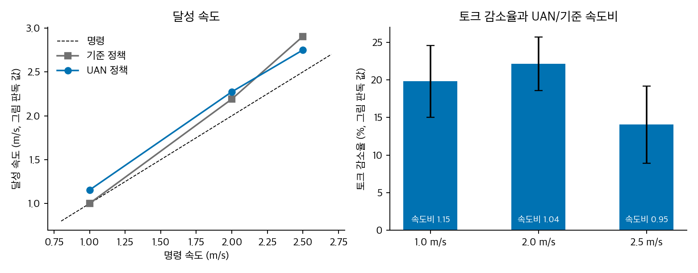
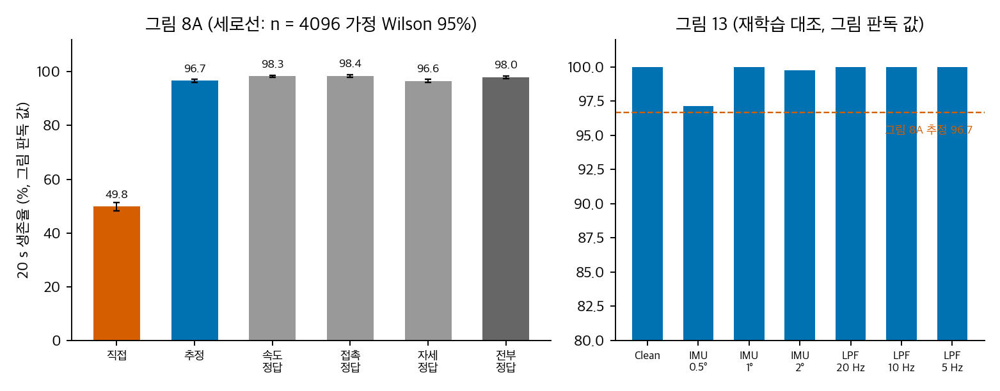
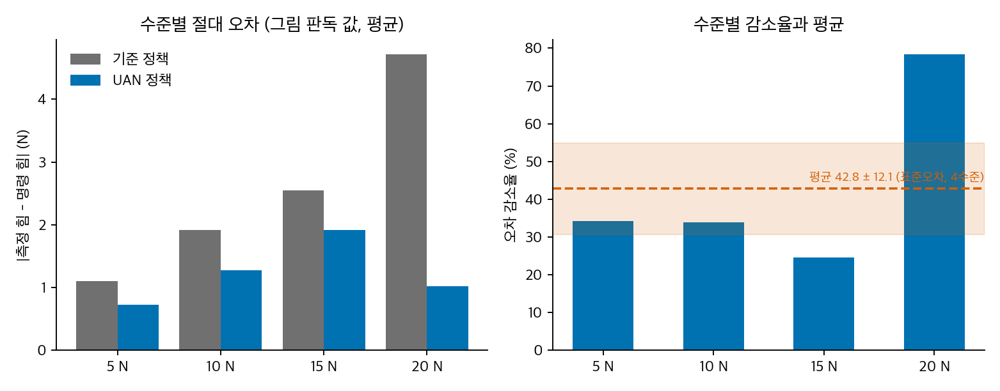
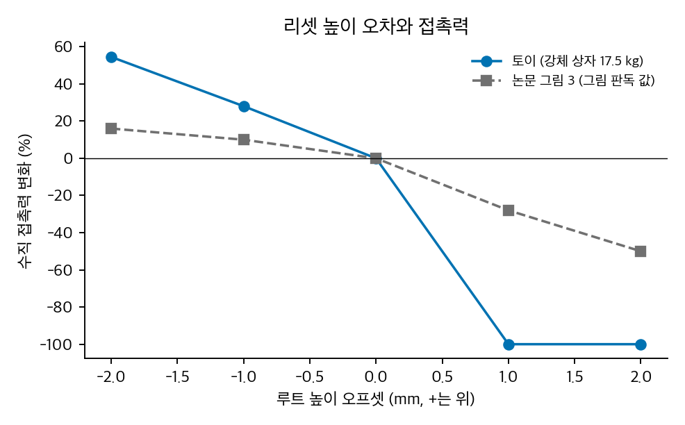

# 03. 수치 재계산과 해석: Contact-UAN (arXiv:2610.18991)

## 0. 방법과 읽는 법

- 논문의 막대·선 그래프는 벡터 그래픽이라서 `analysis/digitize_figures.py`가 PDF 도형 좌표에서 값을 읽습니다(눈금 간격의 1% 안쪽 오차). 읽은 값은 **"(그림 판독 값)"**으로 표시하고 `analysis/figure_values.json`에 있습니다. 본문과 부록에 숫자가 적힌 곳은 그 숫자를 씁니다.
- 논문에 없는 시행 수는 문장 안에 가정이라고 적었습니다. 검정은 `analysis/recompute.py`가 하고 결과는 `analysis/recompute_results.json`입니다.
- 이 문서의 표현은 "무엇과 무엇이 다른가"를 적으며, 저자 확인이 필요한 곳은 그렇게 적었습니다. 번호는 재계산 V1–V16, 토이 T1, 주장 C1–C10입니다.

## 1. 헤드라인 수치 재계산

### 1.1 V1 그림 6C: 토크 사용량 불일치 69.2% 감소

그림 6C의 두 막대(그림 판독 값): No UAN 0.1695, UAN 0.0522. 감소율 1 − 0.0522/0.1695 = **69.19%**로 본문 69.2%와 맞습니다. 이 지표는 U(τ) = Σ_t,j |τ_t,j|의 시뮬–하드웨어 상대 불일치이고, 토크는 **명령 토크**입니다(4.1절: "commanded torques"). 저장소의 수집기(`deploy/data_collector.py` 머리말)는 상태의 토크 열을 "재구성한 PD 토크 + 피드포워드"로 기록하므로, 하드웨어 쪽 토크도 측정된 출력 토크가 아니라 명령에서 계산한 값일 가능성이 있습니다. 본문 서두는 "신뢰할 수 있는 출력 토크 센싱이 없다"고 적습니다. 막대 하나와 오차 막대 하나로 보고되어 합계 지표의 관절·시간별 구성은 알 수 없습니다.

### 1.2 V2 그림 5C와 부록 G.1: 24스텝 위치 RMSE

| 초기화 | 잔차 끔 | 잔차 켬 | 감소율 |
|---|---|---|---|
| 추정 | 0.0750 | 0.0239 | **68.1%** |
| 정답 | 0.0720 | 0.0184 | **74.4%** |

그림 판독 값(0.07503, 0.02393)이 본문 값과 맞습니다. 같은 문장의 부록 G.1 별도 재학습 RMSE는 직접 0.0318, 추정 0.0239, 전부 오라클 0.0120 rad입니다. 추정 초기화 + 잔차(0.0239)와 "재학습한 추정 리셋"(0.0239)이 같은 숫자인 것은 같은 모델이라는 뜻으로 읽힙니다. 정답 초기화 + 같은 잔차(0.0184)는 정답으로 다시 학습한 UAN(0.0120)보다 53% 큽니다. 즉 "정답 초기화에서도 개선된다"는 맞지만, 정답으로 재학습하면 한 번 더 줄어서 **리셋 오차가 잔차에 흡수되는 양이 0.0239 − 0.0120 = 0.0119 rad 정도 남아 있다**는 읽기도 가능합니다(같은 시뮬레이션 설정에서 다른 UAN의 비교이므로 추정이 아니라 관찰입니다).

### 1.3 V3, V4 그림 5A, 5B

- **V3(5A).** 접촉 높이 RMSE Direct 41.7 mm, Stance 3.28 mm, 비 **12.7배**(그림 판독 값). 본문의 "한 자릿수 이상"과 맞습니다. 이 비교는 sim-to-sim 어려움 설정입니다.
- **V4(5B).** MSE(×10⁻³ rad²) 2.61 → 1.75 → 0.72. RMSE로 바꾸면 0.0511 → 0.0418 → 0.0268 rad. 재라벨링(Direct → Stance)이 MSE를 33%, UAN이 다시 59%, 합쳐 73% 줄입니다. 캡션이 "on WTW training data"라고 적습니다. UAN 학습에 쓴 데이터이므로 보류 일반화 지표가 아닙니다. 참고로 하드웨어 학습 데이터 RMSE 0.0268은 sim-to-sim 추정 초기화 + 잔차의 0.0239와 같은 자릿수입니다(데이터가 다르므로 직접 비교하지 않습니다).

### 1.4 V5 그림 7C: "42.8 ± 12.1%"의 구성

그림 7C의 마커 좌표(그림 판독 값)에서 평균 측정 힘을 읽으면 다음과 같습니다.

| 명령 (N) | 기준 정책 | UAN 정책 | 기준 오차 | UAN 오차 | 오차 감소 |
|---|---|---|---|---|---|
| 5 | 3.91 | 4.28 | 1.09 | 0.72 | 34.3% |
| 10 | 8.08 | 8.73 | 1.92 | 1.27 | 33.9% |
| 15 | 12.46 | 13.08 | 2.54 | 1.92 | 24.6% |
| 20 | 15.28 | 18.98 | 4.72 | 1.02 | 78.4% |

- 네 수준의 감소율 평균은 **42.77%**, 표본표준편차 24.17, 표준오차(SD/√4) **12.09**입니다. 캡션 "42.8 ± 12.1%"와 맞아, **"±"는 네 명령 수준에 대한 표준오차(수준 4개)로 읽힙니다.** 시행 4회의 변동이 아닙니다.
- 20 N 수준 하나가 78.4%로 평균을 끌어올립니다. 앞 세 수준만 평균하면 **30.9%**입니다. 모든 수준의 절대 오차를 합쳐 비교하면 52.1%(기준 10.28 N, UAN 4.93 N)입니다. 어떤 집계든 UAN이 낫다는 방향은 같고, 크기는 31–52% 사이에서 집계 방식에 따라 달라집니다.
- 기준 정책은 명령보다 17–24% 작게 내고(모든 수준), UAN 정책은 5–14% 작게 냅니다. 두 정책 모두 명령보다 **덜 미는** 쪽 오차입니다.
- 마커는 수준별 4회의 평균이며 오차 막대의 정의는 논문에 없습니다.

### 1.5 V6, V7 그림 7B, 7A: 달리기 토크 20%와 속도

| 명령 (m/s) | 토크 감소 (%) | 오차 막대 반폭 | 달성 속도 기준 → UAN (m/s) | 속도비 UAN/기준 |
|---|---|---|---|---|
| 1.0 | 19.8 | 4.8 | 1.00 → 1.15 | 1.15 |
| 2.0 | 22.2 | 3.6 | 2.19 → 2.27 | 1.04 |
| 2.5 | 14.1 | 5.1 | 2.90 → 2.75 | 0.95 |

(모두 그림 판독 값)

- 세 막대의 단순 평균은 **18.7%**, 앞 두 막대 평균 21.0%입니다. 초록의 "20%"는 두 값 사이이며, 어떻게 집계했는지는 본문에 없습니다. 3.0 m/s 명령은 기준 정책이 과열 보호로 멈춰 비교에 들어가지 않습니다.
- 시행 5회(본문)를 가정하면, 오차 막대가 표준오차인 경우 칸별 t 검정 p는 0.014, 0.0034, 0.052(2.5 m/s는 경계), 표준편차인 경우 0.0008, 0.0002, 0.0036입니다. 오차 막대의 정의가 결론을 가르는 칸은 2.5 m/s 하나입니다.
- **속도와 섞입니다.** UAN 정책이 1.0 m/s에서 15% 빠르고 2.5 m/s에서 5% 느립니다. 토크 사용은 속도에 따라 변하므로 속도를 맞춘 비교가 아닙니다. 같은 속도에서 토크를 비교한 자료는 논문에 없습니다.
- 평균 절대 속도 오차는 기준 0.199, UAN 0.226 m/s로 비슷합니다("속도 추종 유지"와 맞음). 두 정책 모두 달성 속도가 명령 이상입니다(코스 통과 시간으로 계산하는 평균 속도이며 출발 방식은 본문에 없음).
- UAN 3.0 m/s: 3.13 ± 0.06은 명령보다 4.4% 높습니다. 30 ft(9.14 m)를 3.13 m/s로 주파하면 2.92 s입니다.

그래프: 우리가 그린 그래프. 그림 7A, 7B의 마커와 막대에서 읽은 값(그림 판독 값). 오른쪽 막대 안의 숫자는 UAN/기준 달성 속도비.

### 1.6 V8 그림 8A와 13: 생존율

| 조건 | 그림 8A (그림 판독 값) | 본문 |
|---|---|---|
| 직접 | 49.8% | 49.8% |
| 추정 | 96.7% | 96.7% |
| 속도 / 접촉 / 자세 오라클 | 98.3 / 98.4 / 96.6% | 96.6–98.4% |
| 전부 오라클 | 98.0% | 같은 범위 |

- 추정과 오라클의 차이는 −0.07 ~ +1.78 %p입니다. **자세 오라클(96.6%)이 추정(96.7%)보다 낮습니다.** 환경 수 4,096(시행 수 n 가정)이면 구간 폭이 ±0.5 %p라 추정–접촉 오라클 차이 1.78 %p는 z ≈ 5.2로 표본 오차만으로는 구분되지만, 같은 구성을 다시 학습할 때의 변동은 이보다 클 수 있습니다.
- 그림 13의 Clean(재학습 대조)은 100.0%이고, 같은 구성이라면 그림 8A의 추정(96.7%)과 **3.3 %p 차이**입니다. 센서 손상 재학습 일곱 개의 값은 97.1–100.0%로 그림 8A의 추정 값을 대부분 웃돕니다. 두 그림이 같은 구성인지는 본문에 없으므로, 같은 구성이라면 재학습 변동이 최소 3.3 %p라는 뜻이고 다르다면 비교 불가입니다. 저자 확인이 필요합니다.
- 직접 → 추정의 +46.8 %p는 이 가능한 변동보다 훨씬 큽니다. 직접 추정 리셋(전 보행 단계 회귀) 대 접촉 조건 추정의 차이는 강하게 보이지만, **"가장 낮은 발을 지면에 놓는 단순 키네마틱 리셋"과 비교는 없습니다.**

그래프: 우리가 그린 그래프. 그림 8A와 그림 13의 생존율(그림 판독 값). 세로선은 n = 4096 가정 Wilson 95% 구간.

### 1.7 V9 그림 8B, 8C: 전문가와 비교

(그림 판독 값, 전문가 대비 비)

| 목표 | XY 오차 기준 | WTW UAN | WTW+Vel UAN | 제곱 토크 기준 | WTW UAN | WTW+Vel UAN |
|---|---|---|---|---|---|---|
| 쉬움 | 1.13 | 1.11 | 1.09 | 1.25 | 0.92 | 0.93 |
| 중간 | 2.16 | 1.04 | 1.06 | 1.34 | 0.99 | 0.98 |
| 어려움 | 2.93 | 1.08 | 1.10 | 1.35 | 1.03 | 0.96 |

- UAN 정책은 기준 정책이 벌어지는 중간·어려움에서 전문가 수준(1.04–1.10배, 토크 0.96–1.03배)을 보입니다. 쉬움에서는 기준과의 XY 차이가 작고(0.300 대 0.294), UAN 토크가 전문가보다 낮습니다(0.92배).
- WTW 5분 대 WTW+달리기 5분의 차이는 XY 0.005–0.006 m/s, 토크 0.5–6.5%로 작습니다("추가 이득이 작다"와 맞음). 오차 막대는 막대마다 작게 있으나 시행 수와 정의가 없습니다.
- "전문가"가 무엇으로 학습된 정책인지는 본문 4.3절에 정의가 없습니다(목표 시뮬레이터에서 직접 학습했을 가능성이 있음).

## 2. 일관성 검사

### 2.1 V10 그림 11과 부록 F: 데이터 효율

- 600만 전이 ÷ 50 Hz ÷ 3,600 = **33.3시간**, 5분과의 비 **400.0배**로 본문 "약 33시간, 약 400배"와 맞습니다.
- 목표 환경 값(그림 판독 값): 기준 32.6, WM(처음부터) 6.8, WM FT 38.2, UAN 100%. 본문의 6.8/38.2/32.6과 맞습니다(그림의 막대 순서는 Expert, Base, WM, WM FT, UAN).
- 오차 막대(표준편차, 캡션)는 기준 ±25.8, WM ±1.0, WM FT ±31.6입니다. 평가는 32환경 × 최대 2에피소드이므로 에피소드 64개(가정, 같은 환경의 에피소드는 독립이 아닐 수 있음)이면 WM FT 대 기준의 +5.6 %p는 Welch p = 0.27로 구분되지 않습니다. WM(처음부터)이 기준보다 낮은 25.8 %p 차이는 구분됩니다.
- 비교는 저자가 "최선을 다한 이식"이라 부른 한 구현이고, WM 쪽 PPO는 5,000 반복(표 14), 기준 PPO는 20,000 반복이며 데이터 크기 외 조건이 같지 않습니다.

### 2.2 V11 표 15: 매칭된 구동기 모델 비교

| | 위치 잔차 | 토크 잔차 | 토크 지도학습 |
|---|---|---|---|
| 재생 q (rad) | 0.00349 | 0.00571 | 0.00565 |
| 생존율 (%) | 97.34 | 98.17 | 97.56 |
| XY 오차 | 0.391 | 0.387 | 0.394 |
| 요 오차 | 0.185 | 0.214 | 0.215 |
| 전력 (W) | 69.29 | 69.25 | 71.90 |

- 위치 잔차의 재생 오차가 토크 잔차보다 38.9%, 토크 지도학습보다 38.2% 낮고, 하류 생존율 범위는 0.83 %p, XY 오차 범위는 0.007 m/s입니다. 요 오차는 위치 잔차가 13.6% 낮습니다. 본문 "하류 성능이 비슷하다"와 맞고, 위치 잔차의 장점은 재생 오차에서 나타납니다.
- 표 15의 재생 q 0.0035 rad는 그림 5C의 정답 초기화 + 잔차(0.0184 rad)보다 5.3배 작습니다. 두 값의 측정 프로토콜 차이(초기화, 창 길이, 어려움 설정 여부)는 본문에 없습니다.
- 시행 수와 표준편차가 없어 표 15 차이의 유의성은 계산하지 않았습니다.

### 2.3 V12 표 12: 섭동의 1:2:3 배율

댐핑 +2/+4/+6, 마찰 손실 +0.5/+1.0/+1.5, 지연 1/2/3스텝, 인코더 편향 0.003/0.006/0.009 rad는 쉬움 값의 1배, 2배, 3배입니다. 전기자 배율 1.5/2.0/2.5는 1에서의 증분 0.5/1.0/1.5가 1:2:3입니다. 본문 "같은 섭동 벡터를 척도화"와 맞습니다. 행동 지연의 "스텝"이 정책 스텝(20 ms)인지 물리 스텝(5 ms)인지는 적혀 있지 않아 3스텝이 60 ms인지 15 ms인지 정해지지 않습니다.

### 2.4 V13 데이터 규모와 구조 산술

| 항목 | 값 |
|---|---|
| 하드웨어 6.5분 @ 50 Hz | 19,500행 (겹치지 않는 24스텝 창 약 812개) |
| WTW 5분 / WTW+달리기 10분 | 15,000 / 30,000행 |
| PPO 1회 반복의 환경 스텝 | 4,096 × 24 = 98,304 |
| UAN 파라미터 | 계열당 17,537, 합계 **87,685** |
| 스칼라 목표 수 (19,500행 × 29관절) | 565,500 |
| 공식 문서 예시 반복 2,000회의 환경 스텝 | 1.97억, 19,500행을 약 **10,100번** 재방문(5분 데이터면 약 13,100번) |
| 관절 수 합 (표 3) | 5 + 4 + 6 + 10 + 4 = 29 |
| 점프 관측 차원 (표 9) | 58+1+3+6+3+3+29+29+29 = 161 |
| 추정기 입력 | (3+3+29+29+29) × 3 = 279 |

UAN 학습 반복 수는 논문에 없고(`04` D1), 공식 문서 예시 값 2,000회를 쓰면 한 행당 1만 번 넘는 재방문입니다. 학습 데이터가 작고 보류 하드웨어 지표가 그림 6C 하나뿐이라, 과적합 여부는 보류 데이터 지표 쪽에서 더 많이 보여야 합니다.

### 2.5 V14 식 (7): 토크-속도 포락선

r = q̇/q̇¯로 두면 경계는 r = 0에서 [−1, 1]τ̄, r = 0.5에서 [−1, 0.5]τ̄, r ≥ 1에서 [−1, 0]τ̄, r ≤ −1에서 [0, 1]τ̄입니다. 속도 방향의 구동 토크는 줄고 제동 토크는 유지되며, 논문 설명("full braking torque")과 맞습니다. 식 7에 쓰이는 τ̄_j, q̇¯_j 값은 논문에 표로 없습니다(`04` D10).

### 2.6 V15 소프트 접촉 감도의 산술

발 반길이 0.11 m(가정)이면 피치 1°는 발끝 높이를 1.92 mm, 2°는 3.84 mm 바꿉니다. 그림 3의 "+2 mm에서 −50%"와 같은 자릿수의 지면 높이 변화가 몇 도 기울기만으로 생깁니다.

### 2.7 V16 초록의 숫자

초록의 "20% 낮은 달리기 토크"는 세 막대 평균 18.7%(1.5 참조), "43% 낮은 힘 추종 오차"는 수준 평균 42.8%(1.4 참조), "6.5분"은 19,500행입니다.

그래프: 우리가 그린 그래프. 그림 7C의 마커에서 읽은 힘 수준별 오차와 감소율 (그림 판독 값).

## 3. 토이 T1: 리셋 높이 오차와 소프트 접촉 (`analysis/toy_contact_sensitivity.py`)

**목적.** 논문 2.1절과 그림 3의 전제, "mm 단위 높이 오차가 접촉력을 크게 바꾼다"를 MuJoCo에서 직접 확인합니다. 단순화: 발 하나가 받는 하중 17.5 kg(G1 약 35 kg의 절반, 양발 지지 가정)의 상자(반치수 0.11 × 0.05 × 0.01 m)를 평지 위에 두고 논문 표 4와 같은 접촉 설정(MuJoCo 기본 solref [0.02, 1], solimp [0.9, 0.95, 0.001, 0.5, 2], condim 3, 마찰 0.6, 시간 간격 5 ms)을 씁니다. 약 1초, mujoco 하나만 씁니다.

**결과 (`toy_contact_sensitivity_results.json`).**

| 높이 오프셋 (mm, +는 위) | −2 | −1 | 0 | +1 | +2 |
|---|---|---|---|---|---|
| 토이 수직 접촉력 변화 | +54.5% | +28.0% | 0 | 접촉 없음(−100%) | 접촉 없음(−100%) |
| 논문 그림 3 (그림 판독 값) | +16% | +10% | 0 | −28% | −50% |

- 평형 침투 깊이는 0.11 mm로 매우 얕습니다. MuJoCo의 소프트 접촉은 침투 1 mm에서 임피던스가 포화하기 때문입니다. 그래서 평형에서 1 mm만 올려도 접촉이 사라집니다.
- 피치 ±1°에서 평형 높이의 상자는 한쪽 모서리만 닿아 압력중심이 발끝(±110 mm)으로 이동합니다(발끝 높이 변화 1.9 mm가 평형 침투 0.11 mm보다 큼).
- **읽는 법.** 상자는 강체 하나라서 G1의 크기를 재현하지 못합니다. 방향성("mm 단위 오차가 접촉력을 크게 바꾼다")은 확인되지만, 크기는 논문 그림 3보다 더 가파릅니다(+16% 대 +54.5%, 접촉 소멸 대 −28%). 논문의 G1 모델에서는 같은 접촉 설정으로 +2 mm에서도 힘이 절반 남으므로, 평형 침투가 mm 단위일 가능성이 있습니다(mjlab의 솔버 반복 수 제한 10, 발 형상, 관절 순응이 영향을 줄 수 있으나 이 토이로는 구분하지 못합니다).
- 그래서 이 토이는 논문의 전제(리셋 정밀도가 중요)에는 힘을 싣지만, 그림 3의 구체적 비율은 검증하지 못합니다.

그래프: 우리가 그린 그래프. 토이 T1의 높이 오프셋에 따른 수직 접촉력 변화와 논문 그림 3(그림 판독 값). 토이는 강체 상자 하나이며 크기 비교용이 아닙니다.

## 4. 주장 판정 C1–C10

| 번호 | 주장 (위치) | 근거 | 판정 |
|---|---|---|---|
| C1 | 접촉 일관 초기화가 하류 전이를 크게 올린다 (4.3절, 그림 8A) | 49.8% → 96.7%, 한 sim-to-sim 설정, 시행 수 없음 | 방향과 크기 모두 강함. 단 키네마틱 리셋 기준과 재학습 변동이 없음 (V8) |
| C2 | 잔차 이득은 리셋 오차 보정이 아니다 (4.1절, 그림 5C) | 정답 초기화에서도 0.0720 → 0.0184 | 지지. 정답으로 재학습하면 0.0120이라 잔여 흡수량이 남음 (V2) |
| C3 | 6.5분 걷기 데이터로 달리기 토크 20% 감소 (초록, 그림 7B) | 세 막대 평균 18.7%, 속도 비 0.95–1.15 | 방향은 지지, 크기와 속도 통제는 부분 (V6, V7) |
| C4 | 힘 추종 오차 43% 감소 (초록, 그림 7C) | 4수준 평균 42.8 ± 12.1(표준오차). 20 N 수준이 78% | 재현됨. 집계에 따라 31–52% (V5) |
| C5 | 점프: UAN 정책만 높은 점프 미세조정에서 착지 성공 (4.2절) | 사진(그림 9), 정성 서술 | 정량 근거 없음 |
| C6 | 한 UAN이 걷기에서 달리기, 힘, 점프로 일반화 (초록) | 하드웨어 세 과제의 개선, 대조군은 노미널 + 가벼운 DR 하나 | 지지, 단 비교 대상이 하나 |
| C7 | 위치 잔차 ≈ 토크 잔차 ≈ 지도학습 (G.3, 표 15) | 생존율 범위 0.83 %p, 재생 오차는 위치 잔차가 낮음 | 지지 (시행 수 없음) (V11) |
| C8 | UAN이 학습 세계 모델보다 데이터 효율적 (부록 F, 그림 11) | 5분 100% 대 33시간 WM 6.8–38.2% | 방향 지지. 저자의 단일 이식, 일부 차이는 구분 안 됨 (V10) |
| C9 | 접촉 높이 RMSE가 한 자릿수 이상 감소 (4.1절) | 41.7 → 3.28 mm, 12.7배 | 지지 (V3) |
| C10 | 하드웨어 보류 데이터에서 토크 불일치 69.2% 감소 (그림 6C) | 막대 두 개로 69.19% 재현 | 재현됨. 합계 지표 하나, 변동 정의 없음 (V1) |

## 5. 정리

- 본문 숫자(69.2%, 42.8 ± 12.1, 0.0720 → 0.0184, 49.8 → 96.7, 33시간, 400배, 표 12의 1:2:3)는 그림 판독 값과 산술로 재현됩니다. 달리기 토크 "20%"만 집계 방식에 따라 18.7–21.0% 사이입니다.
- 재계산이 보여주는 것은 **집계 방식의 영향**입니다. "±12.1"은 수준 4개의 표준오차이고, 43%는 20 N 수준 하나가 크게 기여하며, "20%"는 세 막대 평균(18.7%)보다 약간 높습니다.
- 가장 큰 빈칸: 하드웨어 대조군이 하나, 키네마틱 리셋 기준 없음, 점프 정량 없음, 시행 수와 오차 막대의 정의 일부 없음, 그림 8A 추정과 그림 13 Clean의 3.3 %p 차이(같은 구성인지 확인 필요).
