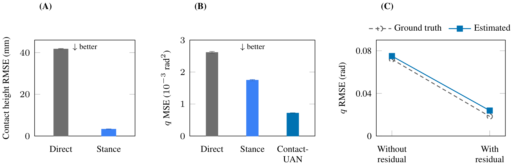
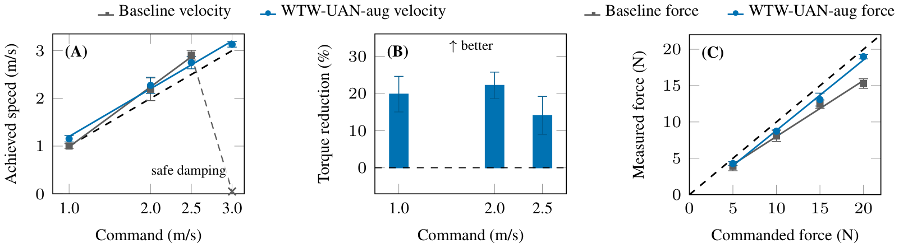
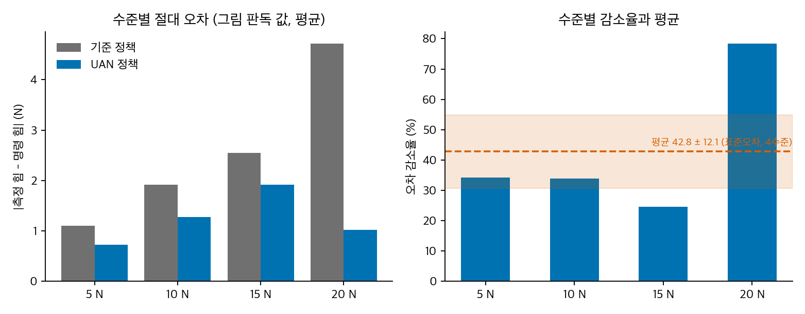
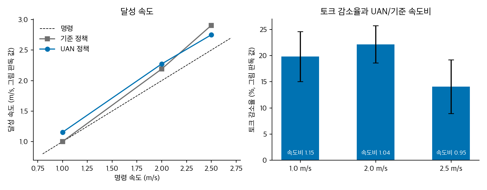
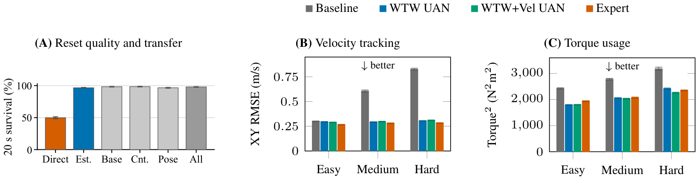
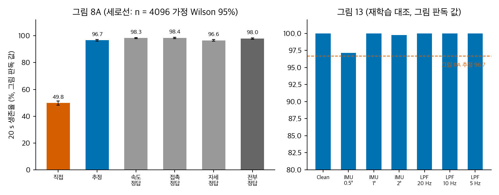
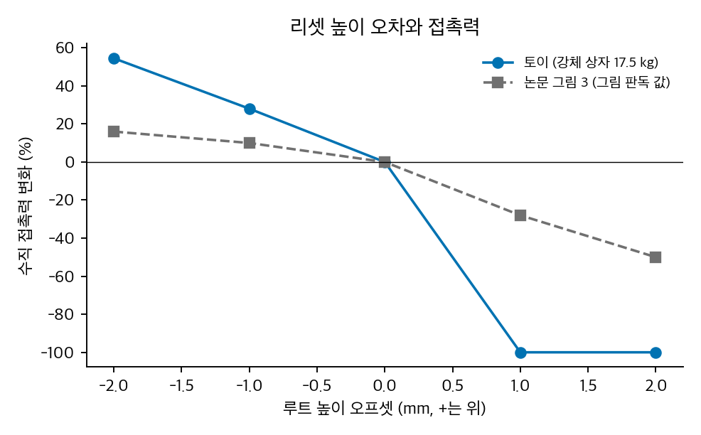

> **논문:** Nolan Fey, Khai Nguyen, Yash Prabhu, Gabriel B. Margolis, Pulkit Agrawal. *Contact-UAN: Unsupervised Actuator Networks as a Residual World Model for Humanoid Control.* CoRL 2026 포스터, arXiv:2610.18991 (v1, 2026-10-13).
> 공식 코드는 GitHub nolie-rolie/contact-uan(Apache-2.0)에 있고 정적으로만 읽었습니다. 이 글의 그림은 논문의 그래프 세 장(출처 표기)과 우리가 그린 그래프 네 장입니다.

## 논문이 묻는 것

시뮬레이션에서 학습한 휴머노이드 정책은 동작의 모양은 하드웨어로 옮겨져도 힘의 크기와 타이밍은 옮겨지지 않을 수 있습니다. 논문은 이 차이를 구동기 모델 탓으로 보고, 시뮬레이터는 그대로 두고 **관절 위치 목표에 더하는 잔차 δq만 학습**합니다. 토크 센서가 없어도 되도록, 하드웨어에서 기록한 명령을 시뮬레이터에서 24스텝(480 ms) 다시 재생했을 때 관절 위치가 맞도록 PPO로 학습합니다. 이 방식은 선행 UAN(RSS 2025)에서 매니퓰레이터를 단 사족 로봇에 쓰였고, 이 논문은 접촉이 있는 떠 있는 베이스(floating base) 휴머노이드로 확장합니다.

## 접촉이 문제를 어렵게 만드는 이유

재생을 시작하는 시뮬레이터 상태가 하드웨어와 같은 접촉력을 내지 못하면, 잔차는 구동기 오차가 아니라 리셋 오차를 보정하게 됩니다. 소프트 접촉에서는 발이 바닥에 "정확히 닿은" 상태가 아니라 약간 파고든 상태가 하중을 받치고, 논문 그림 3은 루트 높이 +2 mm가 수직항력을 약 50% 줄인다고 보입니다. 그래서 논문의 핵심 기여는 **고유감각만으로 "접촉이 일관된 리셋 상태"를 추정하는 것**입니다. 접촉 확률, 지지 발의 높이와 기울기, 베이스 속도를 신경망 여섯 개로 따로 회귀하고, 접촉 확률로 가중해 루트 높이와 자세를 합칩니다. 절대 베이스 높이는 입력에서 빼고, 자세는 접촉 중인 샘플로만 학습합니다.

UAN 자체는 작습니다. G1의 29관절을 구동기 계열 5개로 묶어, 계열마다 6-128-128-1 ELU MLP를 두고 입력은 (목표 오차, 관절 속도)의 3스텝 이력입니다. 파라미터는 계열당 17,537개, 합계 87,685개입니다(우리 계산). 6.5분 걷기 데이터로 학습한 UAN을 얼려 두고 달리기, 힘 제어, 점프 정책을 시뮬레이션에서 학습한 뒤 정책만 로봇에 올립니다.

## 재생 정확도: 개선은 크지만 학습 데이터에서의 값

*논문 그림 5. 접촉 높이 RMSE, 하드웨어 24스텝 관절 위치 MSE, sim-to-sim RMSE. © 저자, CC BY 4.0, 출처 arXiv:2610.18991 (v1).*

그림 5A에서 접촉 샘플로만 학습한 추정기는 접촉 높이 RMSE가 약 3.3 mm로, 전 보행 단계를 한꺼번에 회귀한 약 41.7 mm의 12.7분의 1입니다(그림 판독 값). 그림 5B의 24스텝 MSE는 2.61, 1.75, 0.72(×10⁻³ rad²)로 줄지만, 캡션이 "WTW training data"라고 적고 있어 **UAN 학습에 쓴 데이터에서의 값**입니다. 논문에서 학습에 쓰지 않은 하드웨어 데이터의 정량 지표는 그림 6C의 토크 사용량 불일치(0.170 → 0.052, 69.2% 감소) 하나이며, 막대로 읽은 값이 본문과 맞습니다. 그림 5C는 정답 초기화에서도 잔차가 RMSE를 0.0720에서 0.0184 rad로 줄인다는 점을 보입니다. 같은 구성에서 정답으로 다시 학습한 UAN은 0.0120 rad라서, 두 값의 차이가 리셋 보정의 잔여분인지는 논문만으로는 알 수 없습니다.

## 힘 추종: "43% ± 12.1%"의 구성

*논문 그림 7. 달성 속도, 토크 감소율, 측정 힘. © 저자, CC BY 4.0, 출처 arXiv:2610.18991 (v1).*

*우리가 그린 그래프. 그림 7C의 마커 좌표에서 읽은 수준별 힘 오차(그림 판독 값)와 오차 감소율.*

그림 7C의 마커를 읽으면 명령 5, 10, 15, 20 N에서 오차 감소율이 약 34.3, 33.9, 24.6, 78.4%입니다. 네 값의 평균은 42.8, 표준오차는 12.1로 캡션의 "42.8 ± 12.1%"와 맞습니다. 즉 이 "±"는 시행 4회의 변동이 아니라 **명령 수준 네 개의 표준오차**로 읽힙니다(수준 4개, 그림 판독 값 기준). 20 N 수준 하나가 78%로 평균을 끌어올리며 앞 세 수준만 평균하면 30.9%, 모든 수준의 절대 오차를 합쳐 비교하면 52.1%입니다. 어떻게 집계해도 UAN 쪽이 낫지만 크기는 31–52% 사이에서 집계에 따라 달라집니다. 기준 정책은 명령보다 17–24% 덜 밀고, UAN 정책은 5–14% 덜 밀었습니다.

## 달리기 토크 "20%": 세 막대 평균 18.7%, 속도와 함께 읽기

그림 7B의 세 막대(명령 1.0, 2.0, 2.5 m/s)는 약 19.8, 22.2, 14.1%이고 평균은 18.7%입니다. 초록의 "20%"는 이 값과 가깝지만, 집계 방법은 본문에 없습니다. 그림 7A에서 두 정책의 달성 속도는 UAN/기준 비가 1.15, 1.04, 0.95여서 속도를 맞춘 비교는 아닙니다. 토크 사용은 속도에 따라 달라지므로 UAN 정책이 더 빠른 칸(1.0 m/s)과 느린 칸(2.5 m/s)의 해석이 다릅니다. 시행 5회(시행 수 5 가정)에 오차 막대가 표준오차라면 칸별 t 검정 p는 0.014, 0.0034, 0.052이고, 표준편차라면 모두 0.004 이하입니다. 오차 막대의 정의에 따라 결론이 갈리는 칸은 2.5 m/s 하나입니다. 3.0 m/s 명령에서는 UAN 정책이 3.13 ± 0.06 m/s를 내고, 기준 정책은 몇 초 뒤 모터 과열 보호로 멈춥니다.

*우리가 그린 그래프. 그림 7A와 7B에서 읽은 값(그림 판독 값). 오른쪽 막대 안의 숫자는 UAN/기준 달성 속도비.*

## 리셋 절제: 효과는 크고, 변동의 기준이 빠져 있습니다

*논문 그림 8. 리셋 절제 생존율, 속도 추종, 토크 사용량. © 저자, CC BY 4.0, 출처 arXiv:2610.18991 (v1).*

sim-to-sim "어려움" 설정에서 20 s 생존율은 직접 추정 리셋 49.8%, 접촉 일관 추정 리셋 96.7%, 오라클 리셋 96.6–98.4%입니다. 직접 추정과의 +46.8 %p는 분명한 차이입니다. 다만 그림에서 읽으면 자세 오라클(96.6%)이 추정 리셋(96.7%)보다 낮고, 부록 그림 13의 재학습 대조(Clean)는 약 100%입니다. 두 그림이 같은 구성이라면 재학습 변동이 3.3 %p 이상이라는 뜻이어서, 추정과 오라클 사이 1–2 %p 차이를 읽는 데는 조심이 필요합니다. 두 그림이 같은 구성인지는 저자 확인이 필요합니다. 또 "가장 낮은 발을 지면에 놓는" 단순한 리셋과의 비교는 논문에 없습니다.

*우리가 그린 그래프. 그림 8A와 그림 13의 생존율(그림 판독 값). 세로선은 환경 수 4,096을 가정한 Wilson 95% 구간이며 논문에는 시행 수가 없습니다.*

그림 8B–C에서 UAN으로 학습한 정책은 기준 정책이 크게 벌어지는 중간·어려움 목표에서 속도 오차 0.30 m/s 안팎(전문가 약 0.28), 제곱 토크 약 2,400(전문가 약 2,350)을 보입니다(그림 판독 값). 기준 정책은 어려움에서 0.83 m/s와 약 3,180입니다. 본문 4.3절에는 "전문가"가 어떻게 학습된 정책인지 정의가 없습니다.

## 소프트 접촉 토이

논문의 전제, "mm 단위 높이 오차가 접촉력을 크게 바꾼다"를 MuJoCo로 직접 확인했습니다. 논문 표 4와 같은 접촉 설정(MuJoCo 기본 solref, solimp)에서 17.5 kg 강체 상자를 평지에 두고 평형 높이를 기준으로 오프셋을 줬습니다.

*우리가 그린 그래프. 토이의 높이 오프셋에 따른 수직 접촉력 변화와 논문 그림 3의 값(그림 판독 값). 토이는 강체 상자 하나이며 크기 비교용이 아닙니다.*

평형 침투는 0.11 mm로 얕고, 평형에서 −2 mm면 접촉력이 +54.5%, +1 mm 이상 올리면 접촉이 사라집니다. 논문 그림 3은 −2 mm에서 약 +16%, +2 mm에서 약 −50%이므로 방향은 같고 크기는 다릅니다. 이 토이로는 G1의 접촉 크기를 재현하지 못하고, 리셋 정밀도가 중요하다는 방향만 확인했습니다.

## 공식 코드와 논문

공식 저장소는 mjlab의 사본 위에 UAN을 얹은 구조입니다. 하류 학습 설정(UAN 구조와 보상, PPO 값, 달리기·힘 제어·점프의 보상과 무작위화, 접촉 파라미터)은 대부분 논문 부록과 같습니다. 논문에 없는 값을 코드가 정하는 곳은 다음과 같습니다.

- UAN 입력에서 관절 속도에 0.05를 곱하고 입력 정규화는 쓰지 않습니다.
- 학습 반복 수는 논문에 없고, 코드 기본값은 100,000, 문서 예시는 2,000입니다. 예시를 쓰면 6.5분(19,500행) 데이터를 약 1만 번 재방문합니다.
- 접촉 확률 임계값이 루트 높이 융합에서는 0.5, 발 높이·기울기 융합과 창 선택에서는 0.8입니다.
- 추정기 입출력에 z-정규화가 있고, 토크-속도 포락선의 값(5020 모터 25 N·m, 37 rad/s 등)은 코드 상수입니다.

사전학습 정책과 하드웨어 데이터는 저장소에 없고, 부록의 sim-to-sim 대상, 오라클 리셋, 세계 모델 기준선을 만드는 코드는 찾지 못했습니다(2026-11-26 기준). 저장소의 `third-party/openhomie`는 CC BY-NC 4.0 고지를 가집니다.

## 확인이 필요한 곳

1. 하드웨어 실험의 대조군이 "노미널 시뮬레이터 + 가벼운 무작위화 정책" 하나입니다. SysID나 토크 지도학습 모델과의 하드웨어 비교는 논문에 없습니다.
2. 오차 막대(표준편차인지 표준오차인지), 3.0 m/s와 점프의 시행 수, 점프 높이의 수치가 없습니다.
3. 접촉 일관 리셋의 효과는 sim-to-sim 한 설정에서 보였고, 추정기와 목표 시뮬레이터가 같은 접촉 모델을 씁니다. 하드웨어와 시뮬레이터의 접촉 모델 차이를 넘는 정확도는 간접 증거(재생 오차)뿐입니다.
4. 그림 8A 추정과 그림 13 Clean이 같은 구성인지.

## 정리

본문의 큰 숫자(69.2%, 42.8 ± 12.1%, 0.0720 → 0.0184 rad, 49.8 → 96.7%, 33시간과 400배)는 그림 판독과 산술로 재현됩니다. 이 논문을 읽을 때 얻는 것은 "접촉이 있는 재생에서는 리셋이 구동기 잔차의 전제 조건"이라는 문제 설정과 이를 고유감각으로 푸는 구성이고, 효과 크기는 집계 방식(수준 평균, 세 막대 평균, 속도 비)을 함께 봐야 정확히 읽힙니다.

## 자료

- [통합 리포트 PDF](report/report_public.pdf)
- [01. 논문 분석: Contact-UAN (arXiv:2610.18991)](analysis/01_paper_analysis.md)
- [02. 선행연구와 코드 저장소: Contact-UAN (arXiv:2610.18991)](analysis/02_prior_work.md)
- [03. 수치 재계산과 해석: Contact-UAN (arXiv:2610.18991)](analysis/03_analysis.md)
- [04. 논문과 공식 코드 대조: Contact-UAN (arXiv:2610.18991)](analysis/04_code_verification.md)
