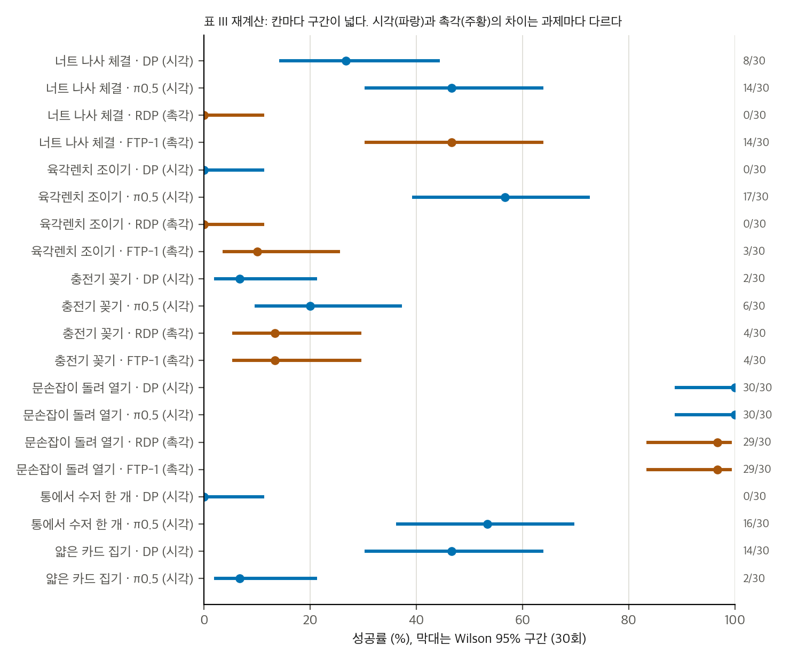
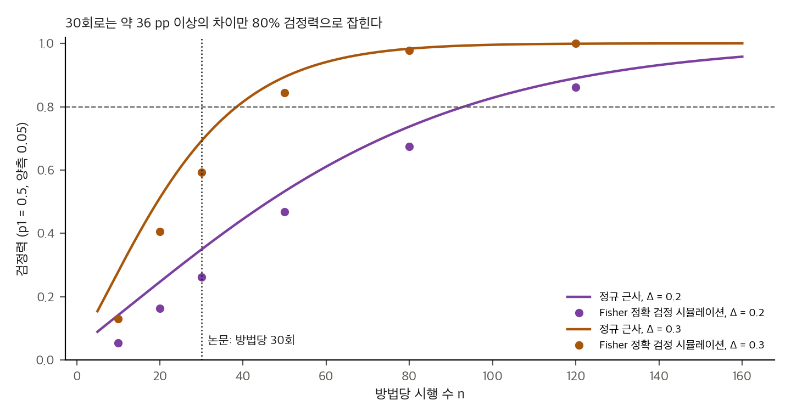
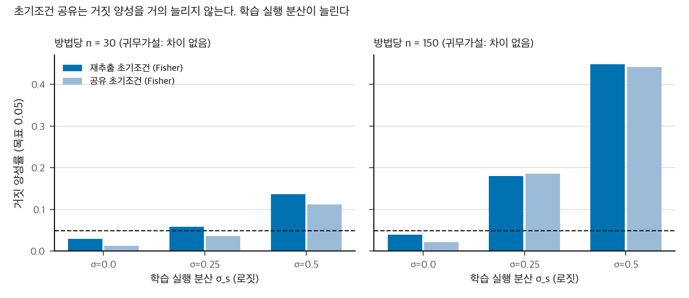
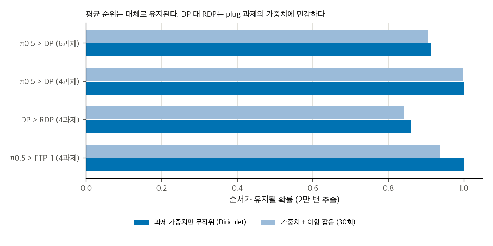

> **논문:** Xiang, Wang, Bohg, Yuan. *ContactBench 1.0: A Benchmark for Everyday Contact-Rich Robotic Manipulation.* arXiv:2610.24512 (v2, 2026-10-23). 학회 채택 표기는 확인하지 못했습니다(프리프린트).
> 논문 그림은 라이선스(arXiv 비독점 배포) 때문에 싣지 않았습니다. 그래프는 논문 표 III의 수치와 직접 만든 토이로 그렸습니다. 그림과 영상은 [프로젝트 페이지](https://jingyi-xiang.github.io/contactbench/)에서 볼 수 있습니다.

---

## 논문이 묻는 것

접촉이 많은 조작은 평가하기 어렵습니다. 과제가 다양하고, 연구실마다 재현하기 어렵기 때문입니다. 저자들은 사람의 일상 조작을 관찰해 **접촉 기술 8개**(얇은 물체 잡기, 여러 물체 잡기, 군집에서 잡기, 제약 아래 놓기, 손안 재배치, 외부 접촉 제어, 관절 물체 조작, 삽입과 정렬)를 뽑고, 이를 **과제 36개**로 구체화했습니다.

물체는 PLA 3D 프린트와 M3 나사로 만듭니다. 인쇄된 압축·비틀림 스프링이 실제 물체와 비슷한 힘을 내도록 설계했습니다. 문손잡이와 콘센트 두 종류에서 손목 힘 센서로 인쇄본과 실물을 맞춰 보았습니다. 같은 물체의 시뮬레이션 모델도 공개합니다(Newton과 MuJoCo Warp 기반).

정책 실험은 과제 6개에서 이뤄집니다. 시각 정책 Diffusion Policy와 π0.5, 촉각을 더한 Reactive Diffusion Policy와 FTP-1을 비교합니다. 과제당 30회, 같은 30개 초기 조건을 씁니다. 결론은 "시각 정책은 접촉을 인지하지 못하고, 촉각을 더해도 나아지지 않는다"입니다.

## 결과 재계산

표 III의 22개 칸은 Fig. 11의 단계 퍼널 마지막 값과 모두 맞습니다. 본문 수치 "56.7%"(17/30)와 "20%"(6/30)도 맞습니다. 칸마다 Wilson 95% 구간을 그리면 폭이 11–34 pp입니다. 30회로 얻은 성공률은 이 정도로 흔들립니다.

## 촉각은 "나아지지 않는다"보다 강하게 말할 수 있습니다

과제 4개에서 촉각 변형과 기반 정책을 비교했습니다.

| 비교 | 과제 | 시각 대 촉각 | Holm 보정 p |
|---|---|---|---|
| DP 대 RDP | 너트 나사 체결 | 8/30 대 0/30 | 0.018 |
| π0.5 대 FTP-1 | 나사 조이기 | 17/30 대 3/30 | 0.001 |

보정 후 유의한 차이 두 건은 모두 **촉각 쪽이 낮습니다**. 4과제를 층화한 CMH 검정은 p = 0.10(RDP)과 0.0097(FTP-1)입니다. 그런데 두 효과는 각각 과제 하나에 기댑니다. 한 과제를 빼면 RDP의 효과는 사라지고(p = 1.00), FTP-1의 효과도 사라집니다(p = 0.69).

FTP-1의 조이기 저하는 논문이 설명한 기제와 맞습니다. 렌치가 손안에서 미끄러지면 촉각 신호가 "조임 완료"처럼 보여 조기에 멈춥니다. 다만 이 기제는 에피소드별 로그가 없어서 검증하지 못했습니다.

## 시각 정책끼리의 차이도 과제에 따라 다릅니다

π0.5는 DP보다 나은 것처럼 보입니다. 하지만 보정 후 유의한 것은 조이기(0/30 대 17/30)와 수저 통(0/30 대 16/30) 두 과제뿐입니다. 너트(8 대 14)와 충전기(2 대 6)는 차이가 검정력 밖입니다. 카드는 반대로 DP가 14/30, π0.5가 2/30입니다.

## 30회 설계가 잡을 수 있는 차이

방법당 30회로 80% 검정력을 얻으려면 차이가 약 36 pp 이상이어야 합니다. 10 pp 차이의 검정력은 약 0.12입니다. 표의 칸 차이 대부분은 이 크기 안에 있습니다. 4–10 pp 차이를 주장하는 결론은 이 설계로는 나오지 않습니다.

## 가정 문제: 같은 초기 조건보다 학습 실행의 분산

논문은 네 방법에 같은 30개 초기 조건을 씁니다. 쌍 구조는 검정을 더 강하게 만들 수 있습니다. 토이로 확인하니 초기 조건을 공유하는 것 자체는 거짓 양성을 늘리지 않았습니다.

거짓 양성을 키우는 것은 **학습 실행의 분산**입니다. 정책마다 한 번 학습한 값은 시행을 늘려도 평균되지 않습니다. 학습 실행 차이를 로짓 0.5로 가정하면, 방법당 150회에서 귀무가설을 "유의하다"고 잘못 판정하는 비율이 약 0.45가 됩니다. 논문은 학습 실행을 한 번만 보고하므로, 이 분산을 자료에서 알 수 없습니다.

## 집계 점수는 과제 선택에 민감합니다

과제 6개 평균과 촉각 방법이 평가된 4과제 평균은 다른 집합입니다. 4과제 기준에서는 촉각 방법이 시각 기준보다 낮습니다(RDP 27.5%, DP 33.3%, FTP-1 41.7%, π0.5 55.8%). 과제 가중치를 무작위로 바꿔 보면 π0.5 > DP는 거의 항상 유지되고, DP > RDP는 충전기 과제의 가중치가 커지면 뒤집힙니다.

## 코드는 논문의 어느 부분을 구현했나

공식 저장소(MIT, 별 9개)는 시뮬레이션 과제 22개를 73행으로 제공합니다. 각 과제는 논문 성공 기준을 자동으로 판정합니다. 그러나 두 가지가 빠져 있습니다.

- **정책 학습과 평가 파이프라인이 공개되지 않았습니다.** 저장소 README에 "not part of this release"라고 씁니다. 표 III는 이 저장소로 다시 만들 수 없습니다.
- **논문에 없는 수치 기준**이 있습니다. 예를 들어 충전기 밀기에서 콘센트 반력 8 N 이상, 카드 들어 올림 30 mm 이상, 문손잡이 잠금 해제 전 열림 1° 미만. 성공의 정의가 텍스트보다 엄격합니다.

논문의 "힘 > 40 N" 지표는 코드의 채점 기준이 아닙니다. 40 N은 원격조작 안전 가드의 임계값입니다. 로봇 초기 자세의 가우시안 샘플링도 코드에 없습니다.

## 이 맥에서 재현할 수 있나

**아닙니다.** 시뮬레이터는 Linux와 NVIDIA GPU(CUDA 12)를 요구합니다. 정책 평가는 실물 로봇 여러 종류, 사람 시연 약 600회, GPU 학습을 요구합니다. 공개된 것으로는 할 수 없습니다. 할 수 있는 것은 표 재계산, 검정, 토이, 과제 사양 읽기입니다. 정책 수준의 주장을 검증하려면 저자의 평가 코드와 에피소드별 기록이 필요합니다.

## 정리

- 접촉 과제의 **정의와 자산 설계**는 가치가 큽니다. 인쇄 스프링으로 힘을 맞추는 방법은 다른 연구에서도 쓸 수 있습니다.
- **정책 비교**는 30회, 한 번의 학습으로는 큰 차이만 잡습니다. 보정 후 유의한 촉각 효과는 해로운 쪽이었습니다. 이 점은 논문 결론보다 강합니다.
- **재현**은 공개 자료로 불가능합니다. 에피소드별 기록과 평가 코드가 공개되면 검정 설계를 다시 볼 수 있습니다.

---

*분석은 CPU에서 했습니다(numpy 단일 스레드, scipy의 Fisher 정확 검정). 원자료가 없으므로 모든 검정은 집계 표를 기준으로 합니다. 재계산과 토이 코드는 게시 패키지에 있습니다.*

## 자료

- [통합 리포트 PDF](report/report_public.pdf)
- [ContactBench 1.0 (arXiv:2610.24512) 논문 분석](analysis/01_paper_analysis.md)
- [ContactBench 1.0: 선행연구, GitHub 저장소, v1 → v2 차이](analysis/02_prior_work.md)
- [ContactBench 1.0: 표 재계산, 유의성, 검정력, 토이 분석](analysis/03_analysis.md)
- [ContactBench 1.0: 논문 ↔ 공식 코드 대조 (정적 읽기)](analysis/04_code_verification.md)
