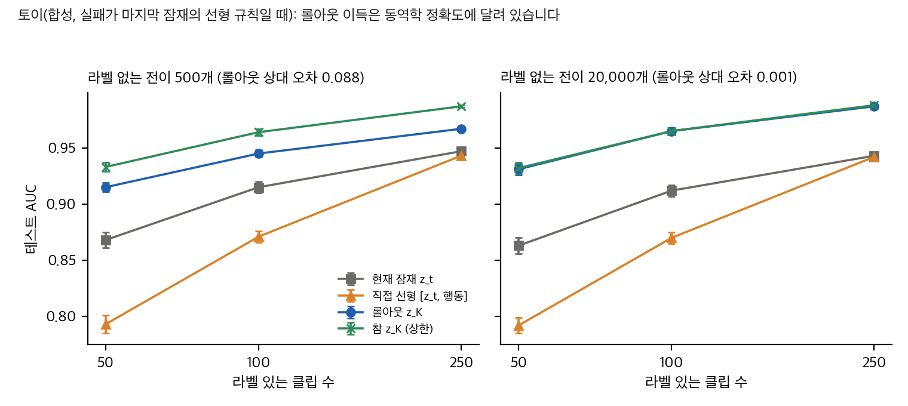
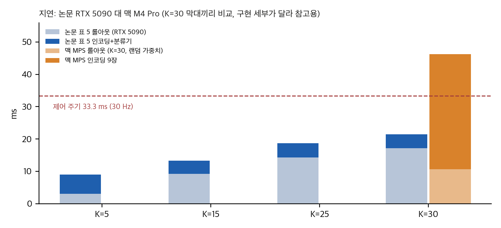
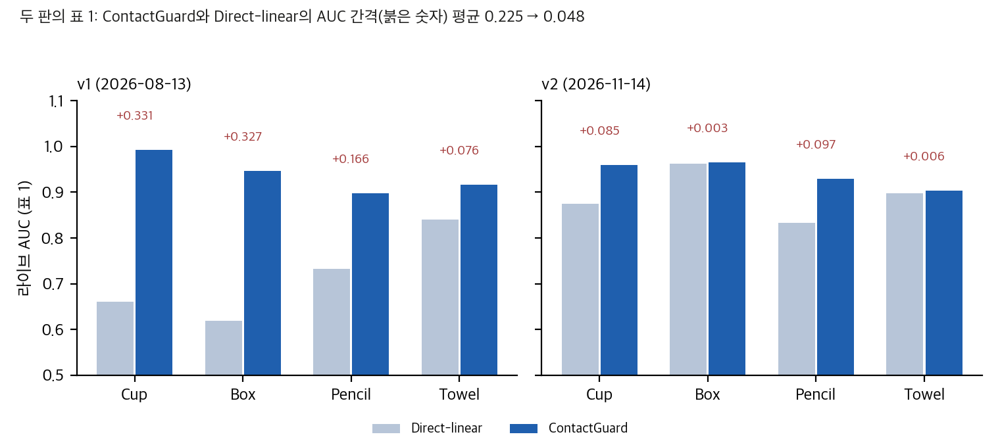
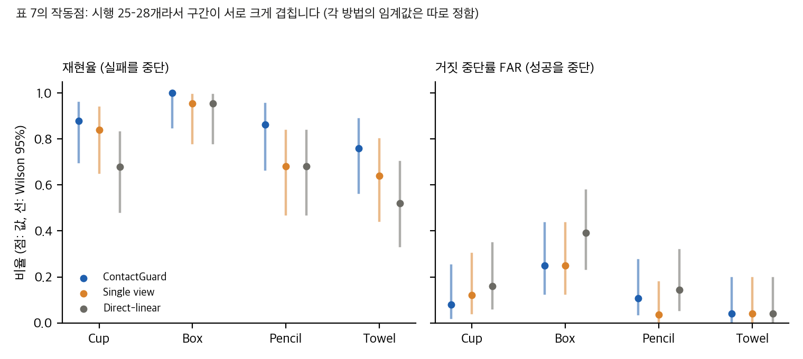

# 03. 수치 재계산, 일관성 검사, 토이

이 문서는 논문 표의 수치를 다시 계산하고(§1–2), 중심 주장을 작은 CPU 토이로 점검합니다(§3–4). 재계산은 `analysis/recompute.py`(결과 `recompute_results.json`), 토이는 `analysis/toy_rollout_probe.py`, 구조와 지연 측정은 `analysis/bench_monitor.py`입니다. 점검 항목은 V1–V16입니다. 점수 원자료가 없어서 AUC의 유의성은 근사입니다.

## 0. 가정

- 시행 수는 표 7의 N+/N−를 씁니다: Cup 25/25, Box 22/28, Pencil 22/28, Towel 25/25(양성 = 실패). 표 3의 "성공한 롤아웃" 수는 N−와 같다고 가정합니다(논문은 수를 적지 않았습니다).
- AUC의 표준오차는 Hanley-McNeil 근사입니다. 방법들은 같은 50개 시행을 채점하므로 AUC 사이에는 양의 상관이 있고, 이를 모르면 독립 가정의 z는 보수적(작은 값)입니다. 상관별 최소 검출 차이를 V16에 따로 적었습니다.
- Wilson 95% 구간은 재현율과 FAR 각각에 대한 것입니다.
- 모든 검정은 양측이고(부호 검정만 단측 명시), 논문의 값은 소수 셋째 자리까지 반올림된 것으로 봅니다.

## 1. 재계산 결과

### 1.1 표 안과 표 사이의 일치 (V1–V4)

| 항목 | 결과 |
|---|---|
| V1. 표 7 혼동행렬 → 재현율, FAR, 정밀도, 균형 정확도 | 12행(과제 4 × 방법 3) 모두 보고값과 일치(최대 차 < 0.0006). TP+FN = N+, FP+TN = N−도 12행 모두 성립 |
| V2. 표 1의 값 = 표 7의 값 | 12행 모두 같음 |
| V3. 표 2, 4, 6의 같은 값 | 표 2의 ContactGuard, Single view, Direct-linear 열과 표 4의 이미지만 열, 표 6의 Ours, Single view, Direct-linear(AUC, BAcc)가 표 1과 모두 같음 |
| V4. AUC가 정수 쌍 수로 가능한가 | 12개 모두 U/(N+·N−)로 반올림하면 보고값이 나오는 U가 존재. 또 모두 작동점으로 정해지는 하한 (1+재현율−FAR)/2 = 균형 정확도 이상이고 상한 FAR·재현율 + (1−FAR) 이하 |

표 안의 산술은 맞습니다. 표 사이의 일치는 표 2, 4, 6이 표 1의 같은 점수에서 나왔음을 뜻합니다.

### 1.2 방법 간 비교: AUC 차이는 시행 수에 비해 작다 (V6, V8, V16)

ContactGuard 대비 AUC 차이와 쌍 환산(차이 × N+·N−, 점수 순서가 서로 바뀐 (실패, 성공) 쌍의 수에 해당), 독립 가정 z:

| 과제 | vs Single view | vs Direct-linear | vs Current latent | vs SAFE |
|---|---|---|---|---|
| Cup | +0.030 (19쌍, z 0.62) | +0.085 (53쌍, z 1.45) | +0.131 (82쌍, z 1.99) | +0.139 (87쌍, z 2.08) |
| Box | +0.041 (25쌍, z 0.81) | **+0.003 (약 2쌍, z 0.07)** | +0.123 (76쌍, z 1.88) | +0.067 (41쌍, z 1.20) |
| Pencil | +0.023 (14쌍, z 0.38) | +0.097 (60쌍, z 1.33) | +0.097 (60쌍, z 1.33) | +0.167 (103쌍, z 2.07) |
| Towel | +0.014 (9쌍, z 0.21) | **+0.006 (약 4쌍, z 0.09)** | +0.042 (26쌍, z 0.60) | +0.093 (58쌍, z 1.22) |

- 네 과제 평균 AUC는 ContactGuard 0.940, Single view 0.913, Direct-linear 0.892, Current latent 0.842, SAFE 0.824, RND 0.655, FAIL-Detect 0.619, PCA-kmeans 0.597입니다. ContactGuard가 네 과제 모두에서 가장 높습니다(4/4, 부호 검정 단측 p = 0.0625).
- **개별 과제에서 독립 가정 z가 약 2를 넘는 것은 SAFE와 Current latent 일부(Cup, Pencil)뿐입니다.** Single view와 Direct-linear에 대한 우위는 모든 과제에서 z < 1.5입니다. Box의 Direct-linear(0.963)와 Towel(0.898)은 점수 쌍 2–4개 차이입니다. 상관 0.5를 가정해도 z는 이 값의 약 1.4배입니다.
- **V16.** 검정력 0.8, 양측 5%로 가를 수 있는 AUC 차이(AUC 0.93, 이 시행 수): 상관 0이면 약 0.15–0.16, 0.5이면 약 0.11, 0.8이면 약 0.07입니다. 표 1과 2의 방법 간 간격은 대부분 이보다 작습니다.
- 따라서 "ContactGuard의 AUC가 모든 과제에서 가장 높다"는 문장은 표와 일치하고, "Direct-linear나 Single view보다 낫다"는 방향의 일관성(4/4)은 있지만 개별 과제의 유의성은 이 표본으로 판정되지 않습니다.

### 1.3 작동점: 합산 재현율과 FAR (V5, V7)

방법마다 임계값 τ를 따로 골랐으므로 같은 작동점의 비교가 아닙니다. 네 과제를 합산한 값(양성 94, 음성 106):

| 방법 | TP/FN | FP/TN | 재현율 [Wilson 95%] | FAR [Wilson 95%] |
|---|---|---|---|---|
| ContactGuard | 82/12 | 13/93 | 0.872 [0.790, 0.925] | 0.123 [0.073, 0.199] |
| Single view | 73/21 | 12/94 | 0.777 [0.682, 0.849] | 0.113 [0.066, 0.188] |
| Direct-linear | 66/28 | 20/86 | 0.702 [0.603, 0.785] | 0.189 [0.126, 0.274] |

- 비쌍 Fisher 검정(두 방법이 같은 시행을 채점하므로 검정력 면에서 참고치): 재현율 ContactGuard 대 Direct-linear p = 0.007, 대 Single view p = 0.12. FAR은 대 Single view p = 1.0, 대 Direct-linear p = 0.26입니다. 합산 FAR에서 Single view가 ContactGuard와 같거나 약간 낮습니다(12 대 13).
- 과제별 Wilson 구간은 표본이 25–28개 클래스라서 넓고 겹칩니다(예: Cup 재현율 ContactGuard 0.880 [0.70, 0.96], Direct-linear 0.680 [0.48, 0.83]). `report/figures/own_operating.png` 참조.

### 1.4 AUC가 0.5 아래인 검출기 (V9)

표 2의 FAIL-Detect(Box 0.284), RND(Box 0.326), PCA-kmeans(Box 0.282)는 0.5 아래입니다. 점수 방향을 뒤집으면 Box는 0.716, 0.674, 0.718입니다. PCA-kmeans의 Cup(0.710), Pencil(0.744)은 반대로 높습니다. 같은 검출기가 과제마다 방향이 달라진다는 뜻이고, 성공 데이터로만 정해지는 이상 점수에서 "실패일수록 높다"는 방향이 이 과제들에서 보장되지 않음을 보여 줍니다. 논문은 이를 "less consistently aligned"로 적었습니다(§4.2). 입력 정의와 구현 출처는 본문에 없습니다.

### 1.5 표 3: 행동 교란 (V10)

Δp > 0 비율을 성공 시행 수 N−로 환산하면 정수 개수로 가능합니다(Cup 21/25, Box 22/28, Pencil 21/28, Towel 16/25). 0.5 대비 단측 부호 검정 p는 Cup < 0.001, Box 0.002, Pencil 0.006, Towel **0.115**입니다. 평균 Δp에는 구간이나 표준편차가 없고, Shift는 평균 −0.05–+0.02(0 근처), Hold는 Box +0.87이 크고 나머지 +0.02–+0.12입니다. 행동 없는 변형의 Δp ≡ 0은 정의상 자명합니다.

해석에 대한 주의(관측-행동 어긋남): Transplant는 "다른 시도의 실패 행동"을 이 관측에 붙입니다. 학습에 쓰인 (관측, 행동) 분포에서 벗어난 입력일 가능성이 있어서, Δp 증가를 "행동이 결과를 정한다는 모형의 이해"로만 읽을 수는 없습니다. 같은 조건에서 **성공한 시도의 행동을 다른 성공 시도의 관측에 이식**한 대조군이 있으면 구분할 수 있습니다(`04` C7).

### 1.6 표 4: 고유감각 절제 (V11)

AUC 차이(이미지만 − 상태 포함): Cup +0.067(약 42쌍), Box +0.060(37쌍), Pencil +0.109(67쌍), Towel +0.235(147쌍). Towel의 0.669는 0.5에 가깝습니다. 융합이 초기화 값으로 고정되어(§4.3) 28차원 상태가 무작위 투영으로 잠재에 더해지는 설계입니다. 이 설계에서 상태가 AUC를 낮춘 것과 "고유감각이 해롭다"는 같은 주장이 아닙니다. 저자도 같은 한계를 적었습니다.

### 1.7 표 5: 지연의 산술 (V12)

| K | 호라이즌(s) 점검 | 롤아웃(ms) | 전체(ms) | 전체 − 롤아웃(인코딩 + 분류기) | 롤아웃/스텝(ms) |
|---|---|---|---|---|---|
| 5 | 0.167 (보고 0.17) | 3.08 | 9.02 | 5.94 | 0.616 |
| 15 | 0.500 | 9.26 | 13.24 | 3.98 | 0.617 |
| 25 | 0.833 (0.83) | 14.31 | 18.71 | 4.40 | 0.572 |
| 30 | 1.000 | 17.20 | 21.48 | 4.28 | 0.573 |

- 롤아웃은 K에 거의 선형입니다(기울기 0.558 ms/스텝, 절편 0.5 ms). "nearly linearly"와 일치합니다.
- 인코딩 비용은 K와 무관해야 하는데 K = 5에서만 5.94 ms로 다른 세 값(약 4.0–4.4)보다 1.5–2 ms 큽니다. 워밍업이나 측정 조건 차이일 수 있습니다. 결론(K = 30에서 21.48 ms < 33.3 ms, 제어 주기의 64%)에는 영향이 없습니다.
- v1 표 4(전체 − 롤아웃 3.6–3.8 ms, 롤아웃/스텝 0.51–0.55 ms)와 비교하면 v2가 인코딩에 약 0.5 ms를 더 쓰고 롤아웃 기울기도 약간 큽니다. 인코더가 ViT-Tiny에서 DINOv2-S로 바뀐 영향으로 읽을 수 있습니다(가능성).

### 1.8 판 사이 변화 (V13)

표 1(라이브)의 AUC가 두 판에서 달라진 정도:

| 과제 | Ours v1 → v2 | Direct-linear v1 → v2 | Ours − Direct v1 → v2 | Ours − 단일 뷰 기준선 v1(LeWM) → v2(Single view) |
|---|---|---|---|---|
| Cup | 0.992 → 0.960 | 0.661 → 0.875 | 0.331 → 0.085 | 0.064 → 0.030 |
| Box | 0.946 → 0.966 | 0.619 → 0.963 | 0.327 → 0.003 | 0.013 → 0.041 |
| Pencil | 0.898 → 0.930 | 0.732 → 0.833 | 0.166 → 0.097 | 0.026 → 0.023 |
| Towel | 0.917 → 0.904 | 0.841 → 0.898 | 0.076 → 0.006 | 0.123 → 0.014 |
| 평균 | | | **0.225 → 0.048** | 0.056 → 0.027 |

- v1 표 8의 혼동행렬도 12행 모두 보고된 정밀도, 재현율, FAR, 균형 정확도와 일치합니다.
- **클래스 수(N+, N−)는 v1과 v2에서 같습니다.** 모델이 바뀌었는데도 클래스 수가 같습니다. v2 표 1이 새로 모은 닫힌 루프 시도인지, 같은 시도를 새 모델로 평가한 것인지는 논문에 적혀 있지 않습니다. 저자 확인이 필요합니다(`04` C9, §5).
- 특히 Direct-linear의 AUC가 Box에서 0.619 → 0.963로 크게 바뀌었습니다. 같은 구조(고정 인코더 + 선형 프로브)가 인코더 교체 하나로 이 정도 움직였다는 것은, 이 비교의 결과가 인코더 선택에 민감하다는 의미로 읽을 수 있습니다.

### 1.9 유병률과 정밀도 (V14, V14b)

표 7의 시험 집합 실패율은 Cup, Towel 50%, Box, Pencil 44%입니다(전부 중단하는 정책의 정밀도와 같음). 재현율과 FAR을 고정하고 실패 유병률 p만 바꾸면 정밀도는 p·재현율 / (p·재현율 + (1−p)·FAR)입니다.

| 과제(ContactGuard) | p = 0.5 | 0.3 | 0.1 | 0.05 |
|---|---|---|---|---|
| Cup | 0.917 | 0.825 | 0.550 | 0.367 |
| Box | 0.800 | 0.632 | 0.308 | 0.174 |
| Pencil | 0.890 | 0.776 | 0.473 | 0.298 |
| Towel | 0.950 | 0.891 | 0.679 | 0.500 |

배포에서 실패가 드물면 같은 FAR에서도 거짓 중단이 다수가 됩니다. 이는 논문 결과의 오류가 아니라 표 1의 정밀도가 시험 집합의 구성에 묶여 있다는 뜻입니다.

### 1.10 임계값 (V15)

Youden-J로 고른 τ는 Ours: Cup 0.487, Box **0.022**, Pencil 0.519, Towel 0.613이고 Direct-linear는 Box 0.018입니다. Box에서 점수의 대부분이 0.02 이상이면 중단하는 규칙이 되어, 프로브 출력이 확률로 보정되어 있다고 보기 어렵습니다(본문은 P(fail)로 부름). 보정 곡선이나 신뢰도 도표가 없습니다.

### 1.11 부록 A의 규모 산술

부록 A: 인코더 21.8 M, 학습 13.2 M, 전체 35.0 M. §3.3과 부록 A의 구조 서술대로 랜덤 가중치 모듈을 만들어 센 값(§4.2): 인코더 ViT-S/14 21.62 M + 고정 사영 0.148 M, 학습 부분 13.01 M(블록 10.64 + 예측 헤드 1.18 + 행동 임베더 1.19), 합계 34.78 M입니다. 논문과 각각 0.2 M 이내로 일치합니다(행동 임베더의 conv 폭과 위치 임베딩 등 논문에 없는 세부가 남은 차이일 수 있습니다).

## 2. 요약 표: 재계산 판정

| 번호 | 검사 | 판정 |
|---|---|---|
| V1 | 혼동행렬 → 비율 (12행) | 일치 |
| V2 | 표 1 = 표 7 | 일치 |
| V3 | 표 2, 4, 6 ↔ 표 1 같은 값 | 일치 |
| V4 | AUC 정수 쌍 가능성과 작동점 상·하한 | 가능, 범위 안 |
| V5 | Wilson 구간 | 구간이 넓고 겹침 |
| V6 | 방법 간 AUC 차이(쌍 환산, z) | Single view, Direct-linear 대비 z < 1.5 |
| V7 | 합산 재현율/FAR | 재현율 대 Direct p = 0.007, 대 Single p = 0.12, FAR 구분 안 됨 |
| V8 | 평균 AUC, 4/4 방향 | ContactGuard 최고, 부호 p = 0.0625 |
| V9 | AUC < 0.5 | Box의 FAIL-Detect, RND, PCA-kmeans |
| V10 | 표 3 비율의 정수 가능성과 부호 검정 | 가능, Towel p = 0.115 |
| V11 | 표 4의 차이 | 0.060–0.235, 고정 융합 조건 |
| V12 | 표 5 산술 | 호라이즌, 선형성 일치, K = 5의 인코딩 비용만 큼 |
| V13 | v1 대 v2 | Ours − Direct 평균 0.225 → 0.048, 클래스 수 같음 |
| V14 | 유병률 | 시험 실패율 44–50%, 정밀도는 이에 종속 |
| V15 | 임계값 | Box 0.022, 0.018 |
| V16 | 최소 검출 차이 | 약 0.07–0.16 (상관 0.8–0) |

표와 본문의 직접 모순은 찾지 못했습니다. 본문의 서술(§4.2 "Direct-linear가 모든 라이브 과제에서 AUC가 낮다", "Box에서 거의 동률")은 표 값과 일치합니다(Box 0.966 대 0.963).

## 3. 토이: 롤아웃한 미래 잠재 위의 선형 프로브는 언제 직접 선형 프로브보다 나은가

(`analysis/toy_rollout_probe.py` → `toy_rollout_probe_results.json`, torch CPU, 약 70초)

논문 §4.2는 라벨이 적을 때 ẑ_{t+K}에 선형 프로브를 쓰는 것이 (z_t, 행동 청크)에 대한 선형 프로브보다 낫다고 말합니다. 합성 환경으로 이 주장이 성립할 조건을 따져 봅니다. **모두 우리의 가정이고 논문 수치의 재현이 아닙니다.**

- 잠재 z ∈ R^16, 행동 a ∈ R^4, 청크 K = 6. 참 동역학 z' = z + 0.4·tanh(Wz + Ua) + 잡음(비선형).
- 결과: 마지막 잠재 z_K의 규칙. (a) 선형 규칙 y = 1[v·z_K > 0] + 라벨 잡음 5%(논문의 가정: 실패 정보가 미래 잠재에서 선형으로 읽힘), (b) 선형이 아닌 규칙 y = 1[z_K[0]·z_K[1] > 0].
- 세계모델: 라벨 없는 전이 n_unlab개로 MLP 동역학을 학습하고 K 스텝 롤아웃. 프로브: 표준화 + ℓ2 로지스틱(클래스 균형). 시드 5 × 라벨 집합 8, 시험 3000개.

| 설정 (선형 규칙) | 현재 잠재 z_t | 직접 선형 [z_t, 행동] | 롤아웃 ẑ_K | 참 z_K (상한) |
|---|---|---|---|---|
| 라벨 50, 전이 500 | 0.868 | 0.793 | 0.915 | 0.933 |
| 라벨 100, 전이 500 | 0.915 | 0.871 | 0.945 | 0.964 |
| 라벨 250, 전이 500 | 0.947 | 0.943 | 0.967 | 0.987 |
| 라벨 50, 전이 20,000 | 0.863 | 0.792 | 0.931 | 0.932 |
| 라벨 100, 전이 20,000 | 0.912 | 0.870 | 0.965 | 0.965 |
| 라벨 250, 전이 20,000 | 0.943 | 0.942 | 0.987 | 0.988 |

- **롤아웃이 직접 선형을 이기는 조건:** 실패가 z_K의 선형 규칙일 때, 라벨이 적을수록(50개에서 +0.12–0.14) 이득이 큽니다. 라벨 250개에서 직접 선형과의 차이는 +0.02–0.045로 줄어듭니다.
- 세계모델의 정확도(롤아웃 상대 오차 0.088 대 0.001)가 이득을 정합니다. 전이 500개에서는 참 z_K와 0.02 정도 벌어지고, 20,000개에서는 상한과 같아집니다.
- 규칙이 선형이 아니면(b) 현재, 직접, 롤아웃, 참 z_K 모두 AUC 0.50 근방으로 구분이 없습니다. 선형 프로브가 읽을 수 있는 표현이어야 "롤아웃 + 선형 프로브"가 의미를 가집니다.
- 이 토이에서 직접 선형은 현재 잠재만 쓰는 것보다도 낮은데(라벨 50개에서 0.793 대 0.868, 차원 40 대 16), 표 2에서는 Direct-linear(평균 0.892)가 Current latent(0.842)보다 높습니다. 실제 과제에서는 행동 자체가 결과 정보를 담고 있다는 뜻입니다(토이는 행동이 무작위라 그렇지 않음).
- 한계: 선형 동역학이면 롤아웃은 새 표현력이 없고 데이터 효율만 바꿉니다. 이 토이의 동역학은 비선형이지만 합성입니다. 논문의 이득이 실제 데이터에서 같은 기전에서 오는지는 이 토이로 확인되지 않습니다. 표준오차는 40회 실행(비독립)으로 계산했습니다.

## 4. 맥에서 구조와 지연 점검 (`analysis/bench_monitor.py`)

### 4.1 파라미터 수

§1.11과 같습니다. 학습 13.01 M, 인코더 + 사영 21.77 M, 합계 34.78 M.

### 4.2 지연 (랜덤 가중치, FP32, 배치 1, 30스텝 롤아웃, 인코딩 9장, 캐시 없음)

| 장치 | 전체 중앙값(ms) | 인코딩 9장(ms) | 롤아웃 추정(ms) |
|---|---|---|---|
| 맥 MPS | 46.3 | 35.7 | 10.6 |
| 맥 CPU(4 스레드) | 214.8 | 109.9 | 104.9 |
| 논문 RTX 5090 (표 5) | 21.48 | (4.28, 인코딩 + 분류기) | 17.20 |

- 이 구현은 매 호출마다 세 시점 × 세 카메라 = 9장을 다시 인코딩합니다. 제어 주기마다 새 프레임 3장만 인코딩하고 이전 잠재를 캐시하면 인코딩은 약 12 ms로 줄고 전체는 약 23 ms가 됩니다(추정). 즉 33 ms 제어 주기 안에 들어갈 가능성이 있습니다. CPU는 불가능한 수준입니다.
- 논문의 5090 롤아웃(17.2 ms)이 MPS 추정(10.6 ms)보다 느린 것은 구현 차이(KV 캐시, 커널 분할, 혼합 정밀도)일 수 있습니다. 이 측정은 논문의 구현 세부가 없어서 구조만 따른 참고치입니다.

## 5. 그래프

