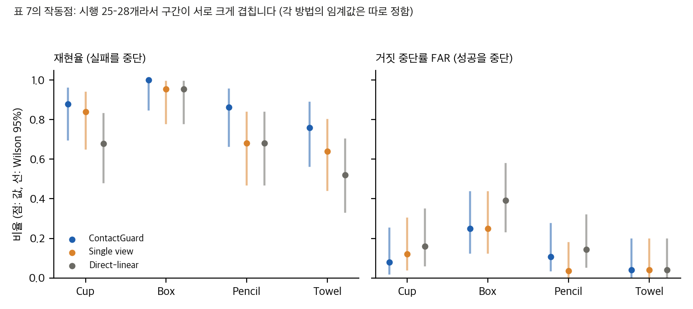
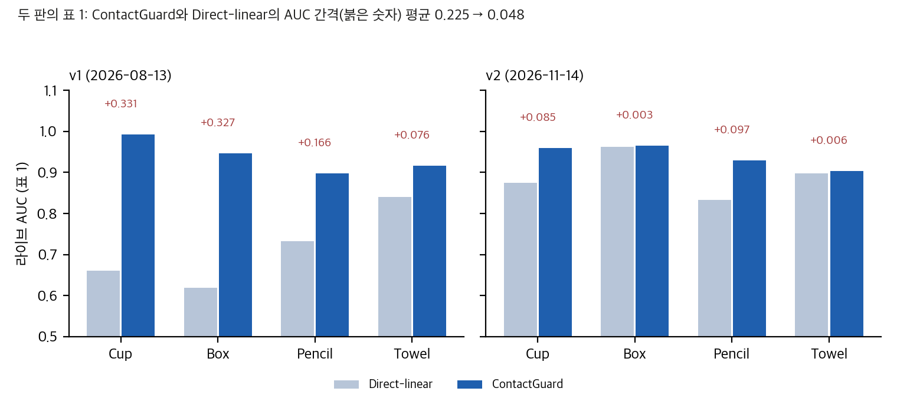
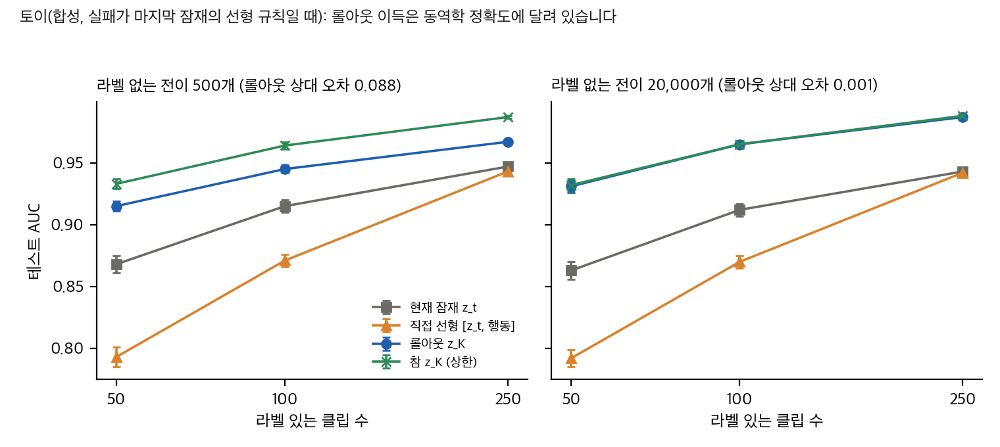
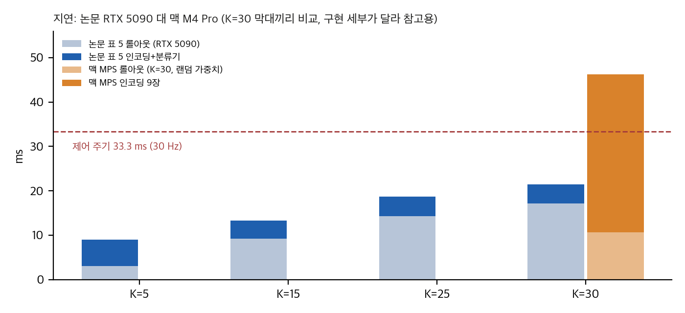

> **논문:** Gehan Zheng, Matthew Johnson-Roberson, Weiming Zhi. *ContactGuard: Pre-Contact Execution Monitoring with Action-Conditioned Latent World Models.* CoRL 2026 포스터, arXiv:2608.13438 (v2, 2026-11-14).
> 논문과 arXiv 페이지에서 코드나 프로젝트 페이지 링크를 찾지 못했습니다(2026-11-26 기준). 논문 그림은 싣지 않고, 우리가 만든 그래프만 씁니다.

## 논문이 묻는 것

접촉이 많은 조작에서는 로봇이 물체에 닿은 뒤에야 실패를 알아채는 경우가 많습니다. 그때는 물체를 이미 밀었거나 놓쳤을 수 있습니다. 이 논문은 질문을 바꿉니다. 정책이 막 내놓은 **행동 청크를 실행하면 어떻게 될지**를 접촉 전에 미리 굴려 보고, 실패할 것 같으면 중단할 수 있을까요?

방법은 **ContactGuard**입니다. 세 가지가 핵심입니다.

- 세계모델은 고정 DINOv2-S로 세 카메라 이미지를 384차원 잠재로 바꾸고, 행동을 조건으로 다음 잠재를 예측하는 13 M 파라미터 Transformer입니다. 라벨 없는 궤적으로 학습합니다.
- 그리퍼 닫힘 명령이 청크에 나타나면 닫힘 15프레임(0.5초) 전에 앵커를 잡고 30스텝을 롤아웃해, 닫힘 직후의 예측 잠재 하나를 읽습니다.
- 읽는 쪽은 로지스틱 회귀 프로브입니다. 과제마다 라벨 있는 접촉 전 클립 약 250개로 학습하고, 확률이 임계값을 넘으면 중단합니다.

평가는 14자유도 AgileX Piper 로봇에서 ACT 정책으로 컵, 상자, 연필, 수건 네 과제를 집는 시도에서 합니다. 과제당 50회입니다.

## 이 글에서 확인한 것

**표 안과 표 사이의 산술은 맞습니다.** 부록 표 7의 혼동행렬에서 재현율, 거짓 중단률, 정밀도, 균형 정확도를 다시 계산하면 12행이 모두 표 1의 값과 같습니다. 표 2, 4, 6의 같은 값도 표 1과 같고, AUC는 시행 수(25/25, 22/28)로 만들 수 있는 정수 쌍 값이며 작동점이 허용하는 범위 안에 있습니다.

**롤아웃이 직접 예측보다 높은 AUC를 보이는 방향은 네 과제 모두에서 유지됩니다. 다만 그 크기는 작습니다.** 네 과제 평균 AUC는 ContactGuard 0.940, 멀티뷰를 쓰지 않은 Single view 0.913, 롤아웃 없이 (현재 잠재, 행동)에 선형 프로브를 쓴 Direct-linear 0.892입니다. 이 차이를 점수 쌍 수로 환산하면 Box에서 Direct-linear와의 차이 +0.003은 약 2쌍, Towel의 +0.006은 약 4쌍입니다. Hanley-McNeil 근사(점수 원자료가 없어 독립 가정, 시행 수 N+/N−는 표 7)로 보면 Single view와 Direct-linear에 대한 차이는 모든 과제에서 z가 1.5 아래입니다. 이 시행 수에서 검정력 0.8로 가를 수 있는 AUC 차이는 약 0.07–0.16입니다. 그래서 "방향은 4/4로 일관된다"까지는 표가 지지하고, 개별 과제의 유의성은 이 표본으로는 판정되지 않습니다.

그래프: 표 7의 세 방법(ContactGuard, Single view, Direct-linear)의 재현율과 거짓 중단률(FAR)과 Wilson 95% 구간. 시행이 25–28개씩이라 구간이 크게 겹칩니다. 각 방법의 임계값은 따로 정해졌습니다. 우리가 그린 그래프입니다.

**v1에서 v2로 가면서 표 1이 크게 달라졌습니다.** v1은 학습하는 ViT-Tiny 인코더에 SIGReg 규제를 썼고 기준선이 LeWM이었습니다. v2는 인코더를 고정 DINOv2-S로 바꿨고 SIGReg를 쓰지 않으며 기준선이 Single view입니다. 표 2는 큰 오프라인 풀의 교차 검증에서 같은 저장 롤아웃의 한 번 계산으로 바뀌었고, 표 3의 행동 손상(섞기, 0, 평균)은 이식, 이동, 유지로 바뀌었습니다. 그 결과 ContactGuard와 Direct-linear의 라이브 AUC 간격은 네 과제 평균 0.225(v1)에서 0.048(v2)로 줄었습니다. Direct-linear의 Box AUC는 0.619에서 0.963으로 변했습니다. 같은 구조에서 인코더를 바꾸자 이 정도 움직였다는 것은 이 비교가 인코더 선택에 민감할 가능성을 보여 줍니다. 한편 모델이 바뀌었는데도 두 판의 클래스 수(25/25, 22/28, 22/28, 25/25)는 같습니다. v2의 표 1이 닫힌 루프로 새로 모은 시도인지, 같은 시도를 새 모델로 평가한 것인지는 논문에 적혀 있지 않아 저자 확인이 필요합니다.

그래프: 논문 v1과 v2의 표 1에서 ContactGuard와 Direct-linear의 라이브 AUC. 붉은 숫자는 두 방법의 간격으로 네 과제 평균이 0.225에서 0.048로 줄었습니다. 우리가 그린 그래프입니다.

**"실로봇 중단"은 실제로 중단한 결과가 아니라 중단 점수의 품질입니다.** 평가는 모니터가 중단해야 할 때 로봇이 그리퍼를 연 채 5초 멈춘 뒤 남은 청크를 재개하고, "중단하지 않았다면의 결과"를 기록합니다. 이 방식으로 점수가 결과 라벨을 얼마나 가르는지는 알 수 있지만, 실제로 멈췄을 때 성공률이 오르는지는 측정되지 않았습니다. 정밀도도 시험 집합의 실패율(44–50%)에 묶여 있습니다. 재현율과 거짓 중단률을 고정하고 실패율만 10%로 바꾸면 ContactGuard의 정밀도는 Cup 0.55, Box 0.31, Pencil 0.47, Towel 0.68로 계산됩니다(가정 하의 환산).

**진단 표(행동 교란, 고유감각)는 설계에 한정해 읽어야 합니다.** 표 3의 Transplant는 같은 과제의 실패 시도 행동을 성공 시도의 관측에 붙이고 실패 확률의 증가를 봅니다. 증가한 비율이 Towel에서 0.64인데, 성공 시도 수를 25로 가정하면 16/25로 단측 부호 검정 p = 0.115입니다(시행 수 가정). 또한 이식한 행동은 그 관측과 어긋난 입력이므로 증가가 "행동의 결과를 예측한다"는 뜻인지, "어긋난 입력에 대한 반응"인지는 이 설계만으로는 구분되지 않습니다. 성공 시도의 행동을 다른 성공 시도의 관측에 이식한 대조군이 있으면 구분할 수 있습니다. 표 4에서는 28차원 상태(관절 위치와 토크)를 넣으면 AUC가 네 과제 모두 낮아지는데, 저자가 밝혔듯 융합이 초기화 값으로 고정된 조건입니다.

## 토이: 롤아웃 이득이 생기는 조건

논문은 라벨이 적을 때 롤아웃한 미래 잠재에 선형 프로브를 쓰는 것이 (현재 잠재, 행동)에 선형 프로브를 쓰는 것보다 낫다고 말합니다. 이 주장이 성립할 조건을 합성 환경에서 따져 보았습니다(우리가 만든 가정이며 논문 수치의 재현이 아닙니다). 비선형 동역학에서 실패가 마지막 잠재의 선형 규칙으로 정해진다고 두고, 라벨 없는 전이로 세계모델을 학습합니다.

- 실패가 마지막 잠재에서 선형으로 읽힐 때, 라벨 50개에서 롤아웃은 직접 선형 프로브보다 AUC가 0.12–0.14 높습니다. 라벨이 250개로 늘면 차이는 0.02–0.045로 줄어듭니다.
- 이득은 세계모델의 정확도에 달려 있습니다. 라벨 없는 전이가 500개이면 상한(참 미래 잠재)보다 약 0.02 낮고, 20,000개이면 같아집니다.
- 실패 규칙이 선형이 아니면 모든 프로브가 0.5 근방입니다. 선형 프로브가 읽을 수 있는 표현이어야 이 설계가 의미를 가집니다.

그래프: 합성 환경에서 라벨 있는 클립 수(50, 100, 250)에 따른 프로브 AUC. 왼쪽은 라벨 없는 전이 500개, 오른쪽은 20,000개로 세계모델을 학습한 경우입니다. 오차막대는 40회 실행의 표준오차(비독립)입니다. 우리가 그린 합성 토이이며 논문 수치를 대신하지 않습니다.

## 이 맥에서 구현할 수 있는가

**논문 표 1–7의 수치는 재현할 수 없습니다. 모델 구조는 구현해 돌릴 수 있습니다.** 재현에는 14자유도 AgileX Piper 로봇, 카메라 3대, 과제별 약 250개 라벨 시도와 라벨 없는 궤적이 필요하고, 이 자료의 공개 링크를 확인하지 못했습니다.

모델 구조는 논문 서술대로 랜덤 가중치로 만들어 재 보았습니다(Apple M4 Pro, MPS, 가중치 다운로드 없음). 파라미터는 학습 부분 13.01 M, 인코더와 사영 21.77 M, 합계 34.78 M으로 논문의 13.2 / 21.8 / 35.0 M과 0.2 M 안에서 맞습니다. 한 번의 통과(인코딩 9장을 매번 다시 하고 30스텝 롤아웃)는 MPS에서 46 ms이고, 제어 주기마다 새 프레임 3장만 인코딩하는 경우는 약 23 ms로 추정됩니다. 논문의 RTX 5090 값은 21.48 ms(제어 주기 33 ms)입니다. CPU(4 스레드)는 215 ms로 어렵습니다. 이 측정은 논문 구현의 세부(캐시, 정밀도)를 모르고 구조만 따른 참고치입니다.

그래프: 논문 표 5의 롤아웃 호라이즌별 지연(RTX 5090, 롤아웃과 인코딩 포함)과, 맥 MPS에서 K = 30으로 잰 값(랜덤 가중치, 인코딩 9장 포함)의 분해. 점선은 30 Hz 제어 주기 33.3 ms입니다. 우리가 그린 그래프입니다.

노력은 구조 구현과 합성 환경에서 핵심 비교(현재 잠재 대 직접 선형 대 롤아웃)를 해 보는 데 1–2주로 봅니다(추정). 새 설치는 필요 없지만, DINOv2-S 가중치(약 90 MB)는 받는 데 별도 승인이 필요합니다.

## 읽을 때 조심할 것

- 개별 과제의 AUC 차이는 시행 25–28개 클래스에서 판정되지 않습니다. "ContactGuard가 모든 과제에서 가장 높다"는 문장은 표와 일치하지만, 방법 사이의 차이를 단정하는 근거로 쓰려면 같은 시행의 점수로 쌍을 이루는 검정(DeLong 등)이 필요합니다.
- v1과 v2의 표 1은 인코더와 손실이 다른 모델의 값입니다. 인용할 때는 판을 함께 적는 것이 안전합니다.
- 표 2의 외부 검출기(FAIL-Detect, RND, PCA-kmeans)는 Box에서 AUC가 0.28–0.33으로 0.5보다 낮습니다. 점수 방향을 뒤집으면 0.67–0.72입니다. 입력 정의와 구현 출처가 본문에 없어서, 이 행은 "이 기준선들이 이 설정에서 작동했는가"로 읽는 것이 맞습니다.
- 토이는 우리가 만든 모형입니다. 실패 규칙이 선형이라는 가정이 들어 있고, 논문 과제의 수치를 예측하지 않습니다.

## 정리

ContactGuard는 "접촉 직전에 행동 청크의 결과를 잠재 공간에서 미리 읽는다"는 구조를 정책과 분리된 검증기로 내놓습니다. 표 안의 산술은 일관되고, 롤아웃이 현재 잠재와 직접 예측보다 높은 AUC를 보이는 방향은 네 과제에서 같습니다. 열려 있는 것은 세 가지입니다. 개별 차이의 유의성(시행 수), v1에서 v2로 바뀐 평가 집합의 관계, 그리고 실제로 중단했을 때의 효과입니다. 평가 방법을 비교할 때는 AUC 차이를 점수 쌍 수나 구간과 함께 적고, 시험 집합의 실패율을 같이 밝히는 것이 안전합니다.

## 자료

- [통합 리포트 PDF](report/report_public.pdf)
- [01. 논문 분석: ContactGuard (arXiv:2608.13438 v2)](analysis/01_paper_analysis.md)
- [02. 선행연구와 계보](analysis/02_prior_work.md)
- [03. 수치 재계산, 일관성 검사, 토이](analysis/03_analysis.md)
- [04. 주장 대조 (공식 코드 없음)](analysis/04_claim_verification.md)
