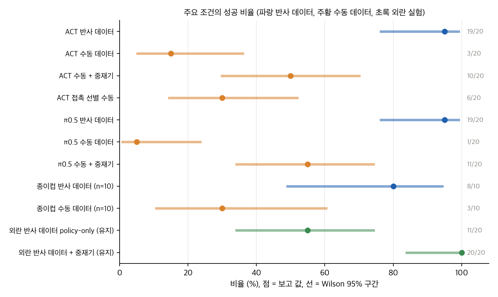
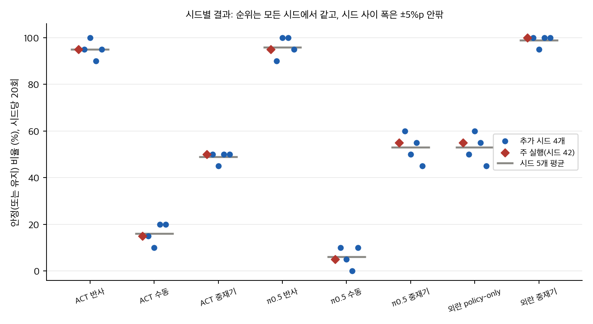
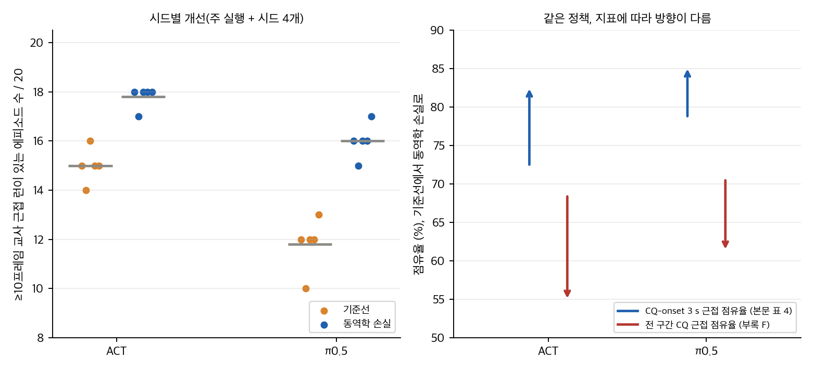
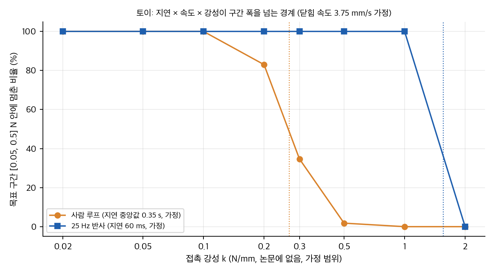

> **논문:** Ziyan Feng, Zizhao Yuan 외. *What is the Better Curriculum: Controller-Shaped Grasping Behavior for Contact Force-Sensitive Manipulation.* CoRL 2026 포스터, arXiv:2609.25887 (v1, 2026-09-22).
> 논문은 arXiv non-exclusive 라이선스이므로 이 글에는 논문 그림을 넣지 않았고, 우리가 다시 그린 그래프만 실었습니다. 논문에 없는 값을 가정한 곳은 "(시드당 20회 가정)", "(그림 판독 값)", "(가정)"으로 표시했습니다. 이 논문의 학습·평가 코드는 공개되어 있지 않습니다. 수집에 쓴 교사 제어기의 저장소(라이선스 파일 없음)는 공개되어 있어 논문 부록과 정적으로 대조했고, 코드를 실행하거나 설치하지는 않았습니다.

## 논문이 하는 것

3.5 g, 벽 두께 0.3 mm인 일회용 플라스틱 컵은 너무 약하게 쥐면 미끄러지고 몇 백 mN만 넘겨 쥐어도 변형됩니다. 논문은 원격조작으로 시연을 모을 때 사람이 거친 버튼으로 그리퍼를 조절하면 관측-반응-실행 지연이 커서 이 좁은 힘 구간을 반복해서 지키기 어렵다고 보고, 수집하는 동안 25 Hz 촉각 반사 제어기(TactileReflex)가 그리퍼를 조절하게 합니다. 이렇게 만든 시연 30개로 **촉각 입력이 없는** 정책(ACT, π0.5)을 학습하면, 영상으로 걸러 낸 수동 시연 30개로 학습한 정책보다 20회 평가의 안정 파지 비율이 크게 높다는 보고입니다. 배포 때는 같은 반사 제어기를 그리퍼에만 붙이는 "중재기"로 다시 쓰고, 외란을 주면 반사 데이터 π0.5 정책의 유지가 11/20에서 20/20으로 올라갑니다.

## 이 글에서 확인한 것

**1. 보고된 검정과 구간은 모두 재현됩니다.** 표 8의 양측 Fisher p 여섯 개와 Wilson 95% 구간, 종이컵의 p = 0.0698, 부록 E.3의 시드 평균 ± 표준편차 여덟 개가 다시 계산한 값과 일치합니다. 안정 비율은 ACT 반사 19/20 대 수동 3/20(p = 4.1×10⁻⁷), π0.5 19/20 대 1/20(p = 5.8×10⁻⁹)이고, 표 8의 여섯 비교와 종이컵 비교를 한 묶음으로 Holm 보정해도 가장 큰 p는 0.07(종이컵)이며 나머지는 0.02 아래입니다. 20회 단위로도 큰 효과는 구분됩니다.

*그림 1. 우리가 그린 그래프. 표 1, 3, 5, 7과 종이컵 결과의 보고 비율과 Wilson 95% 구간입니다(시행 수는 논문 값).*

**2. 수집 방식의 효과가 몇 번 반복되었는지는 따로 읽어야 합니다.** 논문은 학습 시드를 4개 더해 같은 순위를 확인합니다(ACT 안정 95.0 ± 4.1 / 16.3 ± 4.8 / 48.8 ± 2.5%). 이 시드는 학습 시드만 바꾸고 같은 30개 시연 두 세트를 씁니다. 수집은 숙련 조작자 한 명이 한 세션에서 했고, 반사 데이터가 수동 풀보다 먼저 수집되었으며 순서를 무작위화하지 않았다고 논문이 적습니다(부록 E.2.1, §6). 시드 5개(시드당 20회 가정)를 풀링하면 Fisher p는 10⁻³³ 아래이지만, 이는 학습 시드 변동에 대한 순위의 안정성을 보여 줄 뿐 "수집 방식"이라는 처치를 두 번 이상 관측한 것이 아닙니다. 수동 풀은 수동 100회를 영상으로 걸러 30개를 골랐고 통과한 수는 적혀 있지 않으며, 반사 풀은 선별하지 않았다고 서술됩니다.

*그림 2. 우리가 그린 그래프. 시드별 안정(유지) 비율(시드당 20회 가정)입니다. 마름모가 주 실행(시드 42), 점이 추가 시드 4개, 선이 5개 평균입니다.*

**3. 두 풀은 닫힘 정도와 유지 시간도 다릅니다(그림 판독 값).** 논문 그림 3에서 읽으면 반사 시연(교사)은 약 2 s에 약 46 mm까지 닫히고 약 3.6 s까지 유지한 뒤 열립니다. 수동 시연은 약 1 s에 약 48 mm에 이르고 약 1.5 s부터 열리기 시작하며, 수동 데이터로 학습한 정책은 약 51–52 mm까지만 닫힙니다. 이 위치 평균은 덜 조이는 쪽 실패(느슨 55%, 낙하 30%)와 방향이 맞습니다. 다만 논문의 "느슨" 범주에는 눈에 보이는 변형도 들어 있어, 실패 원인이 덜 조임인지 과압인지는 표만으로 가를 수 없습니다. 비교는 "수집 시점 그리퍼 조절만 분리한다"고 서술되지만, 선별 비대칭, 수집 순서, 닫힘 정도, 유지 시간이 함께 다릅니다. 그림 3의 가로축 "contact onset"의 정의가 본문에 없고, 교사 위치가 0초 전까지 평평하다는 점에서 첫 촉각 접촉이 아니라 닫기 시작에 가깝게 읽힙니다.

**4. 교사 근접 지표는 교사의 통계로 정의됩니다.** CQ(접촉 자격) 에피소드는 약한 쪽 센서의 법선 접촉 대리량 F_n,min이 1.5를 넘는 프레임이 있는 에피소드이고, 교사 근접 대역은 반사 정지 유지 통계 2.41 ± 0.7 = [1.71, 3.11]입니다(부록 D). 반사 데이터 정책이 이 지표에서 앞서는 것은 정의에서 예상됩니다. 안정(영상 판정)과 CQ(촉각 판정)는 서로 독립이라, 보고된 31개 행 중 15개에서 안정 횟수가 CQ 에피소드 수보다 큽니다(예: ACT 수동 정책 안정 3/20, CQ 1/20). 부록 D는 CQ 하한 1.5를 "논문의 제어기 설정에서 파지 시작 임계"라고 설명하는데, 공개된 교사 제어기 저장소의 닫기 정지 임계 기본값과 README의 부드러운 컵 값은 1.3입니다. 저장소 README는 논문과 보정 임계값이 다를 수 있다고 적으므로, 어느 설정이 수집에 쓰였는지는 저자 확인이 필요합니다. 모든 촉각 지표는 뉴턴으로 보정되지 않은 무차원 대리량입니다.

**5. 동역학 손실은 지표에 따라 방향이 갈립니다.** 그리퍼 궤적의 2차 차분 L1 일치 항(λ = 0.1)을 더하면 ≥10프레임 교사 근접 런이 ACT 15/20 → 18/20, π0.5 12/20 → 16/20으로 늘고 릴리스까지 시간이 14.6%, 22.8% 줄어듭니다. 주 실행 20회 단위의 Fisher p는 0.41, 0.30이고 검출력은 약 14–19%(참값을 보고 값으로 가정한 몬테카를로)입니다. 시드 5개를 풀링하면 p = 0.016, 0.002입니다(같은 한계). 반면 부록 F가 적듯 전 구간 CQ 근접 점유율은 ACT 68.7 → 54.8%, π0.5 70.8 → 61.2%로 낮아집니다. 저자는 릴리스가 빨라져 이후 근접 체류가 줄기 때문이라고 설명합니다(가능한 설명). 같은 정책에서 어느 요약을 주 지표로 두는지가 결론의 부호를 정하는데, 주 지표를 고른 시점은 논문에 없습니다. 동역학 손실 정책의 안정/느슨/낙하 결과도 보고되지 않았습니다.

*그림 3. 우리가 그린 그래프. 왼쪽은 시드별 ≥10프레임 런 횟수, 오른쪽은 같은 정책에서 CQ-onset 3 s 점유율(본문 표 4)과 전 구간 점유율(부록 F)이 움직이는 방향입니다.*

**6. 외란 실험의 "촉각 없는 정책의 경계"에는 재질의 주기가 묶여 있습니다.** 유지 11/20 대 20/20(p = 1.23×10⁻³)은 재현되고 시드 5개 평균은 53% 대 99%입니다. 이 실험의 학생은 π0.5 하나이고, 청크 10스텝을 20 Hz로 실행해 청크 하나가 0.5 s이며 재질의가 약 1.7–1.8 Hz입니다(재질의 주기 0.56–0.59 s에서 청크를 빼면 추론과 오버헤드가 약 56–88 ms로 서술과 맞습니다). 반사는 25 Hz로 약 14배 빠릅니다. 학생은 촉각이 없으므로 "촉각 정보의 부재"와 "느린 재질의"가 한 요인으로 묶여 있고, 같은 속도로 돌리는 촉각 없는 정책이나 느린 반사를 대조한 결과는 없습니다. 중재기의 K(연속 열기 의도 횟수), g_close, g_open, 억제 시간의 값도 논문에 없고, 외란의 세기와 시점 기록, "유지"의 정의도 적혀 있지 않습니다.

**7. 사람 루프가 "너무 늦다"는 주장은 접촉 강성과 닫힘 속도에 달려 있습니다.** 이 논문은 접촉 강성, 닫힘 속도, 사람 반응 지연을 수치로 주지 않아, 1차원 접촉 모델로 경계만 계산했습니다(가정: 닫힘 속도 3.75 mm/s, 정지 트리거 0.15 N, 허용 구간 [0.05, 0.5] N, 사람 지연 중앙값 0.35 s, 반사 지연 60 ms). 사람 루프가 구간 안에 멈추지 못하는 강성은 약 0.27 N/mm 이상이고 반사는 약 1.56 N/mm이며, 이 경계는 닫힘 속도에 반비례합니다. 가정의 함수이므로 논문 결과의 검증이 아니고, 컵 벽의 접촉 강성이 논문에 없어 이 조건이 충족되는지 확인할 수 없다는 뜻입니다.

*그림 4. 우리가 그린 그래프(가정 기반 계산 실험). 접촉 강성에 따라 목표 구간 안에서 멈춘 비율이며, 점선은 두 루프의 경계 강성입니다.*

## 그 밖에 확인한 것

- 표 1, 3의 행 합계(안정 + 느슨 + 낙하)는 모두 시행 수와 맞고, 표 8의 Wilson 구간, 부록의 릴리스 시간 감소율 10개도 소수 첫째 자리까지 일치합니다.
- 부록 E.3 표 9의 ACT 수동 데이터 + 중재기, 시드 2025 행은 9/20 + 3/20 + 7/20 = 19/20으로 읽힙니다. 한 칸 확인이 필요합니다.
- "≥10프레임"의 시간은 프레임율에 따라 0.4 s(25 Hz)에서 1.0 s(10 Hz)까지 다릅니다. 교사(25 Hz)와 학생(ACT 15 Hz, π0.5 10–20 Hz)에서 같은 10프레임이 같은 시간인지 서술이 없습니다. π0.5의 학습(10 Hz)과 실행(20 Hz)의 대응도 적혀 있지 않습니다.
- 교사 제어기는 위치와 그리퍼 세기를 같이 조절합니다(공개 저장소). 기록되는 행동은 그리퍼 위치이고 policy-only 학생이 쓰는 세기는 서술이 없어, "교사의 힘 프로파일을 배운다"의 힘 쪽 경로를 확인할 수 없습니다.
- 수동 풀, 반사 풀의 정확한 선별 규칙과 부록 A(촉각 이미지 융합이 나아지지 않음)의 시행 수는 적혀 있지 않습니다.
- 공개 저장소의 닫기 스텝 기본값(150 µm × 25 Hz = 3.75 mm/s)은 그림 3에서 읽은 초반 닫힘 속도(약 0.3 s에 약 13 mm)의 약 1/10입니다(그림 판독 값). 25 Hz는 목표 주기이고 실측 로그는 공개되어 있지 않습니다.

## 구현 가능성

실물 재현은 Piper 팔과 그리퍼, SO101 리더, MC-Tac 센서 두 개, 카메라, 학습용 GPU가 필요하고 공개된 교사 저장소는 리눅스 전용이어서 **일반 노트북에서 논문 수치를 그대로 재현할 수는 없습니다.** 반면 중재기의 상태 기계(알고리즘 1)와 동역학 손실, 교사 제어 논리는 수십–200줄 규모로 구현할 수 있고, 접촉 강성과 지연을 가정한 시뮬레이션 축소판(컵 파지, 교사 대 지연 조작자, 모방 학생)도 CPU로 가능해 보입니다(이번 글에서는 실행하지 않았고, 노력은 소프트웨어 부분 1–3일, 시뮬 1–2주로 추정). 시뮬 결과는 실물 결과와 같다고 할 수 없습니다.

## 맺음

촉각을 정책의 입력이 아니라 수집 단계의 교사로 쓰고, 학생에게는 힘 정보 없이 실현된 행동만 전하는 구성, 배포 때 같은 제어기를 그리퍼에만 붙여 정책과 분리하는 중재기, 시드별 결과와 통계 방법을 부록에 모두 적은 점은 분명한 기여입니다. 재계산이 가리키는 것은 표를 읽는 방법입니다. 수동 풀의 선별 통과 수, 수집 순서를 바꾼 반복(또는 여러 세션), 교사 설정(닫기 스텝, 1.5와 1.3), 그리퍼 세기, 중재기 값, 속도를 맞춘 외란 대조를 밝히면 "수집 시점 제어기가 만드는 효과"와 "배포 시점 반응 층의 효과"를 더 단단히 읽을 수 있습니다. 위의 가정과 그림 판독 값, 모의 결과는 모두 저자 확인이 필요합니다.

## 자료

- [통합 리포트 PDF](report/report_public.pdf)
- [01. 논문 분석: What is the Better Curriculum (Controller-Shaped Grasping Behavior)](analysis/01_paper_analysis.md)
- [02. 선행연구와 관련 저장소](analysis/02_prior_work.md)
- [03. 수치 재계산과 일관성 검사](analysis/03_analysis.md)
- [04. 코드 대조, 주장 점검, 구현 가능성](analysis/04_code_verification.md)
