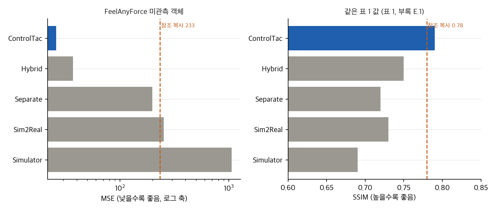
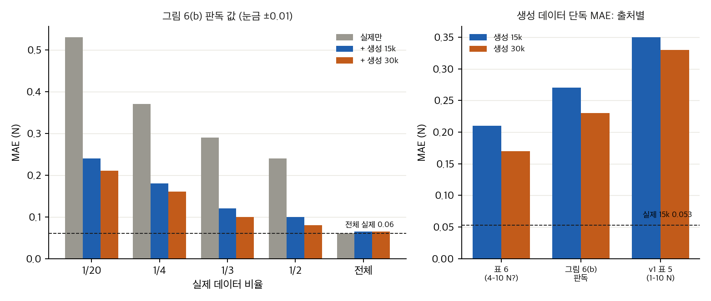
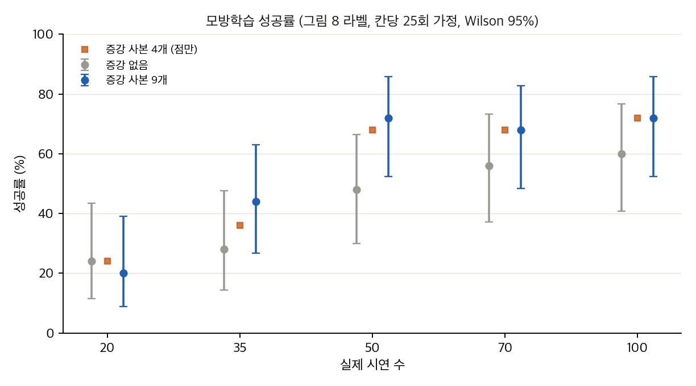

> **논문:** Dongyu Luo, Kelin Yu 외. *ControlTac: Scaling Tactile Data with Physically Controlled Tactile Image Generation.* CoRL 2026 포스터(공식 채택 목록 확인), arXiv:2505.20498 (v3, 2026-09-08).
> 논문은 arXiv non-exclusive 라이선스라 논문 그림은 싣지 않았고, 이 글의 그래프는 모두 표와 그림의 수치를 옮겨 직접 그렸습니다. 공식 코드는 `DongyuLUO/ControlTac`에 있으며 라이선스 파일이 없습니다. 코드는 실행하지 않고 읽기만 했습니다.

---

## 논문이 묻는 것

비전 기반 촉각 센서(GelSight Mini)의 데이터는 접촉 자세와 힘을 넓게 훑으며 모아야 해서 비쌉니다. 저자들은 참조 촉각 영상 한 장, 목표 3D 힘 변화 ΔF, 목표 접촉 마스크를 받아 목표 촉각 영상을 만드는 두 단계 조건부 확산 모델을 제안합니다. 1단계는 힘 조건(FeelAnyForce 영상 20,000장), 2단계는 백본을 얼려 두고 ControlNet 방식의 어댑터로 자세를 조건화합니다(영상 7,000장). 이렇게 만든 영상으로 힘·자세 추정기와 분류기를 학습하고, 물체 밀기, 실시간 자세 추적, 3 mm 여유 삽입, 모방학습에 적용합니다.

v1(2025-05)은 "단일 참조 영상 증강"이었고, v3(2026-09)은 Simulator·Sim2Real·참조 복사 기준선, 교차 센서, 모방학습, 마스크 섭동 실험이 더해진 33쪽 판입니다. 본문 텍스트는 v1과 v2가 같습니다.

## 생성 품질: 참조 복사와의 거리

표 1에서 MSE와 SSIM으로 Simulator, Sim2Real, Hybrid, Separate와 비교하고, 부록 E.1이 참조 영상을 그대로 복사한 기준선을 따로 보고합니다. 값을 한 그림에 놓으면 다음과 같습니다.

- MSE는 참조 복사가 233, ControlTac이 26으로 약 9.0배(AnyTouch2에서는 81 대 29, 2.8배) 차이이고, 부록 E.1의 결론("복사로는 설명되지 않는다")은 MSE에서 뚜렷합니다.
- SSIM은 0.78 대 0.79(AnyTouch2 0.80 대 0.81)로 차이가 0.01이고 효과 크기 d는 0.22–0.39입니다. Simulator, Sim2Real, Hybrid, Separate의 SSIM은 참조 복사보다 낮습니다. 표 1에는 시험 표본 수가 없어 검정은 하지 않았습니다.

## 힘 추정: "1/3 실제 데이터로 전체와 맞먹는다"

본문은 "실제 데이터의 1/3에 생성 데이터를 더하면 전체 실제 데이터 성능과 맞먹는다"고 적습니다(§4.2). 그림 6(b)에서 막대를 읽으면(그림 판독 값, 눈금 ±0.01 N) 1/3 + 생성 30k가 약 0.10 N, 전체 실제가 약 0.06 N이라 비율이 약 1.7배입니다. 표 6에서는 실제 15k가 0.053±0.012 N, 실제 15k + 생성 15k가 0.055±0.021 N으로 같은 수준입니다.

생성 데이터 단독 MAE는 표 6에서 0.21/0.17(15k/30k), 그림 6(b) 판독으로 약 0.27/0.23, v1 표 5(1–10 N)에서 0.35/0.33입니다. v3 본문은 힘 범위를 1–10 N으로 쓰고 v1은 4–10 N 부분집합에서 평가했다고 쓰므로, 표 6의 값이 어느 범위인지는 저자 확인이 필요합니다.

## 모방학습: 방향은 일관되지만 칸별로는 구별되지 않습니다

Pick and Peg-in-Hole에서 ACT 정책을 실제 시연 20–100개와 증강 사본 0–9개로 학습하고, 칸마다 25회 평가합니다(§4.3, 부록 E.2). 그림 8의 막대 라벨은 모두 4의 배수라 25회와 정수로 맞습니다. 라벨을 성공 횟수로 옮겨 Fisher 검정과 Wilson 구간을 계산했습니다.

- 증강 사본 1/2/4/9 대 증강 없음의 20개 비교 중 가장 작은 p는 사본 9 @ 50 시연의 0.148(18/25 대 12/25)이고, Holm 보정 후에는 모두 1.0입니다. 부록 E.2가 인용한 35 시연 44% 대 28%는 p = 0.38입니다.
- 시연 수 다섯 층을 합친 Mantel-Haenszel 검정에서 사본 9는 p = 0.045(합산 55.2% 대 43.2%)이고, 증강 팔 네 개로 보정하면 약 0.18입니다.
- 20 시연에서는 증강이 같거나 낮고(−4, −8, 0, −4 %p), 본문과 부록은 이를 공간 커버리지 부족으로 설명합니다. 25회씩으로 28→44%를 5% 수준에서 검출할 확률은 모의로 약 16%이고, 80% 검정력에는 군당 약 141회가 필요합니다.

삽입 실험(물체당 20회, 원통 90%, 십자·T자 85%, Type-C 75%)은 Wilson 95% 구간이 53–97%이고, 증강하지 않은 추정기와의 비교가 없어 증강의 기여는 이 실험으로 알 수 없습니다.

## 단위와 표기에서 확인이 필요한 곳

- 표 2의 캡션은 "X/Y in mm"인데 부록 E.1과 그림 13–15는 픽셀이고, 부록 E.11은 1 픽셀 = 1/20 mm로 환산합니다. 원통 실제 X 8을 mm로 읽으면 3 mm 삽입 여유보다 큽니다. 픽셀로 읽어야 삽입 결과와 맞습니다.
- 부록 E.1의 "실제/생성 오차 8±3/8±2 픽셀"은 표 2의 Real 행 X, Y 값과 같은 숫자여서 어느 쌍의 비교인지 확인이 필요합니다.
- 부록 B.2의 "75,000 스텝, 배치 4"와 "50 에폭, 에폭당 약 1,500 s"는 에폭이 1,500 스텝일 때 맞고(스텝당 1.0 s), 2단계는 같은 계산에서 스텝당 0.22 s입니다. 합계 파라미터 370.46M은 두 단계의 합이고, 공식 코드에서 2단계 모델이 1단계 백본을 포함하는 구조이므로 추론 모델은 222.93M으로 읽힙니다.

## 공식 코드와 논문

2026-09-16 커밋(`32b005b`)을 정적으로 읽었습니다.

- 생성기는 SANA 계열 선형 어텐션 변환기(12 블록, 은닉 768, 잠재 10×8)이고, 참조 잠재는 채널 방향으로 이어 붙이며, ΔF는 3차원 뉴턴 값을 MLP로 임베딩해 교차 어텐션에 넣습니다. 논문은 이 세부를 쓰지 않습니다.
- 학습 설정(AdamW, 코사인, 학습률, 75,000 스텝, 0.5 L1 + 0.5 MSE)은 논문과 일치합니다. 가중치 감쇠, 기울기 절단, 50 스텝 DDIM 기본값은 논문에 없습니다.
- 한 스텝은 이미지 4장에서 만든 (참조, 목표) 쌍 16개로 구성됩니다. "배치 4"는 이미지 수로 읽힙니다.
- 출시된 force_pose 체크포인트는 첫 블록을 건너뛰는 순회로 학습되어 추론 기본값이 그렇게 설정되어 있고, 새로 학습하는 설정은 다릅니다.
- 평가·기준선 코드(표 1, 2, 6, 7, 그림 6, 8)는 저장소에 없습니다. 검증·시험 목록도 학습 객체 6개뿐이고, README가 "전체 학습과 논문 벤치마크 지표는 이 릴리스에서 다시 돌리지 않았다"고 적습니다.
- 라이선스 파일이 없고, THIRD_PARTY_NOTICES는 DiT 계보(CC BY-NC)의 출처를 확인하라고 적습니다. 체크포인트(590 MB, 892 MB)는 이번 분석에서 받지 않았습니다.

## 구현할 수 있는가

논문 결과의 재현(표 1, 2, 6, 7, 그림 6, 8)은 이 환경(Apple M4 Pro, 약 24 GiB, CUDA 없음)에서 어렵습니다. 학습은 A5000 1장 25.4시간에 FeelAnyForce 약 82 GB가 필요하고, 실로봇 실험은 로봇이 있어야 합니다. 공식 체크포인트 추론은 설치와 다운로드를 승인받으면 CPU에서 가능해 보이고(잠재 토큰 80개), 속도는 측정 전입니다. 표와 그림의 수치 재계산은 끝냈습니다.

## 한계

- 표 1, 2, 그림 6(a)에는 시험 표본 수가 없어 검정을 하지 않았고 효과 크기만 계산했습니다.
- 그림 6(b)와 그림 5(a) 값은 그림 판독 값이고, 그림 8은 막대 위 라벨입니다. 모방학습 시행 수 25회는 부록 E.2의 문장에 따릅니다.
- 이 글은 공식 코드를 실행하지 않았고, 체크포인트와 데이터를 받지 않았습니다.

## 출처와 라이선스

- 논문: arXiv:2505.20498, arXiv non-exclusive-distrib 라이선스(CC 아님). 논문 그림은 싣지 않았습니다.
- 표 값과 본문 수치는 인용과 재계산을 위해 옮겼습니다. 그래프, 분석 문서와 스크립트는 이 글 작성자가 만들었습니다.
- 공식 코드(라이선스 없음)는 복사하지 않았고, 가중치와 데이터셋은 받지 않았습니다.

## 자료

- [통합 리포트 PDF](report/report_public.pdf)
- [01. 논문 분석: ControlTac (arXiv:2505.20498)](analysis/01_paper_analysis.md)
- [02. 선행연구와 관련 저장소](analysis/02_prior_work.md)
- [03. 수치 재계산과 일관성 검사](analysis/03_analysis.md)
- [04. 공식 코드 대조와 구현 가능성](analysis/04_code_verification.md)
