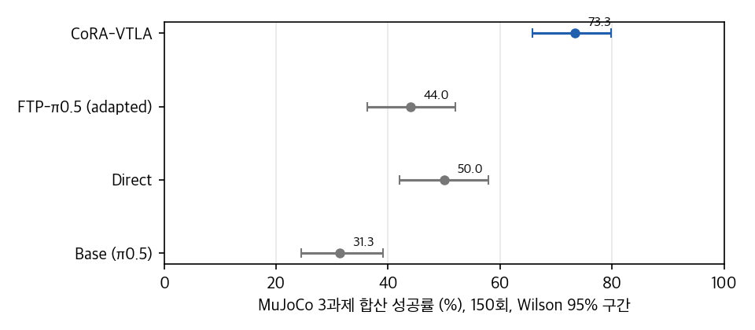
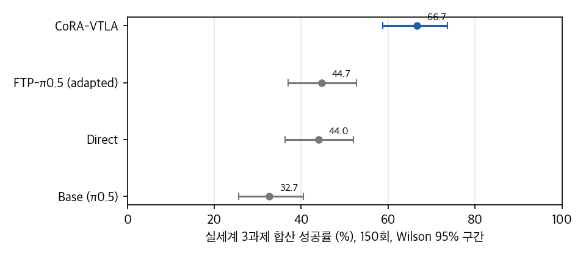
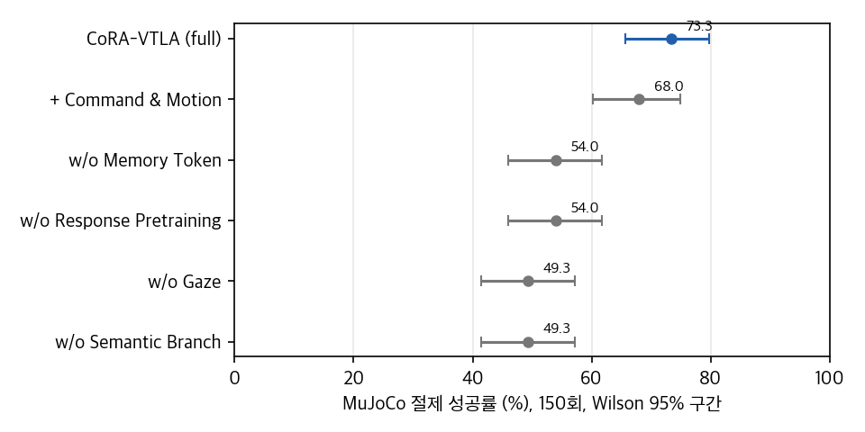

# CoRA-VTLA: 접촉 반응 메모리로 촉각 사후학습하는 VLA 분석

CoRA-VTLA는 사전학습 VLA(π0.5)에 촉각 모듈 세 개를 붙입니다. 현재 접촉 토큰, 접촉 반응을 질의로 고르는 메모리 토큰, 접촉 영역에 주의를 모으는 의미 토큰입니다. 논문은 MuJoCo 세 과제, UniVTAC Insert Tube, 실로봇 세 과제에서 평가했습니다.

## 본 것

- 표 값에서 횟수를 복원하면 평균(MuJoCo 73.33%, 실로봇 66.7%)과 절제 여섯 행이 본문과 맞습니다.
- UniVTAC에서 Direct 대비 16 pp 차이는 쌍체 McNemar 정확 검정으로 p = 0.0195가 나옵니다. 논문 값과 같습니다.
- 학습 시드 반복이 없습니다. 따라서 신뢰구간과 p값은 평가 시행의 표집만 반영합니다.
- 공식 코드는 아직 없습니다. 프로젝트 페이지에 "coming soon"이라고 적혀 있습니다.

*우리가 논문 표 1의 백분율에서 다시 계산한 MuJoCo 150회 합산 성공률입니다.*

*우리가 논문 표 2에서 다시 계산한 실로봇 150회 합산 성공률입니다. 실로봇 CI는 논문과 0.5 pp 안쪽에서 다릅니다.*

*우리가 논문 표 3에서 다시 계산한 절제 변형별 MuJoCo 성공률입니다. 메모리 토큰 제거가 가장 큰 하락입니다.*

## 한계

- 학습 설정과 데모 수가 본문에 없어서 재현할 수 없습니다.
- 3.4절의 명령 조건화 설명과 4.3절 프로브가 맞지 않습니다.
- 주의 분석의 엔트로피와 p값은 원자료가 없어 확인하지 못했습니다.

이 글은 게시하지 않은 초안입니다. 논문 그림은 arXiv 비독점 라이선스 때문에 싣지 않았습니다.

## 자료

- [통합 리포트 PDF](report/report_public.pdf)
- [CoRA-VTLA 논문 분석 (arXiv:2611.23963)](analysis/01_paper_analysis.md)
- [CoRA-VTLA: 선행연구와 관련 저장소](analysis/02_prior_work.md)
- [CoRA-VTLA: 수치 재계산, 검정, 일관성 검사](analysis/03_analysis.md)
- [CoRA-VTLA: 주장 대조와 구현 가능성 (공식 코드 없음)](analysis/04_claim_verification.md)
