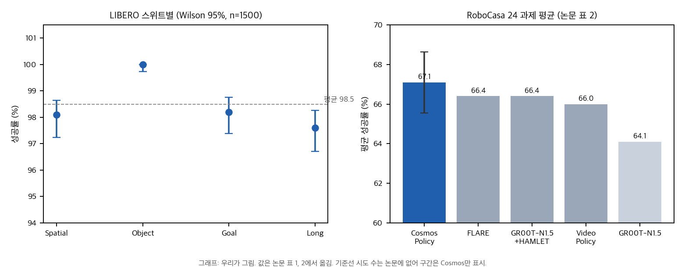

> **논문:** Moo Jin Kim, Yihuai Gao, Tsung-Yi Lin, Yen-Chen Lin, Yunhao Ge, Grace Lam, Percy Liang, Shuran Song, Ming-Yu Liu, Chelsea Finn, Jinwei Gu. *Cosmos Policy: Fine-Tuning Video Models for Visuomotor Control and Planning.* ICLR 2026, arXiv:2601.16163 (v1, 2026-01-22).
> 공식 코드는 GitHub NVlabs/cosmos-policy에 있습니다(Apache-2.0). 이 글의 그래프는 논문 수치를 다시 그린 것이며, 논문 그림은 넣지 않았습니다.

## 논문이 묻는 것

로봇 정책에 영상 모델을 쓰려는 연구는 많습니다. 대개 영상 모델을 먼저 미세조정하고, 그다음 행동을 뽑는 별도 모듈을 붙입니다. 이 과정에서 단계가 늘고 구조도 바뀝니다.

Cosmos Policy는 다른 길을 택합니다. 행동, 로봇의 현재와 미래 상태, 가치를 **영상 잠재 프레임으로 넣어** 같은 영상 확산 목적함수로 한 번에 학습합니다. 모델 구조는 바꾸지 않습니다. 그래서 한 모델이 정책, 세계 모델, 가치 함수를 함께 맡습니다.

## 이 글에서 확인한 것

**1. LIBERO 98.5%는 재계산과 맞습니다.** 네 스위트의 평균(98.1, 100.0, 98.2, 97.6)을 다시 계산하면 98.475입니다. 스위트당 1500 시도(3 seed)로 보면 보고된 백분율이 모두 정수 성공 수로 만들어집니다.

*그래프: 우리가 그림. 값은 논문 표 1, 2에서 옮겼습니다. 왼쪽은 LIBERO 스위트별 Wilson 95% 구간, 오른쪽은 RoboCasa 평균입니다.*

**2. RoboCasa의 최고 기록은 상위권과 차이가 크지 않습니다.** 67.1%는 FLARE(66.4)와 0.7점, Video Policy(66.0)와 1.1점 차이입니다. 기준선의 시도 수가 논문에 없어 근사 검정으로만 보면 통계적으로 확인되지 않습니다. 다만 GR00T-N1.5(64.1)와의 차이는 3.0점입니다.

**3. 실로봇 ALOHA 점수는 재계산과 맞습니다.** 네 과제 점수의 평균이 Cosmos 93.6, π0.5 88.6입니다. 점수는 연속값이라 과제별 차이를 이항 검정으로 볼 수 없습니다. 본문의 "success rate"라는 말은 실제로 점수 평균입니다.

**4. 본문과 표가 다른 곳이 있습니다.** 표 5의 1단계 추론 하락을 본문은 0.5점이라고 쓰지만, 표 값 차이는 0.7점입니다.

**5. 계획 효과의 수치는 확인하지 못했습니다.** 저자는 어려운 두 과제에서 계획이 평균 12.5점 올린다고 씁니다. 이 수치는 그림 7에만 있고 본문 텍스트에는 없었습니다.

**6. 가치 집계 규칙은 방향이 맞습니다.** 계획에서 가치 예측 15개를 "다수가 성공이면 성공한 것들의 평균"으로 집계하는 방식(majority mean)은 이상치가 많을 때 평균보다 강건합니다. 토이에서 그 방향은 맞았습니다. 실제 모델에서의 크기는 확인하지 않았습니다.

## 재현 관점

- **학습은 이 맥에서 불가능합니다.** 저자는 8~64 H100으로 48시간을 씁니다.
- **추론은 조건부입니다.** 공식 코드가 CUDA 호출을 여러 곳에서 쓰므로 포팅이 필요합니다. 추정 1–2주입니다(측정 없음).
- **학습 설정이 논문에 다 없습니다.** 학습률(1e-4), 할인율(0.99와 0.998), 학습 시 노이즈 범위, 계획 임계값(0.05)은 코드에만 있습니다.
- **계획 학습 데이터는 공개되지 않았습니다.** ALOHA 계획에 쓴 rollout 648개는 코드 설정에 "not released"라고 적혀 있습니다.

## 정리

영상 모델을 정책으로 쓰는 방식이 구조를 덜 바꾸고도 시뮬레이션 최고 기록을 냈다는 점은 흥미롭습니다. 다만 상위권 차이는 작고, 계획 효과는 아직 본문 수치로 확인되지 않았습니다. 재현은 추론 포팅부터 시작하는 것이 현실적입니다.

## 자료

- [통합 리포트 PDF](report/report_public.pdf)
- [01. 논문 분석: Cosmos Policy (arXiv:2601.16163)](analysis/01_paper_analysis.md)
- [02. 선행연구와 관련 자료](analysis/02_prior_work.md)
- [03. 수치 재계산, 일관성 검사, 토이](analysis/03_analysis.md)
- [04. 공식 코드 대조와 구현 가능성](analysis/04_code_verification.md)
