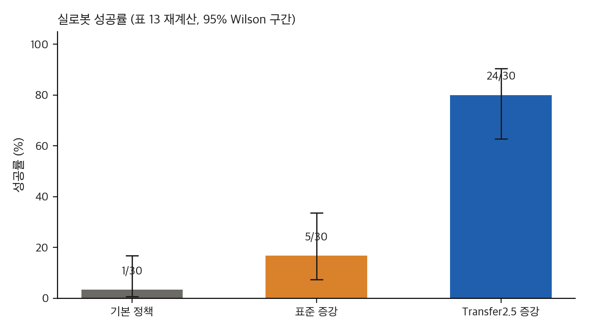
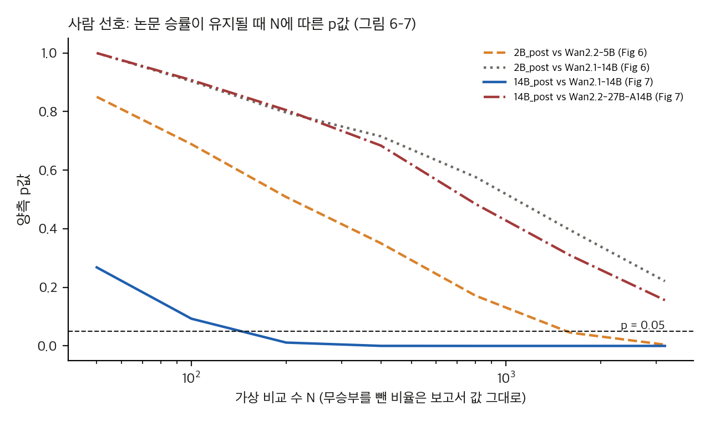
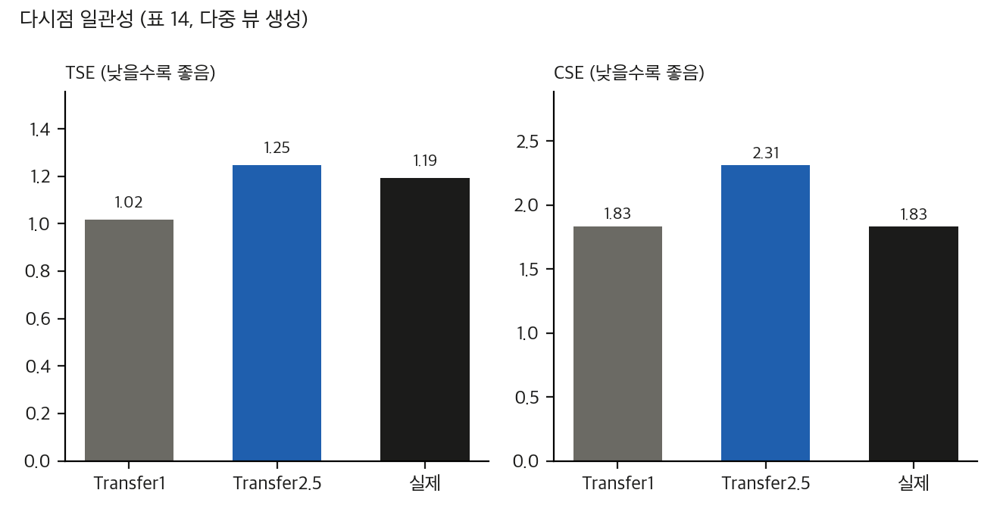

> **논문:** NVIDIA. *World Simulation with Video Foundation Models for Physical AI.* 기술 보고서, arXiv:2511.00062 (v2, 2026-02-24). Cosmos-Predict 2.5와 Cosmos-Transfer 2.5를 다룹니다.
> 공식 코드(Apache-2.0)는 정적으로만 읽었고 실행하지 않았습니다. 논문 PDF에는 NVIDIA 저작권 표시가 있어서 논문 그림은 싣지 않고, 우리가 만든 그래프 세 장만 씁니다.

## 이 보고서가 하려는 것

로봇 학습에서 가장 비싼 것은 시연과 실물 시도입니다. 영상 세계 모델이 그 일을 덜어 줄 수 있는지가 이 보고서의 질문입니다. 보고서는 Cosmos-Predict 2.5라는 흐름 매칭 기반 DiT 모델을 내놓고, 두 방향을 보여 줍니다. 하나는 **생성 기반 증강**으로 시연 영상을 다른 조명, 색, 배경으로 바꿔 정책 학습 데이터를 늘리는 것입니다. 다른 하나는 **행동 조건 세계 모델**로 행동을 넣으면 다음 프레임을 예측하는 것인데, 보고서는 이것이 정책 평가에 쓸 만하다고 말합니다.

모델 구조와 학습은 평범한 편입니다. 흐름 매칭 손실에 시간 이동을 더하고, 2억 개 클립으로 사전학습한 뒤 도메인별로 미세조정하고, 병합하고, VideoAlign 보상으로 강화학습을 합니다. 세부는 원문에 있습니다. 이 글은 로봇 쪽 숫자를 확인하는 데 집중합니다.

## 실로봇 증강: 숫자는 맞고, 범위는 좁다

양팔 로봇으로 사과를 그릇에 담는 시연 100개를 모았습니다. 확산 정책을 세 가지 방식으로 학습했습니다. 기본(시연만), 표준 이미지 증강(밝기, 대비, 블러 등), Transfer 2.5 증강(시연 영상마다 변형 5개 생성)입니다. 열 가지 시나리오(배경, 그릇 색, 식탁보, 조명, 방해물 등)에서 시나리오마다 세 번씩 실행했습니다.

그래프: 표 13의 실로봇 성공률과 95% Wilson 구간. 기본 1/30, 표준 증강 5/30, Transfer 2.5 증강 24/30이며, 행과 합계가 모두 맞습니다.

차이는 크고 통계적으로도 유의합니다. 시도를 독립으로 두고 계산한 Fisher 검정은 p가 10⁻⁶ 수준입니다. 시나리오 단위로 보면 제안 방식이 열 개 중 아홉 곳에서 이기고 지는 곳은 없습니다(부호 검정 p = 0.004). 그러나 정책은 팔마다 한 번만 학습했고 시드를 바꿔 보지 않았습니다. 과제도 하나입니다. 그러니 "생성 증강이 효과가 있다"는 말은 이 조건에서만 맞습니다. 보고서가 이 실험을 "adversarial visual perturbations"라고 부른 것도 정확하지 않습니다. 실제로는 분포 이동입니다.

## 사람 평가: 표본 수가 없다

그림 6–7의 사람 평가는 승·패·무 비율만 보고합니다. 몇 쌍을 비교했는지는 없습니다. 그래서 가정한 N에 대해 승률 차이의 p값을 계산했습니다.

그래프: 보고서의 승·패 비율이 그대로일 때, 비교 수 N에 따른 양측 p값. 논문은 N을 보고하지 않아 가상의 N입니다.

14B 모델이 Wan2.1 14B를 이기는 결과(48.6 대 31.8)는 결정 투표가 88개만 있어도 유의합니다. 반면 2B가 Wan2.2 5B보다 "더 선호된다"(30.0 대 26.2)는 결정 투표가 840개 이상이어야 유의합니다. v2는 이 문장의 강도를 올렸습니다(v1에서는 "동급"이었습니다). N이 없이 강도만 올라간 것입니다.

## 다시점 생성: 지표가 엇갈립니다

카메라 제어 모델과 주행 다시점 모델에서는 FVD가 좋아졌지만 다시점 일관성은 나빠졌습니다. 표 14의 Transfer 2.5는 FVD가 Transfer 1보다 약 2.3배 낮지만, 두 시점 사이의 일관성 지표(TSE, CSE)는 각각 22%, 26% 나쁩니다. 실제 영상의 값과 비교하면 차이가 더 분명합니다. 보고서는 이를 "경쟁력 있음"이라고 씁니다.

그래프: 표 14의 TSE와 CSE (낮을수록 좋음). 실제 영상 값을 함께 표시했습니다. 우리가 그린 그래프입니다.

## 정책 평가라는 빈칸

초록과 §6 도입은 행동 조건 모델이 "policy evaluation"에 특히 적합하다고 씁니다. 그런데 이 주장의 근거로 든 실험은 Bridge 테스트 100개에서 다음 프레임 예측 지표(PSNR, SSIM, FVD)를 잰 것뿐입니다. 세계 모델 안에서 정책 순위를 맞히는지, 실제 성공률과 상관이 있는지는 보고서에 없습니다.

같은 질문을 다룬 다른 연구도 이 주장을 지지하지 않습니다. 정책 다섯 개로 본 WorldArena의 Cosmos-Predict 2.5 행동판 상관은 0.48이고, 95% 구간은 −0.70에서 0.96까지입니다. 같은 세계 모델을 기준선으로 쓴 RoboFQE 연구에서는 긴 과제의 가치 추정 오차가 54%에 이릅니다. 행동 조건 세계 모델을 평가 도구로 쓰려면 정책 순위와 실제 성공률을 직접 비교하는 실험이 먼저 있어야 합니다.

## 공식 코드와 논문의 차이

공식 저장소(Apache-2.0, 가중치는 NVIDIA Open Model License)를 정적으로 읽어 보니 대부분의 설정은 논문과 맞습니다. 고잡음 샘플링 5%, 텍스트 인코더의 28층 연결과 1024 사영, 절대 위치 임베딩 제거, 행동 임베더를 시간 임베딩에 더하는 방식이 그렇습니다.

차이도 있습니다. 표 3은 2B 모델이 32층이라고 하지만 공식 설정은 28층입니다. 제어 블록을 7층 간격으로 4개 넣는다는 설명과는 28층이 맞습니다. 증류는 논문에 rCM이라고 되어 있는데 저장소의 설정은 DMD2 중심입니다. RL 학습 코드와 모델 병합 코드는 저장소에 없습니다. 두 저장소 모두 2026년 6월 무렵부터 Cosmos 3 안내가 붙어 있고, 지금은 유지보수만 합니다.

## 이 맥에서 재현할 수 있을까

아니요. 공식 코드는 Linux x86-64, Ampere 이상 NVIDIA GPU, CUDA 12.8.1을 요구합니다. 이 맥에서는 설치 단계에서 막힙니다. 설정 대조와 표 재계산은 할 수 있었고, 행동 조건 모델의 2B 추론 확인은 CUDA 기기에서 반나절에서 하루 정도로 추정합니다(측정 전). 실로봇 실험은 로봇이 있어야 하므로 재현 범위 밖입니다.

## 라이선스 메모

arXiv 초록 페이지의 라이선스 링크는 CC BY 4.0입니다. 그런데 PDF 첫 쪽에 NVIDIA 로고와 "© 2026 NVIDIA. All rights reserved."가 있습니다. 두 표시가 서로 맞지 않으므로 이 글에서는 논문 그림을 싣지 않았습니다. 그래프는 보고서의 표 값으로 우리가 새로 그린 것입니다.

## 참고

- 원문: https://arxiv.org/abs/2511.00062
- 프로젝트 페이지: https://research.nvidia.com/labs/cosmos-lab/cosmos-predict2.5/
- 공식 코드: https://github.com/nvidia-cosmos/cosmos-predict2.5 (Cosmos-Transfer 2.5는 https://github.com/nvidia-cosmos/cosmos-transfer2.5)

## 자료

- [통합 리포트 PDF](report/report_public.pdf)
- [World Simulation with Video Foundation Models for Physical AI (Cosmos-Predict2.5 / Cosmos-Transfer2.5) 논문 분석](analysis/01_paper_analysis.md)
- [Cosmos-Predict2.5 선행연구, 가까운 대안, 공식 코드](analysis/02_prior_work.md)
- [Cosmos-Predict2.5 재계산, 일관성 검사, 주장 판정](analysis/03_analysis.md)
- [Cosmos-Predict2.5 논문과 공식 코드 대조 (D1–D22)](analysis/04_code_verification.md)
