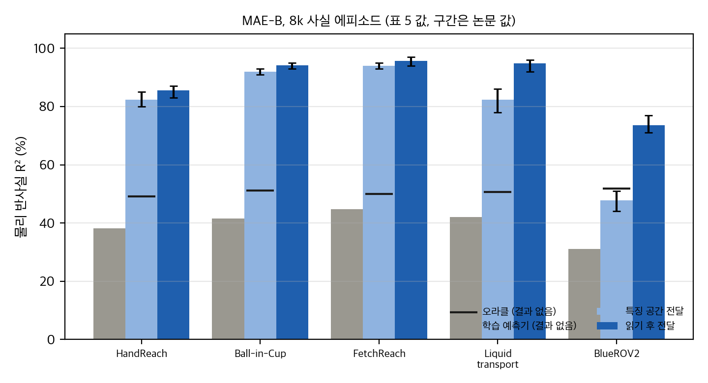
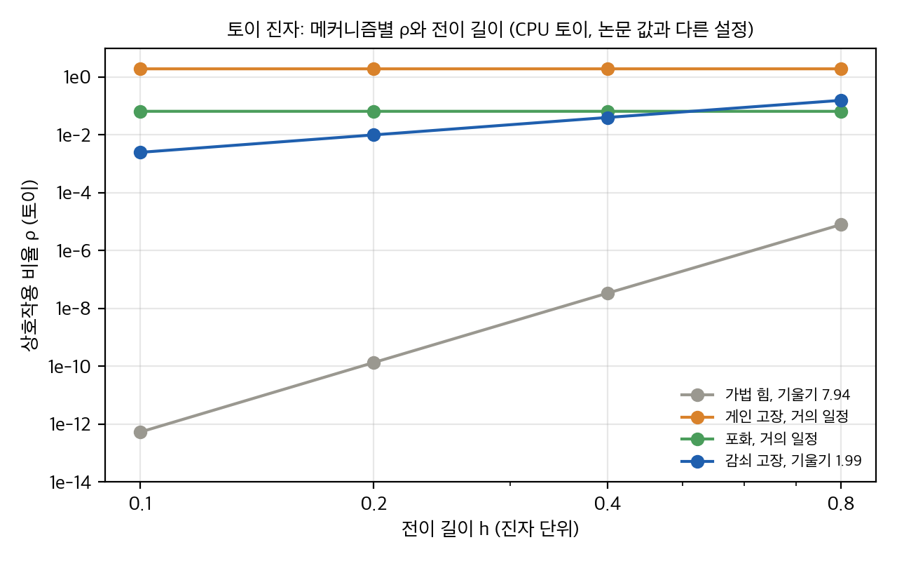
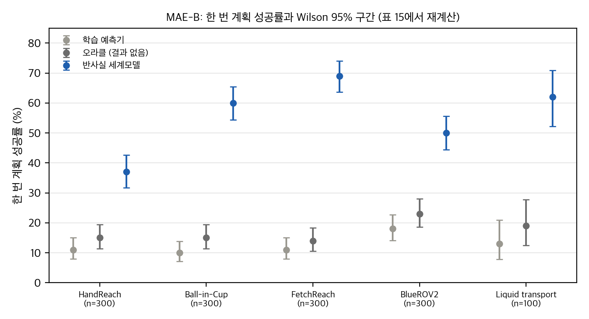

> **논문:** Randall Balestriero, Yann LeCun, Kerda Varaku. *Counterfactual World Models: JEPAs That Reason About "What If".* arXiv:2611.24778 (v1, 2026-11-18). 학회 표기는 없습니다.
> 공식 코드는 GitHub galilai-group/counterfactual-WM(MIT)에 있습니다. 이 글의 그림은 우리가 표 값과 토이 결과에서 그린 그래프입니다. 논문 그림은 쓰지 않았습니다.

## 논문이 묻는 것

세계모델은 행동을 주면 결과가 어떻게 될지를 평균으로 예측합니다. 바람이나 해류 같은 숨은 외란이 있으면 실제 결과는 그 평균에서 벗어납니다. 이때 질문이 생깁니다. **같은 외란이 그대로 있었다면, 다른 행동을 했을 때 결과는 어땠을까?** 이것이 개별 반사실입니다. 실패가 판단 잘못인지 운이었는지 가르는 데 필요합니다.

저자들은 먼저 한 가지를 증명합니다. 사실 전이로만 학습한 세계모델은 데이터와 용량이 무한해도 이 질문에 답하지 못합니다. 같은 사실 분포를 만드는 서로 다른 반사실 세계가 여럿 있기 때문입니다.

그다음 물리에서 나오는 구조를 씁니다. 행동과 외란이 **별도의 힘**으로 들어가면, 짧은 전이에서 둘의 상호작용은 시간의 2차 항입니다. 그러면 반사실 결과는 다음과 같이 근사됩니다.

> 반사실 결과 ≈ 관측 결과 + [세계모델이 예측한 행동 a′의 결과 − 행동 a의 결과]

추가 학습도, 반사실 데이터도 없습니다. 세계모델을 두 번 호출하고 한 번 더하면 됩니다. 저자들은 이 오차가 전이 길이 h에 대해 O(h²)이고, 사실 데이터만 쓰는 추정기 중에서는 최악의 경우 기준으로 이 속도가 최적이라고 증명합니다.

## 확인한 것

**1. 재계산.** 표 15의 계획 성공률을 시도 횟수로 바꾸어(300회, 100회) 다시 계산했습니다. 반사실 모델은 학습 예측기와 "결과를 쓰지 않는 오라클" 모두보다 10개 셀에서 모두 유의하게 높았습니다. 비쌍대 근사의 p 값은 최대 3 × 10⁻⁸입니다. 원자료가 없어 쌍대 검정은 못 했습니다.

그래프: 표 5의 MAE-B 값(8k 사실 에피소드). 막대는 점 추정, 오차 막대는 논문 구간입니다. 우리가 그렸습니다.

**2. 성과의 크기.** 개선 폭은 벤치마크 설계의 영향을 받습니다. 저자들은 시뮬레이터의 외란을 "결과를 쓰지 않는 오라클 예측이 약 50%가 되도록" 보정했습니다. 그래서 기준선(38–46%)과 개선 결과(86–96%)의 차이를 실제 로봇의 기대치로 바로 옮기면 안 됩니다.

**3. 실패 조건.** 규칙이 맞는 조건과 깨지는 조건을 논문이 직접 측정했습니다.

- 외란이 힘으로 들어가는 경우(외부 하중, 가법 힘)는 잘 맞습니다.
- 외란이 명령 크기를 곱하는 경우(게인 고장)는 맞지 않습니다. 외란이 커질수록 상호작용 비율이 0.5에서 2로 올라갑니다.
- 접촉(밀기 블록)에서는 정확한 평균을 써도 설명력이 음수가 됩니다.
- 픽셀 공간에서 전달하면 상대 위험이 5.86으로 커집니다. 관절 같은 좌표로 옮긴 뒤에야 0.002가 됩니다.

**4. 토이로 확인.** 감쇠 진자를 CPU에서 돌려 보았습니다. 가법 힘은 상호작용이 h⁸(기울기 7.9)로 줄고, 감쇠 고장은 h²(기울기 2.0)로 줄며, 게인과 포화는 일정합니다. 논문의 패턴과 같은 방향이지만 값은 다릅니다(설정이 달라서).

그래프: 토이 진자(CPU, numpy)의 메커니즘별 상호작용 비율 ρ와 전이 길이 h. 논문 설정과 다르고 패턴만 비교합니다. 우리가 그렸습니다.

**5. 공식 코드 대조.** 핵심 규칙은 논문 식과 같습니다. 다만 상호작용 비율 ρ를 "부모별 평균"으로 정의했는지, "평균의 비율"로 계산했는지 논문 설명이 모호합니다. 그리고 여러 기본 인자가 `cuda`로 고정되어 있어 맥에서는 바로 돌지 않습니다.

그래프: 표 15의 MAE-B 한 번 계획 성공률과 Wilson 95% 구간(우리가 계산). 반사실 모델(파랑)이 학습 예측기(회색)와 결과를 쓰지 않는 오라클(진회색)보다 높습니다.

## 구현 가능성

- **이 맥(Apple M4 Pro, MPS, CUDA 없음)에서 픽셀 세계모델 재현은 불가능합니다.** 전체 재현에는 H100급 GPU 약 150시간과 최대 80 GB 디스크가 필요합니다.
- **구현할 수 있는 것:** 잔차 전달 규칙과 평가 수식, 표 재계산, CPU 토이. 이미 했습니다.
- **조건부:** 공식 코드의 CPU/MPS 포팅, 상태 기반 MuJoCo 축소판. 노력은 1–3주로 추정합니다(측정 전 판단).

## 읽고 나서 남는 질문

- 로봇 정책 학습에 바로 넣기에는 아직 이릅니다. 픽셀 입력, 접촉, 실로봇 검증이 모두 빠져 있습니다.
- 실제로 가장 쓸모 있는 곳은 **사후 진단**입니다. 실패한 시도에서 같은 사건을 다시 재생해 다른 행동을 평가하는 방식입니다. 논문은 이 재시도로 성공률이 크게 오른다고 보고합니다(표 16).
- 외란이 연속 전이에서 얼마나 지속되는지가 중요합니다. 지속되면 이전 잔차를 다음 전이에서도 쓸 수 있습니다(표 17).

## 출처와 라이선스

- 논문은 arXiv에 CC BY 4.0으로 공개되어 있습니다(abs 페이지의 license 링크 확인). PDF에서 저작권 표시는 찾지 못했습니다.
- 이 글은 논문 그림을 싣지 않고, 표 값과 토이에서 우리가 그린 그래프만 씁니다.
- 공식 코드는 MIT 라이선스이며, 이 글 작성 중 실행하거나 설치하지 않았습니다(정적 읽기만).
- 가중치 중 MAE 인코더는 CC-BY-NC 4.0입니다. 이 코드로 만든 모델의 사용 범위를 제한합니다.

## 자료

- [통합 리포트 PDF](report/report_public.pdf)
- [Counterfactual World Models: JEPAs That Reason About "What If" (arXiv:2611.24778) 분석](analysis/01_paper_analysis.md)
- [선행연구와 관련 자료: Counterfactual World Models (arXiv:2611.24778)](analysis/02_prior_work.md)
- [재계산과 검증: Counterfactual World Models (arXiv:2611.24778)](analysis/03_analysis.md)
- [공식 코드 대조: Counterfactual World Models (arXiv:2611.24778)](analysis/04_code_verification.md)
