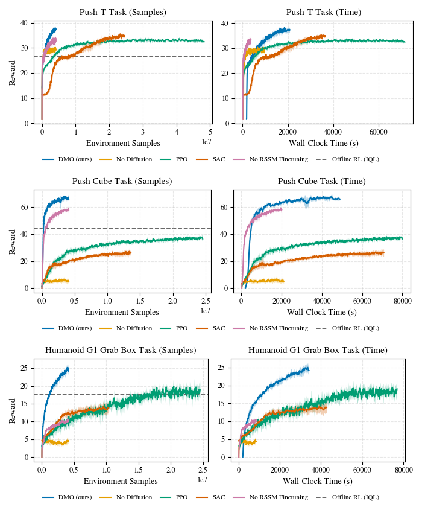
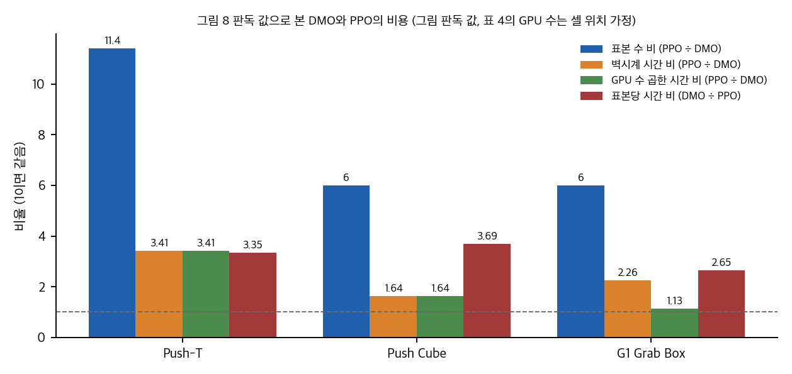
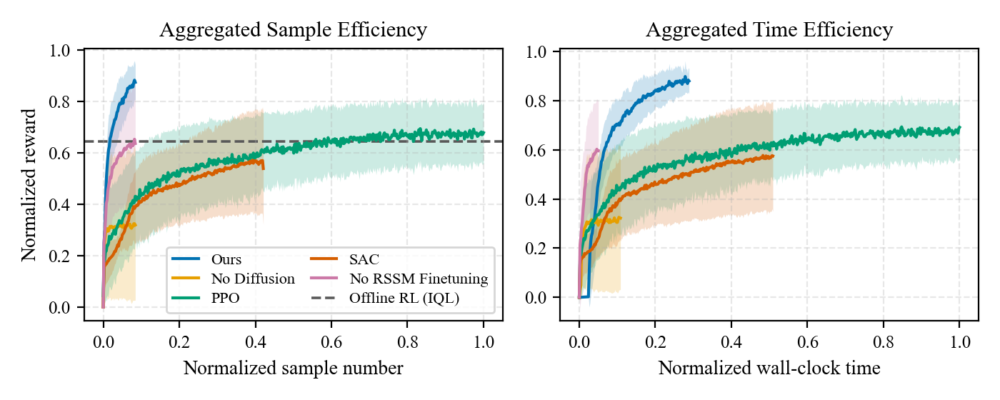
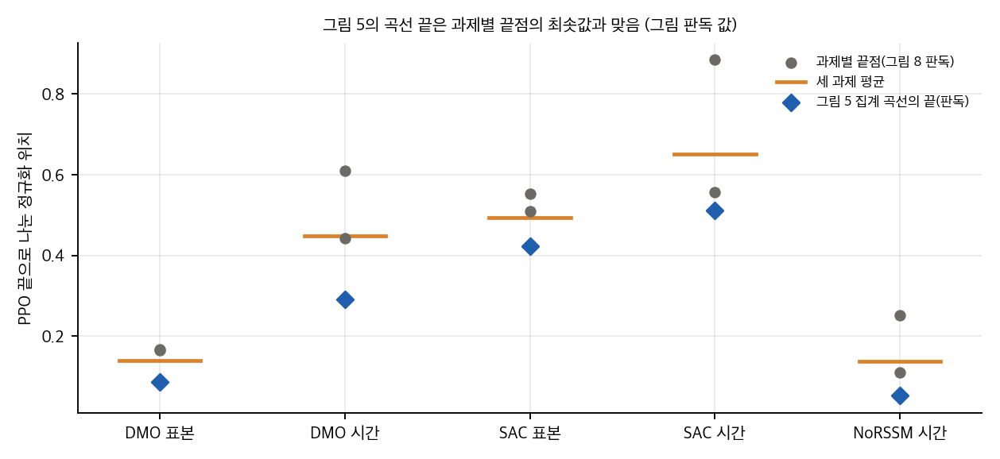
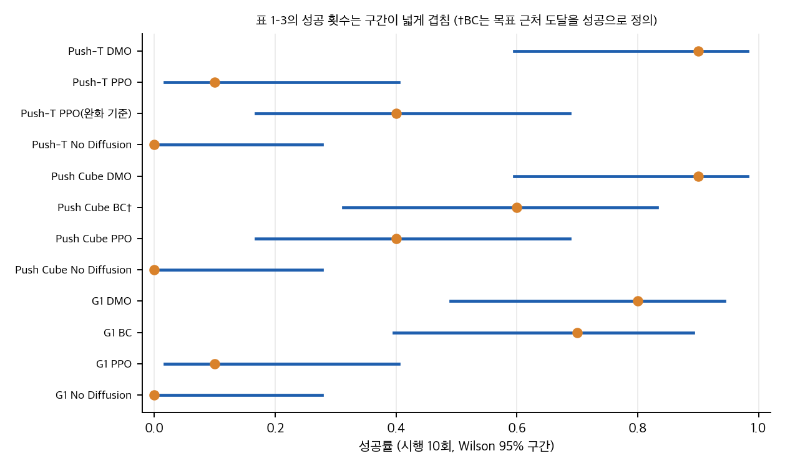
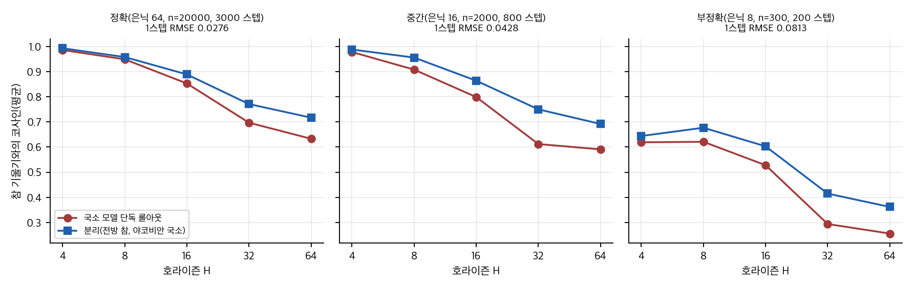

> **논문:** Joseph Amigo, Rooholla Khorrambakht, Nicolas Mansard, Ludovic Righetti. *Coupled Local and Global World Models for Efficient First Order RL.* CoRL 2026 포스터, arXiv:2602.06219 (v3, 2026-10-11).
> 공식 코드는 공개되어 있지 않습니다(프로젝트 페이지에 "Code (release soon)"). 이 글의 그림은 논문 그림 두 장(그래프, 출처 표기)과 우리가 그린 그래프입니다. 그림에서 읽은 값은 "(그림 판독 값)"으로 표시했고, 논문에 시행 수가 없는 곳은 가정을 적었습니다.

## 논문이 묻는 것

실로봇에서 모은 "놀이" 데이터로 큰 확산 세계모델을 학습하고, 그 안에서 RL로 정책을 학습해 실로봇에 영점 이동으로 배포합니다. 1차 기울기(FoG) 방법은 기울기 분산이 낮지만, 큰 확산 모델 안으로 역전파하면 메모리와 시간이 큽니다. 논문은 **순전파 값은 큰 전역 모델이, 야코비안은 작은 DreamerV3식 RSSM(국소 모델)이** 맡는 분리형 기울기를 씁니다. 전역 모델이 만든 프레임을 디코드해 국소 모델의 이미지 인코더로 다시 인코딩하는 것이 이 논문의 변경입니다. Push-T(조작기), Go2 Push Cube, G1 Grab Box에서 PPO, SAC, IQL, ACT와 비교합니다.

## 이 글에서 확인한 것

**1. 효율 비는 세계모델 표본 기준이고, 벽시계와 하드웨어를 곱하면 줄어듭니다.** 모든 방법이 같은 세계모델 안에서 학습하므로 "표본"은 세계모델이 만든 프레임 수입니다. 그림 8에서 읽으면(그림 판독 값) PPO 대비 표본 비는 11.4, 6.0, 6.0배이고 벽시계 비는 3.41, 1.64, 2.26배입니다. 표 4의 "Compute (per Seed)"를 과제 순서대로 읽으면(셀 위치 가정) G1은 DMO 8 H100, PPO 4 H200이어서 GPU 수를 곱한 비는 1.13배입니다.

*그림 8 (논문 원문, 위부터 Push-T, Push Cube, G1 Grab Box). © 저자, CC BY 4.0, 출처 arXiv:2602.06219.*

*그래프 (우리가 그림). 그림 8 판독 값에서 계산한 비입니다.*

**2. 그림 5의 곡선 끝은 과제별 끝점의 평균이 아니라 최솟값과 맞습니다(그림 판독 값).** DMO의 집계 곡선 끝(정규화 표본 0.086)은 과제별 끝점 0.088, 0.165, 0.167의 최솟값과 맞고 평균 0.140과 다릅니다. 부록 A.4의 집계 규칙(시드, 과제 순 평균)만으로는 이 끝점이 설명되지 않아, 세 과제가 모두 데이터를 가진 구간까지만 그린 것일 가능성이 있습니다. 저자 확인이 필요합니다.

*그림 5 (논문 원문). © 저자, CC BY 4.0, 출처 arXiv:2602.06219.*

*그래프 (우리가 그림, 그림 판독 값).*

**3. 실로봇 10회로 구분되는 비교는 DMO 대 PPO입니다.** Push-T 9 대 1(Fisher p = 0.0011), G1 8 대 1(p = 0.0055)은 구분됩니다. Push Cube의 9 대 4(PPO)는 p = 0.057, DMO 대 BC는 Push Cube 9 대 6에서 p = 0.30, G1 8 대 7에서 p = 1.0입니다(시행이 독립이라는 가정). 시행 10회로 참 성공률 0.9 대 0.6을 가를 확률은 약 15%입니다. 표 1의 BC 성공은 "목표 바로 앞 도달"로 정의한 값입니다(각주).

*그래프 (우리가 그림). 시행 10회, 시행 독립 가정.*

**4. "25배 빠르고 GPU 128배 적다"의 측정 조건이 쓰여 있지 않습니다.** 1.5 s 대 59 ms는 25.4배로 일치합니다. 128 GPU와 1 GPU 구성에서 GPU-초 비는 25.4배이지만 128개 액터를 순차 처리하면 시간은 7.55 s로 1.5 s보다 깁니다. 두 문구를 한 구성으로 읽으려면 배치 방식과 메모리 가정이 필요합니다. 단일 상태 16스텝 청크 하나의 기울기 계산 비용입니다.

**5. 버전 사이에 바뀐 것.** Push-T 표본(DMO/PPO)은 v1과 v2의 8M/40M에서 v3의 4M/48M으로, 표 1의 지표는 N = 3 평균에서 N = 10의 성공 에피소드 평균으로 바뀌었습니다. BC 성공은 v1 본문의 "0%"에서 v3의 60%(정의 변경)로 바뀌었습니다. 이유는 쓰여 있지 않습니다.

## 토이로 본 것: 분리 기울기는 참 기울기에 더 가까운가

부록 A.3의 코사인 0.52 대 0.35 대 0.08(G1 세계모델 하나, 분산 없음)의 방향성만 8차원 토이로 확인했습니다. 전역 모델은 참 동역학과 같다고 두고 국소 MLP의 크기를 세 가지로 바꿨습니다(torch CPU, 시드 하나, 약 13초).

- 분리(값은 참 f, 야코비안은 국소 모델)는 모든 설정에서 국소 단독보다 참 기울기와의 코사인이 높았습니다(H = 16에서 +0.04–0.08).
- 이득은 논문의 1.5배보다 작았습니다(코사인 비 1.04–1.41). 토이의 국소 모델이 G1의 것보다 훨씬 정확합니다.
- 국소 모델의 1스텝 RMSE가 0.028에서 0.081로 늘면 H = 16의 분리 코사인이 0.889에서 0.603으로 떨어졌습니다.

*그래프 (우리가 그림). 토이이며 G1 결과가 아닙니다.*

## 정량 근거가 없는 주장

하이퍼파라미터 강건성(Push Cube 에피소드 길이 64와 128), 패칭의 착취 감소(그림 7), 능동 탐색(그림 11), 보행 정책 교체(그림 12)는 질적이거나 한 문장입니다. 시행 수와 대조 실험이 있으면 더 읽기 쉬울 것입니다. 한계 절에 밝힌 대로 Push Cube와 G1의 보상은 사람이 라벨링하고, 토크나이저는 사전학습 모델로 초기화합니다.

## 구현 가능성 (Apple M4 Pro, CUDA 없음)

- **실로봇 세 과제와 1.0–1.4B 전역 모델 학습: 불가.** 24–64장의 H100/H200과 비공개 놀이 데이터가 필요합니다.
- **분리 기울기와 DMO-SAPO 루프의 축소 구현: 가능.** 저차원 환경에서 3–5일(추정), 소형 이미지 환경은 2–3주(추정, MPS 속도 미측정)입니다.

이 글은 재현 실험을 하지 않았고, 공식 코드가 없어 논문과 코드의 대조도 하지 못했습니다.

## 자료

- [통합 리포트 PDF](report/report_public.pdf)
- [01. 논문 분석: Coupled Local and Global World Models for Efficient First Order RL](analysis/01_paper_analysis.md)
- [02. 선행연구와 자료: Coupled Local and Global World Models (arXiv:2602.06219 v3)](analysis/02_prior_work.md)
- [03. 수치 재계산, 일관성 검사, 토이: Coupled Local and Global World Models (arXiv:2602.06219 v3)](analysis/03_analysis.md)
- [04. 주장 검증과 구현 가능성: Coupled Local and Global World Models (arXiv:2602.06219 v3)](analysis/04_claim_verification.md)
