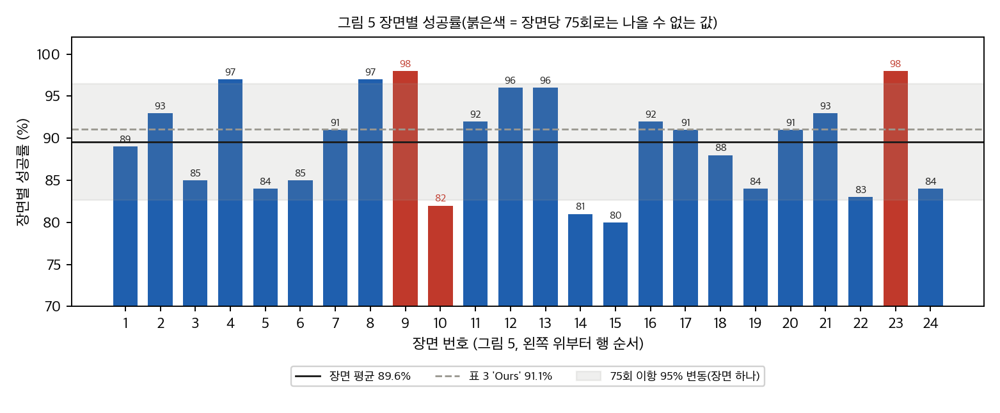
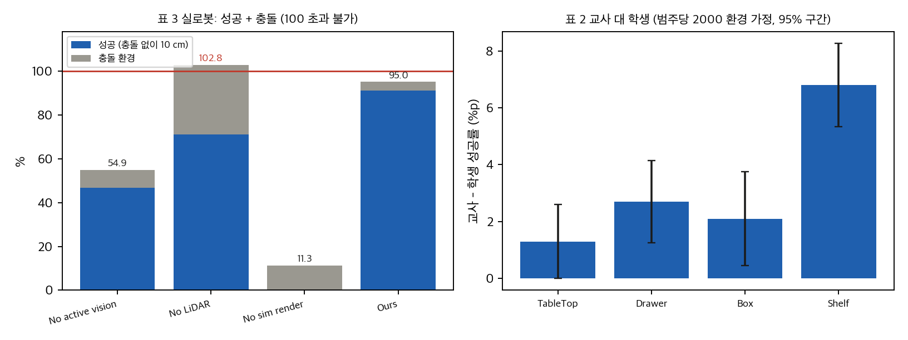
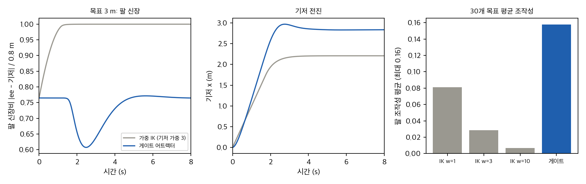

# 03. 수치 재계산과 일관성 검사: COWBOY (arXiv:2610.28948 v1)

모든 계산은 `analysis/recompute.py`(수 초, numpy·scipy)가 하고 결과는 `analysis/recompute_results.json`에 있습니다. 입력은 논문 표 1–4의 숫자와 그림 5의 장면별 값(이미지 판독)입니다. 검사 번호 V1–V12가 이 문서와 스크립트에서 같습니다. 토이 T1, T2는 §3입니다.

**원자료가 없습니다.** 시험별 성공 여부, 시드, 표준편차, 신뢰구간이 논문에 없습니다. 그래서 아래 구간과 p 값은 "논문 숫자에서 가정한 시도 수로 만든 근사"이고, 가정은 매번 적었습니다.

## 1. 표 재계산 (V1–V12)

### V1. 표 1·2 평균과 표 간 복사

| 항목 | 재계산 | 보고 | 판정 |
|---|---|---|---|
| ManipGen 평균 (표 1) | 63.1 | 63.1 | 일치 |
| COWBOY 평균 (표 1 = 표 2 학생) | 92.35 | 92.4 | 일치(반올림) |
| 교사 성공 평균 | 95.575 | 95.6 | 일치 |
| 학생 충돌 평균 | 6.05 | 6.1 | 일치(반올림, 6.0도 가능) |
| 교사 충돌 평균 | 4.325 | 4.3 | 일치 |
| 표 1 COWBOY 행 = 표 2 학생 행 | 같음 | | 일치 |
| 표 4 "Full Fabrics WBC" = 표 2 교사 평균 (95.6, 4.3) | 같음 | | 일치 |

평균은 네 범주를 같은 가중으로 낸 단순 평균과 맞습니다. 범주별 환경 수가 같다는 뜻이거나 단순 평균을 썼다는 뜻입니다(논문에 적혀 있지 않음).

### V2. 표 3 "Ours" 시뮬 열 대 표 2 학생: 충돌 6.4 대 6.1

표 3 Ours의 시뮬 성공 92.4는 표 2 학생 평균 92.4와 같지만, **충돌은 6.4**로 표 2의 6.1과 다릅니다(차 0.3 %p). 범주별 환경 수가 다른 가중 평균이라면 가능한지 선형계획으로 확인했습니다.

- 교사와 학생이 같은 범주 가중을 쓰고, 성공 평균 95.6·92.4와 충돌 평균 4.3·6.4를 동시에 만족하는 가중은 **없습니다**(실행 불가능).
- 같은 가중에서 충돌 6.1이면 만족하는 가중이 있습니다(균등 가중 포함).
- 학생 값만 보면 충돌 6.4·성공 92.4를 만드는 가중은 존재하지만 Drawer 79%, Shelf 21%라는 극단입니다.

따라서 표 2와 표 3은 **같은 평가가 아니라 서로 다른 실행(다른 시드나 환경 표본)일 가능성**이 큽니다. 어느 쪽이 맞는지 논문에서 정할 수 없습니다.

### V3. 그림 5 장면별 성공률과 헤드라인 91%

| 항목 | 값 |
|---|---|
| 장면별 판독값 24개의 단순 평균 | **89.58%** |
| 장면 간 표준편차 | 5.82 %p (장면 하나의 이항 변동만 보면 3.51 %p) |
| 장면 간 t 구간(95%) | 87.1–92.0% |
| 본문·그림 5 캡션의 평균 | 91% (차 +1.42 %p) |
| 표 3 Ours | 91.1% (차 +1.52 %p) |
| 1,800회로 환산했을 때 | 그림 5 값은 성공 약 1612회, 표 3 값은 약 1640회. 차이 약 27회 |

해석:

- **헤드라인 91%는 그림 5의 장면 평균(89.6%)과 맞지 않습니다.** 장면별 시도 수가 같다고 보면 평균은 89.6입니다. 반올림해서 91%가 되려면(90.5% 이상) 장면 값의 합이 2172 이상이어야 하는데 판독 합은 2150입니다. 다른 분모(예: 고정 20개 물체만, 사전 검출 실패 제외)로 계산했을 수 있지만 논문에 적혀 있지 않습니다. 구간 87.1–92.0에는 91이 들어가므로 "통계적으로 모순"은 아니고, **보고 방식의 불일치**입니다.
- **장면당 75회로는 나올 수 없는 값이 세 개 있습니다.** 장면 9와 23의 98%, 장면 10의 82%입니다(75회에서 가능한 값은 …81.3, 82.7…, …97.3, 98.7…). 장면마다 유효 시도 수가 달랐다는 뜻입니다(예: 실패한 검출 초기화 제외). 장면 24개가 모두 가능한 공통 시도 수는 n = 80, 89, 95, 96, 98 이상 등입니다. 즉 장면당 75회가 모두에게 적용된 것은 아닙니다.
- **장면 사이 차이는 이항 변동보다 큽니다.** 균질성 검정 χ² = 64.9(자유도 23), p = 7e-6. 장면 간 난이도가 실제로 다르다는 뜻이며(최저 80%, 최고 98%) 평균 하나로 요약하면 이 변동이 가려집니다. 반면 장면 하나의 구간(75회에서 ±7 %p 정도)은 넓어서 "장면 A가 B보다 쉽다"는 개별 비교는 약합니다.
- 구간: 1,800회로 가정하면 Wilson 95% = 89.7–92.3(91.1% 기준). 시도들이 장면에 묶여 있으므로 장면 간 구간(87.1–92.0)이 더 정직합니다.

### V4. 표 3 실로봇 열의 정수 가능성

실로봇 열의 숫자 8개(성공 46.7, 71.1, 0.0, 91.1과 충돌 8.2, 31.7, 11.3, 3.9)가 한 시도 수 n에서 모두 나오는 최소 n은 **584**이고, 1,800은 모두 가능합니다(성공 840, 1279, 0, 1639; 충돌 147, 570, 203, 70). 장면당 75회(n = 75)로는 71.1, 91.1과 충돌 값 네 개가 모두 불가능하고, 45회로도 충돌 값 네 개가 불가능합니다. 절제 실험에서 24개 장면 전부를 돌렸다면 1,800회와 일관됩니다. 일부 장면만 썼다면 최소 584회라는 하한이 생깁니다. **논문에는 절제 실험의 시도 수가 없습니다.**

### V5. 표 3 실로봇: 성공 + 충돌이 100을 넘는 칸

실로봇 성공은 "10 cm 들어올림, 충돌 없음"으로 정의됩니다(§4). 그러면 성공한 시도에는 충돌이 없어야 하므로 성공% + 충돌% ≤ 100이어야 합니다.

| 변형 | 실 성공 | 실 충돌 | 합 |
|---|---|---|---|
| 능동 시각 없음 | 46.7 | 8.2 | 54.9 |
| **LiDAR 없음** | **71.1** | **31.7** | **102.8 (불가능)** |
| 렌더링 없음 | 0.0 | 11.3 | 11.3 |
| Ours | 91.1 | 3.9 | 95.0 |

"LiDAR 없음" 열만 100을 넘습니다. 성공 정의에 충돌이 안 들어갔거나(정의 서술 오류), 충돌 비율의 분모가 다르거나(예: 접촉 단위 계산), 숫자 오류입니다. 시뮬레이션은 성공 정의(§5: 10 cm 들어올림)에 충돌 조건이 없어 합이 100을 넘어도 모순이 아닙니다(표 4 "충돌 회피 없는 fabric" 74.8 + 32.6 = 107.4).

### V6. 학생 대 교사, COWBOY 대 ManipGen (가정: 범주당 2000환경)

8,000개 환경이 네 범주에 같게 나뉜다고 가정한 비짝지음 비율 검정입니다(실제로는 같은 환경에서 짝지은 비교가 가능하므로 이 p는 보수적입니다).

| 범주 | 교사 | 학생 | 차 | p (가정) |
|---|---|---|---|---|
| TableTop | 96.0 | 94.7 | 1.3 | 0.051 |
| Drawer | 95.6 | 92.9 | 2.7 | 2e-4 |
| Box | 93.4 | 91.3 | 2.1 | 0.012 |
| Shelf | 97.3 | 90.5 | **6.8** | < 1e-15 |

- 평균 격차는 3.2 %p이고 이 중 Shelf 한 범주가 절반 이상입니다. 본문의 "student closely matches teacher in tabletops, drawers, boxes"는 격차 1.3–2.7 %p로 크지 않지만, 환경 수가 큰 평가에서는 TableTop을 제외하고 모두 검출됩니다. "closely"는 효과 크기 기준(수 %p)이면 타당하고 통계 기준이면 아닙니다.
- COWBOY 대 ManipGen: Drawer +3.7, Box +4.1 %p(p ≈ 4e-5, 3e-5)이고 TableTop +39.9, Shelf +69.3 %p입니다. "모든 범주에서 높다"는 맞습니다. 다만 Drawer, Box의 격차는 작아 기준선 설정(구현, 계획기, VLM 선택)에 민감할 수 있습니다(`04` C4).

### V7. WBC 진입률과 교사 성공률

WBC가 국소 전문가 분포에 진입하는 비율 98.4%(§5)와 교사 평균 성공 95.6%에서, 진입 후 조건부 성공률은 95.6/98.4 = **97.2%**입니다(선반 97.3/98.4 = 98.9%). 진입 실패가 교사 성공률을 약 1.6 %p 깎고, 국소 전문가 자체는 97% 안팎입니다. 교사의 성공 한계는 WBC 접근보다 국소 전문가·장면 조합이 정하고, 학생이 잃는 3.2 %p(V6)는 증류 손실이라는 해석과 맞습니다.

### V8. 차원과 개수의 내부 일관성

| 항목 | 재계산 | 논문 | 판정 |
|---|---|---|---|
| 배우 관측 (표 6) | 16+12+3+3+6+3+6+3+6+3 = 61 | 61 | 일치 |
| critic 관측 (표 7) | 23+23+3+6+6+12+3+3+6+3+6+3+6+3 = 106 | 106 | 일치 |
| 전문가 행동 | 3+3+16 = 22 | 22 | 일치 |
| 학생 행동 | 3+7+16+6 = 32 | 32 | 일치 |
| 자유도 (그림 2) | 3+7+16+6 = 32 | 32 | 일치 |
| 토큰 폭 | 124+4 = 128, 8헤드 → 16 | 128 | 일치 |
| 점군 | 2 × (1024 + 512) = 3072 | 3072 | 일치 |
| **증류 환경 수** | 랭크당 512 × 8 GPU = **4096** | **8192** (§3.3) | **불일치** |
| WBC 지원 환경 수 | 최대 4096 (§3.1) | 증류 8192 | 8192가 지원 한도의 2배 |
| 보류 평가 환경 수 | 8,000 (표 2 캡션, G.2) | 8192 (§4) | 불일치(작음) |
| 전문가 물체 수 | 304 + 195 = 499 (겹치지 않으면) | 증류 250개 (§3.3) | 일부만 쓰였다는 뜻이거나 겹침. 서술 없음 |

### V9. 계산량 산술

| 항목 | 값 |
|---|---|
| WBC 배치 한 스텝 (0.03 ms × 환경 수) | 4096개 → 122.9 ms, 8192개 → 245.8 ms. 60 Hz 실시간 예산(16.7 ms)의 7.4배, 14.7배. 학습 시뮬에서 실시간일 필요는 없지만 "0.03 ms/환경"이 **WBC만** 잰 값이라는 것이 전제 |
| 36시간 안에 WBC가 처리할 수 있는 환경 스텝의 상한 | 4.3 × 10⁹ (WBC 시간이 전부라고 둔 상한) |
| 센서 시뮬 (환경 1024개) | 깊이 0.07 s, LiDAR 0.25 s → 환경당 0.068 ms, 0.244 ms. 랭크당 512 환경이면 한 스텝 0.16 s. 60시간이면 상한 135만 스텝 |
| 계산 총량 | 전문가 3 × 36 = 108 GPU시간(A6000) + 증류 8 × 60 = 480 GPU시간 = **588 A6000 GPU시간** |
| PPO 한 반복 | 8192환경 × horizon 32 = 262,144 샘플, 미니배치 8192 → 32 미니배치 × 5 에폭 = 160 그래디언트 스텝 |
| 무작위화 스케줄 "200,000 시뮬 스텝" | 환경 스텝 총합으로 읽으면 0.76 반복이면 끝나서 무의미. **벡터 환경의 스텝 수(PPO 반복 6,250회)**로 읽어야 합니다. 논문은 "simulation steps"라고만 적었습니다. 표준 구현의 규약으로 보면 이 해석이 자연스럽지만 코드로 확정하지는 못했습니다(`04` §3.1) |
| 객체 순간이동 곡선 | n0 = 10, n1 = 150, n2 = 300에서 이차 가지의 계수 a = 0.5/150² = 2.2 × 10⁻⁵ (E.7, 식이 텍스트 추출에서 깨져 부분 확인) |

### V10. 실환경 절제의 검정력

시도 수가 보고되지 않아 필요량으로 뒤집었습니다(양측 α = 0.05, 검정력 0.8). Ours 91.1% 대 LiDAR 없음 71.1%를 가르는 데 팔당 **59회**, 대 능동 시각 없음 46.7%는 **16회**면 충분합니다. 장면 하나(75회)면 두 차이 모두 충분히 커서 **방향은 확실**합니다. 실 성공 91.1과 시뮬 92.4의 차 1.3 %p는 이 규모로 가르려면 팔당 수천 회가 필요하므로 "시뮬과 실환경이 같다"는 주장에 반증도 증거도 못 됩니다(성공 정의도 다릅니다, V5).

### V11. 표 4 (WBC 절제)

- 전체 fabric WBC 대 가중 IK: 성공 +52.0 %p, 충돌 −37.1 %p, 조작성 1.85배, 관절 한계 여유 +0.48 rad.
- 전체 대 충돌 회피 없는 fabric: 성공 +20.8 %p, 충돌 −28.3 %p. 조작성은 1.07배, 여유 +0.12 rad로 충돌 회피가 이 두 지표에는 거의 영향이 없습니다. 이 구분은 본문("full achieves highest... while preserving strong manipulability")과 일치합니다.
- 환경 8,000개로 가정한 전체 95.6%의 Wilson 구간은 95.1–96.0. 시드와 구간은 논문에 없습니다.
- 가중 IK의 정의는 "기저 이동에 더 큰 벌점"(G.2)뿐이고 가중비, λ, 한계 처리가 없습니다. 아래 T1에서 가중비만 바꿔도 같은 IK가 크게 달라집니다.

### V12. 표 3 실로봇 열의 Wilson 구간 (가정 n = 1800)

Ours [89.7, 92.3], LiDAR 없음 [69.0, 73.2], 능동 시각 없음 [44.4, 49.0], 렌더링 없음 [0.0, 0.2]. 모두 서로 겹치지 않지만 n = 1800은 가정입니다. 시도 수가 584 근처이면 구간이 약 1.8배 넓어져도 순위는 같습니다.

## 2. 본문·표·캡션 불일치 목록 (위치 포함)

| 번호 | 위치 | 내용 | 영향 |
|---|---|---|---|
| N1 | §5 "COWBOY achieves higher grasp success…" | "Tab. 2"로 인용하지만 ManipGen 비교는 표 1 | 작음(표기) |
| N2 | §4(8192) 대 표 2 캡션·§5·G.2(8,000) | 보류 환경 수 | 작음 |
| N3 | 표 3 Ours 시뮬 충돌 6.4 대 표 2 학생 6.1 | 같은 정책의 같은 평가로 보이는데 다름(V2) | 중간 |
| N4 | §3.3(8192 환경) 대 E.5(512 × 8) 대 §3.1(WBC 최대 4096) | 증류 환경 수(V8) | 중간 |
| N5 | 초록·그림 5 캡션(91%) 대 그림 5 판독 평균 89.6 | 헤드라인(V3) | 중간 |
| N6 | 그림 5 판독의 82, 98, 98 | 장면당 75회와 양립 불가(V3) | 중간 |
| N7 | 표 3 실 LiDAR 없음 71.1 + 31.7 | 성공+충돌 > 100(V5) | 중간 |
| N8 | 그림 5 캡션 "100 objects" 대 §4 | 한 장면 25개 = 고정 20 + 무작위 5이므로 서로 다른 물체는 최대 20 + 100 = 120개. "수백 개"(초록, §1)는 실환경 물체 수로는 맞지 않고 시뮬레이션 물체까지 세야 함 | 작음 |
| N9 | D.1 side-grasp 전문가 끝 문장 | "lift target … 0.20 m above the box top at the box center"가 top-down 설명과 문장 그대로 같음. 벽 두 개짜리 side 영역에는 상자 위가 없으므로 복사 흔적으로 보임 | 작음 |
| N10 | 부록 A 표 5 OCS2의 "Native Batch API: Yes" | 본문은 MPC를 "배치 평가가 비싸다"며 배제. 표 5는 런타임 비교가 아니라고 적음 | 작음(논증 약함) |
| N11 | E.6 "provide a prompt that yields a valid initial detection" | 시작 전 검출 실패 시도는 제외되고 "초기화 이후 실패만 포함"(E.6). 91%의 분모에서 빠진 시도 수는 알 수 없음 | 중간(선택 편향 가능성) |
| N12 | 표 3 "No sim render" 시뮬 94.4 > Ours 92.4 | 정답 점군으로 학습하면 시뮬에서 더 좋음. 실 0.0%와 합쳐 "시뮬 점수는 실환경 성능의 지표가 못 된다"는 것을 논문이 직접 보임 | 정보 |

## 3. 토이

### T1. 거리 게이트 금속이 만드는 coarse-to-fine (`analysis/toy_gate_reaching.py`, 약 3초, numpy)

**무엇을 보나.** 논문의 핵심 구성 중 식 (2)의 게이트 금속(BA: m_min = 0, EEA: m_far = 0)이 "먼 곳은 베이스, 가까운 곳은 팔"을 만들고 팔의 과신장(조작성 저하)을 막는다는 §3.1과 표 4의 주장을 평면 로봇(전방향 기저 + 2링크 팔 0.4 + 0.4 m)에서 봅니다. 비교는 가중 감쇠 IK(기저 가중 1, 3, 10)와 게이트 어트랙터(식 (2), 부록 C의 어트랙터 형태, 약한 자세 정칙화)이며 에너지화와 충돌 항은 넣지 않았습니다. 목표는 2–3 m 거리 30개, 시작은 접힌 팔입니다.

| 제어기 | 수렴 시간(s) | 팔 신장 최대 | 조작성 평균 (최대 0.16) | 조작성 최소 | 기저 이동(m) |
|---|---|---|---|---|---|
| 가중 IK, 기저 가중 1 | 2.48 | 0.965 | 0.081 | 0.078 | 1.85 |
| 가중 IK, 기저 가중 3 | 3.00 | 0.997 | 0.029 | 0.023 | 1.77 |
| 가중 IK, 기저 가중 10 | 10.73 | 1.000 | 0.007 | 0.000 | 1.73 |
| 게이트 어트랙터 | 3.14 | 0.770 | **0.158** | 0.156 | 2.71 |

**읽는 법.**

- 가중 IK는 기저 가중을 올릴수록 팔을 끝까지 뻗고(신장 0.97 → 1.0) 조작성이 0.081 → 0.007로 무너집니다. 논문 표 4가 말하는 "weighted IK stretches the arm toward distant targets, low manipulability" 현상이 **기저에 큰 벌점을 줄 때** 나옵니다. 가중이 1이면 IK도 신장 0.965에 조작성 0.081로, 최대의 절반입니다.
- 게이트 어트랙터는 팔 신장을 0.77에서 유지하고 조작성이 최대(0.158)에 가깝지만, 기저를 1.5배 더 멀리(2.71 대 1.85 m) 움직이고 수렴이 IK(w = 1)보다 0.7 s 늦습니다. 즉 조작성을 얻는 대가가 있습니다.
- 한계: 이 토이의 PR(자세 정칙화)이 팔을 접힌 자세에 붙잡는 효과가 섞여 있어, "게이트만의" 효과를 분리하지 않았습니다. 게이트 반경(1.0 m, 0.9 m)과 가중치는 이 토이에서 정한 값입니다. 3차원 충돌, 시야, 관절 한계가 없어 표 4의 숫자를 재현한 것이 아닙니다.

**결론.** 가중 IK 기준선이 얼마나 나쁜지는 **가중비 선택에 달려 있습니다.** 표 4의 43.6% 대 95.6%가 이 가중비 하나를 어떻게 골랐느냐에 얼마나 의존하는지는 논문이 밝히지 않았습니다(V11). 메커니즘(거리 게이트가 팔 신장을 늦춘다)은 토이에서 확인되었습니다.

### T2. 학생 정책 크기 (`analysis/student_size_check.py`, torch, 수 초)

부록 E.5의 값(폭 128, 6 + 6층, 8헤드, FFN 1024, 점 토큰 128 + 상태 토큰 5, 상태 인코더 MLP 5개)으로 만든 모델은 **약 4.7M 파라미터**(트랜스포머 4.36M + 인코더 0.35M, 집합 추상화 그룹핑은 파라미터 없음)입니다. 행동 질의 수 C는 논문에 없어 1과 8로 두었고 파라미터 차는 900개 미만입니다. 배치 64, 학습 한 스텝(순전파 + 역전파 + AdamW)은 이 맥 CPU에서 약 250 ms, MPS에서 약 73 ms입니다. 학생 학습의 병목은 모델이 아니라 시뮬레이션과 센서 렌더링입니다(V9).

## 4. 요약

- 표 안의 산술(평균, 차원, 복사)은 거의 모두 맞습니다.
- 어긋나는 곳은 **보고된 요약 숫자와 근거 사이**입니다: 헤드라인 91% 대 장면 평균 89.6, 75회로 불가능한 장면 값 세 개, 100을 넘는 성공 + 충돌, 8192 대 4096 환경, 6.4 대 6.1.
- 통계적 강도는 논문에 없는 정보(시도 수, 시드, 신뢰구간)에 막혀 있고, 보류 시뮬레이션 비교는 환경 수가 커서 방향은 확실합니다.
- 메커니즘 수준의 주장(게이트가 팔 과신장을 막는다)은 토이로 지지되지만, 효과 크기는 기준선 설정에 민감합니다.
