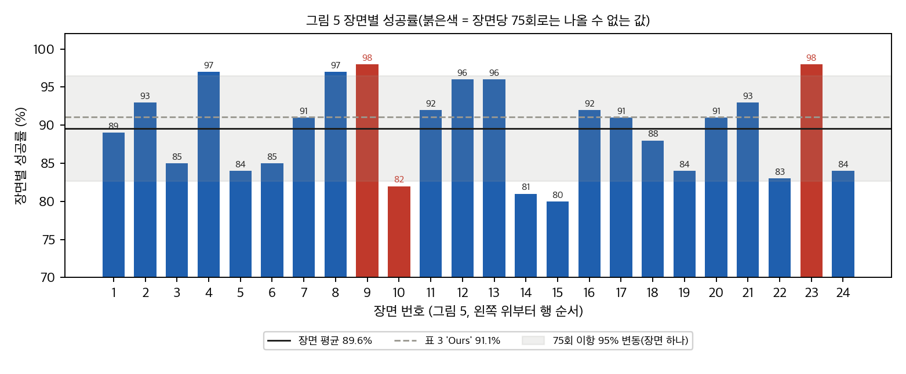
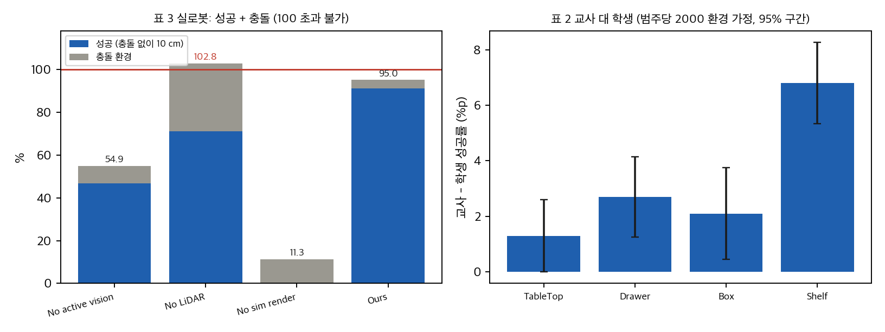
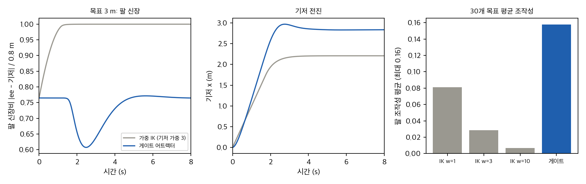

> **논문:** Jiahui Yang, Jason Jingzhou Liu, Ray Muxin Liu 외. *COWBOY: A Scalable Sim-to-Real Framework for Learning Contextual Whole-Body Manipulation.* CoRL 2026 포스터, arXiv:2610.28948 (v1, 2026-10-20).
> 논문은 arXiv 비독점 배포 라이선스(CC BY 아님)라 논문 그림은 싣지 않았고, 이 글의 그래프는 모두 직접 그렸습니다. 공식 코드는 확인되지 않았습니다.

## 논문이 묻는 것

모바일 매니퓰레이터는 물체뿐 아니라 물체가 놓인 공간에 따라 베이스 위치, 팔 궤적, 시선, 잡는 방식을 바꿔야 합니다. 장면마다 RL을 돌리면 장면 표현, 보상, 고차원 행동이 한꺼번에 어려워집니다. COWBOY는 문제를 둘로 나눕니다.

1. **접근:** 기하 패브릭으로 만든 벡터화 전신 제어기(WBC)가 말단 목표와 응시점만 받아 베이스와 팔, 능동 카메라를 움직이고 충돌을 피합니다.
2. **접촉:** 국소 장면(상자, 선반)에서 RL 전문가 3종을 학습하고, 말단 좌표계로 쓰여 있어 수천 개 전체 장면에 재사용합니다.
3. **합치기:** 둘을 이은 교사를 점군 입력 트랜스포머 학생 하나로 DAgger 증류합니다. 실환경 24개 장면에서 91% 성공을 보고합니다.

## 이 글에서 확인한 것

**1. 헤드라인 91%는 그림 5의 장면별 값과 맞지 않습니다.** 그림 5의 장면별 성공률 24개를 읽어 평균하면 89.6%이고 표 3은 91.1%입니다. 장면 간 구간(87.1–92.0)에는 91이 들어가므로 모순은 아니지만 보고 방식이 다릅니다. 또 그림에서 읽은 98%, 82%, 98% 세 값은 장면당 75회(고정 20 + 무작위 5 물체, 방향 3)로는 나올 수 없습니다. 장면마다 유효 시도 수가 달랐을 가능성이 있고, 부록은 시작 전 검출 실패를 제외한다고 적습니다.

*그래프 (우리가 그림). 논문 그림 5의 숫자를 눈으로 읽은 값입니다. 붉은 막대는 장면당 75회로 나올 수 없는 값입니다.*

**2. 표들끼리도 몇 군데 어긋납니다.** 실로봇 "LiDAR 없음"은 성공 71.1% + 충돌 31.7% = 102.8%인데, 성공은 "충돌 없이 10 cm 들어올림"으로 정의됩니다. 증류 환경 수는 본문 8192, 부록 계산 512 × 8 GPU = 4096이고, WBC가 지원하는 최대도 4096입니다. 표 3 Ours의 시뮬 충돌 6.4%는 표 2 학생의 6.1%와 다릅니다. 학생과 교사의 성공률 차이는 평균 3.2%p이고 선반에서 6.8%p로 가장 큽니다.

*그래프 (우리가 그림). 왼쪽은 표 3 실로봇 열의 성공 + 충돌, 오른쪽은 표 2의 교사 대 학생 격차(범주당 2000 환경 가정)입니다.*

**3. "scalable"은 직접 시험되지 않았습니다.** 장면, 물체, 전문가 수를 바꾼 실험이 없고 단일 규모(환경 8192, 물체 250, 전문가 3종)의 결과만 있습니다. 계산량은 전문가 36 GPU시간 × 3과 증류 8 GPU × 60시간을 합쳐 약 588 A6000 GPU시간입니다.

**4. 설계의 핵심 메커니즘은 토이에서 확인됩니다.** 식 (2)의 거리 게이트 메트릭(기저 어트랙터는 가까워지면 사라지고, 말단 어트랙터는 가까워질 때만 켜짐)을 평면 로봇에서 가중 IK와 비교했습니다. 기저 가중을 올릴수록 IK는 팔을 끝까지 뻗어 팔 조작성이 0.081 → 0.029 → 0.007로 무너지고, 게이트 어트랙터는 0.158을 유지합니다. 대신 기저를 1.5배 더 움직입니다. 표 4의 가중 IK 기준선(43.6% 대 95.6%)이 얼마나 강한지는 가중비 선택에 달려 있고 논문에 그 값이 없습니다.

*그래프 (우리가 그림). 평면 2링크 로봇, 충돌 없음, 목표 30개. 논문 표 4를 재현한 것이 아니라 메커니즘의 확인입니다.*

## 코드

공식 코드는 논문, 부록, 프로젝트 페이지 어디에도 없습니다. 제1저자 개인 계정에 IsaacGymEnvs fork(2026-06 스냅샷)가 있어 정적으로 읽어 보았습니다. 부록의 PPO 설정, 무작위화 크기, 관측·행동 차원, 학생 구조는 그대로 일치합니다. 다만 그 스냅샷에서는 충돌 벌점이 켜져 있고(논문 부록은 없다고 서술), 국소 전문가가 패브릭이 아니라 IK 위에서 학습하며, 증류의 무작위화가 전문가보다 약합니다. 공식 릴리스가 아니고 논문 제출 4.5개월 전 스냅샷이라, 최종 코드와의 차이는 확정하지 않았습니다.

## 구현 가능성 (Apple M4 Pro, CUDA 없음)

- **실로봇과 공식 학습: 불가.** TidyBot++, Franka, LEAP 손, LiDAR가 필요하고 Isaac Gym은 NVIDIA GPU를 전제합니다.
- **구조 검증의 축소판: 가능.** 평면 게이트 WBC 토이와 학생 크기 점검(약 4.7M 파라미터, MPS에서 배치 64 한 스텝 약 73 ms)을 해 보았습니다. torch fabric WBC(2–4주), 센서 시뮬(1주)은 추정치입니다.

이 글은 재현 실험을 하지 않았고, 표 수치의 재계산과 작은 토이만 했습니다.

## 한계

- 논문에 시도 수, 시드, 신뢰구간이 없어 구간은 가정에 기댑니다. 그림 5의 값은 이미지에서 읽었습니다.
- 토이는 2차원이고 충돌, 시야가 없으며 게이트 반경과 가중치는 직접 정했습니다.
- 개인 fork는 6월 스냅샷이며 fabric WBC와 가중치가 빠져 있습니다.

## 출처와 라이선스

- 논문: arXiv:2610.28948, arXiv 비독점 배포 라이선스(abs 페이지 확인). 그래서 논문 그림은 싣지 않았습니다.
- 표 값은 인용과 재계산을 위해 옮겼습니다. 그래프, 토이, 분석 문서와 스크립트는 이 저장소 작성자가 만들었습니다.
- 공식 코드, 가중치, 데이터는 받아서 실행하지 않았습니다. 코드는 정적으로만 읽었습니다.

## 자료

- [통합 리포트 PDF](report/report_public.pdf)
- [01. 논문 분석: COWBOY (arXiv:2610.28948 v1)](analysis/01_paper_analysis.md)
- [02. 선행연구와 코드 현황: COWBOY (arXiv:2610.28948 v1)](analysis/02_prior_work.md)
- [03. 수치 재계산과 일관성 검사: COWBOY (arXiv:2610.28948 v1)](analysis/03_analysis.md)
- [04. 주장 검증과 코드 현황, 구현 가능성: COWBOY (arXiv:2610.28948 v1)](analysis/04_claim_verification.md)
