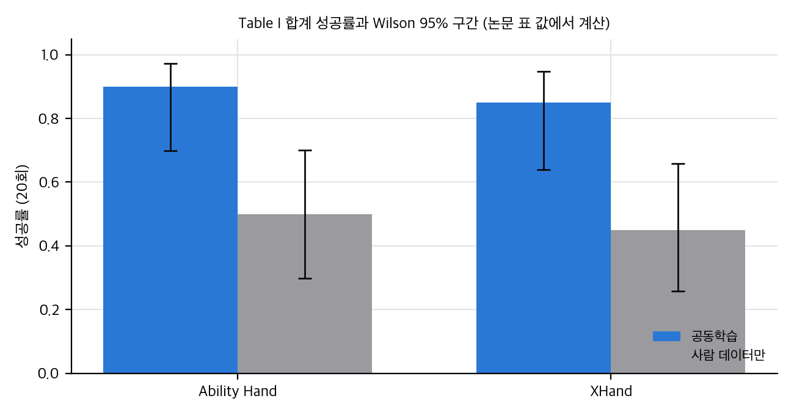
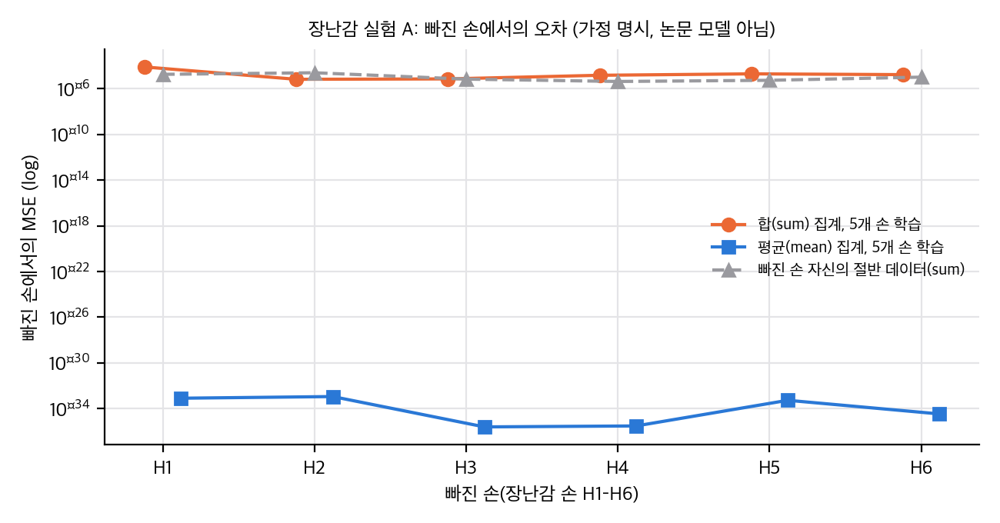
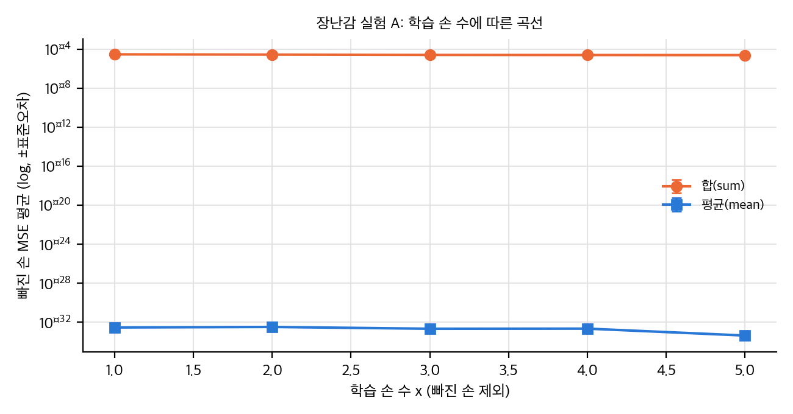
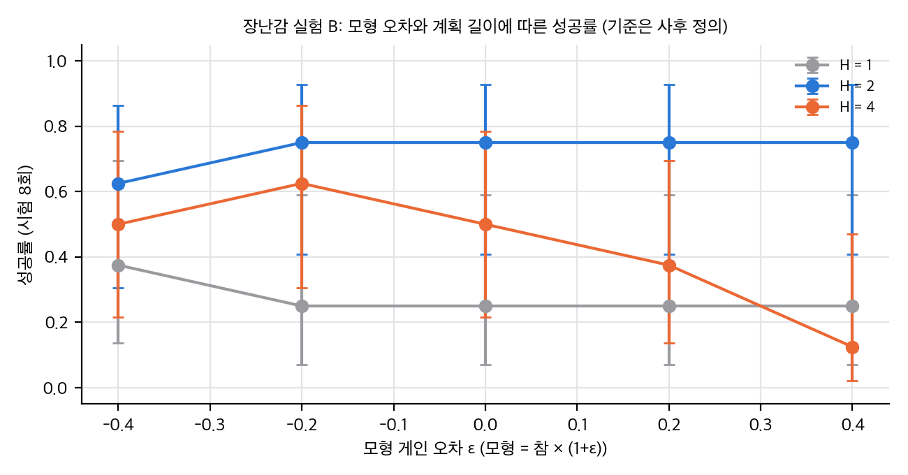

손의 관절 공간은 손마다 다릅니다. 이 논문은 관절 명령 대신 **말단 파티클의 변위장**을 행동으로 쓰면 사람 손과 여러 로봇 손을 한 세계 모델로 다룰 수 있다고 주장합니다. 시뮬 로봇 손 6개의 무작위 상호작용과 사람 시연으로 그래프 세계 모델을 학습하고, 샘플링 MPC로 실물 손 두 개에 붙였습니다.

## 무엇을 주장하나

1. 학습에 넣는 손의 수가 많을수록, 보지 않은 손에 대한 예측 오차가 줄어듭니다.
2. 시뮬 데이터와 사람 데이터를 섞으면 사람 데이터만 쓴 것보다 낫습니다.
3. 사람 데이터만으로 학습한 모델을 Ability Hand와 XHand에 MPC로 붙여 점토를 글자 모양으로 만들 수 있습니다.

## 숫자로 본 결과

실물 성공률(글자당 5회, 손당 20회)은 공동학습 18/20 대 사람만 10/20(Ability), 17/20 대 9/20(XHand)입니다. 합계 기준 Fisher 검정 p는 각각 0.014와 0.019입니다. 표본이 작고 글자별로는 유의하지 않습니다.

*그림: Table I 합계 성공률과 Wilson 95% 구간(논문 표 값에서 계산).*

시뮬 결과(Fig. 2)는 그림으로만 나와서 정확한 수치를 알 수 없습니다. 그림에서 읽으면, 같은 샘플 수의 목표 전용 학습(Equal Data 대조)이 여러 패널에서 교차 손 학습보다 낮게 보입니다. 본문은 이 대조를 설명하지 않습니다.

혼합 비율 그림(Fig. 5)에서 본문이 말하는 "1:1 비율이 최적"은 그림과 맞지 않습니다. 그림에서 최적은 0.5 근처입니다.

## 짚어 볼 점

- 실물 공동학습 모델에는 Ability Hand와 XHand의 시뮬 데이터가 들어 있습니다(표 캡션). 그래서 "미지 손에 제로샷"은 사람 전용 모델에만 해당합니다.
- 손 파티클을 어떻게 뽑는지, 손마다 어떻게 대응시키는지가 본문에 없습니다. 재현의 가장 큰 빈칸입니다.
- 공식 코드가 공개되지 않았습니다. 프로젝트 페이지의 코드 링크는 아직 자리표시자입니다.

## 장난감으로 본 것

2차원 장난감(논문 모델이 아님)에서, 입자 간격이 다른 손 사이에서는 합 집계 모형이 평균 집계 모형보다 오차가 큰 경우가 많았습니다. 다만 장난감 참 세계가 평균형으로 만들어진 것이라 이것은 구조 일치의 결과이고, 실제 DPI-Net에 그대로 옮겨지는지는 알 수 없습니다. 계획 길이와 모형 오차의 영향은 시험 수가 적어 결론을 낼 수 없었습니다.

*그림: 장난감 실험 A, 빠진 손에서의 MSE(합 집계와 평균 집계 비교).*

*그림: 장난감 실험 A, 학습 손 수에 따른 평균 MSE.*

*그림: 장난감 실험 B, 모형 게인 오차와 계획 길이에 따른 성공률(시험 8회).*

## 정리

이 논문은 "파티클 행동 표현이 여러 손을 한 모델에 묶을 수 있다"는 방향을 잘 보여 줍니다. 다만 교차 손 확장의 효과는 그림 판독 수준이고, 실물 증거는 작은 표본입니다. 재현 가능성은 공개 코드가 나올 때까지 낮습니다.

출처: He, Ai, Mu, Liu, Wan, Fu, Du, Christensen, Su, "Scaling Cross-Embodiment World Models for Dexterous Manipulation", arXiv:2511.01177v3. 그림과 표는 이 글에 넣지 않았습니다(원 논문 라이선스 CC BY-NC-SA 4.0).

## 자료

- [통합 리포트 PDF](report/report_public.pdf)
- [논문 분석: Scaling Cross-Embodiment World Models for Dexterous Manipulation](analysis/01_paper_analysis.md)
- [선행연구와 관련 저장소](analysis/02_prior_work.md)
- [재계산·유의성·유도와 장난감 검증](analysis/03_analysis.md)
- [주장 검증 (공식 코드 없음): C1–C16](analysis/04_claim_verification.md)
