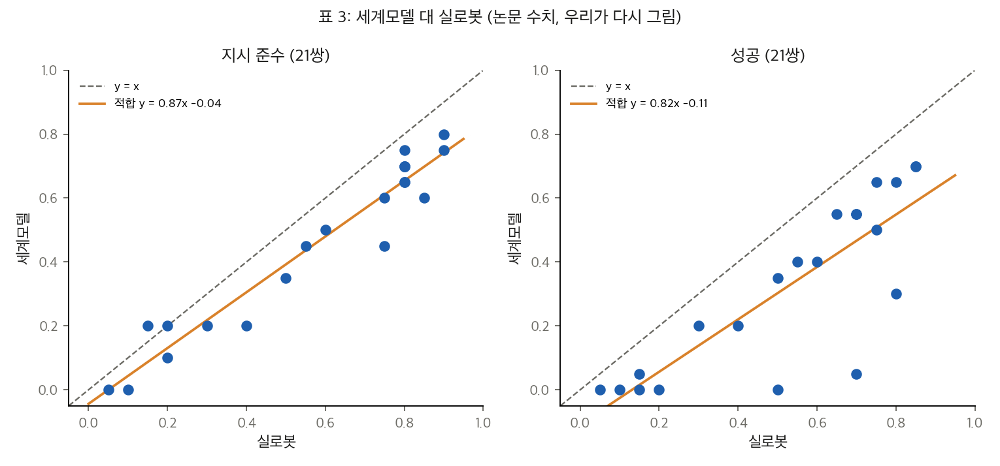
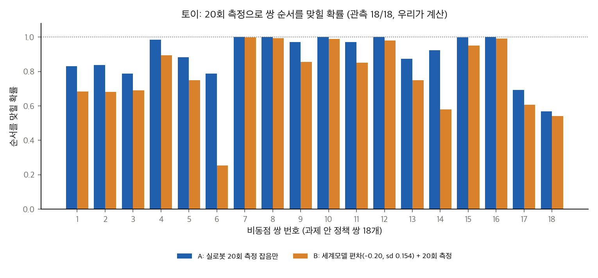
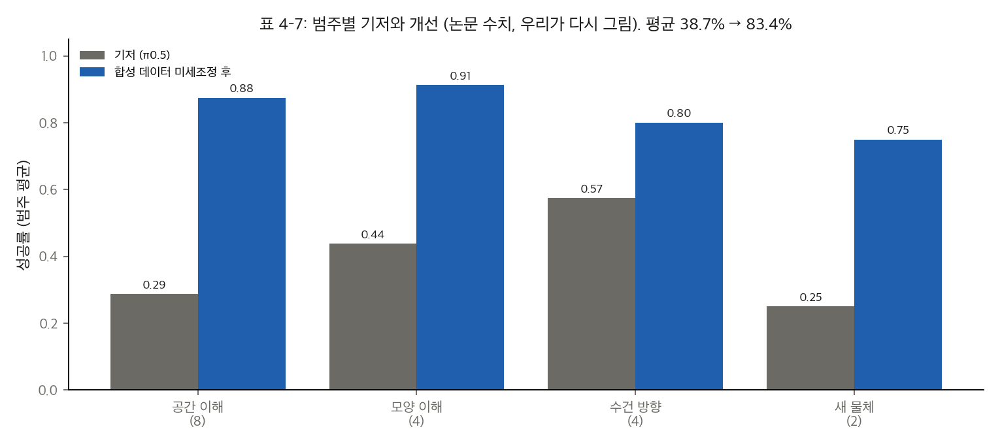

> **논문:** Yanjiang Guo, Lucy Xiaoyang Shi, Jianyu Chen, Chelsea Finn. *Ctrl-World: A Controllable Generative World Model for Robot Manipulation.* ICLR 2026 포스터, arXiv:2510.10125 (v3, 2026-03-01).
> 공식 코드(MIT, Robert-gyj/Ctrl-World)는 정적으로만 읽었고 실행하지 않았습니다. 논문 그림은 싣지 않고, 논문 수치를 우리가 다시 그린 그래프만 씁니다.

## 논문이 묻는 것

로봇 정책을 실물에서 평가하거나 개선하려면 실험이 많이 듭니다. Ctrl-World는 이 실험을 **세계모델 안의 상상**으로 옮기려 합니다. 영상 확산 모델 SVD 1.5B에 세 장치를 더합니다. 손목 카메라까지 함께 예측하는 다시점 공동 예측, 과거 프레임을 자세로 골라 쓰는 메모리 검색, 행동을 프레임마다 넣는 조건입니다.

결과는 세 가지입니다. 정책의 지시 준수 순위가 실로봇과 잘 맞고, 세계모델 안에서 만든 성공 궤적으로 π0.5를 미세조정하면 새 지시의 성공률이 평균 38.7%에서 83.4%로 오른다고 보고합니다.

## 이 글에서 확인한 것

**순위는 잘 맞고, 성공률은 낮게 나옵니다.** 표 3의 21쌍(과제 7개, 정책 3개)에서 지시 준수의 상관은 r = 0.97, 성공의 상관은 r = 0.83입니다. 그러나 성공률은 21행 모두에서 실로봇보다 낮고 평균 차이는 −0.20입니다. 과제 안에서 정책 쌍의 순서는 비동점 18쌍 모두 실로봇과 같았습니다.

*그림 1. 논문 표 3의 값을 우리가 다시 그린 그래프입니다. 적합선은 우리 재계산입니다 (지시 y = 0.87x − 0.04, 성공 y = 0.82x − 0.11).*

**순서 일치는 표본이 작아서 강하게 말할 수 없습니다.** 정책당 시행 수는 논문에 없습니다. 값이 모두 0.05 단위이므로 20회로 추정했습니다. 이 가정 아래 20회 측정 한 번으로는 쌍 순서를 대체로 맞히지만, 18쌍 모두 맞을 확률은 독립 근사에서 약 0.11입니다. 세계모델이 평균 −0.20 낮고 셀마다 sd 0.154의 편차를 가진다고 가정하면 그 확률은 약 0.005로 떨어집니다. 관측된 18/18은 이 가정에서는 드문 일치입니다. 쌍 설계나 편차 구조가 논문에 적혀 있지 않아서 이 확률은 근사치입니다.

*그림 2. CPU 토이의 쌍별 확률입니다. 실로봇 잡음만 본 경우(A)와 세계모델 편차를 더한 경우(B)를 나눴습니다.*

**개선 44.7%p는 절대 차이이고, 대조군이 없습니다.** 네 범주의 평균은 기저 38.75%에서 개선 83.44%로 올랐습니다. 차이는 44.69 퍼센트 포인트이고, 상대로 옮기면 115%입니다. 초록과 결론의 "44.7%"는 절대 차이입니다. 합성 궤적을 선별 없이 같은 양만큼 학습한 대조나 개선 후 실로봇 재평가가 없어서, 세계모델 상상의 기여와 "성공 궤적만 골라 학습"한 효과를 나눌 수 없습니다.

*그림 3. 논문 표 4–7의 범주 평균을 우리가 다시 그린 그래프입니다.*

**주장과 근거의 틈.** 초록은 "20초 이상 일관된 궤적"을 말하지만, 정량 평가는 10초 생성 (표 1)뿐입니다. 표 1의 PSNR은 단일 시점끼리 비교하면 IRASim이 높습니다. v3에서 추가된 다시점 기준선은 WPE와 IRASim에서 방향이 엇갈립니다.

## 공식 코드와 논문의 차이

공식 저장소에는 세계모델 학습과 추론 코드가 있습니다. 그러나 **영상 지표 계산 코드와 정책 개선 코드(합성 궤적 생성, 선별, SFT)는 없습니다.** 표 1–2와 표 4–7은 저장소로 재생성할 수 없습니다.

차이도 있습니다. 식 3은 가중 없는 MSE로 적혀 있지만 코드는 EDM 가중 손실을 씁니다. 손실에는 미래 프레임만 들어간다고 적혀 있지만 현재 프레임도 들어갑니다. 정책 루프에는 과제마다 손으로 고른 그리퍼 상한과 z 하한이 들어가는데 논문에는 없습니다.

## 이 맥에서 재현할 수 있을까

- **학습과 정책 평가: 불가능합니다.** 학습은 2×8 H100 2–3일, 정책 평가는 π0.5 JAX와 실로봇이 필요합니다.
- **추론 시연: 조건부입니다 (미검증).** 체크포인트와 SVD를 합쳐 약 16 GB를 받아야 하고, MPS에서 bf16 경로가 도는지 확인해야 합니다. 이 분석에서는 실행하지 않았습니다.

## 라이선스와 공개 범위

- 논문은 arXiv 비독점 배포 라이선스입니다 (CC가 아닙니다). 그래서 논문 그림은 싣지 않았습니다.
- 공식 코드는 MIT이고, 이 글은 코드를 복제하지 않고 링크만 씁니다.
- 체크포인트와 데이터셋은 받지 않았습니다.

## 정리

세계모델이 정책의 순서를 맞힌다는 주장은 이 규모에서 그럴듯합니다. 그러나 성공률 수준은 과소 추정되고, 개선 폭은 대조 없는 절대 차이입니다. 이 주장을 우리 평가에 옮기려면 시행 수, 초기 상태 공유, 대조군을 먼저 정해야 합니다.

## 자료

- [통합 리포트 PDF](report/report_public.pdf)
- [01. 논문 분석: Ctrl-World](analysis/01_paper_analysis.md)
- [02. 선행연구, 가까운 대안, 코드와 자료](analysis/02_prior_work.md)
- [03. 수치 재계산, 일관성 검사, CPU 토이 (Ctrl-World)](analysis/03_analysis.md)
- [04. 코드 대조와 구현 가능성 (Ctrl-World)](analysis/04_code_verification.md)
