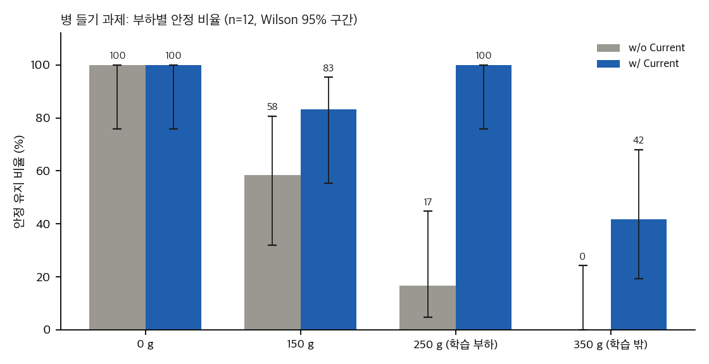
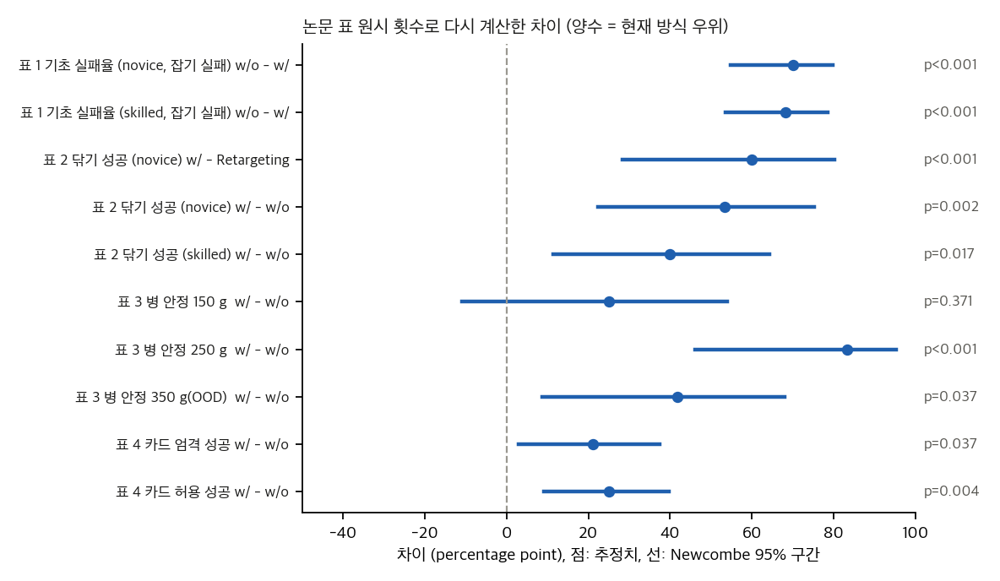

> **논문:** Chenyang Ma, Yunchao Yao, Zhenyu Wei, Ruogu Li, Daniel Szafir, Mingyu Ding. *Current as Touch: Proprioceptive Contact Feedback for Compliant Dexterous Manipulation.* arXiv:2607.03529 (v1, 2026-07-03). CoRL 2026 포스터(공식 채택 목록).
> 공식 코드 저장소는 있지만 README 한 장뿐이고 "Pending release."입니다. 이 글의 그림 두 장은 우리가 원시 횟수로 다시 그린 그래프입니다. 논문 그림은 arXiv 비독점 라이선스라 싣지 않았습니다.

## 논문이 묻는 것

저가형 손은 목표 관절 위치를 PD 제어기로 따라갑니다. 목표가 물체 안쪽이면 과한 힘으로 찌그러지고, 가까우면 힘이 부족해 미끄러집니다. 촉각이나 힘 센서를 달면 해결되지만 비싸고 깨지기 쉽습니다.

이 논문은 다른 길을 택합니다. 모터 전류와 관절 상태로 **보상 기준 위치(CRP)** 를 예측하고, 그 위치를 그대로 PD 제어기의 목표로 넣습니다. 힘을 추정하거나 토크를 직접 명령하지 않으므로, 기존 텔레오퍼레이션과 정책 학습 파이프라인을 바꿀 필요가 적습니다.

학습 라벨은 사람이 조작하면서 고친 목표 위치입니다. 사람은 찌그러짐이나 미끄러짐을 보고 목표를 조정하므로, 라벨에는 접촉 정보가 담겨 있다는 것이 저자들의 생각입니다.

## 이 글에서 확인한 것

**1. 전류를 넣으면 실패가 확실히 줄어듭니다.** 전류 유무를 비교한 열 가지 중 아홉 가지가 p < 0.05입니다(Fisher 정확검정, 보정 없음). 가장 큰 차이는 물병 250 g에서 안정 비율이 16.7%에서 100%로 오르는 것(p < 0.001)과, 컵 잡기 실패가 76.7%에서 6.7%로 줄어드는 것(p < 0.001)입니다.

*그림 1. 우리가 그린 그래프. 논문 표 3의 횟수(부하당 12회)로 계산한 안정 비율과 Wilson 95% 구간입니다. 150 g의 차이(p = 0.37)는 확실하지 않습니다.*

**2. 직접 조작보다 낫다는 주장은 부분적으로만 맞습니다.** 컵 찌그러짐은 초보 43%, 숙련 25%에서 0%로 줄어듭니다(p < 0.001). 그러나 잡기 실패 차이는 초보 6.7 pp(p = 0.36), 숙련 11.7 pp(p = 0.053)로 확실하지 않습니다. 시간 차이는 분산이 없어 검정하지 못했습니다.

**3. 숙련자의 칠판 지우기에서는 전류가 없는 모델이 나빠집니다.** 직접 조작은 100%인데 전류 없는 모델은 60%입니다(p = 0.017). 본문은 이를 "일관되게 개선하지 못한다"고만 씁니다. 실제로는 악화입니다.

**4. 카드 한 장 뽑기의 개선은 중간 정도입니다.** 엄격 성공(정확히 한 장)은 55.8%에서 76.9%로, 허용 성공은 65.4%에서 90.4%로 오릅니다(p = 0.037, p = 0.004). 시도는 52회입니다. 관찰 차이를 기준으로 하면 한쪽에 약 78회가 필요해, 52회로는 효과 크기가 과대평가되었을 수 있습니다.

*그림 2. 우리가 그린 그래프. 논문 표에서 횟수를 되돌려 계산한 차이(percentage point)입니다. 양수는 전류를 넣은 방식이 나은 쪽입니다. 검정은 보정하지 않았습니다.*

**5. 본문과 부록이 엇갈리는 곳이 있습니다.**

- 실행 평활 창이 본문에서는 두 예측이고(§3.3, §4.1), 부록에서는 M = 3입니다(A.5). M = 3은 평가 10회를 보고 고른 값입니다.
- 표 1에는 성공률 열이 없는데 본문은 "두 사용자 모두 100.0% 성공"이라고 씁니다.
- KL 가중치 기본값 1e-5는 주먹 쥐기 성공이 60%로, λ = 0(100%)보다 낮습니다. 기본값은 물병 잡기에서만 정당화됩니다.

**6. 라벨과 물리 사이의 간격은 아직 측정되지 않았습니다.** 실험은 성공률, 찌그러짐, 미끄러짐만 봅니다. 파지력이나 접촉력을 재지 않습니다. "적절한 힘을 만든다"는 해석은 간접 지표에 기댑니다. 전류 → 힘 회귀(그림 3, RMSE 10.09 g과 17.75 g)는 데이터가 공개되지 않아 확인할 수 없었습니다.

## 재현 가능성

- **구조는 다시 구현할 수 있습니다.** ACT 스타일의 작은 Transformer(차원 128, 4층)와 손실, 실행 평활을 PyTorch로 만들 수 있습니다. 노력은 3–5일 정도로 추정합니다(추정).
- **결과 재현은 이 맥에서 불가능합니다.** 공식 코드, 데이터, 가중치가 없습니다. 실험에는 실물 손(LEAP Hand, Dex3)과 로봇(Franka, Unitree G1)이 필요합니다.
- **MuJoCo로 라벨 가정을 점검하는 것은 가능합니다.** 다만 전류 모델이 가정이므로 결과를 실제 손에 옮길 수 없습니다.

## 한계와 다음에 볼 것

- 저자들도 인정하는 한계는 두 가지입니다. 전류 정보량은 하드웨어 설계에 따라 달라지고, 부하 감지는 LEAP의 외전·내전 모터에 기댑니다.
- 제가 보기에 더 중요한 한계는 시드 반복이 없다는 점, 손과 과제가 섞여 있다는 점(LEAP는 컵과 물병, Dex3는 칠판과 카드)입니다.
- 정책 실험은 카드 자세를 VICON으로 측정합니다. "외부 센서 없음"은 촉각과 힘 센서에 한해 맞습니다.
- 다음에 볼 것은 힘 센서가 있는 손에서 같은 라벨을 쓸 때 파지력이 실제로 목표 위치에 따라 바뀌는지입니다.

## 출처와 공개 범위

- 논문: arXiv:2607.03529 v1, 라이선스 링크는 arXiv 비독점 배포 1.0입니다(CC BY 아님). 논문 그림은 싣지 않았습니다.
- 프로젝트 페이지: https://cat.chenyangma.com (페이지 초록은 arXiv 초록과 표현이 조금 다릅니다).
- 공식 코드 저장소: https://github.com/cublicma/current-as-touch (2026-11-21 확인, README 한 장, 라이선스 없음).
- 이 글의 수치는 논문 표에서 옮긴 값과 그 값으로 다시 계산한 결과입니다. 원시 시도 기록은 없습니다.

## 자료

- [통합 리포트 PDF](report/report_public.pdf)
- [Current as Touch 논문 분석 (arXiv:2607.03529)](analysis/01_paper_analysis.md)
- [선행연구와 관련 자료 (Current as Touch, arXiv:2607.03529)](analysis/02_prior_work.md)
- [수치 재계산과 일관성 검사 (Current as Touch, arXiv:2607.03529)](analysis/03_analysis.md)
- [주장 검증 (Current as Touch, arXiv:2607.03529)](analysis/04_claim_verification.md)
