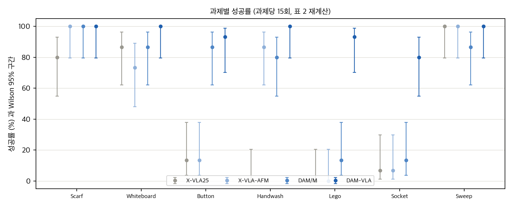
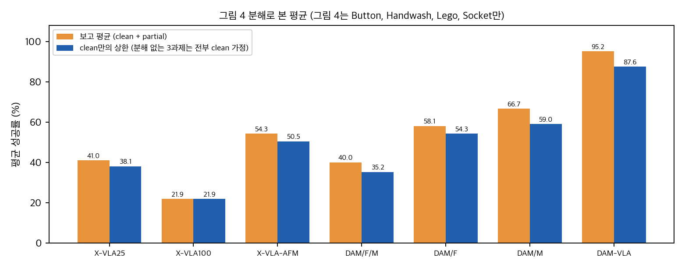
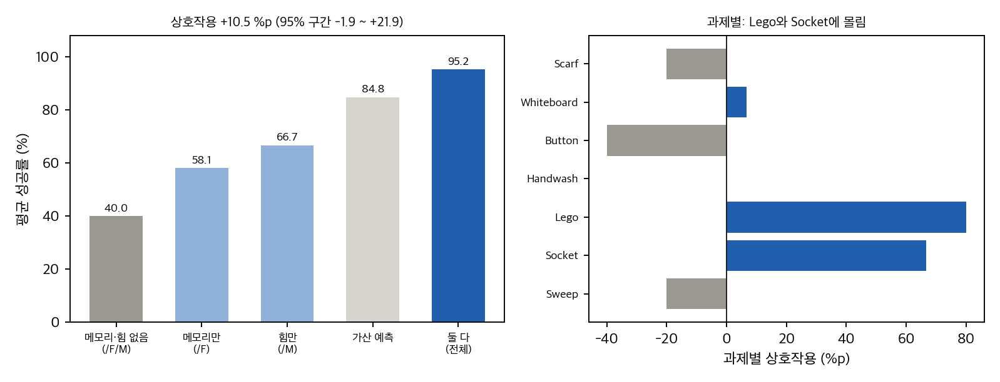
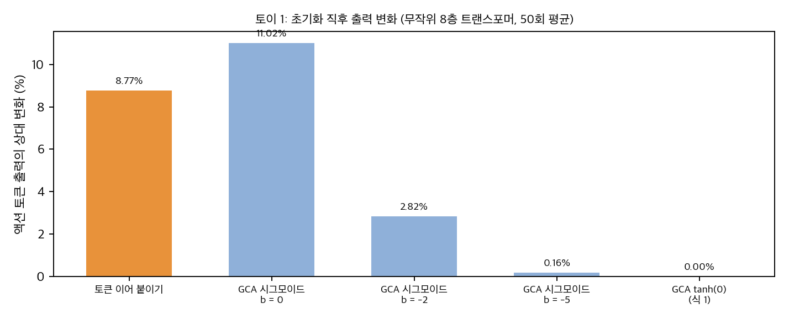

# 03. 수치 재계산, 일관성 검사, 토이 실험

`analysis/recompute.py`(수 초), `analysis/toy_gca_init.py`(수 초), `analysis/toy_zoh_lag_sparc.py`(수 초)의 결과입니다. 확인 항목은 V(재계산)와 K(일관성)로 번호를 매겼습니다. 주장 판정은 `04`의 C 항목입니다.

## 0. 가정

- **시행 수:** 표 2는 "15 trials per task"입니다(§4.1, 표 2 캡션). 모든 칸의 값이 k/15의 반올림과 맞습니다(V1). 아래 검정은 시행이 서로 독립이고 구성마다 15회가 따로 수행되었다고 봅니다. 초기 조건이 구성 사이에 짝지어졌는지는 논문에 없어 짝 검정은 하지 않았습니다.
- **그림 판독 값:** 그림 6, 7, 8(부록 D, E)의 막대 높이와 오차 막대 길이는 PDF에서 길이를 재어 얻은 값입니다. 오차 막대가 SD인지 SE인지, 에피소드 수가 몇인지는 논문에 없습니다. 그림 4의 clean/partial 값은 PDF 막대 라벨과 프로젝트 페이지의 막대 폭이 같습니다.
- **다중 비교:** 구성 6개 × 과제 7개 = 42개 Fisher 검정을 Holm으로 보정했습니다.

## 1. 재계산 결과

### 1.1 표 2의 산술 (V1–V3)

- **V1 정수 격자:** 49칸 모두 k/15에 맞습니다(예: 93.3 = 14/15, 86.7 = 13/15, 13.3 = 2/15).
- **V2 평균:** 평균 열은 과제 7개 값의 단순 평균이며 합산 성공 수/105와 같습니다(소수 셋째 자리 이하 차이만 있음).

| 구성 | 성공 수 /105 | 보고 평균 | 합산 Wilson 95% 구간 |
|---|---|---|---|
| X-VLA25 | 43 | 40.95 | 32.0–50.5 |
| X-VLA100 | 23 | 21.9 | 15.1–30.7 |
| X-VLA_AFM | 57 | 54.3 | 44.8–63.5 |
| DAM-VLA/F/M | 42 | 40.0 | 31.1–49.6 |
| DAM-VLA/F | 61 | 58.1 | 48.5–67.1 |
| DAM-VLA/M | 70 | 66.7 | 57.2–75.0 |
| DAM-VLA | 100 | 95.2 | 89.3–97.9 |

- **V3 초록의 비율:** 95.24/40.95 = 2.33배("more than doubles")이고 차이는 54.29 %p입니다. 서론의 "54.25%"는 반올림 값(95.2 − 40.95)의 차이이고 단위는 %p입니다. 같은 정보를 쓰는 X-VLA_AFM과 비교하면 1.75배, 40.95 %p입니다. 구간끼리는 DAM-VLA(89.3–97.9)와 AFM(44.8–63.5)이 겹치지 않습니다.


<p class="cap">그래프: 우리가 그린 그래프. 표 2의 네 구성(과제당 15회)과 Wilson 95% 구간.</p>

### 1.2 과제별 검정 (V5–V7)

- **V5 Fisher (DAM-VLA 대 각 구성, 과제별 42개):** 원 p < 0.05가 24개, Holm 보정 후 20개입니다. 보정 후 유의한 칸은 Button, Handwash, Lego, Socket에 모여 있습니다(예: 대 X-VLA25 Button 14/15 대 2/15, Holm p = 7e-4; Lego 14/15 대 0/15, p = 8e-6; Socket 12/15 대 1/15, p = 0.003).
- **구별되지 않는 칸:** Scarf, Whiteboard, Sweep은 X-VLA100 대 Whiteboard(15/15 대 2/15, Holm p = 6e-5) 한 칸을 빼면 Holm 후 모두 구분되지 않습니다(DAM-VLA가 같거나 높지만 15회로는 구분되지 않음). 예: Whiteboard 15/15 대 X-VLA25 13/15는 p = 0.48, 대 X-VLA_AFM 11/15는 p = 0.10(보정 전).
- **V6 과제로 층화한 합산(Mantel-Haenszel):** DAM-VLA 대 X-VLA25 공통 오즈비 172, p = 6e-21. 대 X-VLA_AFM 130, p = 4e-15. 대 DAM-VLA/M 22.4, p = 6e-9. 층화 합산이므로 과제 간 이질성을 허용하지만, 오즈비가 큰 것은 Lego와 Socket처럼 0/15에 가까운 칸 때문입니다.
- **V7 부호 검정:** DAM-VLA는 모든 대 비교에서 어느 과제에서도 더 낮지 않습니다(7과제 중 5–7개에서 더 높음, 나머지 동률). 단측 정확 p는 대 X-VLA25 0.016, 대 X-VLA_AFM 0.031입니다.
- **구성 사이의 다른 차이:** 합산 105회로 X-VLA_AFM(57) 대 X-VLA25(43)는 Fisher p = 0.072이고, DAM-VLA/M(70) 대 DAM-VLA/F(61)는 p = 0.25입니다. 즉 "기억만"과 "힘만" 사이, 이어 붙이기와 기준선 사이는 이 시행 수로 구별되지 않습니다. 구별되는 큰 간격은 전체 DAM-VLA와 나머지 사이입니다.

### 1.3 "성공"의 정의와 부분 성공 (V9, 그림 4)

그림 4의 clean + partial은 네 과제 28칸 모두 표 2 값과 일치합니다(V9). 표 2의 값은 부분 성공을 포함합니다. 분해가 없는 Scarf, Whiteboard, Sweep을 전부 clean이라고 가정한 **clean-only 평균 상한**은 다음과 같습니다.

| 구성 | 보고 평균 | clean 상한 |
|---|---|---|
| X-VLA25 | 40.95 | 38.1 |
| X-VLA100 | 21.9 | 21.9 |
| X-VLA_AFM | 54.3 | 50.5 |
| DAM-VLA/F/M | 40.0 | 35.2 |
| DAM-VLA/F | 58.1 | 54.3 |
| DAM-VLA/M | 66.7 | 59.0 |
| DAM-VLA | 95.2 | 87.6 |

상한 기준으로 DAM-VLA와 X-VLA25의 차이는 49.5 %p입니다(보고 54.3). Lego의 DAM-VLA 93.3% 중 clean은 66.7%, Socket 80% 중 73.3%, Button 93.3% 중 86.7%, Handwash 100% 중 86.7%입니다. 부분 성공의 정의는 논문 본문에 없어(그림 3의 범례에 Stall, Misalignment, Half insertion/Overshooting, Multipress가 있음) 어떤 상태가 partial인지는 읽을 수 없습니다.


<p class="cap">그래프: 우리가 그린 그래프. 보고 평균과 clean만 센 상한(분해가 없는 세 과제는 전부 clean이라고 둔 값).</p>

### 1.4 절제: 메모리와 힘의 효과가 더해지는가 (V8)

본문 §4.2는 두 요소가 "각각 독립적으로 기여한다"고 씁니다. 합산 성공률로 보면 비동기만 40.0%, 메모리를 더하면 +18.1 %p, 힘을 더하면 +26.7 %p, 둘 다 더하면 +55.2 %p입니다. 가산 예측은 84.8%이고 실제는 95.2%로 상호작용이 +10.5 %p입니다. 칸마다 이항 분포를 20,000번 모의해 얻은 95% 구간은 −1.9 ~ +21.9 %p로 0을 포함합니다(시행 15회, 독립 가정).

과제별 상호작용은 Lego +80.0, Socket +66.7 %p로 몰려 있고 Button −40.0, Scarf와 Sweep −20.0은 천장 효과(100%에 가까워 더 못 오름) 방향입니다. 즉 평균의 초가산은 Lego와 Socket 두 과제가 만든 것이고, "각각 독립"과 "둘이 함께 있어야 풀리는 과제가 있다" 중 어느 쪽인지는 이 데이터로 가를 수 없습니다. 후자라면 논문 서술(힘은 접촉 종료, 기억은 반복 방지)과는 오히려 맞습니다.


<p class="cap">그래프: 우리가 그린 그래프. 왼쪽: 메모리·힘 절제의 가산 예측 대 실제(합산 105회). 오른쪽: 과제별 상호작용.</p>

### 1.5 부록 D, E: 부드러움, 지연, 에피소드 시간 (V12, 그림 판독 값)

- **V12 지연(그림 7):** 100 Hz 구성의 평균 지연은 DAM-VLA 0.118, X-VLA_AFM 0.124, DAM-VLA/M 0.127, DAM-VLA/F 0.128, X-VLA100 0.135, DAM-VLA/F/M 0.139 s입니다(막대 높이와 라벨). DAM-VLA와의 차이는 6–21 ms인데 오차 막대 반폭(그림 판독)의 합은 23–51 ms라서 비교한 다섯 구성 모두와 막대가 겹칩니다. 오차 막대의 종류와 에피소드 수가 없어 검정은 하지 않았습니다.
- **K1 본문과 그림:** 본문은 DAM-VLA의 지연을 0.116 s라고 쓰고 그림 7은 0.118(라벨, 막대 높이 판독 0.118)입니다.
- **SPARC(그림 6):** DAM-VLA 8.1(±1.9), X-VLA_AFM 10.47(±2.9), DAM-VLA/M 10.6(±3.0), DAM-VLA/F 10.98(±2.4), DAM-VLA/F/M 16.83(±3.5), X-VLA100 25.04(±7.0)입니다(오차는 그림 판독 반폭). DAM-VLA가 점추정으로 가장 낮고 AFM과의 차이 2.4는 반폭 합 4.8보다 작습니다. 눈에 띄는 점은 비동기만 쓴 DAM-VLA/F/M(16.83)이 비동기이면서 이어 붙이기를 쓴 AFM(10.47)보다 덜 부드럽다는 것입니다. 부드러움의 이득은 비동기 자체보다 힘·기억 입력과 함께 나타납니다.
- **V12 에피소드 시간(그림 8, 판독):** DAM-VLA의 시간은 Sweep 22.9, Handwash 12.9, Lego 28.4, Scarf 24.8, Whiteboard 24.0, Button 10.2, Socket 21.9 s입니다. 데모 평균(회색 막대 판독)은 13.8, 6.7, 20.6, 13.1, 21.9, 6.3, 17.1 s로, DAM-VLA/데모 비는 1.1–1.9배(평균 1.55배)입니다. 본문 §E는 이를 "속도가 아니라 결정성"이라고 해석하고 데모 시간은 "참고 기준"으로 둡니다. 본문 수치 Button 10.8 / 16 / 20, Whiteboard 83 대 24.4, Sweep 22.5는 판독 값(10.2 / 15.6 / 19.6, 83.0 대 24.0, 22.9)과 0.6 s 이내로 맞습니다. 해칭 막대(부분 성공 또는 실패)는 색 검출이 안 되어 판독하지 않았습니다.
- **K15 비교 범위:** 지연 문단의 "DAM-VLA completes Sweep episodes faster than all other configurations"에서 그림 8에 있는 구성은 DAM-VLA, X-VLA25, X-VLA100 셋뿐이고, DAM-VLA/F의 40 s는 §4.2 본문에만 있습니다. 나머지 세 구성의 Sweep 시간은 논문에 없습니다.

### 1.6 주파수와 창 산술 (V11)

식 하나로 확인할 수 있는 값만 모았습니다. 재계획 주파수의 상한을 "제어 주파수 / 실행 지평 s"(청크를 끝까지 실행하는 경우)로 두면 다음과 같습니다.

| 설정 (출처) | 상한 | 보고 | 보고/상한 |
|---|---|---|---|
| 100 Hz, s=22 (§4.1) | 4.5 Hz | 약 5.5 Hz | 1.21 |
| 200 Hz, s=22 (§4.1, 표 4) | 9.1 Hz | 약 8 Hz | 0.88 |
| 200 Hz, s=6 (§4.1, 표 4) | 33 Hz | 약 17 Hz | 0.51 |

- **K3:** 100 Hz, s=22의 5.5 Hz는 청크를 끝까지 실행하는 경우의 상한(4.5 Hz)보다 큽니다. 지연 인지 비동기 실행에서 청크를 다 쓰기 전에 다음 청크로 넘어가면 가능한 값이라서, s의 정의(청크 길이인지 실행 지평인지)와 실행 방식을 적어 주면 확인됩니다.
- **K4:** s=6의 17 Hz는 상한의 절반입니다. 추론 지연이 청크 실행 시간(30 ms)과 비슷한 약 29 ms라면 맞는 값입니다.
- **K2 시각 창:** "시각 이력 16프레임, 25 Hz, 약 0.64 s"(§3.2)와 표 3의 "Visual stride S = 8"을 100 Hz 시간축에서 같이 읽으면 16 × 8/100 = 1.28 s, 유효 주기 12.5 Hz입니다. S=4이면 25 Hz와 0.64 s가 맞습니다. 200 Hz 제어기에서는 S=8이 25 Hz입니다. 어느 설정의 값인지가 표 3에 적혀 있지 않습니다.
- **K5 VLM 갱신 주기:** "추론 4스텝마다 VLM 호출"의 스텝이 재계획 주기라면 약 5.5/4 = 1.4 Hz이고, 제어 스텝이라면 25 Hz입니다. 25 Hz는 RTX 4060 Ti에서의 VLM 인코딩 주기로는 카메라 주기와 같지만, 한계 절의 "고정 타이머"와 부록 F의 "남은 VLM 인코딩 지연이 병목"이라는 서술은 재계획 주기 쪽 해석에 가깝습니다. 어느 쪽인지는 논문만으로 정할 수 없습니다.
- 힘 창: 96샘플은 100 Hz에서 0.96 s이고 200 Hz에서는 0.48 s입니다(부록 F의 200 Hz 실험에서 창이 바뀌었는지 알 수 없음).

## 2. 일관성 검사 (K 항목)

| 번호 | 위치 | 관찰 | 영향 |
|---|---|---|---|
| K1 | 부록 D 대 그림 7 | 지연 0.116 s 대 0.118 s | 사소함 (반올림 차이 가능) |
| K2 | §3.2 대 표 3 | 시각 창 0.64 s(16프레임, 25 Hz) 대 stride 8(1.28 s 또는 12.5 Hz) | 시각 이력 길이가 모호함 |
| K3 | §4.1 | 100 Hz, s=22에서 5.5 Hz가 4.5 Hz 상한보다 큼 | s의 정의 필요 |
| K4 | 표 4 | 200 Hz, s=6에서 17 Hz는 상한의 절반 | 추론 지연 약 29 ms면 맞음 |
| K5 | §3.2, 표 3 | "추론 4스텝마다 VLM"의 스텝 단위 불명 (1.4 Hz 대 25 Hz) | 시각 갱신 주기의 해석이 둘 |
| K6 | 그림 1, 그림 2 대 §3.1 | 그림 1·2는 고유감각·힘 200 Hz, 본문 주 실험은 100 Hz(200 Hz는 부록 F만) | 그림이 부록 설정을 그림 |
| K7 | 부록 B | 과제별 학습인지 다중 과제 학습인지, 선택한 체크포인트 기준이 없음. "task split" 언급 (표 1 캡션) | 학습 조건 불명 |
| K8 | §4.2 RQ4 | "degrades across all tasks (54.3% vs 95.2%)": 표 2에서 Scarf와 Sweep은 100 대 100 동률, Whiteboard 73.3 대 100 | "모든 과제"는 5개 과제에서 낮음이 맞음 |
| K9 | §4.2 RQ3 | "adds modality information improves": 평균은 모두 상승. 과제별로는 AFM의 Button 13.3 < 비동기만 40.0 | 평균 기준 서술 |
| K10 | §4.2 대 그림 4 | DAM-VLA/M Handwash의 "46.67% 반복 누름"은 그림 4의 partial 7/15와 일치. 반면 AFM의 반복 누름(그림 5)은 Handwash 합계 86.7%(partial 13.3%)에 이미 포함 | 반복 누름이 성공으로 세어지는 정도는 구성마다 읽을 수 없음 |
| K11 | §1 | "54.25%"는 %p | 단위 표기 |
| K12 | 초록 | "가장 강한 동기식 기준선"은 X-VLA25(40.95%). 같은 입력을 쓰는 AFM은 표에서 "Ours" 묶음이고 54.3% | 배율이 2.33배 또는 1.75배 |
| K13 | 표 1, 그림 3, 4 | 첨자 "/F"가 힘 제거, "/M"이 기억 제거. 설명열의 "memory contribution"(/F)과 같이 읽어야 함. 그림 3 열 이름은 "/M/F", 표는 "/F/M" | 표기 혼란 |
| K14 | 그림 8 | "모두 측정 가능한 성공을 가진 과제에서 DAM-VLA가 가장 짧거나 근접": 판독 값으로 Scarf 24.8 대 27.7, 36.7 s, Button 10.2 대 15.6, 19.6 s, Sweep 22.9 대 24.6, 49.8 s | 맞음 |
| K15 | 부록 D | "all other configurations" 비교가 그림에 세 구성뿐 | 위 §1.5 |

## 3. 토이 실험

### 3.1 토이 1: 새 모달리티를 넣는 방식과 초기 출력 변화 (`analysis/toy_gca_init.py`, 수 초)

논문의 RQ4 설명은 "사전학습 self-attention에 처음 보는 토큰을 통과시키면 백본 특징이 흐트러진다"입니다. 학습 성능이 아니라 **초기화 직후 구조적 성질**만 재는 작은 확인입니다. 무작위 가중치의 8층 트랜스포머(은닉 64)를 사전학습 백본의 대역으로 쓰고, 액션 토큰 출력이 힘 토큰 8개 때문에 바뀌는 상대 크기를 50개 무작위 입력에서 평균했습니다.

| 방식 | 평균 상대 변화 |
|---|---|
| 토큰 이어 붙이기 (AFM 방식) | 8.8% |
| GCA, 시그모이드 게이트 b = 0 | 11.0% |
| GCA, 시그모이드 게이트 b = −2 | 2.8% |
| GCA, 시그모이드 게이트 b = −5 | 0.16% |
| GCA, tanh(α = 0) (식 1) | 0 (정확히) |


<p class="cap">그래프: 우리가 그린 그래프. 무작위 가중치 트랜스포머에서 초기화 직후 액션 토큰 출력의 상대 변화 (토이 1).</p>

- 식 1의 시각 기억 경로는 tanh(0) = 0이라 초기 출력이 정확히 같습니다. 식 2의 힘 경로는 시그모이드 게이트가 "거의 닫힘"일 뿐 0이 아니라서, 닫힘 정도(b)에 따라 초기 변화가 0.2%에서 11%까지 달라집니다. 논문은 b의 값을 적지 않았습니다.
- 이어 붙이기가 초기 출력을 흔드는 정도(8.8%)는 게이트를 충분히 닫은 GCA(b = −5, 0.16%)보다 큽니다. 이 크기 자체는 무작위 가중치에서의 값이므로 실제 사전학습 백본에서의 값에 대한 증거는 아닙니다.
- 이 토이는 "GCA가 학습 후 표현을 더 잘 보존한다"는 것을 보이지 않습니다. 초기화 직후의 차이가 학습 20,000 스텝 뒤의 성능 차(54.3% 대 95.2%)를 설명하는지는 별개입니다. 이어 붙이기 구성에는 새 파라미터가 적고 GCA 구성에는 교차어텐션과 GRU가 새로 들어간다는 용량 차이도 있습니다.

### 3.2 토이 2: 25 Hz 0차 유지가 지연과 SPARC에 미치는 영향 (`analysis/toy_zoh_lag_sparc.py`, 수 초)

부록 D는 X-VLA25의 높은 지연(0.189 s)이 "부분적으로 구조적"이라고 설명합니다. 명령을 2 Hz 이하 사인 합으로 만들고 로봇을 시정수 τ_r의 1차 지연으로 두어, 부록 D의 정의(유한 차분 속도, 정규화 상호상관, τ ∈ [0, 0.5] s)로 지연을 재었습니다. 논문의 구현 세부(속도 노름, SPARC 문턱)는 공개되지 않아 표준 정의를 가정했습니다.

| τ_r | 100 Hz 명령 | 25 Hz 0차 유지 (측정이 그 명령의 응답) | 25 Hz 0차 유지 (공통 측정 신호) |
|---|---|---|---|
| 0.03 s | 34 ms | 13 ms | 21 ms |
| 0.08 s | 73 ms | 51 ms | 60 ms |

- 이 가정에서 0차 유지는 추정 지연을 **늘리지 않고 12–22 ms 줄였습니다**. 논문의 X-VLA25와 DAM-VLA의 차이 71 ms(0.189 − 0.118)를 이 토이의 구조 효과로 설명하지 못합니다. 지연 추정이 명령 신호의 구성(계단 모양, 공통 측정 신호 여부)에 따라 수십 ms 달라진다는 점이 보입니다. 100 Hz 구성 사이의 차이(6–21 ms)가 이 민감도와 같은 크기입니다.
- SPARC는 토이에서 0차 유지로 5.75에서 5.83(τ_r = 0.03)으로 1–2%만 커졌습니다. 이 정의 가정의 토이에서 0차 유지가 SPARC를 바꾸는 크기는 논문이 말한 "계단이 SPARC를 부풀린다"보다 훨씬 작습니다. 논문의 SPARC는 7차원 관절 명령에 쓴 값이라 정의가 다를 수 있습니다.
- 한계: 로봇 모델이 1차 지연이고 명령이 사인 합이라 실제 Franka와 정책 명령의 스펙트럼과 다릅니다. 지연 추정기의 구현 세부 차이가 위 결과를 바꿀 수 있어, 논문 수치에 대한 반증이 아니라 지표의 민감도 점검입니다.

## 4. 요약

- 표 2의 산술은 모두 맞고(V1, V2), 큰 간격은 통계적으로 확실합니다. DAM-VLA 대 모든 구성은 Button, Handwash, Lego, Socket 네 과제에서 Holm 보정 후에도 유의합니다(V5).
- Scarf, Whiteboard, Sweep에서는 구성 사이를 15회로 구분할 수 없습니다(V5).
- 표 2의 성공은 부분 성공을 포함하며, clean 상한 기준 격차는 49.5 %p입니다(V9).
- 메모리와 힘의 상호작용은 평균에서는 0을 포함하는 구간이고 Lego·Socket에 몰립니다(V8).
- 부드러움과 지연의 차이는 오차 막대 안에서 겹치고, 비동기만의 SPARC는 이어 붙이기보다 높습니다(V12).
- 재계획 주파수와 시각 창의 정의는 논문만으로 정할 수 없는 부분이 있습니다(K2–K5).

## 5. 재실행

```bash
python3 analysis/recompute.py          # 수 초, recompute_results.json
python3 analysis/toy_gca_init.py       # 수 초, torch (CPU)
python3 analysis/toy_zoh_lag_sparc.py  # 수 초, numpy
python3 analysis/plot_figures.py       # 그래프 네 장
```
