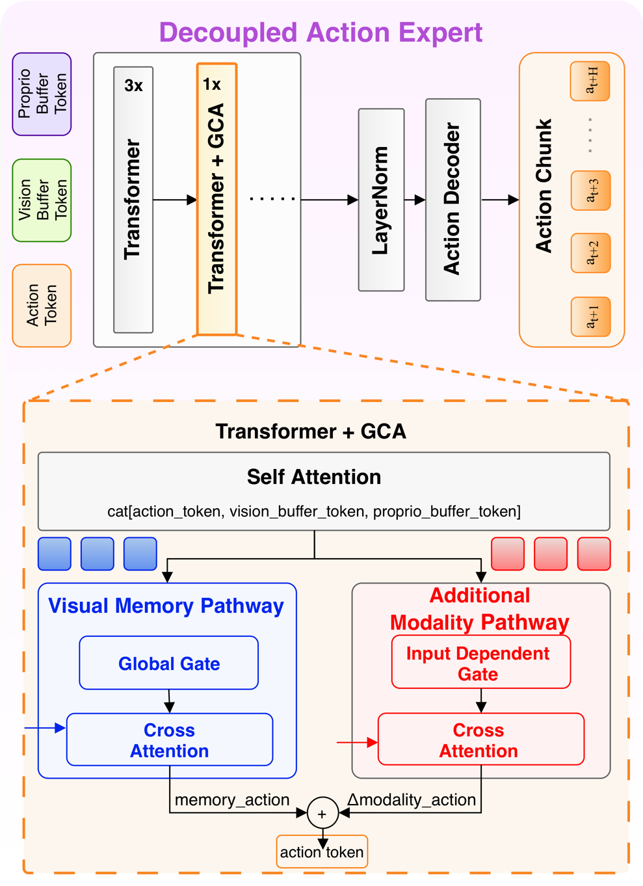
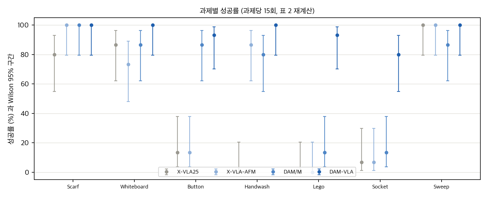
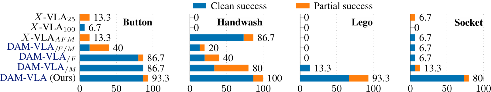
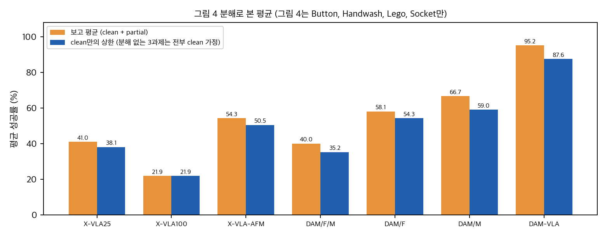
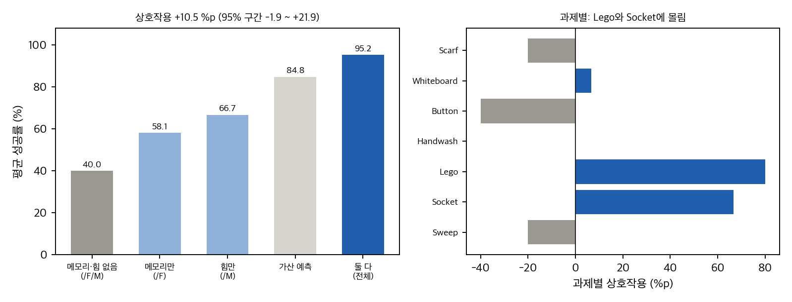
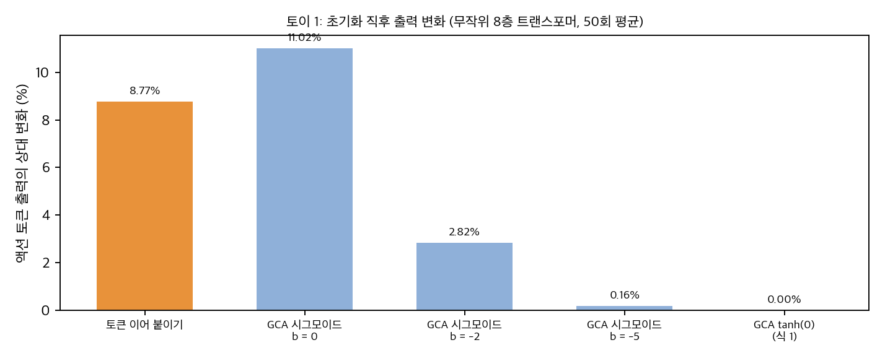

> **논문:** Pankhuri Vanjani, Zhuoyue Li, Jakub Suliga, Moritz Reuss, Gianluca Geraci, Xinkai Jiang, Rudolf Lioutikov. *DAM-VLA: Decoupled Asynchronous Multimodal Vision Language Action model.* CoRL 2026 포스터, arXiv:2606.12105 (v1, 2026-06-10, 유일한 버전).
> 2026-11-26 기준으로 공식 코드는 공개되지 않았습니다(프로젝트 페이지에 "Code (soon)"). 이 글의 그림은 논문 그림 두 장(출처 표기)과 우리가 그린 그래프입니다. 아래 수치 비교는 논문이 적은 과제당 15회 시행을 전제로 했고, 그림에서 읽은 값은 문장에 그렇게 밝혔습니다.

## 논문이 묻는 것

대부분의 VLA는 영상, 고유감각, 힘을 같은 주기로 한꺼번에 인코딩합니다. 힘은 수백 Hz로 변하고 영상은 몇 Hz면 충분하며 언어는 에피소드 내내 같은데, 하나의 시계로 묶으면 느린 입력은 중복 계산하고 빠른 입력은 놓친다는 문제의식입니다.

DAM-VLA는 모달리티마다 잠재 버퍼를 두고 각자의 센서 주기로 갱신하며, 액션 헤드가 매 추론에서 버퍼 전체를 읽게 합니다. 백본은 X-VLA이고, 힘과 시각 기억은 액션 전문가의 4번째 층마다 끼운 게이트 교차어텐션(GCA)으로 넣어 사전학습 가중치를 건드리지 않는다고 설명합니다. 시각 기억 경로는 `tanh(α)` 게이트(α는 0 초기화), 힘 경로는 입력에 의존하는 시그모이드 게이트(거의 닫힘 초기화)를 씁니다.

*논문 그림 2의 오른쪽 패널(Decoupled Action Expert). © 저자, CC BY 4.0, 출처 arXiv:2606.12105.*

실험은 Franka Panda 7개 과제(과제당 15회)입니다. 평균 성공률은 X-VLA 25 Hz 40.95%, 전체 DAM-VLA 95.2%로 보고됩니다.

## 이 글에서 확인한 것

**1. 산술은 맞고 큰 간격은 확실합니다.** 표 2의 49칸은 모두 k/15와 맞고, 평균은 합산 성공 수/105와 같습니다(DAM-VLA 100/105, X-VLA 25 Hz 43/105). 과제별 Fisher 검정을 42개(구성 6 × 과제 7) 하고 Holm으로 보정하면 Button, Handwash, Lego, Socket 네 과제에서 DAM-VLA가 다른 구성보다 분명히 높습니다. Scarf, Whiteboard, Sweep은 점수가 높은 구성이 여럿이라 15회로는 구분되지 않습니다.

*우리가 그린 그래프. 표 2의 네 구성(과제당 15회)과 Wilson 95% 구간.*

**2. 표의 "성공"은 부분 성공을 포함합니다.** 논문 그림 4는 네 과제의 막대를 clean success와 partial success로 나눕니다. 두 값의 합은 표 2의 28칸과 모두 일치합니다. 분해가 없는 Scarf, Whiteboard, Sweep을 전부 clean이라고 두면 clean만의 평균 상한은 DAM-VLA 87.6%, X-VLA 25 Hz 38.1%입니다(상한이므로 실제 차이는 더 작거나 같습니다). 부분 성공의 판정 기준은 본문에 정의되어 있지 않아, 이 값이 어떤 상태까지를 포함하는지 읽을 수 없습니다.

*논문 그림 4. © 저자, CC BY 4.0, 출처 arXiv:2606.12105.*

*우리가 그린 그래프. 보고 평균과 clean만의 상한(분해가 없는 세 과제는 전부 clean이라고 둔 값).*

**3. "두 배 이상"은 비교 기준에 따라 달라집니다.** 초록은 가장 강한 동기식 기준선(40.95%)과 비교해 2.33배를 말합니다. 같은 힘·기억 정보를 이어 붙여 넣은 X-VLA_AFM(54.3%)과 비교하면 1.75배, 차이는 40.95 %p입니다. 두 구성 모두 같은 정보를 쓰므로 이 비교가 통합 방식의 효과를 가장 직접 보여 줍니다. Wilson 구간은 겹치지 않습니다(DAM-VLA 89.3–97.9%, AFM 44.8–63.5%).

**4. 메모리와 힘의 효과는 평균에서 "독립"인지 구별되지 않습니다.** 비동기만 쓴 구성이 40.0%, 메모리를 더하면 +18.1 %p, 힘을 더하면 +26.7 %p, 둘 다 더하면 +55.2 %p입니다. 가산 예측은 84.8%이고 실제는 95.2%로 상호작용이 +10.5 %p이지만, 칸마다 이항 분포를 모의한 95% 구간은 −1.9 ~ +21.9 %p로 0을 포함합니다(시행 수 15 가정). 초가산은 Lego(+80 %p)와 Socket(+66.7 %p)에 몰려 있고 Button, Scarf, Sweep은 천장 근처라 반대 방향입니다. 두 요소가 함께 있어야 풀리는 과제가 있는 것으로 읽는 편이 데이터와 맞고, 본문의 "각각 독립적으로 기여한다"는 서술과는 다른 그림입니다.

*우리가 그린 그래프. 왼쪽은 합산 105회 기준 가산 예측 대 실제, 오른쪽은 과제별 상호작용.*

**5. 재계획 주파수와 시각 창의 정의는 논문만으로 정해지지 않습니다.** 100 Hz 제어기, 실행 지평 s=22에서 재계획은 약 5.5 Hz로 보고되는데, 청크를 끝까지 실행하는 경우의 상한은 100/22 ≈ 4.5 Hz입니다. 지연 인지 비동기 실행에서 청크를 다 쓰기 전에 넘어가면 가능한 값이라 s의 정의와 실행 방식이 필요합니다. 시각 창은 본문에서 16프레임, 25 Hz, 약 0.64 s인데 부록 표 3의 "Visual stride S = 8"을 100 Hz 시간축에서 읽으면 1.28 s(유효 12.5 Hz)입니다. 두 값이 어느 설정의 것인지 적혀 있지 않습니다. 또 "VLM을 4 추론 스텝마다 호출"의 스텝이 재계획 주기라면 약 1.4 Hz, 제어 스텝이라면 25 Hz입니다.

**6. "100 Hz 반응"은 제어기 주기입니다.** 힘 버퍼는 100 Hz로 갱신되지만 액션 헤드가 버퍼를 읽는 시점은 재계획 시점이고, 저자도 한계 절에서 힘을 청크 안의 교정에 쓰지 않는다고 적습니다. 따라서 이 설계의 이득은 "버퍼가 최신"이라는 점에서 오고, 정책이 100 Hz로 힘에 반응한다는 뜻은 아닌 것으로 읽힙니다.

**7. 부드러움과 지연의 차이는 오차 막대 안에서 겹칩니다.** 부록 D는 Sweep에서 DAM-VLA의 추종 지연이 0.116 s(본문)로 가장 낮다고 쓰며, 그림 7의 라벨은 0.118 s입니다. 100 Hz 구성들과의 차이는 6–21 ms이고, 그림에서 읽은 오차 막대 반폭의 합은 23–51 ms입니다(오차 막대의 종류와 에피소드 수는 논문에 없음). SPARC도 점추정은 DAM-VLA(8.1)가 가장 낮지만 X-VLA_AFM(10.47)과 오차 막대가 겹치고, 비동기만 쓴 구성(16.83)은 AFM보다 높습니다. 부드러움의 이득은 비동기 자체보다 힘·기억 입력과 함께 나타나는 것으로 보입니다.

## 작은 토이 두 개

**GCA의 초기화.** 논문은 이어 붙이기가 "사전학습 self-attention에 처음 보는 토큰을 통과시켜 백본 특징을 흐트러뜨린다"고 설명합니다. 무작위 가중치의 8층 트랜스포머를 백본 대역으로 써서 초기화 직후 액션 토큰 출력의 상대 변화를 쟀습니다. 식 1의 `tanh(0)` 게이트는 변화가 정확히 0이고, 식 2의 힘 경로는 게이트가 0이 아니라 "거의 닫힘"이라 닫힘 정도에 따라 0.2%에서 11%까지 달라집니다(논문은 그 값을 적지 않음). 이어 붙이기는 8.8%였습니다. 무작위 가중치에서의 값이고 학습 후 표현 보존에 대한 증거는 아닙니다. GCA 구성이 교차어텐션과 GRU를 새로 가진다는 용량 차이도 있어, 표의 격차(54.3% 대 95.2%)가 어디서 오는지는 이 토이로 가를 수 없습니다.

*우리가 그린 그래프. 무작위 8층 트랜스포머에서 새 모달리티를 넣는 방식별 초기 출력 변화(50회 평균).*

**지연 지표의 민감도.** 부록 D의 정의(유한 차분 속도, 정규화 상호상관)로 지연을 재는 합성 실험에서, 25 Hz 0차 유지는 추정 지연을 12–22 ms **줄였습니다**. 논문의 X-VLA 25 Hz와 DAM-VLA 지연 차이 71 ms를 이 가정에서는 구조 효과로 설명하지 못하고, 지표가 명령 신호의 구성에 수십 ms 민감하다는 점만 보입니다. 논문의 구현 세부(속도 노름, SPARC 문턱)는 공개되지 않아 표준 정의를 가정했으므로 반증이 아니라 민감도 점검입니다.

## 코드와 구현 가능성

공식 코드는 2026-11-26 기준으로 확인하지 못했습니다. 그래서 코드 대조 대신 주장별 검증을 했습니다. 핵심 하이퍼파라미터(기억 버퍼 길이, 압축 토큰 수, 힘 게이트 초기값, 실행 지평의 정의, 부분 성공 기준)는 코드나 보충 설명이 있어야 확인됩니다.

- 실로봇 재현(Franka Panda, 7개 과제, 과제당 시연 50–60개)과 X-VLA 미세조정(GH200, 20,000 스텝)은 일반 노트북에서 할 수 없는 규모입니다.
- 비동기 버퍼와 GCA의 축소판은 작은 정책과 MuJoCo 접촉 과제로 구현할 수 있습니다(노력 1–2주, 추정).

## 한계

- 이 분석은 논문 본문과 부록, 프로젝트 페이지의 수치에 기댑니다. 그림 6–8의 값은 PDF에서 막대와 오차 막대의 길이를 재어 얻은 판독 값입니다.
- 검정은 구성별 15회 시행이 독립이라고 가정합니다. 초기 조건이 구성 사이에 짝지어졌는지, 학습 시드가 몇 개인지는 논문에 없습니다.
- 위의 불일치로 보이는 부분은 정의가 적혀 있지 않아서 생긴 것일 가능성이 큽니다. 저자 확인이 필요합니다.

## 자료

- [통합 리포트 PDF](report/report_public.pdf)
- [DAM-VLA (arXiv:2606.12105) 논문 분석](analysis/01_paper_analysis.md)
- [02. 선행연구와 관련 저장소](analysis/02_prior_work.md)
- [03. 수치 재계산, 일관성 검사, 토이 실험](analysis/03_analysis.md)
- [04. 주장 검증과 구현 가능성](analysis/04_claim_verification.md)
