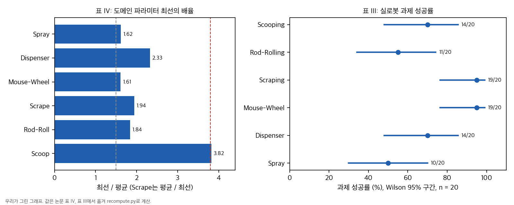
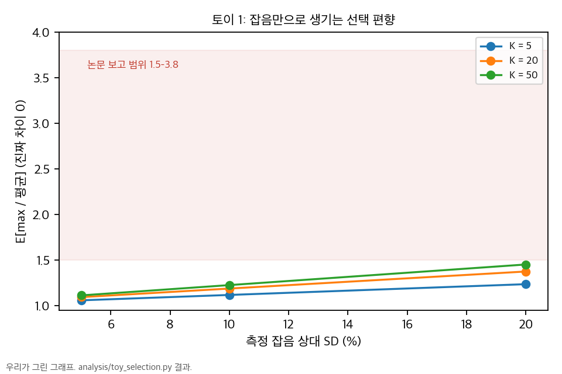

> **논문:** Beining Han, Jia Deng. *DAPPT: Domain-Aware Policies from Procedural Trajectories for Sim-to-Real Dexterous Tool Use.* arXiv:2611.20202 (v1, 2026-11-15). 학회 표기는 없습니다.
> 공식 코드 저장소는 README 한 장("Code coming soon")뿐입니다. 논문 그림은 싣지 않고, 우리가 그린 그래프와 표 재계산만 씁니다.

## 논문이 하려는 것

모래 삽질, 반죽 밀기, 스프레이 누르기처럼 **입자나 변형체가 많이 얽힌 도구 사용**은 시뮬레이션이 느리고, 실제와의 차이도 큽니다. 강화학습에서 입자 시뮬레이션을 매번 돌리면 학습이 너무 오래 걸립니다.

DAPPT는 이 문제를 피합니다. 물체 전체를 시뮬레이션하지 않고, **도구의 강체 6D 궤적만** 강체 시뮬레이터에서 추종하도록 학습합니다. 궤적은 몇 개의 파라미터(삽 각도, 삽입 거리, 속도 등)로 절차적으로 만들어집니다. 정책은 이 파라미터를 입력으로 받고, 학습 중에는 파라미터를 무작위로 바꿉니다. 그래서 하나의 정책이 여러 궤적 집합에 대응합니다.

학습이 끝나면 파라미터를 탐색해 과제 점수가 가장 높은 값을 고르고, 그 값으로 정책을 실제 로봇에 옮깁니다. 정책은 상태 기반 교사를 DAgger로 **포인트 클라우드 기반 정책**으로 증류한 것입니다. 손은 XHand1(12 자유도), 팔은 Franka R3(7 자유도)입니다.

## 표 값을 다시 계산하면

**"1.5–3.8배"의 하한이 맞지 않습니다.** 논문 표 IV에서 최선과 평균의 비율을 구하면 과제별로 1.61–3.82입니다. 가장 큰 값은 삽질의 3.82이고, 가장 작은 값은 마우스 휠의 1.61입니다. 1.5가 나오는 과제는 없습니다.

**최선은 평가 시뮬레이터 안에서 고른 값입니다.** 무작위 탐색으로 고른 파라미터를 같은 시뮬레이터(Genesis)에서 점수 매기고 보고합니다. 탐색과 보고에 시드를 나눴는지 논문에는 없습니다. 우리가 잡음만 넣은 간단한 모형으로 보면, 진짜 차이가 없어도 최선/평균이 1.06–1.45가 나올 수 있습니다(시도 수와 잡음 크기에 따라 다름). 마우스 휠과 스프레이의 1.6배는 이 범위 바깥이지만 크게 벗어나지는 않습니다.

그래프: 왼쪽은 논문 표 IV의 최선/평균 배율, 오른쪽은 표 III의 실로봇 과제 성공률과 Wilson 95% 구간(과제당 20회). 우리가 그린 그래프입니다.

그래프: 진짜 차이가 0일 때 도메인 수 K와 측정 잡음에 따라 최선/평균 배율이 올라가는 모습. 우리가 만든 모형이며, 논문의 값을 예측하지 않습니다.

## 기준선과 절제

- **기준선이 대칭이 아닙니다.** SimToolReal은 물체 실제 포즈를 쓰는 oracle이고, GPT-6이 만든 궤적을 반복해 최선을 보고합니다. DAPPT와 탐색 예산이 같은지 알 수 없습니다.
- **고정 도메인과 비교하면 크게 떨어집니다.** 파라미터를 하나로 고정해 학습한 정책은 마우스 휠 48.6%, 디스펜서 57.5%, 삽질 97.7% 낮습니다. 세 값 모두 표에서 재계산과 맞습니다. 다만 본문의 "nearly more than 50%"는 마우스 휠 48.6%와 맞지 않습니다.
- **표 값 하나가 의심스럽습니다.** 표 II 마우스 휠의 고정 도메인 값 0.19 rad가 표 I의 SimToolReal 값과 같습니다. 우연일 수도 있어서 저자 확인이 필요합니다.

## 실로봇에서는

과제당 20회 시행했습니다. 과제 성공률은 삽질 14/20, 반죽 11/20, 긁기 19/20, 마우스 휠 19/20, 디스펜서 14/20, 스프레이 10/20입니다. 20회에서는 구간이 넓습니다(예: 삽질 48–86%). 기준선 실로봇 실험이 없어서 "비슷한 성능"이라는 말을 판단할 수 없습니다.

또 하나 주의할 점이 있습니다. 실로봇 팔의 Kd 값은 **실로봇의 열린 루프 궤적에 맞춰 보정**했습니다(부록 B). 그러니 완전히 시뮬레이션만으로 옮긴 전이라고 보기는 어렵습니다.

## 재현할 수 있는가

**이 맥(Apple M4 Pro, 24 GiB, CUDA 없음)에서는 학습과 실로봇 재현이 불가능합니다.** 학습에 쓰는 IsaacLab은 macOS를 지원하지 않습니다. 평가에 쓰는 Genesis는 Apple Metal을 언급하지만, 이 맥에서 확인하지는 않았습니다.

재현에 필요한 값도 많이 빠져 있습니다. 보상 계수, PD 게인 값, 학습 예산, 시드 수, 도메인 파라미터 범위, 궤적 함수 식이 본문에 없습니다. 코드도 아직 공개되지 않았습니다. 그래서 강체 도구 궤적 추종 정도의 작은 실험을 먼저 만들어 보는 것이 현실적입니다. 노력은 1–2주로 봅니다(추정).

## 정리

DAPPT의 핵심 아이디어는 **입자 시뮬레이션 대신 도구 궤적을 추종하게 하고, 파라미터로 행동을 조절하는 것**입니다. 이 아이디어는 설득력이 있습니다. 다만 "1.5–3.8배"는 보고 방식에 따라 부풀 수 있고, 실로봇 결과는 비교 대상이 없습니다. 코드가 공개되면 다시 확인할 가치가 있습니다.

## 자료

- [통합 리포트 PDF](report/report_public.pdf)
- [01. DAPPT 논문 분석](analysis/01_paper_analysis.md)
- [02. 선행연구와 계보](analysis/02_prior_work.md)
- [03. 수치 재계산과 일관성 검사](analysis/03_analysis.md)
- [04. 주장 대조 (공식 코드 없음)](analysis/04_claim_verification.md)
