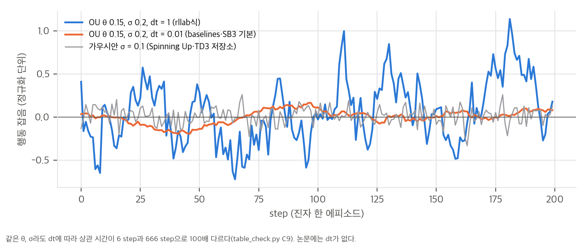
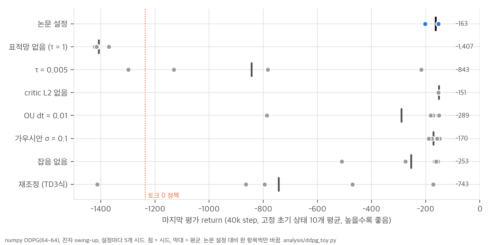
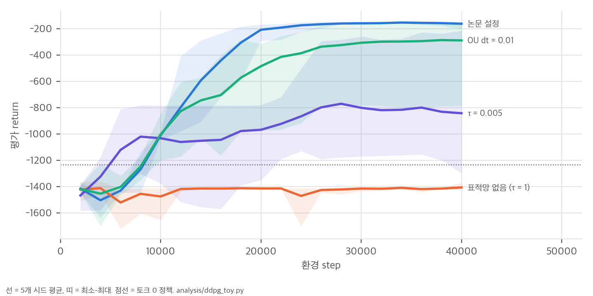

# 03. 핵심 식 해석과 toy 검증

스크립트는 세 개입니다.
- `analysis/table_check.py`: 표·부록 수치 재계산 → `table_check_results.json`
- `analysis/ddpg_toy.py`: numpy로 구현한 DDPG를 진자 swing-up에서 실행 → `ddpg_toy_results.json`
- `analysis/plot_figures.py`: 그림과 toy 통계 → `toy_stats_results.json`

toy의 수동 역전파는 중앙 차분과 비교해 최대 상대 오차 1×10⁻⁷로 확인했습니다.

## 1. Eq. 6은 무엇의 경사인가

off-policy 목적함수를 행동 분포 ρ^β 위에서 정의하면 J_β(μ) = E_{s~ρ^β}[Q^μ(s, μ(s))]입니다. 이를 미분하면 두 항이 나옵니다.

```
∇_θ J_β = E_{s~ρ^β} [ ∇_θ μ(s) · ∇_a Q^μ(s, a)|_{a=μ(s)} ]  +  E_{s~ρ^β} [ ∇_θ Q^μ(s, a)|_{a=μ(s)} ]
                    └──── Eq. 6 ────┘                              └─ 정책이 바뀌면 Q^μ 자체가 바뀌는 항 (버림) ─┘
```

Eq. 6은 두 번째 항을 버린 근사입니다. Silver et al.(2014)의 off-policy 결정적 actor-critic도 같은 근사를 씁니다. 정리가 정확히 성립하는 것은 on-policy 할인 방문 분포 ρ^μ에서인데, DDPG는 재생 버퍼의 분포에서 기댓값을 취하고 각주 2처럼 할인도 무시합니다. 버퍼가 크고 정책이 빨리 바뀔수록 ρ^β와 ρ^μ의 차이가 커집니다. 따라서 "버퍼가 클수록 좋다"는 데이터 효율과, 경사의 편향 사이에 맞교환이 있습니다. 논문은 버퍼 크기를 10⁶ 하나만 씁니다.

해석하면 Eq. 6은 "현재 critic이 보기에 Q가 커지는 방향으로 행동을 민다"는 정책 개선 단계입니다. critic이 틀리면 actor도 그대로 따라갑니다. 과대추정(§5)이 정책 품질로 바로 이어지는 이유입니다.

## 2. soft 표적망 = 지수이동평균

`θ' ← τθ + (1−τ)θ'`을 펼치면 θ'_k = Σ_j τ(1−τ)^j θ_{k−j}이므로, 표적망은 최근 파라미터의 지수이동평균입니다. 반감기는 ln 0.5 / ln(1−τ) 업데이트입니다.

| τ | 반감기 (업데이트) | 쓰는 곳 |
|---|---|---|
| 0.001 | 693 | 논문, rllab, TD3 저장소 `DDPG.py` 클래스 기본값 |
| 0.005 | 138 | SB3, Spinning Up(polyak 0.995), TD3 저장소 `main.py` |
| 0.01 | 69 | OpenAI baselines `learn()`, FlashDexRetarget의 FlashSAC |
| 1 | 0 (표적망 없음) | 원래 DPG |

환경 step마다 업데이트가 한 번이면, 논문 설정의 표적은 약 700 step 전 파라미터에 가장 큰 무게를 둡니다. 진자 3.5 에피소드 분량입니다. 업데이트-대-데이터 비율(UTD)을 바꾸면 같은 τ라도 환경 step 기준 지연이 달라집니다. FlashSAC는 환경 step당 업데이트 2번이라 τ = 0.01이 환경 step 기준 반감기 약 35입니다.

## 3. OU 잡음: dt가 빠지면 상관 시간이 100배 달라진다

Euler 이산화 x' = x − θx·dt + σ√dt·ε의 성질은 다음과 같습니다(`table_check.py` C9).

```
lag-1 자기상관 ρ = 1 − θ·dt,   정상 분산 = σ²·dt / (1 − ρ²) = σ² / (2θ − θ²·dt)
```

| dt | 정상 표준편차 | lag-1 자기상관 | 상관 시간 (1/e) | 쓰는 곳 |
|---|---|---|---|---|
| 1 | 0.380 | 0.850 | 6 step | rllab (σ 0.3 기본) |
| 0.1 | 0.367 | 0.985 | 66 step | — |
| 0.01 | 0.365 | 0.9985 | 666 step | OpenAI baselines, SB3 기본 |

정상 표준편차는 거의 같지만 상관 시간이 100배 다릅니다. 또 Algorithm 1처럼 에피소드마다 과정을 0에서 다시 시작하면, dt = 0.01에서는 200 step 안에 정상 상태에 닿지 못합니다. step t의 표준편차가 약 σ√(dt·t)라서 t = 200에서도 0.28이고, 초반 수십 step은 거의 0입니다. 즉 "OU(0.15, 0.2)"라는 같은 이름으로 한쪽은 빠르게 흔들리는 잡음을, 다른 쪽은 천천히 떠도는 편향을 쓰게 됩니다(그림 `ou_noise.png`).



## 4. 시드 퍼짐의 하한 (Table 1)

5개 값의 평균이 m이고 최댓값이 M이면, 표본 표준편차가 가장 작아지는 경우는 한 값이 M이고 나머지 넷이 m − (M−m)/4로 같을 때입니다. 이때 편차 제곱합은 (M−m)²·(1 + 4/16) = 1.25(M−m)²이므로 다음이 성립합니다.

```
s ≥ sqrt(1.25 / 4) · (M − m) ≈ 0.559 · (R_best − R_av)
```

저차원 DDPG에 적용하면 canada 0.80, walker2d 0.49, hardCheetah 0.38, canada2d 0.32 이상입니다. 26개 과제의 중앙값은 0.17입니다. 정규화 점수 범위(0–1)에 비하면 큰 퍼짐입니다. 단, 이 하한은 R_best가 R_av를 만든 같은 5개 최종 점수 중 최댓값일 때만 성립합니다. 논문의 "best observed"가 학습 중 최고 체크포인트라면 하한이 아닙니다.

## 5. toy: numpy DDPG로 본 장치별 효과

**설정:** gym Pendulum-v1과 같은 동역학(200 step, 토크 ±2)에서 실행했습니다. 구조와 하이퍼파라미터는 논문 부록을 따랐습니다: ReLU, tanh 출력, 행동은 critic 두 번째 층에 합류, 마지막 층 U(±3e-3), Adam 10⁻⁴/10⁻³, critic L2 10⁻², γ = 0.99, 배치 64. 다만 폭은 64-64로 줄였고 배치 정규화는 넣지 않았습니다. 40,000 step, 시드 5개이고, 논문 설정에서 한 항목씩만 바꿨습니다. 평가는 고정 초기 상태 10개에서 결정적 정책의 return 평균이고, 토크 0 정책은 −1,236입니다.



| 설정 | 최종 return 평균 | −250을 넘은 시드 | 논문 설정 대비 (Mann–Whitney p) |
|---|---|---|---|
| **논문 설정** (τ 0.001, OU dt 1, L2 1e-2) | **−163** | 5 / 5 | — |
| 표적망 없음 (τ = 1) | −1,407 | 0 / 5 | 0.008 |
| τ = 0.005 | −843 | 1 / 5 | 0.008 |
| critic L2 없음 | −151 | 5 / 5 | 0.14 |
| OU dt = 0.01 | −289 | 4 / 5 | 0.42 |
| 가우시안 σ = 0.1 | −170 | 5 / 5 | 0.55 |
| 잡음 없음 | −253 | 3 / 5 | 0.07 |
| 재조정 (lr 3e-4 둘 다, 배치 256, τ 0.005, 가우시안 0.1, L2 0) | −743 | 1 / 5 | 0.016 |



해석:
- **표적망 없이는 전혀 배우지 못했습니다.** 다섯 시드 모두 토크 0 정책보다 나쁩니다. 수치 발산은 없었지만 정책이 개선되지 않았습니다. 논문의 "target networks are crucial"과 맞습니다.
- **τ는 다른 하이퍼파라미터와 묶여 있습니다.** 이 toy에서는 τ = 0.005가 논문 값 0.001보다 크게 나빴고, TD3 논문식 "재조정" 묶음도 5개 중 1개만 풀었습니다. 이것을 "τ = 0.005가 나쁘다"로 일반화하면 안 됩니다. SB3와 TD3 저장소는 τ = 0.005로 MuJoCo를 잘 풀고, 차이는 망 폭(400-300·256-256 vs 64-64), 할인율, 보상 크기에서 올 수 있습니다. 결론은 "τ만 따로 바꾸면 위험하다"입니다.
- **L2, 잡음 종류의 효과는 이 toy에서 구분되지 않습니다**(p > 0.1). L2를 빼도 오히려 약간 나았습니다(−151). 가우시안 0.1도 결국 풀지만 −400 기준을 넘는 시점이 늦었습니다(시드별 18–28k step, 논문 설정은 14–20k).
- **OU dt = 0.01은 한 시드가 실패했습니다**(−787). 나머지 넷은 풀었습니다. §3에서 본 대로 에피소드 초반 잡음이 거의 없어서 탐색이 약해진 결과로 보입니다. 시드 5개로는 유의하지 않습니다.
- **잡음이 없어도 5개 중 3개는 풀었습니다.** 진자는 초기 상태가 무작위라 탐색 부담이 작습니다. 잡음의 역할을 보기에는 약한 과제입니다.

**Q 추정 편향 (Fig. 3 주장 확인):** 학습 뒤 Q(s₀, μ(s₀))를 같은 초기 상태에서 1,000 step 굴린 실제 할인 return과 비교했습니다.
- 논문 설정은 다섯 시드 모두 과대추정이었습니다(+1.4%, +7.4%, +22.3%, +4.0%, +11.7%. Wilcoxon p = 0.06, 5개라 검정력의 한계).
- 잘 풀린 세 설정(논문, L2 없음, 가우시안)을 합치면 15개 중 13개가 과대추정이고 평균 +6.7%입니다.
- 진자 같은 단순 과제에서도 체계적 과대추정이 있었습니다. "편향 없이 정확하다"는 Fig. 3의 해석은 이 toy에서는 재현되지 않았습니다. 그림의 축 단위가 "임의"라서 원 논문의 편향 크기를 직접 비교할 수는 없습니다.

**toy의 한계:** 망이 작고(64-64), BN이 없고, 과제가 하나이며, 시드가 5개입니다. 결론은 "이 설정에서의 경향"으로만 읽어야 합니다. 실행 시간은 다른 작업과 CPU를 나눠 써서 70분이 걸렸습니다. 단독으로 실행하면 몇 분 수준으로 추정합니다(3k step 실측 0.8초에서 환산하면 시드 하나 40k step에 약 15–20초).

## 6. 파라미터 수 확인 (부록 7절)

400-300 구조에 Table 2의 관측·행동 차원을 넣으면, actor는 122,201–164,209개, critic은 122,501–164,501개입니다(cheetah: actor 129,306, critic 129,601). "약 13만"은 두 망의 합이 아니라 **각 망의 크기**입니다.

픽셀 망은 커널과 stride가 적혀 있지 않습니다. 세 합성곱 층이 같은 커널·stride를 쓴다고 가정하고 k = 2–8, stride 1–4, valid/same padding을 모두 넣어 봤습니다. 가장 가까운 설정(k 2, stride 2)도 46만 개로 43만에서 7% 벗어납니다. 층마다 설정이 달랐을 것으로 보이며, 논문만으로는 픽셀 망을 복원할 수 없습니다.
