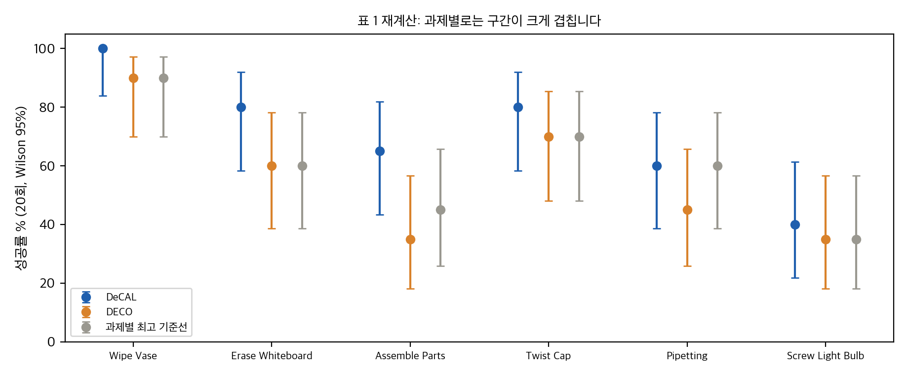
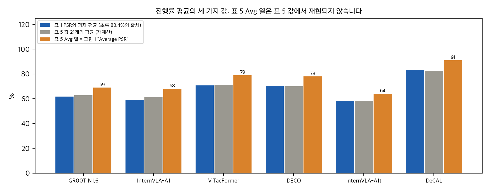
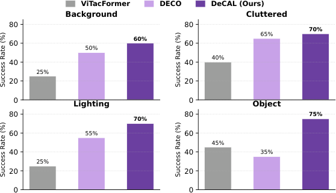
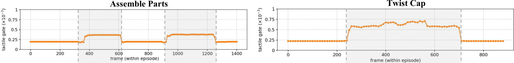
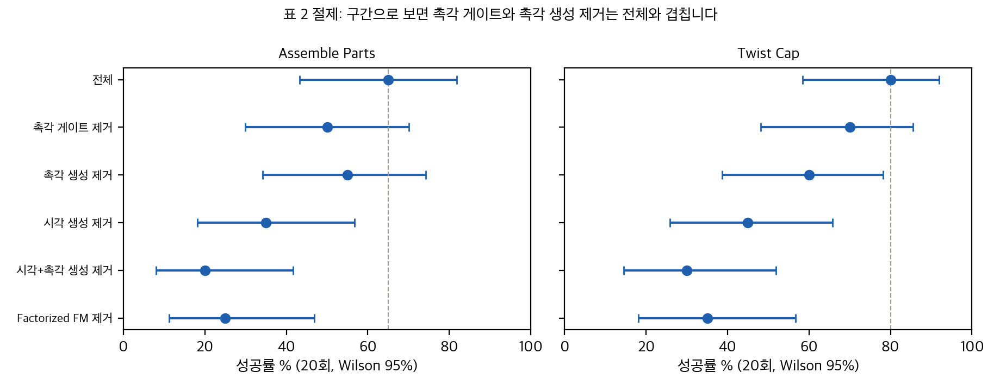
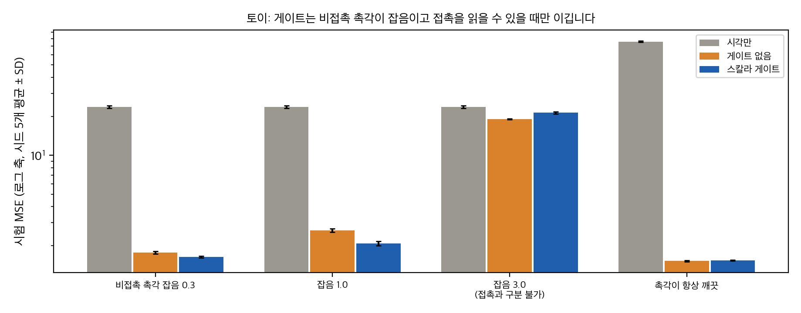

> **논문:** Yankai Fu, Ning Chen, Junkai Zhao, Heng Zhang, Guocai Yao, Pengwei Wang, Zhongyuan Wang, Shanghang Zhang. *DeCAL: Towards Physically-Grounded Dexterous Vision-Language-Action Models via Contact-Aware Latent Co-Imagination.* CoRL 2026 포스터, arXiv:2609.09119 (v1, 2026-09-08).
> 공식 코드는 GitHub AureleoPKU/DeCAL(Apache-2.0 표기)에 있습니다. 이 글의 그림은 논문 그림 두 장(출처 표기)과 우리가 그린 그래프입니다. 코드는 실행하지 않고 읽기만 했습니다.

## 논문이 묻는 것

손가락으로 병뚜껑을 돌리거나 플러그를 끼울 때는 손이 물체를 가려 카메라만으로는 접촉 상태를 알기 어렵습니다. 손끝 촉각을 VLA에 넣으면 도움이 되지만, 접촉이 없는 구간에서까지 촉각을 섞으면 시각 표현이 흐트러질 수 있다는 것이 DeCAL의 출발점입니다.

DeCAL은 세 가지를 합칩니다. 이해(Qwen3-VL), 미래 시각·촉각 잠재를 예측하는 생성, 행동 전문가가 한 변환기 묶음(Mixture-of-Transformers) 안에서 한 방향으로만 정보를 주고받습니다. 촉각은 손가락 10개의 변형 지도를 교차어텐션으로 이해 전문가에 넣고, 전역 촉각 토큰에서 나온 게이트 σ가 주입 세기를 조절합니다(식 2). 행동은 팔과 손을 두 토큰열로 나눠 흐름 정합으로 만듭니다(Factorized Flow Matching).

## 이 글에서 확인한 것

**1. 합산하면 가장 센 기준선보다 낫습니다. 과제별로는 구분되지 않습니다.** 6개 실로봇 과제를 20회씩 평가한 표 1에서 DeCAL의 평균 성공률은 70.8%, 가장 센 기준선 DECO는 55.8%입니다. 차이는 정확히 15.0 %p라서 서론의 "15% 넘게"는 맞지 않습니다. 120회로 합치면 Fisher p = 0.023, 과제로 층화한 Mantel-Haenszel p = 0.0096으로 차이가 확인됩니다. 그러나 과제 하나씩 보면 최고 기준선 대비 p가 0.30 이상이고 Pipetting은 동률(60%)입니다.

*그래프 (우리가 그림). 표 1의 성공 횟수를 20회로 보고 Wilson 95% 구간을 그렸습니다.*

**2. 부록 표와 그림의 평균이 서로 맞지 않습니다.** 초록의 진행률 83.4%는 표 1의 평균에서 나옵니다(정확한 값은 83.33). 그런데 그림 1의 "Average PSR" 91은 부록 표 5의 Avg 열 값이고, 이 열은 표 5의 값으로 재현되지 않습니다. 모든 방법에서 재계산 값보다 10–11% 큽니다. 순위는 바뀌지 않습니다. 표 6과 그림 9의 DeCAL 조명 값도 0.65와 70%로 다릅니다.

*그래프 (우리가 그림). 표 1 평균, 표 5 값의 평균, 표 5 Avg 열(그림 1의 값)을 방법별로 비교했습니다.*

**3. 일반화는 Twist Cap 하나입니다.** 네 가지 OOD에서 DeCAL은 60–75%입니다. 시도 수가 20회라고 가정하면 DECO와 시나리오별로 구분되는 것은 새 컵(75% 대 35%, p = 0.025) 하나이고, 네 개를 합치면 p = 0.036입니다. 부록 E.4는 기준선이 이미지 증강을 썼다고 밝히는데, 공식 학습 스크립트에는 DeCAL도 증강이 켜져 있습니다.

*그림 9 (논문 원문). © 저자, CC BY 4.0, 출처 arXiv:2609.09119 (v1).*

**4. 게이트 그림의 값은 매우 작습니다.** 그림 6은 접촉 구간에서 게이트가 오른다는 것을 보여 줍니다. 그런데 세로축 눈금이 ×10⁻³이어서 값은 비접촉 약 2×10⁻⁴, 접촉 약 4–7×10⁻⁴입니다. 오른 것은 맞지만 절대 크기는 1에 한참 못 미칩니다.

*그림 6의 그래프 두 개 (논문 원문, 아래의 카메라 사진 줄은 뺐습니다). © 저자, CC BY 4.0, 출처 arXiv:2609.09119 (v1).*

**5. 절제에서 촉각 쪽 요소는 구분되지 않습니다.** 20회, 시드 하나인 표 2를 전체 모델과 Fisher로 비교하면 Factorized FM 제거(p = 0.025, 0.0095)와 시각 생성 제거(0.11, 0.048)는 구분되지만, 촉각 생성 제거(0.75, 0.30)와 촉각 게이트 제거(0.52, 0.72)는 구분되지 않습니다. 게이트를 뺀 모델의 Twist Cap 70%는 DECO와 같습니다.

*그래프 (우리가 그림). 표 2의 성공률과 Wilson 95% 구간(20회).*

**6. 공식 코드는 논문 설명과 구조가 다른 곳이 있습니다.** 촉각 인코더는 "ResNet 기반"이라고 쓰지만 코드는 3층 합성곱과 2층 변환기를 처음부터 학습합니다. 게이트는 28층이 한 네트워크를 공유하는 샘플당 스칼라입니다. "상상"은 미래용 질의 토큰 없이 입력 토큰의 출력 은닉에서 t+15 시점을 회귀하는 보조 손실이고, 추론 때 디코더는 기본으로 쓰지 않습니다. 흐름 정합의 시간 규약도 논문과 반대입니다(코드는 t = 1이 잡음). 그 밖의 차이(이력 프레임, 예측 지평, 학습 일정, 증강, 라이선스 표기)는 첨부 문서의 D 항목에 정리했습니다.

**7. 합성 토이로 게이트가 이기는 조건을 봤습니다.** 접촉이 없을 때 촉각이 잡음이고 접촉을 촉각에서 읽을 수 있으면 스칼라 게이트가 이깁니다. 접촉과 구분할 수 없는 잡음이거나 촉각이 항상 깨끗하면 이득이 없습니다. 구성에서 거의 자명한 결과이고 논문의 수치와는 무관합니다.

*그래프 (우리가 그림). 합성 데이터 토이의 시험 MSE(시드 5개 평균 ± SD, 로그 축).*

## 재현 가능성

- **실로봇 재현과 공식 학습은 불가능합니다.** UR5 2대와 SharpaWave 손, 8×H100, 약 2.2 TB 데이터가 필요하고 학습된 체크포인트는 공개되지 않았습니다. 공개 데이터는 다른 형식(OXT)이고 변환기와 원본 촉각 이미지가 없어, 저장소의 학습 경로로 그대로 이어지지 않습니다.
- **수치 재계산과 구조의 합성 토이는 CPU에서 됩니다.** 첨부 스크립트로 확인할 수 있습니다.

## 한계

20회 시도와 단일 시드, 그림 9의 시도 수 가정, 그림에서 눈으로 읽은 값(그림 1, 그림 6, 그림 9)이 이 글의 한계입니다. 코드는 정적으로만 읽었고 `transformers_replace/`의 수정본은 읽지 않았습니다. 가중치가 없어 그림 6의 게이트를 확인하지 못했습니다.

## 자료

- [통합 리포트 PDF](report/report_public.pdf)
- [01. 논문 분석: DeCAL (arXiv:2609.09119)](analysis/01_paper_analysis.md)
- [02. 선행연구와 관련 저장소](analysis/02_prior_work.md)
- [03. 수치 재계산, 일관성 검사, 토이](analysis/03_analysis.md)
- [04. 공식 코드 대조와 구현 가능성](analysis/04_code_verification.md)
