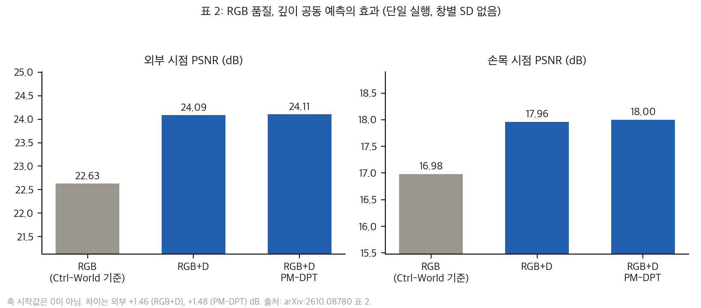
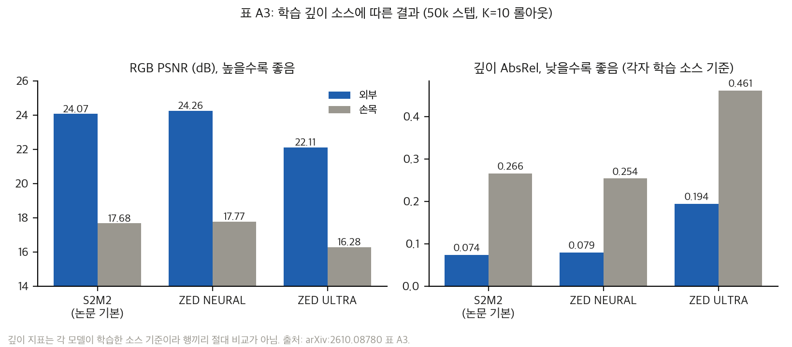
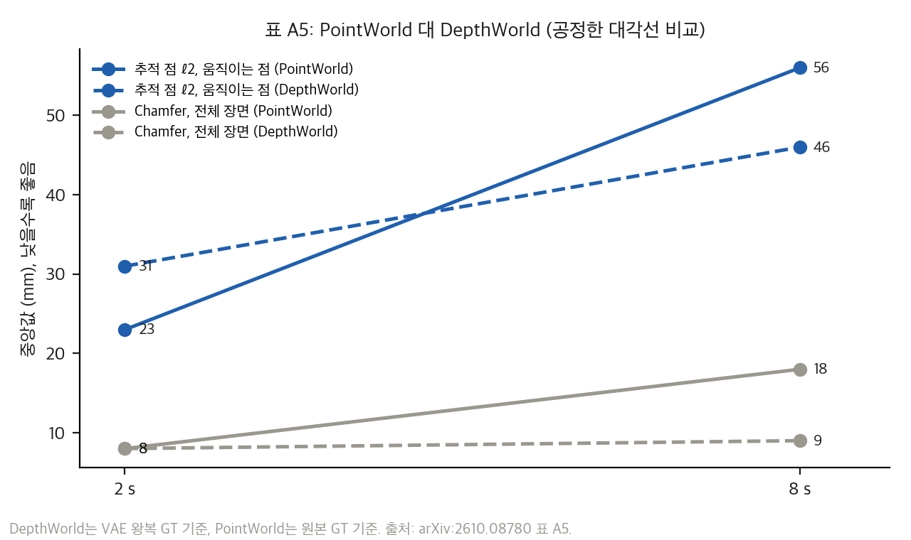

> **논문:** Jai Bardhan, Josef Sivic, Vladimir Petrik. *DepthWorld: 3D World Model for Robot Manipulation.* CoRL 2026 포스터, arXiv:2610.08780 (v1, 2026-10-06).
> 공식 코드는 GitHub Jai2500/depthworld(MIT)에 있습니다. 이 글의 그림은 모두 우리가 논문 표 값으로 그린 그래프입니다. 논문 그림은 싣지 않았습니다.

## 논문이 묻는 것

영상 세계 모델은 정책 평가, 정책 개선, 계획에 쓰입니다. 그런데 RGB만 학습하면 프레임마다는 그럴듯하지만 여러 시점에서 맞물리지 않는 롤아웃이 나옵니다. 물체가 모양을 잃거나, 팔이 문을 통과하는 듯 보이는 식입니다.

저자들은 두 가지를 냅니다. 첫째는 DROID 로봇 데이터를 다시 보정해 **DROID-3D**를 만드는 일입니다. 같은 로봇의 모든 에피소드를 한 요인 그래프에 묶어 손-눈 보정과 관절 오프셋을 한 번에 추정합니다. 둘째는 **DepthWorld**입니다. SVD 영상 모델의 VAE는 그대로 두고, RGB 잠재와 깊이 잠재를 옆으로 붙여 72×80 격자 하나로 U-Net에 넣습니다. 여기에 로봇 기준 좌표의 3D 점을 맞추는 보조 DPT 헤드를 더할 수 있습니다.

*그래프 1 (우리가 그림). 논문 표 2 값을 옮겼습니다. 단일 실행이라 오차 막대가 없습니다.*

## 이 글에서 확인한 것

- **RGB 이득은 수치가 맞습니다.** 외부 PSNR 차이는 공동 예측만으로 +1.46 dB, 점지도 헤드를 더하면 +1.48 dB입니다. 초록의 +1.48 dB는 헤드를 더한 쪽입니다. 헤드 추가분 0.02 dB는 실행 하나로는 노이즈와 구분되지 않습니다.
- **그러나 실행은 하나입니다.** 창 256개를 쌍체로 본다고 가정하면, 차이가 비유의하려면 창별 SD가 약 12 dB 이상이어야 합니다. 그래서 창 노이즈가 문제라기보다, 학습 시드를 바꿨을 때의 분산을 모른다는 점이 한계입니다.
- **깊이 쪽 주장은 부분만 맞습니다.** 헤드를 더하면 외부 AbsRel은 0.0765에서 0.0782로 나빠집니다. 손목에서만 좋아집니다. 타일링이 깊이까지 낫다는 문장도 외부 RMSE에서는 맞지 않습니다.
- **보정은 수치가 크지만 지표가 같은 계열입니다.** 중앙값 재투영 오차는 23배, 13배 줄었습니다. 같은 잔차를 최적화한 지표라서, 독립 검증은 캡처 5세트에서 자세를 잰 것(4.9 mm / 0.39° 대 기준선 72 mm / 3.0°)뿐입니다.

*그래프 2 (우리가 그림). 논문 표 A3 값입니다. 깊이 지표는 각 모델이 학습한 소스 기준이라 행끼리 정확도 비교가 아닙니다.*

## 공식 코드와 논문의 차이

공식 저장소에는 세계 모델 학습과 평가, 점지도 생성, 데이터 로더가 있고 MIT입니다. 다만 다음이 다릅니다.

- **보정 최적화기가 없습니다.** 요인 그래프와 손목 정합, S²M² 깊이 추론이 없습니다. 보정 결과 파일만 HF에서 받을 수 있습니다. 논문의 핵심 기여를 공개 코드로 확인할 수는 없습니다.
- **샘플링 조건이 상수가 아닙니다.** 논문은 CFG 스케일 2라고 쓰지만, 코드는 프레임마다 1에서 2로 선형으로 바꿉니다.
- **깊이 전처리가 다릅니다.** 논문은 카메라별 95백분위로 자른다고 쓰지만, 코드는 고정 범위(0.30–3.30 m, 0.07–2.00 m)를 씁니다. 쌍선형 보간도 씁니다.
- **학습 설정이 맞지 않습니다.** 논문은 90k 스텝(40k + 50k), 전역 배치 64라고 씁니다. 저장소 README 예시는 전역 배치와 총 스텝이 다르게 계산됩니다.

## 데이터와 라이선스

- 논문은 arXiv에 CC BY 4.0으로 공개되어 있습니다. 원문 PDF에 저작권 표시는 없습니다. 그러나 그림 2와 3에는 실험실과 DROID 장면 사진이 들어 있어서, 그림은 싣지 않았습니다.
- 공개된 DROID-3D 보정 자세는 CC BY 4.0이지만 수동 승인이 필요합니다. 공개 카드는 71,006 에피소드라고 적고, 논문은 71,100이라고 씁니다. 공개 카드의 pseudo-label 25,616 에피소드는 VGGT-Ω 출력이라 CC BY-NC 4.0이며, 논문에는 없습니다.
- 체크포인트는 SVD 커뮤니티 라이선스를 따릅니다. VGGT로 초기화한 헤드가 있는 체크포인트는 CC BY-NC 4.0이라 비상업 연구용입니다.

## 구현 가능성 (Apple M4 Pro, 24 GiB, MPS, CUDA 없음)

- **학습은 불가능합니다.** H200 두 노드에서 약 2일이 걸리고, 저장소 설정도 FSDP와 CUDA를 전제합니다.
- **공개 체크포인트 한 청크 추론은 조건부입니다.** 6 GB 이상의 체크포인트 다운로드와 패키지 설치가 필요하고, 장치 포팅도 필요합니다. 속도는 측정하지 않았습니다.
- **구조는 구현할 수 있습니다.** 공간 타일링과 점지도 헤드는 MIT 코드가 있어 옮겨 짜기 쉽습니다. 보정은 처음부터 짜야 합니다. 노력 추정은 보정 재구현 4–8주, 추론 확인 2–4일입니다(추정).

*그래프 3 (우리가 그림). 논문 표 A5 값입니다. 두 시점만 있고, DepthWorld는 VAE 왕복 GT 기준, PointWorld는 원본 GT 기준이라 비교 조건이 완전히 같지는 않습니다.*

## 한계

- 자기회귀 롤아웃은 노출 편향과 품질 저하가 있습니다. 저자도 RL 후처리(PersistWorld)가 필요하다고 인정합니다.
- 평가 깊이 참조는 S²M² 깊이를 VAE로 한 번 왕복한 것입니다. 독립된 깊이 정답이 아닙니다.
- 학습과 검증 에피소드가 같은 로봇과 연구실에서 나옵니다. 저자가 직접 적은 한계입니다.

## 출처와 라이선스

- 논문 arXiv:2610.08780 (CC BY 4.0), 공식 채택 목록 corl.org(CoRL 2026 포스터).
- 공식 코드 GitHub Jai2500/depthworld (MIT, 커밋 6823c13). 실행하거나 설치하지 않고 정적으로만 읽었습니다.
- 그래프 세 장과 재계산 스크립트는 논문 표 값을 옮겨 만들었습니다. 가중치와 데이터는 받지 않았습니다.

## 자료

- [통합 리포트 PDF](report/report_public.pdf)
- [01. 논문 분석: DepthWorld (arXiv:2610.08780)](analysis/01_paper_analysis.md)
- [02. 선행연구와 관련 저장소](analysis/02_prior_work.md)
- [03. 수치 재계산과 일관성 검사](analysis/03_analysis.md)
- [04. 공식 코드 대조와 구현 가능성](analysis/04_code_verification.md)
