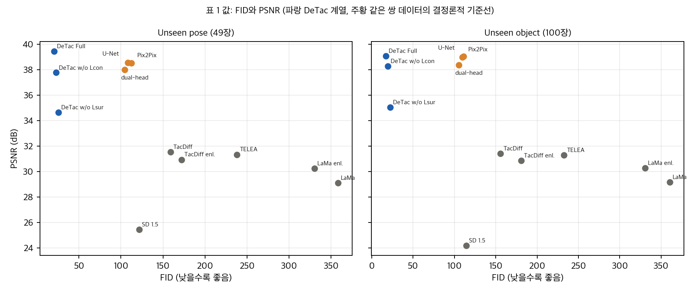
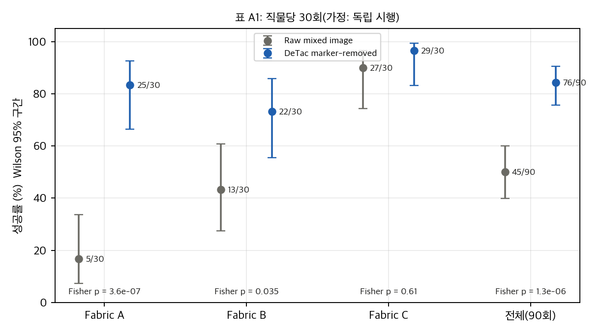
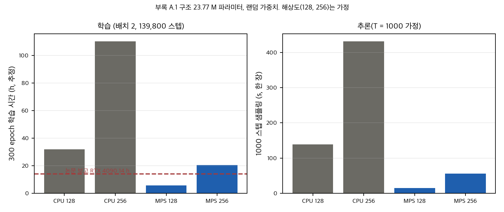

> **논문:** Zhirui Zhang 외. *DeTac: Dual-branch Decoupling of Texture and Force Signals in Vision-Based Tactile Sensors.* CoRL 2026 스포트라이트, arXiv:2610.16463 (v1, 2026-10-12).
> 공식 코드와 프로젝트 페이지는 찾지 못했습니다. 논문 그림은 싣지 않고(arXiv non-exclusive 라이선스), 우리가 만든 그래프만 씁니다. 표 값은 논문에서 옮겨 다시 계산했습니다.

## 논문이 묻는 것

마커 기반 시각 촉각 센서는 엘라스토머에 마커를 넣어 마커의 움직임으로 힘을 추정합니다. 같은 영상에서 마커가 표면 음영을 가려 형상 복원은 어려워집니다. 마커를 지우는 기존 방법은 마커 마스크를 먼저 추정한 뒤 인페인팅하는 직렬 구조입니다. 저자들은 마커가 가린 곳뿐 아니라 주변 엘라스토머에도 함입 흔적을 남기기 때문에 마스크를 어떻게 잡아도 한계가 있다고 봅니다.

## 방법과 데이터

- **두 분기 병렬.** 혼합 영상을 조건으로 하는 확산 모델이 마커 없는 음영 영상을 만들고, 3층 합성곱망이 마커 영상을 따로 예측합니다.
- **보조 손실 두 개.** 예측한 마커를 팽창해 만든 고리에서 복원 오차를 강조하는 손실(L_sur)과, 복원 전후 차이와 마커 예측을 맞추는 손실(L_con)입니다.
- **쌍 데이터.** 같은 엘라스토머를 마커 제작 전후에 같은 자세로 눌러 정렬된 쌍을 얻습니다. 객체 54개 × 자세 20개 = 1,080쌍이고, 미관측 객체 5개(100장)와 미관측 자세 49장을 시험에 둡니다. 마커 정답은 사람이 찍은 중심점과 SAM 분할로 만든 값입니다.

## 확인한 것

### 7 dB의 비교 조건

미관측 자세 기준 PSNR은 DeTac 39.45 dB, TacDiff 31.52 dB로 7.93 dB 차이입니다(미관측 객체는 7.67 dB). 이 비교에서 TacDiff는 마커를 덧씌운 합성 데이터로, 회귀 기준선(U-Net, Pix2Pix, dual-head)은 DeTac과 같은 쌍 데이터로 학습했습니다. 같은 쌍 데이터로 학습한 U-Net과 비교하면 PSNR 차이는 0.89 dB(자세)와 0.04 dB(객체)입니다. 확산 구조의 몫은 FID에서 더 크게 보입니다. 회귀 기준선 중 최저 FID가 DeTac의 5.1배(자세), 6.2배(객체)입니다.

*그림 1. 논문 표 1의 FID와 PSNR(두 시험 분할). 파랑은 DeTac 계열, 주황은 같은 쌍 데이터로 학습한 결정론적 기준선입니다. 직접 그린 그래프입니다.*

### 절제와 확대 마스크

L_sur를 빼면 PSNR이 4.81 / 4.02 dB 낮아져 회귀 기준선보다 낮은 값(34.64 / 35.05 dB)이 됩니다. L_con을 빼면 1.68 / 0.79 dB 낮아집니다. L_sur는 마커 고리에서의 L1 손실이므로, 효과가 마커 인식 가중에서 오는지 픽셀 손실을 더한 데서 오는지는 균일 가중 L1과의 비교가 있어야 가릴 수 있습니다. 확대 마스크 기준선은 TacDiff에서는 네 지표가 모두 나빠지고 LaMa에서는 모두 좋아집니다. 이 차이의 원인은 표만으로 알 수 없어 저자 확인이 필요합니다.

### 마커 추출과 하위 과제

마커 중심 오차(MCLE)는 DeTac 0.00762 mm로, UVTac(0.21)의 1/27.6, SAM 3.1(0.41)의 1/53.8입니다. 정답 중심이 SAM 기반 pseudo GT에서 오므로 이 값은 그 정답과의 일치도입니다. 센서의 mm/픽셀이 없어 픽셀 오차로 옮길 수 없습니다. L_con 제거(+9.2%)와 L_sur 제거(+10.1%)의 차이는 0.9%p이고 시드가 하나라서 두 값의 우열은 말하기 어렵습니다. 힘 추정은 평균 MAE가 UVTac 0.119 N에서 DeTac 0.089 N(−25.2%)이고, 표면 복원은 Chamfer −31.5%, RMSE −36.0%입니다. 시험 표본 수와 힘 범위, 반복은 논문에 없습니다.

### 직물 분류

부록 표 A1은 직물 세 종류를 30회씩 분류합니다. 보고된 백분율은 모두 30회 정수 성공 수(5, 13, 27 / 25, 22, 29)와 맞습니다. 30회가 서로 독립이라고 가정하고 Fisher 정확 검정을 하면 직물 A p = 3.6e-07, 직물 B p = 0.035(세 직물 Holm 보정 후 0.070), 직물 C p = 0.61입니다. 개선은 직물 A에 집중되어 있습니다. 분류 범주 수가 "several"로만 적혀 있어 우연 수준을 알 수 없고, 혼합 이미지의 직물 A 성공률 16.7%는 범주가 3–5개일 때의 우연 수준(20–33%)보다 낮습니다.

*그림 2. 표 A1의 성공 수와 Wilson 95% 구간, Fisher p(시행 독립 가정). 직접 그린 그래프입니다.*

## 이 맥에서 학습할 수 있을까

부록 A.1의 구조(6채널 입력 U-Net, 채널 64–256, 잔차 블록 22개)를 랜덤 가중치로 만들면 23.77 M 파라미터입니다. 입력 해상도는 논문에 없어 128과 256을 가정해, Apple M4 Pro(MPS)에서 한 스텝 시간을 쟀습니다. 배치 2 기준 0.144 s(128), 0.528 s(256)이고, 139,800 스텝(300 epoch)이면 약 5.6 h, 20.5 h입니다(데이터 로딩과 보조 손실은 제외한 추정). 논문의 RTX 4090 14 h는 스텝당 0.36 s에 해당합니다. T = 1000 샘플링은 한 장당 15–56 s(가정)라 실시간 제어 루프에는 맞지 않습니다.

*그림 3. 부록 A.1 구조(랜덤 가중치)의 학습 시간과 1000 단계 샘플링 시간 추정. 해상도는 가정이고 학습은 하지 않았습니다. 직접 그린 그래프입니다.*

## 읽을 때 주의할 점

- 7 dB는 데이터가 다른 기준선과의 비교입니다. 같은 데이터 기준선과의 PSNR 차이는 0.04–0.89 dB입니다.
- 미관측 객체 5개, 미관측 자세 49장에 시드와 구간이 없습니다. FID의 절대값보다 격차가 큰 순서(DeTac 17–26 대 나머지 104 이상)가 의미가 있습니다.
- 교차 센서 일반화는 정성 그림 한 장이고 수치가 없습니다. 쌍 데이터는 센서 한 대의 것입니다.
- 코드와 데이터가 공개되어 있지 않아 논문 수치의 재현은 확인하지 못했습니다. 위 수치는 논문 표를 다시 계산한 것입니다.

## 저자에게 묻고 싶은 것

입력 해상도와 샘플링 단계 수, TacDiff 확대 마스크 변형의 구성, 표 1–3의 시드와 반복 여부, MCLE의 정답과 기준선 적용 방식, 표 3·4의 시험 표본 수, 표 A1의 분류 범주 수와 시행 독립성, 데이터셋·코드의 공개 계획입니다.

## 자료

- [통합 리포트 PDF](report/report_public.pdf)
- [01. 논문 분석: DeTac (arXiv:2610.16463)](analysis/01_paper_analysis.md)
- [02. 선행 연구와 관련 자료: DeTac](analysis/02_prior_work.md)
- [03. 수치 재계산과 맥 속도 측정](analysis/03_analysis.md)
- [04. 주장 검증과 구현 가능성: DeTac](analysis/04_claim_verification.md)
