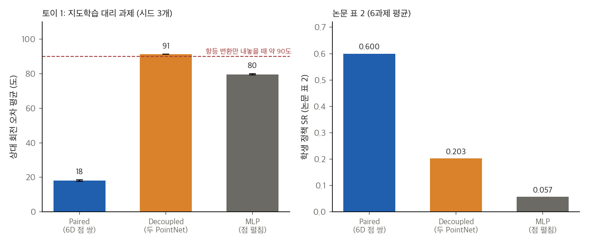
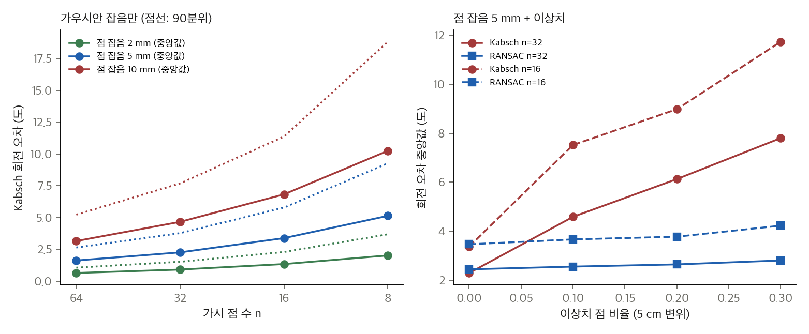
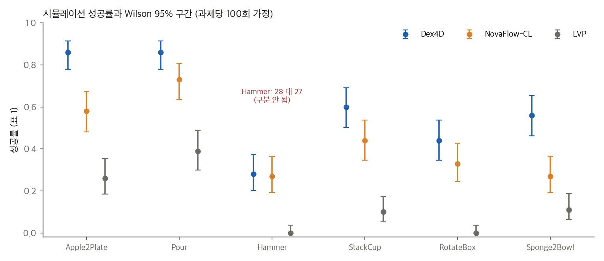
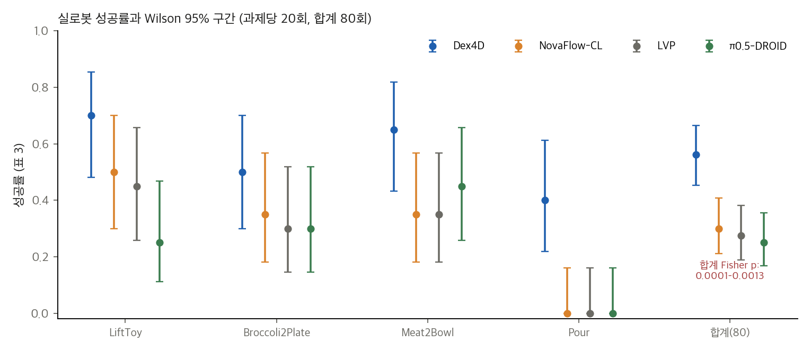

# 03. 수치 재계산과 토이 검증: Dex4D (arXiv:2602.15828 v2)

재현 실험(학습, 실로봇)은 하지 않았습니다. 이 문서는 (a) 논문 표 값의 재계산과 일관성 검사 V1–V14, (b) CPU 토이 두 개로 이루어집니다. 재계산은 `analysis/recompute.py`(결과 `recompute_results.json`), 토이는 `analysis/toy_pair_encoding.py`와 `analysis/toy_kabsch.py`입니다. 논문에 없는 시행 수는 가정으로 표시했고, 그림에서 읽은 값은 "(그림 판독 값)"으로 표시했습니다.

## 0. 결과 요약

| ID | 검사 | 결과 |
|---|---|---|
| V1 | 표 1의 평균 SR, TP 재계산 | 8개 평균 모두 일치 (반올림 3자리) |
| V2 | TP ≥ SR, 평균의 1/600 격자, 표 2 마지막 행 = 표 1 | 위반 0건, 격자 일치, 표 2 마지막 행은 표 1 평균과 같음 |
| V3 | 향상 표기의 정의 | 시뮬 "+16.3%"는 %p(상대 +37.3%), 실로봇 "87.5%"는 상대 이득. 한 논문 안에서 정의가 다름 |
| V4 | 표 3 합계, 부록 F Wilson 구간, Fisher | 합계 4개와 구간 5개 모두 일치. 합계 비교는 p ≤ 0.0013, 과제별 12개 중 Holm 후 유의 3개(Pour) |
| V5 | 시뮬레이션 검정(과제당 100회 가정), 절제 | Hammer 구분 불가, Holm 후 유의 2과제(Apple2Plate, Sponge2Bowl), dynamics modeling +3.0 %p는 p = 0.32 |
| V6 | 시뮬 대 실로봇 Pour | Dex4D 86/100 대 8/20, 조건이 달라 직접 비교는 아님 |
| V7 | v1 대 v2 실로봇 값 정합 | v1을 v2의 부분집합으로 보면 모든 셀에서 v2 ≥ v1 (모순 없음, 가정 필요) |
| V8 | 그림 5 흐름 보존 | 80 = 72 + 8, 72 = 58 + 14, 58 = 45 + 10 + 3. 성공 45는 표 3과 같음 |
| V9 | 그림 4 (점 개수) 판독 | 64 → 32점에서 SR −8 %p, 8점에서 0.21 (그림 판독 값) |
| V10 | 학습 규모와 시간의 정합 | 교사 5만 스텝, 처리량 역산 6.3–9.5k 샘플/s (가정 포함) |
| V11 | 보상식 단위 | `r_goal`이 0이 되는 거리 0.467 m, 성공 문턱 0.05 m에서 1.25 |
| V12 | 코드의 물체 집합 | 3,200 항목 = 메시 2,145개 × 스케일 |
| V13 | 참고문헌 번호 표본 확인 | [30], [39] 모두 abs 페이지와 제목 일치 |
| V14 | 표 7의 γ·λ 라벨 | 코드와 값은 같고 라벨이 반대 (`04` D1) |

## 1. 표 1(시뮬레이션) 재계산

### 1.1 평균과 격자 (V1, V2)

- 표 1의 평균은 과제 여섯 개의 단순 평균입니다. NovaFlow 0.345/0.448, LVP 0.143/0.373, NovaFlow-CL 0.437/0.608, Dex4D 0.600/0.712로 보고값과 반올림 3자리까지 모두 일치합니다.
- SR 칸은 모두 소수 둘째 자리이고 과제당 100회와 맞습니다. 평균 SR에 600을 곱하면 207, 85.8, 262.2, 360.0이고 가장 가까운 정수 86/600 = 0.1433, 262/600 = 0.4367이 보고값 0.143, 0.437로 반올림됩니다(격자 1/600과 일치). 표 2의 0.057, 0.203, 0.490, 0.570도 34/600, 122/600, 294/600, 342/600과 맞습니다.
- TP ≥ SR이 24칸 모두 성립합니다(TP는 도달한 waypoint 비율이고, 마지막 waypoint 도달이 SR). §4.1은 TP를 "도달한 waypoint의 평균 개수"라고 쓰지만 값은 [0, 1]이라, 비율로 정규화한 것으로 읽습니다. waypoint 개수는 과제별로 논문에 없습니다.
- 표 2의 Dex4D 행(0.600, 0.712)은 표 1의 Dex4D 평균과 같은 값입니다. 같은 학생 정책의 같은 평가를 다시 적은 것으로 보입니다.

### 1.2 향상 표기의 정의 (V3)

- §4.1: "+16.3% in SR and +10.4% in TP"는 0.600 − 0.437과 0.712 − 0.608로 계산한 **%p** 입니다. 같은 비교의 상대 이득은 +37.3%입니다.
- §1과 §4.3: "87.5% relative performance gain"은 45/24 − 1입니다. 절대 차는 26.25 %p입니다.
- v1은 같은 종류의 비교(실로봇 19/40 대 10/40)를 "22.5% performance gain"으로 적었고 이 값은 (19 − 10)/40의 %p입니다(상대로는 +90%). 두 판에서 같은 단어의 정의가 달라, 판 사이 비교에는 표 값 쪽이 안전합니다.

### 1.3 시뮬레이션의 통계적 해석 (V5; 과제당 100회, 시도 독립 가정)

논문은 시뮬 시도가 같은 초기 자세를 공유하는지 말하지 않습니다. 독립 Fisher 검정으로 계산했고, 쌍체라면 검정력이 더 높을 수 있습니다.

| 과제 | Dex4D | NovaFlow-CL | p (Fisher) | Holm(6) |
|---|---|---|---|---|
| Apple2Plate | 86 | 58 | 1.6e-5 | 9.5e-5 |
| Pour | 86 | 73 | 0.035 | 0.13 |
| Hammer | 28 | 27 | 1.00 | 1.00 |
| StackCup | 60 | 44 | 0.034 | 0.13 |
| RotateBox | 44 | 33 | 0.146 | 0.29 |
| Sponge2Bowl | 56 | 27 | 5.2e-5 | 2.6e-4 |

- Dex4D는 NovaFlow, LVP에 대해서는 6과제 모두 보정 전 p < 0.02입니다(LVP는 p < 1e-9). NovaFlow-CL에 대해서는 Holm 후 Apple2Plate와 Sponge2Bowl만 남습니다. 합산(600 대 600)은 p = 2e-8이므로 평균 우위는 분명하지만, 과제별로는 Hammer의 28 대 27이 구분되지 않고 Pour·StackCup·RotateBox는 보정 후 구분되지 않습니다.
- 개루프 NovaFlow 대 NovaFlow-CL: 합산 262 대 207(p = 0.0014)로 폐루프 이득은 있으나 과제별로는 Hammer만 p = 0.012입니다.
- **세 기준선의 잡기가 Dex4D 정책**이므로(부록 D), 이 표의 우위는 "잡은 뒤의 이동 제어" 차이로 읽는 것이 정확합니다.

### 1.4 절제 (V5, 표 2; 합산 600회 가정)

| 변형 | SR (k/600) | Dex4D와의 차 | p (Fisher) |
|---|---|---|---|
| MLP Point Encoding | 34 | −54.3 %p | < 1e-90 |
| Decoupled Point Encoding | 122 | −39.7 %p | 1e-45 |
| w/o Self-Attention | 294 | −11.0 %p | 1.6e-4 |
| w/o Dynamics Modeling | 342 | −3.0 %p | 0.32 |

앞의 세 차이는 큽니다. 마지막 차이(+3.0 %p)는 이 표본 크기에서 평가 변동의 범위 안이고, 학생 학습이 몇 번이었는지는 논문에 없습니다(그림 14의 시드는 교사). "dynamics modeling이 성능을 높인다"는 방향은 표와 맞지만 구분되는 수준은 아닙니다. 교사 쪽 절제(그림 10)는 평균 보상 곡선 한 장이고 분산은 보이지 않습니다.

## 2. 실로봇 (표 3, 부록 F)

### 2.1 합계와 구간 (V4)

- 합계 22, 24, 20, 45는 과제별 값의 합과 일치합니다.
- 부록 F의 Wilson 구간 다섯 개(LiftToy [0.48, 0.86], Broccoli2Plate [0.30, 0.70], Meat2Bowl [0.43, 0.82], Pour [0.22, 0.61], 합계 [0.45, 0.67])를 재계산하니 모두 소수 둘째 자리까지 일치합니다.
- 합계 Fisher: Dex4D 45/80 대 LVP 22/80 p = 3.9e-4, NovaFlow-CL 24/80 p = 1.3e-3, π0.5-DROID 20/80 p = 9.7e-5. 상대 이득 87.5%의 95% 구간은 로그 비율 근사로 약 27%–176%입니다.
- 기준선끼리는 구분되지 않습니다(LVP 대 NovaFlow-CL p = 0.86, NovaFlow-CL 대 π0.5-DROID p = 0.60). "최고 기준선 대비 87.5%"의 기준 선택에 따라 값이 104.5%(대 LVP), 125%(대 π0.5-DROID)로 바뀝니다.

### 2.2 과제별 (V4)

| 비교 | LiftToy | Broccoli2Plate | Meat2Bowl | Pour |
|---|---|---|---|---|
| 대 LVP (p / Holm 12) | 0.20 / 1.0 | 0.33 / 1.0 | 0.11 / 0.90 | 0.0033 / 0.039 |
| 대 NovaFlow-CL | 0.33 / 1.0 | 0.52 / 1.0 | 0.11 / 0.90 | 0.0033 / 0.039 |
| 대 π0.5-DROID | 0.010 / 0.094 | 0.33 / 1.0 | 0.34 / 1.0 | 0.0033 / 0.039 |

과제 단위 12개 비교 중 Holm 보정 후 유의한 것은 Pour 세 개(8/20 대 0/20)뿐입니다. 나머지 아홉 개는 과제당 20회로는 구분되지 않습니다. 부록 F가 "구간이 넓다"고 스스로 적은 것과 같은 결론입니다. 같은 초기 배치를 모든 방법이 쓴다고 했으므로 쌍체 정보(McNemar)가 있으면 더 정밀해지지만 원자료가 없습니다.

### 2.3 시뮬레이션과 실로봇의 Pour (V6)

Dex4D Pour는 시뮬 86/100, 실로봇 8/20입니다(Fisher p = 4e-5). 두 평가는 조건이 다릅니다. 시뮬은 사전 정의 waypoint에 가우시안 잡음을 더한 목표이고 실로봇은 생성 영상에서 뽑은 점 궤적과 온라인 추적입니다. 차이의 원인을 이 정보로 나눌 수는 없고, 그림 5의 단계별 손실이 단서입니다.

### 2.4 v1과의 정합 (V7)

v1 표 III(과제당 10회)은 NovaFlow-CL 4, 3, 3, 0 / 10과 Dex4D 6, 4, 5, 4 / 10이고 v2 표 3은 NovaFlow-CL 10, 7, 7, 0 / 20과 Dex4D 14, 10, 13, 8 / 20입니다. v1의 시도가 v2 시도의 일부라고 가정하면 추가된 10회에서 Dex4D는 8, 6, 8, 4(합 26/40), NovaFlow-CL은 6, 4, 4, 0(합 14/40)이고 모든 셀이 0 이상이라 모순이 없습니다. 부분집합이라는 가정은 논문에 적혀 있지 않습니다. 가정을 받아들이면 Dex4D의 앞 10회(19/40)와 추가 10회(26/40)는 구분되지 않습니다(p = 0.18).

### 2.5 실패 흐름 (V8, 그림 5, 그림 판독 값)

80회 → 계획 성공 72, 영상 실패 8 → 잡기 성공 58, 잡기 실패 14 → 과제 성공 45, 온라인 추적 실패 10, 실행 실패 3. 세 단계의 합은 모두 보존되고 성공 45는 표 3과 같습니다. 실패 35회의 구성은 잡기 40.0%, 온라인 추적 28.6%, 영상 22.9%, 실행 8.6%입니다. 단계별 통과율은 계획 90.0%(72/80), 잡기 80.6%(58/72), 잡은 뒤 77.6%(45/58)입니다. 본문의 "영상 환각이 고수준 계획의 유일한 실패 지점"은 계획 단계 안의 서술이며, 전체 실패에서는 잡기 실패가 가장 큰 몫입니다. 영상 실패의 판정 기준(누가, 어떤 기준으로)은 본문에 없습니다.

## 3. 점 개수 강건성 (V9, 그림 4, 그림 판독 값)

64, 48, 32, 16, 8점에서 SR ≈ 0.60, 0.58, 0.52, 0.365, 0.21이고 TP ≈ 0.71, 0.70, 0.635, 0.495, 0.35입니다(눈금 읽기 오차 약 ±0.01). 64점 값은 표 2의 0.600, 0.712와 같습니다. 본문 "48과 32점에서는 한계적 저하"는 SR로 −2, −8 %p(64점 대비 0.97, 0.87배)입니다. 8점에서도 0.21로 64점의 0.35배이며 "10점 미만에서도 동작"과 맞습니다. 0점으로 이어지는 점선은 측정이 아니라 연결선입니다. 각 점의 시행 수와 분산은 없습니다. 이 평가는 시뮬에서 학생을 가려 쓴 점 수입니다(실제 추적 점 손실은 다른 분포).

## 4. 학습 규모, 보상식 (V10, V11)

- 교사는 15k + 10k + 25k = 50k 스텝이고(표 4와 본문 일치), 공식 코드의 `nsteps = 8`(논문에 없는 값)을 쓰면 4,096 × 8 × 50,000 ≈ 1.64e9 샘플입니다. 보고 시간 2–3일로 나누면 약 6.3–9.5k 샘플/s입니다. 학생은 3,200 × 1 × 25,000 = 8.0e7 샘플을 약 20시간에 보고했으므로 약 1.1k 샘플/s(코드의 `nsteps: 1` 가정)입니다. 보고 시간과 설정이 서로 모순되지는 않습니다.
- 보상 `r_goal = 1.4 − 3 d_t`(접촉 시)는 `d_t = 0.467 m`에서 0이 되고 성공 문턱 `d_t = 0.05 m`에서 1.25입니다. 성공 보너스는 `d_t = 0.05`에서 `5/(1 + 0.5) = 3.33`, 유지 보너스는 10입니다.

## 5. 코드의 물체 집합 (V12)

공식 코드 `train_set.yaml`을 읽어 세면 항목 3,200개이고 서로 다른 메시는 2,145개입니다(항목당 스케일이 하나이며 스케일 값은 0.06, 0.08, 0.10, 0.12, 0.15). 94개 범주 중 병(bottle)이 735항목이고 단계 1과 2는 이 범주만 씁니다. 코드 설정에는 보지 않은 범주 시험 목록도 있습니다(본 범주 141항목 중 메시 137개, 학습과 겹치는 메시 79개; 보지 않은 범주 100항목, 메시 43개, 22개 범주, 학습과 겹치는 메시 0개, 학습에 있는 범주는 mug 하나). 이 시험 목록의 결과는 논문에 없습니다(`04` D10). 논문과 프로젝트 페이지의 "3,200 objects"와 "over 3,000 objects"는 항목 수 기준으로는 맞고, 메시 기준으로는 2,145개입니다.

## 6. 토이 1: 점 인코딩의 정보 차이 (지도학습 대리 과제)

**질문.** 표 2에서 Paired(0.600) ≫ Decoupled(0.203) ≫ MLP(0.057)입니다. RL 없이 "입력만 보고 현재 → 목표의 상대 강체 변환을 맞히는" 지도학습으로 세 인코더의 정보 차이를 따로 볼 수 있는가?

**설정(가정, 논문에 없음).** 점 32개, 매 표본마다 새 비등방 가우시안 형상(3–8 cm), 상대 회전은 0–180도 균일, 이동 ±0.15 m. 세 인코더는 파라미터 수를 비슷하게 맞췄고(Paired 79k, Decoupled 98k, MLP 118k) 1,500 스텝 학습, 학습에 쓰지 않은 형상 4,096개로 평가, 시드 3개(약 100초).

| 인코더 | 상대 회전 오차 평균 (도) | 10도 이내 비율 | 이동 오차 (cm) |
|---|---|---|---|
| Paired (6D 점 쌍 + PointNet) | **18.1 ± 0.5** | 26.3% | 1.74 |
| Decoupled (두 PointNet) | 91.4 ± 0.0 | 5.2% | 0.58 |
| MLP (점을 펼쳐 MLP) | 79.7 ± 0.4 | 0.8% | 0.81 |

**해석.**
- 회전 오차 균일 분포(0–180도)에서 항등 변환만 내놓을 때의 평균은 90도입니다. Decoupled는 이 값(91.4도)에 머물렀고, 이동은 두 점군의 평균 차이로 읽을 수 있어서 잘 맞췄습니다(0.58 cm). **두 점군을 따로 요약한 특징에서는 형상이 매번 바뀔 때 상대 회전을 복원하기 어렵다**는 점이 논문의 논리(대응 손실)와 방향이 같습니다.
- MLP도 79.7도로 회전을 못 읽었고, Paired만 18도까지 내려갑니다. 이 토이에서 MLP의 실패는 "점 순서에 민감한 일반 MLP가 짧은 학습에서 회전을 풀지 못한" 결과로 볼 수 있어 정보 유실이 아니라 최적화·귀납 편향의 문제일 수 있습니다. 표 2의 MLP 0.057과 이 토이는 같은 방향이지만 같은 원인이라는 증거는 아닙니다.
- **한계.** RL 성능의 대리값이 아니고, 학습 길이와 구조 크기가 결과를 좌우하며(Paired도 18도 오차에 머묾), 논문 방법의 세부(평균-최대 풀링, 중심화)를 재현한 것이 아닙니다. 표 2의 수치를 재현하지 않습니다.

## 7. 토이 2: Kabsch의 잡음·가시 점·이상치 민감도

**질문.** §4.1과 부록 F는 NovaFlow-CL이 "가시 점이 적고 잡음이 많을 때 Kabsch가 회전을 풀지 못한다"고 설명합니다. 이 서술은 점 잡음 때문인가, 추적 이상치 때문인가?

**설정(가정).** 대응이 알려진 점쌍, 물체 점군 표준편차 (4, 3, 2) cm, 카메라 쪽 반쪽만 보이는 가시 점 n개, 참 회전 30–90도, 2,000회. 이상치는 비율 q의 점에 5 cm 변위. RANSAC(3점 표본 200회, 임계 1.5 cm)과 비교(numpy, 25초). 기준선 구현의 실제 입력 분포는 논문에 없으므로 일반 성질만 봅니다.

| 조건 | Kabsch 회전 오차 중앙값 / 90분위 (도) |
|---|---|
| 잡음 2 mm, n = 64 → 8 | 0.65 / 1.07 → 2.03 / 3.69 |
| 잡음 5 mm, n = 64 → 8 | 1.63 / 2.65 → 5.14 / 9.27 |
| 잡음 10 mm, n = 64 → 8 | 3.16 / 5.23 → 10.25 / 18.82 |
| 잡음 5 mm + 이상치 30%, n = 32 | Kabsch 7.80 / 12.88, RANSAC 2.81 / 4.79 |
| 잡음 5 mm + 이상치 30%, n = 16 | Kabsch 11.73 / 19.53, RANSAC 4.23 / 7.32 |

**해석.** 가우시안 잡음만으로는 가시 점 8개에서도 중앙값이 몇 도(10 mm 잡음에서 10도)에 그칩니다. 점이 적은 것만으로 회전이 "풀리지 않는" 것은 아닙니다. 이상치 30%에서 Kabsch는 8–12도로 나빠지고 간단한 RANSAC은 3–4도입니다. 따라서 NovaFlow-CL의 실제 실패는 (1) 이상치 점, (2) 모션 플래닝·IK 해의 제한(논문도 언급), (3) 잡은 뒤 물체가 손에서 미끄러지는 동역학(폐루프 개입 없음)이 섞인 결과일 가능성이 있고, 이 토이로 구분할 수는 없습니다. 기준선 구현 세부가 공개되면 확인할 수 있습니다.

## 8. 그래프

## 9. 이 문서의 한계

- 시뮬·실로봇의 시도 수는 논문 서술(100회, 20회)을 따랐고, 쌍체 정보가 없어 독립 검정을 썼습니다.
- 그림 4, 5의 값은 그림 판독 값이고 분산이 없습니다.
- 토이는 우리가 만든 모형이며 논문의 RL 결과를 대신하지 않습니다.
- 처리량 역산(V10)은 코드의 `nsteps`를 가정에 썼습니다.
