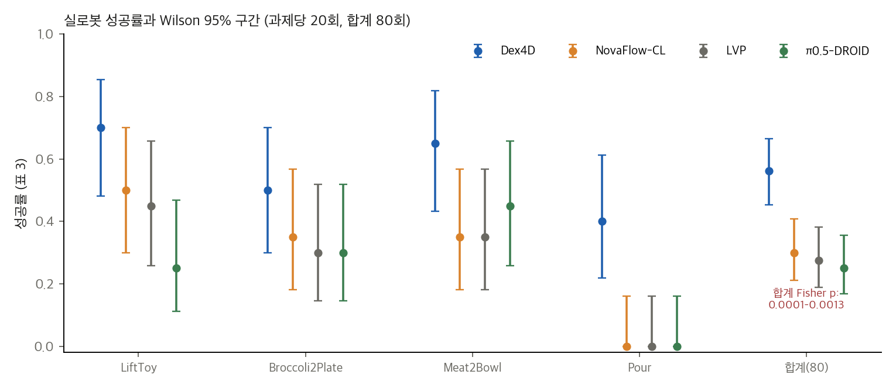
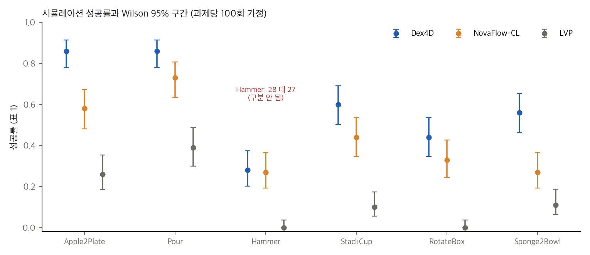
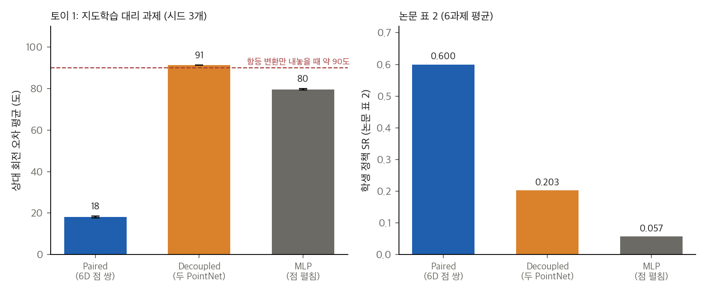
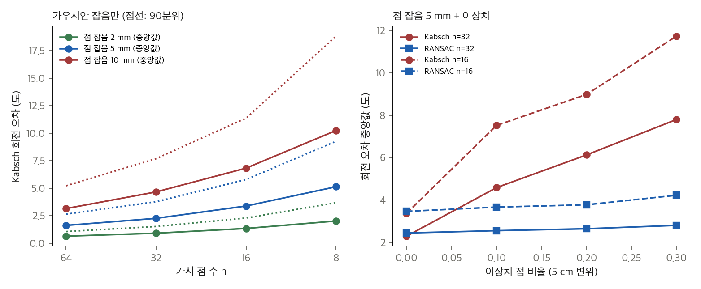

> **논문:** Yuxuan Kuang, Sungjae Park, Katerina Fragkiadaki, Shubham Tulsiani. *Dex4D: Task-Agnostic Point Track Policy for Zero-Shot Dexterous Manipulation.* CoRL 2026 포스터, arXiv:2602.15828 (v2, 2026-10-13).
> 공식 코드(Apache-2.0, Dex4D-Simulation 등)는 정적으로만 읽었고 실행하지 않았습니다. 논문 그림은 싣지 않고, 우리가 만든 그래프만 씁니다.

## 논문이 묻는 것

다지 손 정책을 과제마다 환경과 보상을 새로 만들어 학습하지 않고, 하나의 제어 정책으로 여러 과제를 하게 할 수 있을까요? Dex4D는 시뮬레이션에서 "물체를 임의의 자세에서 임의의 자세로 옮기는" 정책(AP2AP) 하나를 학습합니다. 목표는 현재 물체 점과 목표 물체 점을 대응별로 이어 붙인 점 쌍(Paired Point Encoding)으로 줍니다. 배포 때는 생성 영상에서 물체 점 궤적을 뽑아 그 목표를 순서대로 넣고, 온라인 점 추적으로 폐루프 제어를 합니다.

## 이 글에서 확인한 것

**실로봇 합계는 뚜렷하고, 과제별로는 Pour만 구분됩니다.** 4과제, 과제당 20회에서 Dex4D는 45/80, 최고 기준선(NovaFlow-CL)은 24/80입니다. Fisher p는 0.0013이고 "87.5% 상대 향상"의 95% 구간은 약 27%–176%입니다(로그 비율 근사). 과제별 12개 비교 중 Holm 보정 후 구분되는 것은 Pour 세 개(8/20 대 0/20)입니다. 나머지는 과제당 20회로는 구분되지 않는데, 부록도 구간이 넓다고 적고 있습니다.

그래프: 실로봇 성공률과 Wilson 95% 구간(과제당 20회, 합계 80회). 합계에서는 구간이 겹치지 않고, 과제별로는 Pour를 제외하면 겹칩니다. 우리가 그린 그래프입니다.

**"향상"의 정의가 서술마다 다릅니다.** 시뮬레이션의 "+16.3% SR"은 0.600 − 0.437의 %p이고 상대 이득으로는 +37.3%입니다. 실로봇의 "87.5%"는 45/24 − 1입니다. v1의 "22.5%"는 19/40 − 10/40의 %p였습니다. 같은 단어가 판마다, 절마다 다른 양을 가리키므로 표 값으로 비교하는 편이 안전합니다.

**시뮬레이션 표 1의 평균은 모두 맞고, 우위는 과제별로 다릅니다.** 평균 8개가 재계산과 일치하고 TP ≥ SR이 24칸 모두 성립합니다. 과제당 100회와 독립 시도를 가정하면(시행 수 n 가정) Hammer는 28 대 27로 구분되지 않고, NovaFlow-CL 대비 Holm 후 구분되는 과제는 Apple2Plate와 Sponge2Bowl입니다. 세 기준선의 잡기 단계가 모두 Dex4D 정책이므로 이 표는 "잡은 뒤 옮기는 제어"의 비교로 읽는 것이 정확합니다.

그래프: 시뮬레이션 성공률과 Wilson 95% 구간(과제당 100회 가정). 우리가 그린 그래프입니다.

**절제에서 Paired Point Encoding의 효과는 크고, dynamics modeling의 효과는 이 표본 크기로는 구분되지 않습니다.** 표 2에서 MLP와 Decoupled 변형은 Dex4D보다 각각 54, 40 %p 낮고 self-attention 제거는 11 %p 낮습니다. dynamics modeling 제거는 3.0 %p 차이로, 합산 600회 가정에서 p = 0.32입니다. 학생 학습 시드 수는 논문에 없습니다.

## 점 인코딩이 정말 정보를 보존하는가: 작은 토이

RL 없이 "입력만 보고 현재 → 목표의 상대 회전을 맞히는" 지도학습으로 세 인코더를 비교했습니다(점 32개, 매 표본 새 형상, 학습 1,500스텝, 시드 3개, 가정은 스크립트에 있습니다). Paired는 평균 회전 오차 18도, MLP는 80도, Decoupled는 91도(항등 변환을 내놓을 때의 평균은 약 90도)입니다. 두 점군을 따로 요약하면 형상이 바뀔 때 상대 회전을 복원하기 어렵다는 논문의 논리와 방향이 같습니다. 다만 이것은 RL 성능의 대리값이 아니고, MLP의 실패는 정보 유실보다 짧은 학습에서의 최적화 문제일 수 있습니다.

그래프: 왼쪽은 토이의 상대 회전 오차(시드 3개), 오른쪽은 논문 표 2의 학생 SR. 토이가 표 2를 재현하는 것은 아닙니다. 우리가 그린 그래프입니다.

## 기준선 설명 점검: Kabsch 토이

논문은 NovaFlow-CL이 "가시 점이 적고 잡음이 많으면 Kabsch가 회전을 풀지 못한다"고 설명합니다. 대응이 알려진 점쌍에서 가우시안 잡음만 주면 가시 점 8개에서도 회전 오차 중앙값이 몇 도(잡음 5 mm에서 5도)입니다. 일부 점이 추적 이상치(30%)가 되면 Kabsch는 8–12도로 나빠지고 간단한 RANSAC은 3–4도입니다. 기준선의 입력 분포가 논문에 없어서 실제 실패 원인을 이 토이로 확정할 수는 없고, 이상치, 모션 플래닝 해의 제한, 잡은 뒤 미끄러짐이 섞였을 가능성을 남겨 둡니다.

그래프: 왼쪽은 가우시안 잡음과 가시 점 수에 따른 Kabsch 회전 오차, 오른쪽은 이상치 비율에 따른 Kabsch와 RANSAC 비교. 우리가 그린 그래프입니다.

## 공식 코드와 논문 부록의 차이

공식 저장소(시뮬레이션 커밋 0dfccd8)와 부록을 대조했습니다.

- 표 7의 Discount Factor 0.95, GAE 0.96은 코드에서 gamma(할인) 0.96, lam(GAE) 0.95로, 값은 같고 배정이 반대입니다.
- 부록 J의 유지 성공 0.5 s는 코드에서 30 제어 스텝이며, 30 Hz 단계에서 1 s, 5 Hz 단계에서 6 s입니다.
- 표 4의 스텝 크기는 코드에서 적응 KL 스케줄의 시작값입니다.
- 학생의 가림 마스크는 물체 중심 대신 임의 키포인트를 지나는 평면을 쓰고, 가려진 점을 제거하지 않고 (0, 0, 0)으로 채웁니다.
- "3,200개 물체"는 (메시, 스케일) 항목 수이고 서로 다른 메시는 2,145개입니다.

공개 범위는 시뮬레이션 환경, 교사 PPO, 학생 DAgger, 체크포인트, 영상 도구입니다. 폐루프 배포(목표 갱신 문턱 포함), 시뮬 평가 6과제, 기준선, 실로봇 코드는 공개되지 않았고 하드웨어 저장소는 "Coming Soon"입니다. 코드 저장소의 마지막 커밋은 논문 v1 직후(2026-02-23)입니다.

## 구현 가능성

논문 수치의 재현은 Apple M4 Pro(24 GiB, CUDA 없음) 맥에서 불가능합니다. 학습은 Isaac Gym Preview와 NVIDIA GPU를 전제로 하고(교사 2–3일, 학생 약 20시간 보고), 실로봇과 기준선 코드는 없습니다. 영상 → 점 궤적 부분은 가중치 다운로드와 MPS 포팅 후 오프라인으로 가능하고, 점 쌍 인코더와 증류 손실의 합성 검증은 CPU로 됩니다.

## 한계와 맺음

이 글의 시뮬레이션·실로봇 검정은 논문의 시행 수(과제당 100회, 20회)를 따랐고 쌍체 정보가 없어 독립 검정을 썼습니다. 그림 4, 5의 값은 그림 판독 값입니다. 토이는 우리가 만든 모형입니다. 표 7의 라벨, 유지 성공 시간, 가림 점의 처리, 학생 학습 시드 수는 저자 확인이 필요합니다.

## 자료

- [통합 리포트 PDF](report/report_public.pdf)
- [01. 논문 분석: Dex4D (arXiv:2602.15828 v2)](analysis/01_paper_analysis.md)
- [02. 선행연구와 관련 자료: Dex4D](analysis/02_prior_work.md)
- [03. 수치 재계산과 토이 검증: Dex4D (arXiv:2602.15828 v2)](analysis/03_analysis.md)
- [04. 논문 ↔ 공식 코드 대조: Dex4D (정적 읽기만)](analysis/04_code_verification.md)
