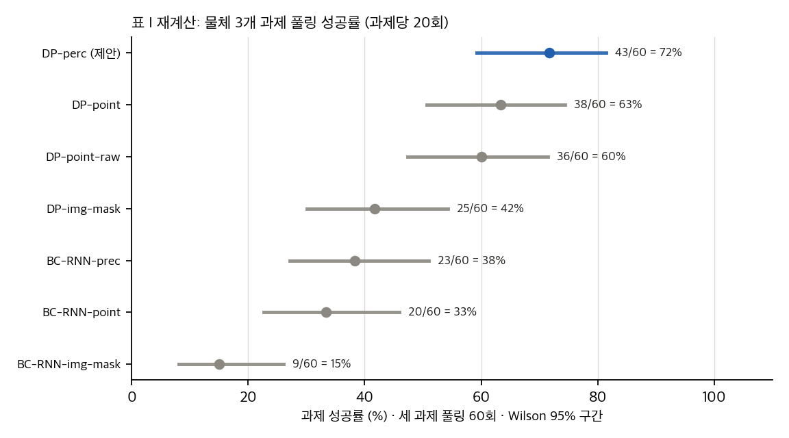
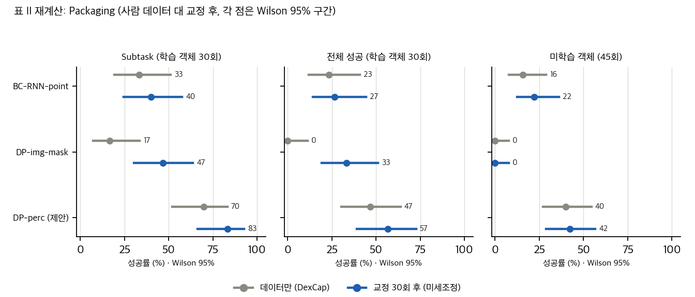

> **논문:** Chen Wang, Haochen Shi, Weizhuo Wang, Ruohan Zhang, Li Fei-Fei, C. Karen Liu. *DexCap: Scalable and Portable Mocap Data Collection System for Dexterous Manipulation.* RSS 2024, arXiv:2403.07788 (v2, 2024-07-04).
> 공식 코드는 GitHub j96w/DexCap(MIT)에 있습니다. 이 글의 그래프는 논문 수치를 다시 그린 것이며, 논문 그림은 쓰지 않았습니다.

## 논문이 묻는 것

다지 손 정책을 배우려면 손 움직임 데이터가 많이 필요합니다. 원격조작은 로봇이 있어야 하고 느립니다. 손을 보는 카메라 한 대는 손가락이 가려지면 실패합니다. DexCap은 **로봇 없이** 사람 손을 기록하는 휴대형 장비입니다. 장갑으로 손가락을, SLAM 카메라로 손목 6-DoF를, 가슴 RGB-D로 장면을 함께 기록합니다. 저자들은 이 데이터를 로봇 손 (LEAP, 16관절) 동작으로 옮기고 점군 확산 정책을 학습하는 방법 DexIL을 함께 냈습니다.

핵심 설계는 세 가지입니다.

- 손끝 IK로 인간 손끝을 로봇 손끝에 맞춥니다. 손 크기 차이는 로봇 손이 약 50% 큽니다.
- 점군을 세계 좌표로 옮겨 가슴의 움직임을 없앱니다. 이동하는 카메라에서 이미지 정책이 실패하는 문제를 피합니다.
- 사람이 발판 페달로 정책 실행을 고치고, 그 교정 궤적으로 다시 학습합니다.

## 표 수치를 다시 계산했습니다

표 I은 세 과제 (스펀지, 공, 접시)에서 과제당 20회 시험한 결과입니다. 모든 칸이 정수 개수로 맞고, 제안 모델의 세 과제 평균 72%도 산술적으로 맞습니다. 그러나 가장 가까운 대안인 DP-point (점군, PointNet)와의 차이는 60회 풀링에서 43/60 대 38/60이고, Fisher 검정 p = 0.44입니다.

*그림 1 (우리가 그린 것). 표 I의 세 과제 풀링 성공률과 Wilson 95% 구간. 과제당 20회, 60회 풀링.*

확실하게 읽을 수 있는 비교는 두 가지입니다.

- **점군 입력이 마스크 이미지보다 낫다:** 38/60 대 25/60, p = 0.03.
- **확산 정책이 MLP (BC-RNN)보다 낫다:** p = 0.002.

이 실험 규모에서는 20%p보다 작은 차이를 판별할 수 없습니다. 기준 50%에서 20%p 차이를 80% 검정력으로 보려면 집단당 약 93회가 필요합니다.

## 포장 과제와 사람 교정

표 II는 포장 과제입니다. 사람이 장비를 들고 다른 장소에서 찍은 데이터만으로 학습합니다. 학습 객체 30회에서 제안 모델은 14/30 (47%), 미학습 객체 45회에서 18/45 (40%)입니다. 미학습 객체의 대조군 BC-RNN-point (7/45)와의 차이는 p = 0.018입니다.

*그림 2 (우리가 그린 것). 표 II의 포장 과제 성공률. 데이터만과 교정 30회 후, Wilson 95% 구간.*

교정의 효과는 두 가지로 나뉩니다.

- **이미지 기반 정책 (DP-img-mask):** 교정 30회 후 0/30에서 10/30 (33%p, p < 0.001). 교정이 강한 효과를 냅니다.
- **제안 모델:** 14/30에서 17/30 (10%p, p = 0.61). 통계적으로 확인되지 않습니다.

이미지 정책의 큰 향상은 원인이 섞여 있습니다. 교정 데이터는 추가 데이터이면서 평가와 같은 고정 카메라에서 얻어졌습니다. 저자들도 두 요인을 나누지 않았습니다.

가위와 차 준비에서는 교정 뒤 성공이 올라갑니다 (가위 자르기 Subtask 0/20 → 9/20, p = 0.001). 다만 시행이 20회라 방향만 읽을 수 있습니다.

## 공식 코드와 논문이 다른 점

공식 저장소 (MIT)에는 데이터 수집, 처리, 학습 코드가 있습니다. 하지만 다음 부분은 논문과 다릅니다.

- **점군 인코더:** 논문의 기본 모델은 Perceiver인데, 공식 코드는 PointNet으로 고정되어 있습니다.
- **점 수와 행동 간격:** 논문은 5000과 1000을 쓰고, 코드는 10000을 저장합니다. 코드는 행동 간격 5로 데이터를 다섯 부분열로 나눕니다. 논문에는 없습니다.
- **교정, 로봇 실행, 하드웨어:** 페달, 잔차 계수, 두 손 제어기, 장비 설계는 공개되지 않았습니다.
- **데이터:** 공개된 것은 포장과 접시 닦기 두 과제 (약 108 GB)뿐입니다.

논문 안에서도 설명이 맞지 않는 곳이 있습니다. 캘리브레이션 시간은 본문 10초, 부록 15초입니다. v1에서 v2로 바뀌면서 포장과 가위의 데모 수가 서로 바뀌었습니다.

## 이 맥에서 재현할 수 있나

**전체 재현은 할 수 없습니다.** 장비 (장갑, 카메라 세 대, 라이더)와 두 팔 로봇이 필요하고, 교정 코드가 없습니다. 데이터 처리 일부는 CPU에서 할 수 있지만 공개 데이터가 두 과제뿐입니다. 학습 재현은 GPU가 필요해서 이 글에서는 하지 않았습니다.

## 정리

DexCap은 사람 손 데이터를 로봇 학습에 쓸 수 있다는 것을 보인 논문입니다. 표 수치는 맞고, 이미지 대 점군과 확산 대 MLP는 확실합니다. 반면 제안 모델의 우위와 인코더 선택, 교정 효과의 원인은 이 실험 규모로는 확정되지 않습니다. 공식 코드를 쓰려면 기본 인코더와 교정 부분을 직접 채워야 합니다.

## 자료

- [통합 리포트 PDF](report/report_public.pdf)
- [01. 논문 분석: DexCap (arXiv:2403.07788)](analysis/01_paper_analysis.md)
- [02. 선행연구와 관련 저장소](analysis/02_prior_work.md)
- [03. 수치 재계산, 일관성 검사, 주장 판정](analysis/03_analysis.md)
- [04. 공식 코드 대조와 구현 가능성](analysis/04_code_verification.md)
