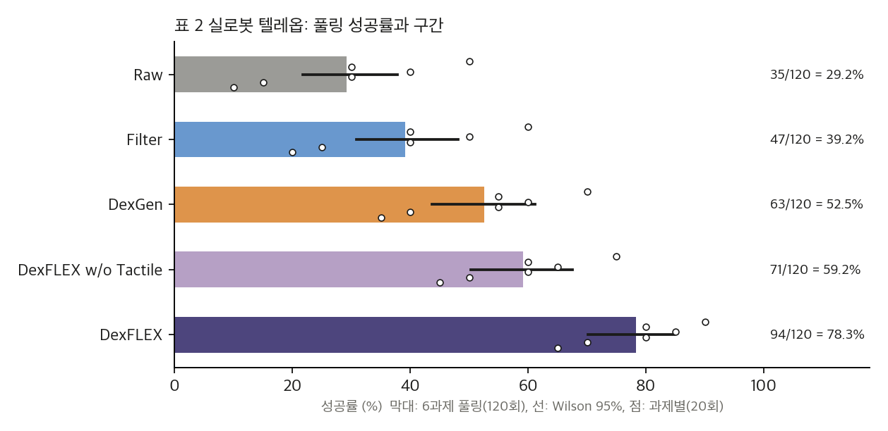
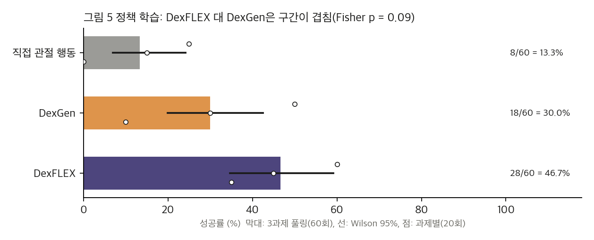
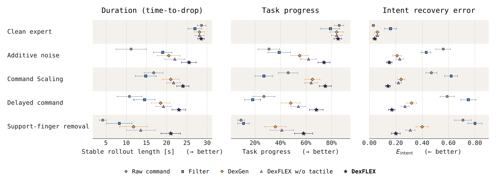
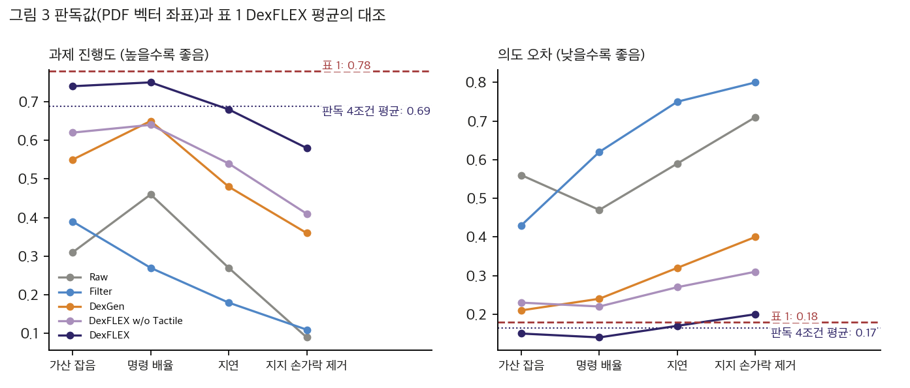
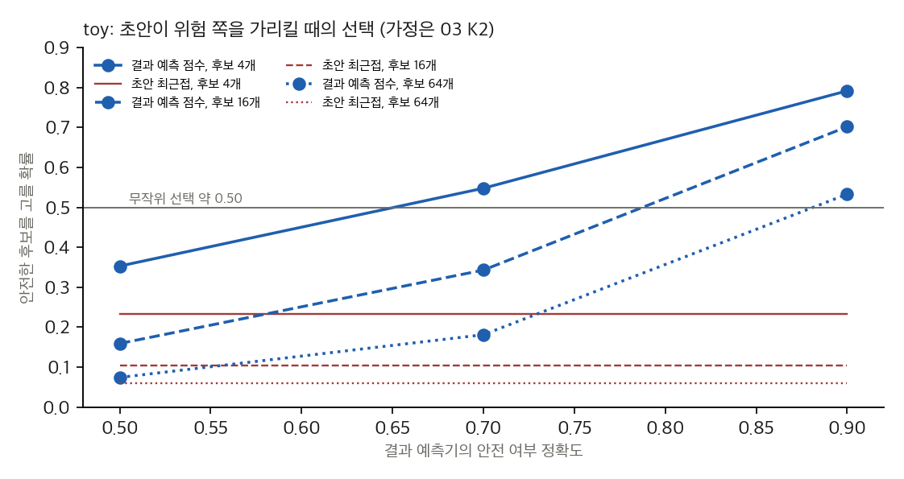

# 03. 수치 재계산과 해석: DexFLEX (arXiv:2610.14372)

모든 계산은 `analysis/recompute.py`(numpy, scipy, 약 10초)와 `analysis/fig3_readout.py`(PDF 벡터에서 그림 3 값을 읽음)로 다시 할 수 있고, 결과는 `analysis/recompute_results.json`, `analysis/fig3_readout.json`에 있습니다. 코드와 데이터가 공개되지 않았으므로(`02` §4) **논문이 보고한 숫자만** 입력으로 씁니다. 시행 수는 논문 서술(과제·방법당 20회, 정책 학습 과제당 20롤아웃)을 그대로 받아들인 가정입니다. 시행이 독립이라는 가정도 깔려 있고, 같은 조작자가 반복하므로 실제로는 성립하지 않을 수 있습니다(§1.5).

번호 규칙: **V** = 보고 수치의 재계산·정합성 검사, **K** = 우리가 만든 계산·toy, 주장 판정은 `04`의 **C**입니다.

## 0. 요약

| 항목 | 결과 |
|---|---|
| 표 2 평균 SR 5개, 본문의 25.8·19.1 %p, 2배 문장 | 모두 재계산과 일치(V1, V4). 19.1은 반올림값끼리의 차이이고 정확값은 19.17 |
| 정수 가능성 | 표 2 모든 셀은 20회 시행의 5 %p 배수, 평균은 5/6 %p 격자에 놓임(V2). 그림 5도 정수 성공 수로 가능(V8) |
| 실로봇 DexFLEX 대 Raw·Filter·DexGen | 풀링 120회에서 모두 유의(p = 1.7e-14, 9.3e-10, 4.1e-5). **과제별로는 대 DexGen에서 6개 중 0개**(Holm 후 p = 0.67), 대 Filter 0개(Holm 후) (V5, V6) |
| 촉각 효과(DexFLEX 대 w/o Tactile) | 풀링 +19.2 %p(95% 구간 7.7–30.6, p = 0.002). 과제별 유의 0개 (V5, V6) |
| "consequence-aware selection이 DexGen보다 낫다"(w/o Tactile 59.2 대 52.5) | **구분되지 않음**: +6.7 %p, 구간 −5.9–19.2, p = 0.36 (V5) |
| 정책 학습 3.5배, 1.56배 | 비율은 재계산과 일치(28/8, 28/18). 대 직접 관절은 확실(p = 1.2e-4), **대 DexGen은 p = 0.09, 비율 95% 구간 1.0–2.5** (V8) |
| 표 1 대 그림 3 | **어긋남**: DexFLEX 진행도 표 1의 0.78은 그림 3 판독 네 값(0.58–0.75)의 평균(0.69)일 수 없음. w/o tactile의 의도 오차도 표 1 0.36 대 그림 3 0.26 (V9) |
| CT 비교 | 성공 시행만의 평균이고 성공 수가 35–94회로 달라 선택 편향. 분산 없음 (V7) |
| 검정력 | 과제당 20회로 DexFLEX 대 DexGen을 가르는 검정력은 약 30%, 정책 학습 합산 대 DexGen의 80% 검정력에는 군당 약 155회 필요 (V10) |

## 1. 표 2 실로봇 텔레옵 (§4.3)

### 1.1 평균과 정수 가능성 (V1, V2)

| 방법 | 과제 평균 재계산 | 보고 | 일치 |
|---|---|---|---|
| Raw | 29.17 | 29.2 | O |
| Filter | 39.17 | 39.2 | O |
| DexGen | 52.50 | 52.5 | O |
| DexFLEX w/o Tactile | 59.17 | 59.2 | O |
| DexFLEX | 78.33 | 78.3 | O |

표 캡션 "Averages are computed over task-level means"와 맞고, 과제별 20회라 모든 셀이 5의 배수입니다. 불가능한 값은 없습니다.

### 1.2 본문 문장 검사 (V4)

| 본문 | 재계산 | 판정 |
|---|---|---|
| "25.8 percentage points over DexGen"(§1, §4.3) | 78.33 − 52.50 = 25.83 | 맞음 |
| "gains another 19.1 points by using tactile state" | 78.3 − 59.2 = 19.1(반올림값), 정확값 19.17 | 맞음(0.07 차이) |
| "more than doubles raw SR (29.2 to 78.3)" | 비 2.69 | 맞음 |
| "roughly doubles NHT (0.42 to 0.85)" | 비 2.02 | 맞음 |
| "DexFLEX w/o Tactile improves over DexGen (52.5 to 59.2)" | +6.67 %p, 풀링 p = 0.36 | **수치는 맞으나 통계적으로 구분 안 됨**(V5) |
| 초록 "3.5×", "1.56×" | 28/8 = 3.50, 28/18 = 1.556 | 맞음 |

### 1.3 풀링 성공률과 Wilson 95% 구간 (V3)

과제 6개 × 20회 = 방법당 120회로 합칩니다(시행 독립 가정).

| 방법 | 성공 / 120 | 성공률 | Wilson 95% |
|---|---|---|---|
| Raw | 35 | 29.2% | 21.8–37.8 |
| Filter | 47 | 39.2% | 30.9–48.1 |
| DexGen | 63 | 52.5% | 43.6–61.2 |
| DexFLEX w/o Tactile | 71 | 59.2% | 50.2–67.5 |
| DexFLEX | 94 | 78.3% | 70.2–84.8 |

그래프: 우리가 그린 것. 표 2 풀링 성공률과 Wilson 구간, 점은 과제별 값.

### 1.4 쌍별 검정 (V5, V6)

풀링(120 대 120) Fisher 정확 검정과 성공률 차의 95% 구간(정규 근사):

| 비교 | 차이 (%p) | 95% 구간 | Fisher p |
|---|---|---|---|
| DexFLEX − Raw | +49.2 | 38.2–60.1 | 1.7e-14 |
| DexFLEX − Filter | +39.2 | 27.7–50.6 | 9.3e-10 |
| **DexFLEX − DexGen** | **+25.8** | 14.3–37.4 | 4.1e-5 |
| DexFLEX − w/o Tactile | +19.2 | 7.7–30.6 | 0.0021 |
| w/o Tactile − DexGen | +6.7 | −5.9–19.2 | 0.36 |
| DexGen − Filter | +13.3 | 0.8–25.8 | 0.052 |
| DexGen − Raw | +23.3 | 11.3–35.4 | 3.7e-4 |

**과제별 Fisher(n = 20 대 20)와 Holm 보정(6개 과제 내):**

| 비교 | 과제별 p (Brush, Nut, Hammer, Screwdrv, Spatula, Toast) | p < 0.05 개수 (원 p / Holm) | 과제 층별 Mantel–Haenszel (p) | 6개 과제 모두 우세 |
|---|---|---|---|---|
| DexFLEX 대 Raw | 0.014, 0.004, 0.008, 0.004, 0.001, 0.001 | 6 / 6 | 1e-14 | 6/6 |
| DexFLEX 대 Filter | 0.065, 0.023, 0.041, 0.023, 0.010, 0.010 | 5 / 0 | 4e-10 | 6/6 |
| **DexFLEX 대 DexGen** | 0.24, 0.18, 0.16, 0.18, 0.11, 0.11 | **0 / 0** | 2e-5 | 6/6 |
| DexFLEX 대 w/o Tactile | 0.41, 0.30, 0.27, 0.30, 0.33, 0.34 | 0 / 0 | 0.0013 | 6/6 |
| w/o Tactile 대 DexGen | 1.0, 1.0, 1.0, 1.0, 0.75, 0.75 | 0 / 0 | 0.29 | 6/6 |

해석:

- **효과의 방향은 확실합니다.** DexFLEX가 모든 기준선보다 6개 과제 모두에서 높습니다(부호 검정 양측 p = 0.031은 6과제에서 얻을 수 있는 최솟값). 과제를 층으로 묶은 MH 검정에서도 DexGen 대비 p = 2e-5입니다.
- **과제 하나하나의 결론은 못 냅니다.** 20회 시행의 20–30 %p 차이는 과제별로 구분되지 않습니다. 논문이 과제별 우위를 말하지는 않지만("gains are largest on SPATULA SERVE and FLIP TOAST"), 그 문장은 기준선 대비 +55 %p(Raw), +30 %p(DexGen) 크기 비교이고 통계 근거가 없습니다.
- **w/o Tactile 대 DexGen은 두 검정이 갈립니다.** 부호 검정은 6/6 우세(p = 0.031)지만 시행 수를 반영한 MH는 p = 0.29입니다. 과제별 차이가 5–10 %p로 작아서입니다. "consequence-aware selection이 prior-only보다 낫다"는 본문 문장은 시행 수를 반영하면 지지되지 않습니다.

### 1.5 독립성 가정과 설계의 빈칸

- 시행은 두 조작자가 나눠 했고(§4.1), 조작자별 결과·순서·무작위화·맹검은 없습니다. 같은 조작자의 시행 사이에는 학습 효과와 피로가 있습니다. 조작자 효과가 크면 120회 풀링의 구간은 너무 좁습니다. 조작자별 숫자가 있어야 군집을 반영한 구간을 낼 수 있습니다.
- 30분 적응이 "인터페이스마다"라고 했습니다(§4.1). Raw·Filter·DexGen·DexFLEX 사이에 적응 시간과 시행 순서가 어떻게 배분됐는지 알 수 없습니다.
- 기준선 Filter와 DexGen의 튜닝(차단 주파수, 클리핑 값, DexGen형 재구현)은 부록(없음)입니다.

### 1.6 CT와 NHT (V7)

| 방법 | 성공 수 (n = 120) | CT (s) | NHT |
|---|---|---|---|
| Raw | 35 | 27.5 | 0.42 |
| Filter | 47 | 33.8 | 0.55 |
| DexGen | 63 | 31.2 | 0.65 |
| w/o Tactile | 71 | 30.8 | 0.71 |
| DexFLEX | 94 | 32.0 | 0.85 |

- **CT는 성공 시행만의 평균**입니다(표 2 캡션). Raw는 쉬운 시행 35회, DexFLEX는 94회 중에서 평균을 내므로 모집단이 다릅니다. 분산이 없어 CT 차이(27.5–33.8 s)의 유의성은 계산할 수 없습니다. 본문이 "평균 CT 32.0 s가 방법 간 범위 27.5–33.8 s 안에 있다"며 "감속으로 설명되지 않는다"고 한 것은 범위가 DexFLEX 자신을 포함하므로 **순환적**입니다. 그림 4의 개입 크기가 더 직접적인 증거이지만 대표 롤아웃 몇 개의 정성적 그림입니다.
- **NHT는 SR과 거의 같은 정보를 담습니다.** 5개 방법에서 SR(성공 수)과 NHT의 상관은 0.994입니다. 실패 시행도 일부 유지 시간을 기여해 NHT − SR은 0.07–0.16입니다. 따라서 "NHT가 2배"는 독립된 두 번째 증거로 읽기 어렵습니다.

## 2. 그림 5 정책 학습 (§4.4) (V8)

막대 위 라벨 9개를 그림에서 직접 읽어 정수 성공 수로 썼습니다(위 `01` §4.3).

| 비교 | 합산 | 풀링 Fisher p | 과제별 p (Holm) | 과제 층별 MH p |
|---|---|---|---|---|
| DexFLEX 대 직접 관절 | 28/60 대 8/60 | 1.2e-4 | 0.054, 0.082, 0.008 (0.107, 0.107, 0.025) | 5.5e-5 |
| **DexFLEX 대 DexGen** | 28/60 대 18/60 | **0.091** | 0.75, 0.51, 0.13 (1.0, 1.0, 0.38) | 0.054 |
| DexGen 대 직접 관절 | 18/60 대 8/60 | 0.045 | 0.19, 0.45, 0.49 | 0.021 |

- Wilson 95%: 직접 13.3% (6.9–24.2), DexGen 30.0% (19.9–42.5), DexFLEX 46.7% (34.6–59.1). DexGen과 DexFLEX 구간이 겹칩니다.
- **비율의 95% 구간**(과제 내 베르누이 재표집 2만 회): DexFLEX/직접 = 3.5 (1.9–8.5), **DexFLEX/DexGen = 1.56 (1.0–2.5)**.
- "DexFLEX가 세 과제 모두에서 가장 높다"(§4.4)는 맞습니다(12>10>5, 9>6>3, 7>2>0). 과제 단위 방향은 일관되지만, DexGen 대비 과제별 격차(2, 3, 5회)는 모두 유의하지 않고 Assemble Table(7 대 2)만 가장 큽니다.
- 단일 학습 실행인지 여러 시드인지 알 수 없습니다. 시드 변동이 있으면 구간은 더 넓어집니다.

그래프: 우리가 그린 것. 정책 학습 성공률과 Wilson 구간.

## 3. 표 1 대 그림 3 일관성 (V9)

그림 3은 벡터 그래프라서 PDF의 점과 오차 막대 좌표를 읽어 눈금으로 환산했습니다(`fig3_readout.py`). 읽기 오차는 눈금 간격의 1% 안쪽이어야 하지만, 정의상 0이어야 하는 Raw·청정 전문가의 의도 오차가 0.03으로 읽혀 **±0.03 정도의 여유**를 둡니다. 그림 3의 오차 막대는 SD·SE·CI 어느 것인지 캡션에 없습니다.

그림 3 (원 논문). © 저자(Wan 외), CC BY 4.0, 출처 arXiv:2610.14372. 시뮬레이션 열화 명령 복구.

**DexFLEX 판독값(네 열화 조건, 청정 전문가 제외):**

| 지표 | 가산 잡음 | 명령 배율 | 지연 | 지지 손가락 제거 | 4조건 평균 | 5행 평균 | 표 1 |
|---|---|---|---|---|---|---|---|
| 지속 시간 (s) | 25.5 | 24.0 | 23.0 | 21.0 | 23.4 | 24.4 | 0.86 (정규화) |
| 진행도 | 0.74 | 0.75 | 0.68 | 0.58 | **0.69** | 0.72 | **0.78** |
| 의도 오차 | 0.15 | 0.14 | 0.17 | 0.20 | 0.165 | 0.14 | 0.18 |

- **진행도:** 표 1의 0.78은 네 값 중 어느 것보다도 큽니다(최대 0.75). 평균은 최댓값을 넘을 수 없으므로 **읽기 오차 ±0.03을 줘도 0.78이 네 조건 평균일 수 없습니다.** 청정 전문가를 넣은 5행 평균도 0.72입니다. 표 1이 다른 평가 실행(시드, 열화 강도)의 평균이거나 그림 3과 표 1의 정의가 다른 것으로 보입니다. 부록(없음)에 설명이 있을 수 있습니다.
- **지속 시간:** 표 1이 정규화인데 정규화 기준이 없습니다. 청정 전문가 지속 시간 28.5 s로 나누면 5행 평균이 0.856으로 표 1의 0.86에 맞지만(우연일 수 있음), 같은 정규화를 w/o tactile에 쓰면 0.744로 표 1의 0.62와 맞지 않습니다.
- **w/o tactile 변형(표 1 "w/o tactile/contact"와 그림 3 "DexFLEX w/o tactile"이 같은 모델이라면):** 진행도는 0.55 대 0.552로 맞지만, **의도 오차는 표 1 0.36 대 그림 3 4조건 평균 0.26**, 지속 시간 비(w/o tactile ÷ full)는 표 1 0.72 대 그림 3 0.82로 어긋납니다. 의도 오차 비는 표 1 2.0 대 그림 3 1.56입니다.
- 그림 3 오차 막대 기준으로 DexFLEX와 DexGen이 겹치는 칸은 12칸 중 2칸(명령 배율의 지속 시간과 진행도)뿐입니다. 즉 시뮬레이션에서는 DexFLEX 우위가 대체로 분명해 보입니다(오차 막대의 정의가 없어 참고용).
- DexFLEX와 w/o tactile의 오차 막대는 지속 시간 두 칸(가산 잡음, 명령 배율)을 빼면 모두 갈라집니다. 지지 손가락 제거에서 진행도는 0.51 대 0.50 경계에서 겨우 갈립니다.

그래프: 우리가 그린 것. 그림 3의 판독값과 표 1의 DexFLEX 값(점선).

**표 1 자체에 대한 점검:**

- 표 1은 네 조건 평균이라 본문의 "tactile 제거와 결과 예측 제거는 특히 접촉 결정적 열화에서 성능을 떨어뜨린다"(§4.2 Component ablations)를 조건별로 확인할 수 없습니다. 조건별 절제 표는 없습니다.
- w/o tactile(0.62/0.55/0.36)과 w/o consequence pred.(0.64/0.57/0.34)는 거의 같습니다. 결과 예측 기여와 촉각 기여를 표 1로는 가를 수 없습니다.
- 오차 막대 또는 시드 정보가 표 1에 없습니다.

## 4. 검정력 (V10)

| 질문 | 검정력(시뮬레이션 4000회) |
|---|---|
| 과제당 20회, 진짜 성공률 0.78 대 0.53(DexFLEX 대 DexGen)을 Fisher로 구분 | 0.30 |
| 과제당 20회, 0.78 대 0.59(대 w/o Tactile) | 0.18 |
| 풀링 120회, 0.78 대 0.59 | 0.87 |
| 정책 학습 합산 60회, 0.47 대 0.30 | 0.41 |
| 정책 학습 과제당 20회, 0.60 대 0.50 | 0.05 |
| 합산에서 0.47 대 0.30을 80%로 구분하는 군당 롤아웃 수 | 약 155 |

논문이 가정한 효과 크기가 진짜라 해도, 과제당 20회 설계는 과제별 주장을 뒷받침하지 못합니다. 풀링 비교(실로봇)는 충분히 강하지만, 정책 학습의 DexFLEX 대 DexGen 비교는 60회로는 약합니다.

## 5. 우리가 만든 계산

### K1. 사건당 생존 확률로 환산 (K1)

접촉 결정적 사건 T개를 모두 넘겨야 성공이라고 가정하면 성공률 = (사건당 생존 확률)^T입니다. T는 논문에 없어 3, 5, 8, 12로 두었습니다.

| T | Raw | Filter | DexGen | w/o Tactile | DexFLEX |
|---|---|---|---|---|---|
| 3 | 0.66 | 0.73 | 0.81 | 0.84 | 0.92 |
| 5 | 0.78 | 0.83 | 0.88 | 0.90 | 0.95 |
| 8 | 0.86 | 0.89 | 0.92 | 0.94 | 0.97 |
| 12 | 0.90 | 0.93 | 0.95 | 0.96 | 0.98 |

T = 5이면 사건당 실패율이 Raw 22%에서 DexFLEX 4.8%로 줄어야 합니다(약 4.5배 감소). 이 환산은 모든 사건이 독립이고 같은 난이도라는 강한 가정이며, 방법별 실패 원인(접촉 상실 대 다른 원인)을 알 수 없어 인과적 해석은 못 합니다. 용도는 "78.3%를 만들려면 사건당 안정성이 얼마나 높아야 하는가"의 감을 주는 것입니다.

### K2. 후보 선택 toy: 결과 예측이 얼마나 정확해야 하는가 (K2)

방법의 핵심 주장(§3.2: 초안에 가깝지만 접촉을 깨는 후보 대신, 초안을 약간 수정해 지지를 보존하는 후보를 고른다)을 가장 단순한 형태로 점검합니다. **이것은 우리가 가정을 세운 toy이며 논문 수치의 재현이 아닙니다.**

- 접촉 결정적 순간 하나에서 후보 N개. 후보 i의 초안 근접도 d_i ~ U(0,1), 위험 확률 = 0.9(1 − d_i) + 0.05(초안에 가까울수록 위험, 지지 손가락 제거 상황).
- 결과 예측기는 후보의 안전 여부를 확률 acc로 맞힙니다. 점수 = (1 − d) + 1.0 × 예측 안전.
- 기준선: 초안 최근접 선택, 무작위 선택(약 0.50).

| 후보 수 | 예측기 정확도 | 초안 최근접 | 결과 인지 점수 | 무작위 |
|---|---|---|---|---|
| 4 | 0.5 | 0.23 | 0.35 | 0.50 |
| 4 | 0.7 | 0.23 | 0.55 | 0.50 |
| 4 | 0.9 | 0.23 | 0.79 | 0.50 |
| 16 | 0.7 | 0.10 | 0.34 | 0.50 |
| 16 | 0.9 | 0.10 | 0.70 | 0.50 |
| 64 | 0.9 | 0.07 | 0.53 | 0.50 |

그래프: 우리가 그린 것. 안전한 후보를 고를 확률.

읽을 점 세 가지입니다.

1. **초안이 위험 쪽을 가리키면 "초안 최근접"은 후보가 많을수록 나빠집니다**(0.23 → 0.07). 표 1의 "w/o predictive score"가 가장 큰 하락(Dur 0.52)인 것과 방향이 같습니다.
2. **결과 인지 선택의 이득은 예측기 정확도에 크게 의존합니다.** 정확도 0.5(무작위 예측)에서는 무작위 선택(0.50)보다도 나쁘고(초안 항이 위험 쪽으로 끌기 때문), 후보가 64개로 늘면 정확도 0.9에서도 0.53으로 떨어집니다(점수의 안전 보너스가 초안 근접도 항과 경쟁).
3. 따라서 논문의 후보 수, 점수 가중, **세계모델 결과 예측의 안전 판정 정확도**가 성능을 정합니다. 논문에는 세계모델 예측 오차, 점수 순위 정확도 같은 중간 진단이 없고(부록 가능성), 이 진단이 방법의 인과 주장을 가장 직접 뒷받침할 지표입니다(`04` C1).

## 6. 이 문서가 확인하지 못한 것

- 시뮬레이션 평가의 시행·시드 수, 열화 크기, 정규화 기준(부록 없음).
- 표 1과 그림 3의 불일치가 평가 실행의 차이인지 오류인지.
- 실로봇의 조작자별 결과, 오차 막대의 정의, CT·NHT의 분산.
- 그림 4(개입 크기)와 그림 1의 영상 기반 주장. 영상을 열지 않았습니다.
