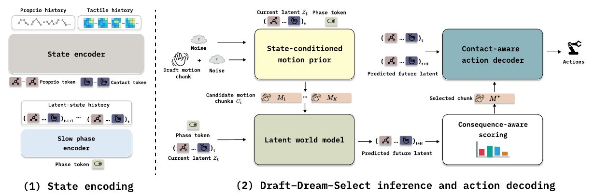
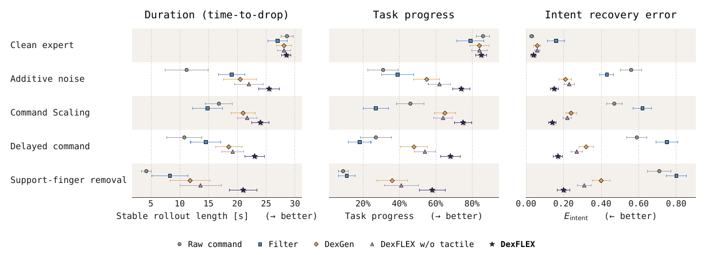
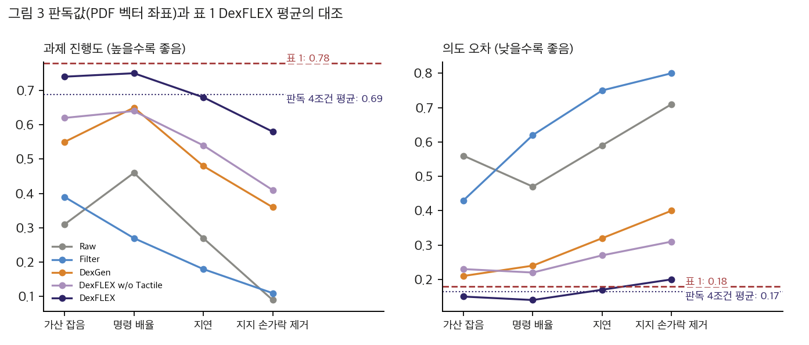
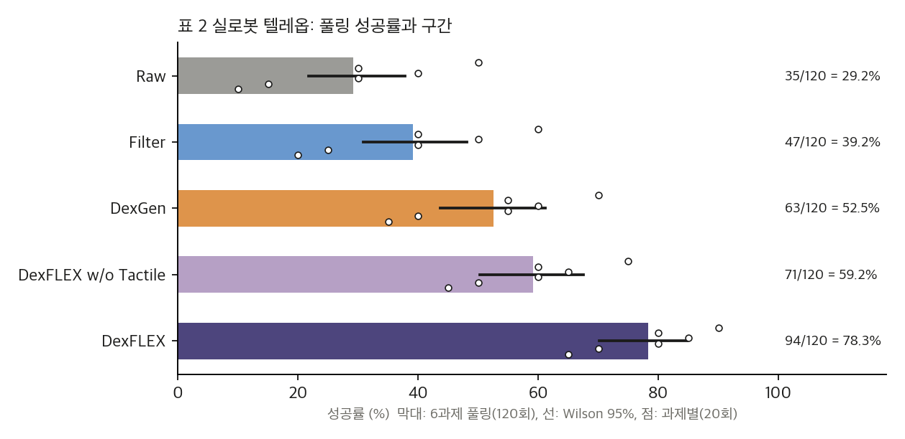
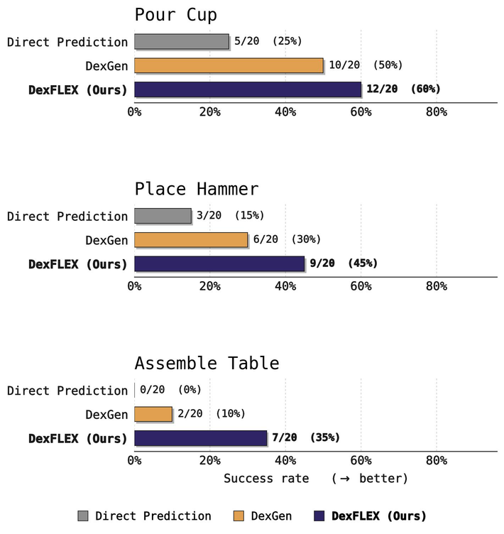
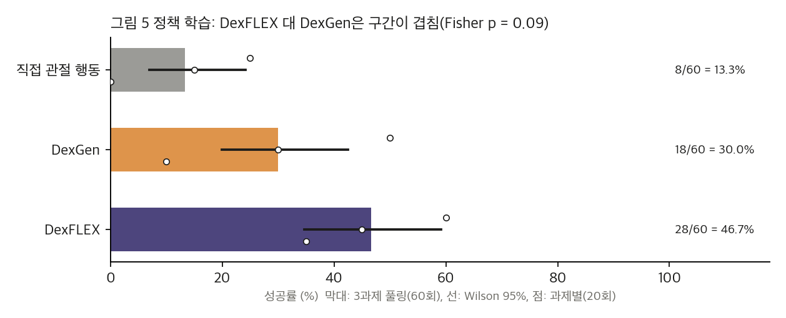
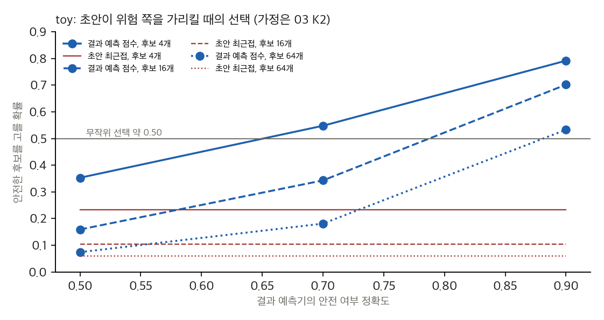

> **논문:** Weikang Wan, Zeyu Lai, Jianyu Hou, Yuchen Zhou, Jiawei Fu, Henrik I. Christensen, Hao Su. *DexFLEX: Contact-Aware Foundation Controller for Command-Guided Dexterity.* CoRL 2026 포스터, arXiv:2610.14372 (v1, 2026-10-09, 단일 버전).
> 공식 코드는 공개되지 않았고 프로젝트 페이지(dex-flex.github.io)만 있습니다. 논문은 arXiv에서 CC BY 4.0이라 그림 2, 3, 5(막대)를 출처와 함께 옮겼습니다.

## 논문이 묻는 것

텔레옵이나 상위 정책이 주는 손끝 움직임 초안은 "어느 접촉을 유지할지"를 말해 주지 않습니다. 초안을 그대로 실행하면 지지 손가락을 놓치거나 접촉을 일찍 끊을 수 있습니다. DexFLEX는 초안을 따라 할 궤적이 아니라 **의도의 증거**로 봅니다. 촉각·고유수용 상태에서 가능한 짧은 움직임 후보를 제안하고, 후보마다 접촉 결과를 예측하고, 초안에 맞으면서 미래 접촉이 안정한 후보를 고릅니다.

## 방법

*그림 1. DexFLEX 파이프라인(논문 그림 2). © 저자(Wan 외), CC BY 4.0, 출처 arXiv:2610.14372.*

- **제안.** 상태에만 조건화한 consistency-flow 프라이어가 후보를 냅니다. 순수 프라이어 후보(회복용)와, 초안에 노이즈를 섞어 같은 flow에서 시작한 후보(응답성용)를 합칩니다.
- **예측.** 잠재 세계모델이 후보 청크 실행 뒤의 접촉·고유수용 잠재를 예측합니다.
- **선택.** 초안 정렬과 예측 결과를 함께 보는 대조 순위 점수가 최고 후보를 고르고, 관절 목표로 해독해 앞부분만 실행합니다(식 1).

## 이 글에서 확인한 것

**1. 시뮬레이션 열화 복구는 방향이 분명하지만, 표 1과 그림 3이 어긋납니다.**

*그림 2. 열화 명령 복구(논문 그림 3). © 저자(Wan 외), CC BY 4.0, 출처 arXiv:2610.14372.*

그림 3은 벡터 그래프라서 PDF 좌표에서 점의 값을 읽었습니다. DexFLEX 진행도는 네 열화에서 0.74, 0.75, 0.68, 0.58로 읽히는데, 표 1의 네 조건 평균은 0.78입니다. 평균이 최댓값을 넘을 수 없으므로 두 값은 같은 실행에서 나온 것으로 보기 어렵습니다. w/o tactile의 의도 오차도 표 1은 0.36, 그림 3 평균은 0.26입니다.

*그림 3. 그림 3 판독값과 표 1의 DexFLEX 값(점선). 우리가 그린 그래프.*

**2. 실로봇 이득의 방향은 확실하지만 DexGen 대비는 과제별로 구분되지 않습니다.**

*그림 4. 표 2의 풀링 성공률(방법당 120회)과 Wilson 95% 구간, 점은 과제별 값. 우리가 그린 그래프.*

DexFLEX는 94/120(78.3%), DexGen은 63/120(52.5%)이고 차이 +25.8 %p의 95% 구간은 14.3–37.4, Fisher p = 4.1e-5입니다. 여섯 과제 모두에서 높습니다. 그러나 과제당 20회라서 과제별 Fisher는 DexGen 대비 6개 중 0개가 유의합니다. "결과 예측 선택이 prior-only보다 낫다"의 근거로 든 w/o Tactile 59.2 대 DexGen 52.5는 +6.7 %p(구간 −5.9–19.2, p = 0.36)로 구분되지 않습니다. 두 모델은 프라이어와 해독기, 데이터도 달라 선택만 격리한 비교도 아닙니다.

완료 시간(CT)은 성공 시행만의 평균이라 성공 수가 35–94회로 다른 방법끼리는 모집단이 다릅니다. "평균 CT가 방법 간 범위 안에 있다"는 논거는 범위가 자신을 포함해 순환적입니다. 정규화 유지 시간(NHT)은 방법 간 성공률과 상관이 0.994로 사실상 같은 정보입니다.

**3. 정책 학습: 직접 관절 대비 3.5배는 확실하고, DexGen 대비 1.56배는 미확정입니다.**

*그림 5. 정책 학습 성공률(논문 그림 5의 막대 부분, 시연 사진은 뺌). © 저자(Wan 외), CC BY 4.0, 출처 arXiv:2610.14372.*

막대 라벨에서 8/60, 18/60, 28/60을 읽어 3.5배와 1.56배가 맞음을 확인했습니다.

*그림 6. 정책 학습 풀링 성공률과 Wilson 구간. 우리가 그린 그래프.*

DexFLEX 대 직접 관절은 p = 1.2e-4이지만, 대 DexGen은 p = 0.09이고 비율 95% 구간이 1.0–2.5입니다. 60회로 이 차이를 가를 검정력은 약 0.41이고, 80%를 얻으려면 군당 약 155회가 필요합니다.

**4. 후보 선택의 이득은 결과 예측기의 정확도에 좌우됩니다(우리 toy).**

*그림 7. 안전한 후보를 고를 확률. 초안이 위험 쪽을 가리키는 가정의 toy이고 논문 수치의 재현이 아닙니다. 우리가 그린 그래프.*

초안에 가까울수록 위험하다고 가정하면 초안 최근접 선택은 후보가 많을수록 나빠집니다(0.23 → 0.07). 결과 인지 선택은 예측기 정확도 0.9에서 0.79(후보 4개), 0.53(후보 64개)입니다. 논문에는 세계모델 예측 정확도나 점수 순위 정확도 같은 중간 진단이 없습니다.

**5. 부록이 없습니다.** 본문은 학습 손실, 점수 구현, 후보 수와 제어 주파수, 데이터 규모, DexGen 재현을 "Appendix"에 있다고 여섯 번 가리키지만, arXiv v1 PDF와 프로젝트 페이지 PDF(텍스트가 같음) 모두 11쪽에서 끝납니다. 열화 크기와 시뮬레이션 시행 수도 알 수 없어 방법의 재구현과 표 1·그림 3의 해석이 막혀 있습니다.

## 구현할 수 있는가

- 논문 수치의 재현은 Isaac Gym 데이터, 촉각 시뮬레이션, 실로봇이 필요해 일반 노트북에서는 불가능합니다.
- 핵심 선택 루프(프라이어, 세계모델, 점수, 해독기)는 MuJoCo 손 모델과 대리 촉각으로 축소해 구현해 볼 수 있습니다. 2–4주로 추정하며 결과는 논문과 비교할 수 없습니다.

## 저자에게 묻고 싶은 것

부록 공개, 표 1과 그림 3의 평가 실행 관계, 오차 막대의 정의, 조작자별 성공 수와 시행 순서, DexGen 기준선의 재현 방법, 정책 학습의 시드 수, 결과 예측기의 정확도 진단.

## 자료

- [통합 리포트 PDF](report/report_public.pdf)
- [01. 논문 분석: DexFLEX (arXiv:2610.14372)](analysis/01_paper_analysis.md)
- [02. 선행연구와 관련 자료: DexFLEX (arXiv:2610.14372)](analysis/02_prior_work.md)
- [03. 수치 재계산과 해석: DexFLEX (arXiv:2610.14372)](analysis/03_analysis.md)
- [04. 주장 검증과 구현 가능성: DexFLEX (arXiv:2610.14372)](analysis/04_claim_verification.md)
