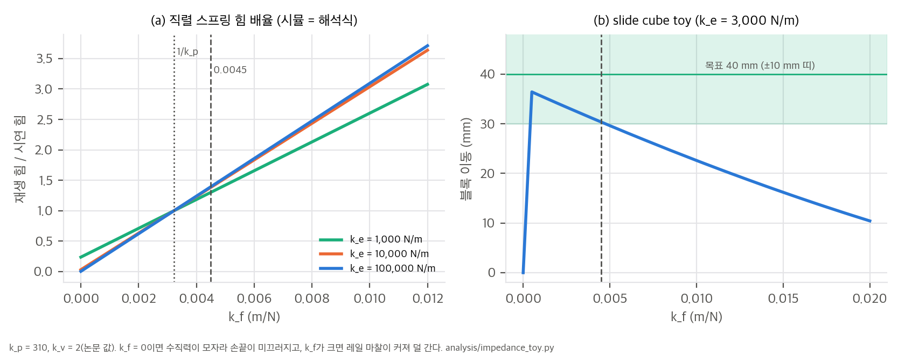
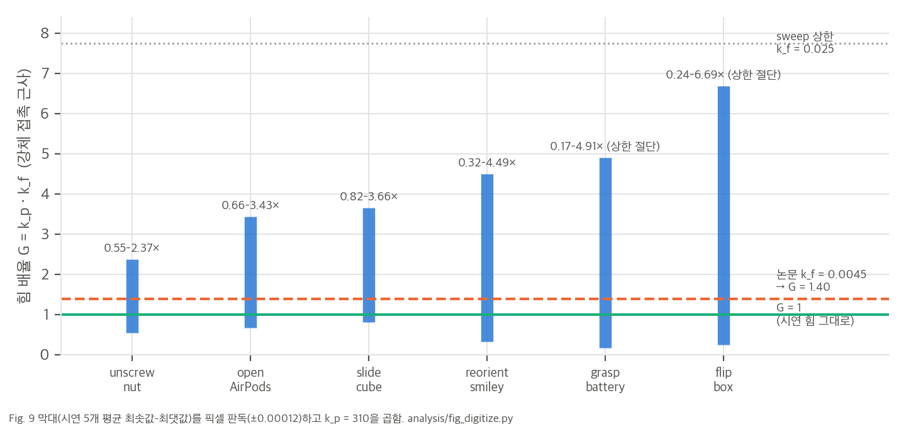
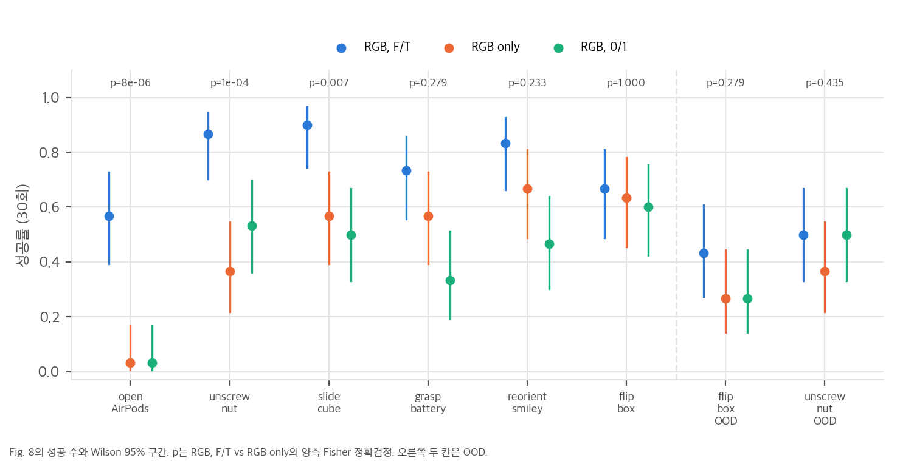

# 03. 핵심 식 해석과 toy 검증

스크립트: `analysis/table_check.py`(그림 수치 재계산, 결과 `table_check_results.json`), `analysis/fig_digitize.py`(Fig. 9 픽셀 판독, `fig9_digitize_results.json`), `analysis/impedance_toy.py`(식 1–3 toy, `impedance_toy_results.json`). 모두 numpy·scipy 단일 스레드로 몇 초 안에 끝납니다.

## 1. 식 1과 식 3을 함께 쓰면 힘은 몇 배가 되는가

### 1.1 강체 접촉
재생할 때 손끝이 접촉면에 막혀 시연 때와 같은 자리(x_c ≈ x_o)에 멈춘다고 하면, 식 1의 정상 상태 힘은 다음과 같습니다.

```
F = k_p (x_f − x_c) = k_p (x_o + k_f f − x_o) = k_p k_f · f
```

v2의 값(k_p = 310, k_f = 0.0045)이면 **G = k_p k_f = 1.395**이고, 재생 힘은 시연 힘의 1.4배입니다. 논문이 식 3을 정당화한 "식 1과 같은 스프링" 논리를 그대로 따르면 k_f = 1/k_p = **0.00323**이어야 G = 1입니다. v1의 K_f = I₃/220(= 0.004545)은 "강성 220의 역수" 꼴이고, v2 k_p와의 곱은 1.41입니다. v1 시점에 다른 k_p를 썼거나, 처음부터 1.4배 증폭을 의도했을 수 있습니다. 논문만으로는 어느 쪽인지 알 수 없습니다(가설).

### 1.2 연한 접촉 (직렬 스프링)
손끝 패드나 물체가 강성 k_e로 변형되면, 시연의 관측 위치 x_o에 이미 침투 f/k_e가 들어 있습니다. 재생에서는 임피던스 스프링(k_p)과 접촉 스프링(k_e)이 직렬로 걸리므로 다음이 성립합니다.

```
G(k_f, k_e) = (1/k_e + k_f) / (1/k_p + 1/k_e)
```

- k_e → ∞(강체)이면 G → k_p k_f입니다.
- k_f = 1/k_p이면 k_e와 상관없이 G = 1입니다. 시연 힘을 그대로 재현하는 유일한 값입니다.
- k_f = 0(관측 위치 그대로)이면 G = k_p/(k_p + k_e)입니다. k_e = 1,000 N/m면 0.24, 10,000이면 0.03, 100,000이면 0.003입니다.

toy T1은 점 질량 손끝을 k_p = 310, k_v = 2로 적분해 정상 상태 힘을 쟀고, 위 식과 소수점 셋째 자리까지 같았습니다.

| k_e (N/m) | k_f = 0 | k_f = 1/k_p | k_f = 0.0045 | k_f = 0.01 |
|---|---|---|---|---|
| 1,000 | 0.237 | 1.000 | 1.302 | 2.603 |
| 3,000 | 0.094 | 1.000 | 1.358 | 2.903 |
| 10,000 | 0.030 | 1.000 | 1.383 | 3.037 |
| 100,000 | 0.003 | 1.000 | 1.394 | 3.094 |



## 2. Fig. 9를 힘 배율로 다시 읽기

Fig. 9의 k_f 범위에 k_p = 310을 곱하면(강체 근사), "재생 힘이 시연 힘의 몇 배일 때 과제가 성공하는가"가 됩니다.



해석:
- **G = 1이 여섯 과제 모두 범위 안에 있습니다.** k_f = 1/k_p로 두면 과제마다 따로 맞추지 않아도 된다는 저자 결론이, 물리적으로 의미 있는 값에서도 성립합니다.
- **범위의 최대/최소 비가 과제의 힘 허용 폭입니다.** 강체 근사에서 과제가 허용하는 수직력이 [N_lo, N_hi]이고 시연자가 f만큼 눌렀다면, 허용 k_f = [N_lo, N_hi]/(k_p f)입니다. 비 k_f,max/k_f,min = N_hi/N_lo는 시연자와 무관하게 과제만으로 정해집니다. 판독값은 unscrew nut 4.3, AirPods 5.2, slide cube 4.5, smiley 13.9, battery 28.8 이상, flip box 27.3 이상입니다.
- **범위의 위치는 시연자가 얼마나 세게 눌렀는지로 정해집니다.** 같은 과제라도 더 세게 누른 시연은 범위 전체가 작은 k_f 쪽으로 이동합니다. grasp battery의 최솟값 0.0006(G = 0.17)은, 이 과제에서 시연자가 필요한 힘의 약 6배로 쥐었다는 뜻으로 읽을 수 있습니다.
- **오차 막대는 시연자 힘의 변동을 담습니다.** toy T3에서 시연 힘의 CV를 0.3으로 두면 k_f 최댓값의 CV(시연 5개 안)가 0.27로 나옵니다. Fig. 9 최댓값의 CV는 절단이 없는 네 과제에서 0.25(slide)–0.46(AirPods, smiley)입니다. 그런데 순수한 "시연자 힘" 모델에서는 최솟값과 최댓값의 CV가 같아야 하는데, AirPods는 최솟값 CV가 0.14로 최댓값(0.46)보다 훨씬 작습니다. 시연마다 과제 조건(물체 배치, 접촉 위치)도 달랐다는 뜻입니다.
- **상한 절단:** battery와 flip box는 최댓값 평균 + SD가 sweep 상한 0.025(G = 7.75)를 넘습니다. 시연 5개 중 일부가 상한에 걸렸다는 뜻이고, 실제 허용 폭은 표보다 넓습니다. "덜 민감한 과제"라는 순위는 바뀌지 않습니다.

## 3. 관측 위치 기준선은 왜 실패하는가 (toy T2)

toy T2는 "위에서 눌러 끌기" 판 slide cube입니다. 손끝이 블록 윗면을 눌러 마찰로 끌고, 블록은 레일 마찰을 받습니다. 블록이 움직이려면 μ_f N > μ_r (N + m g)이어야 합니다(μ_f = 0.8, μ_r = 0.3, m = 50 g, N_min = 0.29 N, 시연 수직력 2 N). 시연을 x_f로 재생하며 k_f를 훑었습니다.

| 접촉 강성 k_e | k_f = 0 블록 이동 | k_f = 0.0045 블록 이동 | 성공 k_f 창 (목표 40 mm ± 10 mm) |
|---|---|---|---|
| 1,000 N/m | 36.1 mm | 30.8 mm | 0 – 0.0050 |
| 3,000 N/m | 0.0 mm | 30.4 mm | 0.0005 – 0.0045 |
| 30,000 N/m | 0.0 mm | 30.1 mm | 0.0005 – 0.0045 |

- **k_f = 0은 접촉이 단단하면 실패합니다.** 수직력이 G(0)·2 N = 0.19 N(k_e = 3,000)으로 N_min보다 작아 손끝이 미끄러집니다. 논문의 관측 위치 정책이 거의 0%인 것과 같은 현상입니다. 반대로 패드가 무르면(k_e = 1,000) x_o 안의 변형만으로 0.47 N이 남아 성공합니다. 관측 위치 기준선이 실패하는지는 접촉 강성과 필요한 힘의 여유에 달려 있습니다.
- **k_f가 너무 커도 실패합니다.** 수직력이 커지면 레일 마찰도 함께 커져서, 같은 접선 목표로는 블록이 덜 갑니다. 논문 보충 영상의 "힘이 너무 크면 slide cube가 실패한다"는 관찰을 설명할 수 있는 기구 하나입니다. 실제로 어떤 기구인지는 영상을 보지 않아 확인하지 못했습니다.
- 창의 상한은 허용 오차(목표 구역 폭)로 정해집니다. ±5 mm로 좁히면 상한이 0.001–0.0015까지 내려옵니다. 즉 k_f 민감도는 힘 자체뿐 아니라 과제의 기하 허용 오차에도 묶여 있습니다.

toy의 질량, 마찰계수, 패드 강성, 목표 허용 오차는 모두 가정입니다. 결과는 경향으로만 읽어야 합니다.

## 4. 통계로 다시 본 Fig. 8 (C3, C4, C6)



- 과제별로 F/T가 RGB-only보다 유의한 것은 AirPods(p = 8×10⁻⁶), unscrew nut(1.4×10⁻⁴), slide cube(0.0074)입니다. Holm 보정(6개 과제) 뒤에도 세 개 모두 0.05 아래입니다.
- 나머지 세 과제와 OOD 두 개는 p = 0.23–1.0입니다. 다만 8개 비교의 방향이 모두 같아서, 부호 검정으로는 "F/T가 RGB-only보다 낮지 않다"는 방향성이 유의합니다(단측 p = 0.004).
- "force-sensitive 과제일수록 힘 관측 이득이 크다"는 관찰은, k_f 범위 너비와 상대 이득의 순위 상관 ρ = −0.89(정확 순열 단측 p = 0.017)입니다. 절대 이득(성공 수 차이)으로 바꾸면 ρ = −0.93(p = 0.008)입니다. 과제 6개라 표본이 작지만 방향은 분명합니다.

## 5. 실험 규모 (C7)

- 시연 550개(80, 60, 150, 110, 80, 70)
- 평가 rollout: Fig. 7·8 합계 900회(관측 위치 180 + 관측 절제 8 × 3 × 30). v1 proprioception 절제는 120회 더
- k_f sweep 재생: 0.0045에서 0.0001씩 위아래 실패까지, 과제당 시연 5개라면 평균 범위 기준 과제당 시연 하나에 61–210회, 합계 **약 3,700회**(우리 추정). 이분 탐색이나 로그 간격을 썼다면 수십 분의 일로 줄일 수 있습니다.

## 추가 검증 (2026-11-11)

스크립트: `analysis/extra_pinch_window.py` → `analysis/extra_pinch_window_results.json` (numpy 단일 스레드, 0.1초 미만).

### 추가 검증 1: 집기 과제의 k_f 허용 구간과 접촉 위치 오차

**목적.** 집기(배터리형) 과제에서 k_f 하한이 0 근처로 나온다(§2). 이를 "시연자가 과하게 쥔 것"으로 설명할 수 있는지, 재생 때 접촉 위치 오차가 하한을 얼마나 바꾸는지, 이분 탐색이 격자 훑기와 같은 경계를 얼마나 적은 평가로 찾는지 본다.

**설정(가정, 정상 상태 모형).**
- 손가락 i의 재생 힘은 F_i = k_p (x_f − x_c) = k_p k_f f_i − k_p e_i다. f_i는 시연 힘, e_i는 재생 때 접촉 위치가 시연 관측 위치에서 벗어난 양이며 N(0, σ_e²)에서 독립으로 뽑는다.
- 과제 창: 두 손가락 힘이 모두 [N_lo, N_hi] = [0.5, 5] N에 있어야 한다(쥐고 있기 하한, 부품 파손 상한). 실제 Fig. 9의 창과는 다르며 가정이다.
- 시연 힘: 중앙값 3 N, CV 0.3의 로그정규 분포, 집단 크기 M = 20,000. k_p = 310 N/m.
- 한 시연의 허용 k_f 구간은 두 손가락 제약의 교집합이다(선형이므로 구간이 된다).
- σ_e ∈ {0, 0.5, 1, 2} mm.
- 집단 성공률 R(k_f) = P(k_f가 구간 안)가 0.9 이상이 되는 하한과 상한을 두 방법으로 찾는다. 격자는 0.0001 간격(201점), 이분 탐색은 허용 오차 1e-5다.

**결과.**

| σ_e (mm) | 허용 구간이 있는 비율 | k_f 하한 중앙값 | k_f 상한 중앙값 | 하한 < 1e-4인 비율 | 90% 하한 (격자 / 이분) | 90% 상한 (격자 / 이분) | 평가 횟수 (이분 / 격자) |
|---|---|---|---|---|---|---|---|
| 0 | 1.000 | 0.00066 | 0.00479 | 0.000 | 0.0010 / 0.00090 | 0.0034 / 0.00348 | 8 + 11 / 201 |
| 0.5 | 1.000 | 0.00069 | 0.00477 | 0.000 | 0.0011 / 0.00105 | 0.0034 / 0.00347 | 8 + 11 / 201 |
| 1 | 1.000 | 0.00076 | 0.00477 | 0.010 | 0.0014 / 0.00132 | 0.0034 / 0.00344 | 8 + 11 / 201 |
| 2 | 0.999 | 0.00094 | 0.00469 | 0.066 | 0.0020 / 0.00192 | 0.0032 / 0.00328 | 9 + 11 / 201 |

시연 힘에 따른 하한(σ_e = 0): 최대 힘이 상위 25%인 시연의 하한 중앙값은 0.00058, 하위 25%는 0.00077이다.

**결론.**
- 하한 0 근처는 N_lo / (k_p f)로 나온다. N_lo = 0.5 N, f = 3 N이면 0.00054다. 방향은 "시연자가 세게 쥐었다"와 같지만, 이 해석은 과제 창의 하한 N_lo를 알아야 나온다. Fig. 9의 하한 값만으로는 "과하게 쥠"과 "창 하한이 낮음"을 구분할 수 없다. 앞 절의 "시연 힘의 약 6배로 쥐었다"는 해석도 같은 가정에 달려 있다.
- 접촉 위치 오차는 하한의 중앙값을 거의 바꾸지 않는다(σ_e = 2 mm에서 0.00066 → 0.00094). 그러나 90% 경계의 하한은 거의 두 배가 된다(0.0009 → 0.0019). 신뢰할 수 있는 허용 범위의 하한을 정하려면 접촉 위치 오차를 함께 봐야 한다. 2 mm에서 k_p e는 약 0.6 N으로, 창 폭 4.5 N의 일부를 먹는다.
- 이분 탐색은 평가 8–11회로 격자 201회와 같은 경계를 찾는다(차이는 격자 간격 1e-4 안). 이 방법은 집단 성공률이 최고점 양쪽에서 단조인 경우에만 맞으므로, 최고점을 기준으로 두 쪽을 따로 찾았다.
- **한계.** 정상 상태 모형이라 동특성과 마찰을 무시했다. 과제 창과 시연 힘 분포는 가정이다. 허용 k_f 폭의 절대값은 이 가정에 크게 달려 있다. 실제 DexForce 시연 데이터는 쓰지 않았다.

### 추가 검증 2: MuJoCo 모의 시연과 임피던스 재생에서 힘 배율과 허용 창

**목적.** 추가 검증 1(numpy)의 허용 창과 §1의 힘 배율 식이 MuJoCo의 팁과 접촉 모델에서도 나오는지 확인한다. 접촉 면 위치가 재생 때 어긋나면 허용 창이 어떻게 움직이는지도 본다. 블록을 마찰로 끄는 과제는 포함하지 않았다.

**설정.** `analysis/extra_kinesthetic_mujoco.py` → `analysis/extra_kinesthetic_mujoco_results.json`. CPU, 스레드 4, 실행 6.9 s. MuJoCo 4.0.0, numpy 1.26.4, torch 2.15.0(미사용).
- 팁: 슬라이드 관절 1개, 질량 0.05 kg, 위치 서보 k_p = 310 N/m, k_v = 2 N·s/m(MuJoCo position actuator).
- 접촉: 강성 k_e의 한쪽 스프링을 팁에 외력으로 가한다. MuJoCo 접촉 파라미터는 쓰지 않았다. 시간 간격 0.5 ms(k_e = 10⁵에서도 안정).
- 시연: 가상 leader를 적분 제어해 접촉력을 3 N에 맞춘 뒤 2.5 s 동안 팁 위치 x_o와 힘 f를 기록한다.
- 재생: 목표 x_f(t) = x_o(t) + k_f f(t)를 같은 시각으로 재생한다. 정상상태(마지막 0.5 s) 힘 F를 시연 힘으로 나눈 값을 G로 본다.
- 허용 창: 정상상태 힘이 [N_lo, N_hi] = [0.5, 5] N에 드는 k_f 범위를 0–0.012, 61점 격자로 구한다. 식 쪽은 G ∈ [N_lo/f, N_hi/f]를 k_f로 푼 닫힌 구간이다.
- 집기: 두 팁이 폭 0.04 m인 물체의 양 면을 민다. 두 힘이 모두 창 안에 있고 물체 이동이 5 mm 미만이면 성공이다.

**결과.** (1) 힘 배율 G (시연 힘 3 N)

| k_e (N/m) | k_f = 0 | k_f = 1/k_p (0.00323) | k_f = 0.0045 | k_f = 0.01 |
|---|---|---|---|---|
| 10³ | 0.237 | 1.000 | 1.302 | 2.603 |
| 10⁴ | 0.030 | 1.000 | 1.383 | 3.037 |
| 10⁵ | 0.003 | 1.000 | 1.394 | 3.094 |

측정 G와 식 G는 모든 칸에서 소수 넷째 자리까지 같다.

(2) 누름 과제의 허용 창 (k_f)

| k_e (N/m) | 면 위치 오차 | 시뮬레이션 창 | 식 창(공칭) | k_f = 0 성공 |
|---|---|---|---|---|
| 10³ | 0 | [0, 0.0060] | [−0.0003, 0.0060] | 예 |
| 10⁴ | 0 | [0.0006, 0.0054] | [0.00045, 0.00544] | 아니오 |
| 10⁵ | 0 | [0.0006, 0.0052] | [0.00053, 0.00538] | 아니오 |
| 10⁴ | 1 mm | [0.0008, 0.0056] | — | 아니오 |
| 10⁴ | 2 mm | [0.0012, 0.0060] | — | 아니오 |

(3) 집기 과제(양 면, 시연 힘 3 N): k_e = 10³에서 창 [0, 0.0060], k_f = 0 성공. k_e = 10⁴에서 창 [0.0006, 0.0054], k_f = 0 실패. 두 손가락의 힘은 대칭이고, 물체 이동은 모든 격자점에서 5 mm 미만이었다.

모든 창은 연속 구간이었다.

**결론.**
- 식의 힘 배율은 MuJoCo의 팁과 접촉 모델에서도 그대로 나온다. k_f = 1/k_p에서 G = 1이고, k_f = 0은 k_e가 10⁴ 이상이면 실패한다(G = 0.03). 관측 위치 기준선이 실패하는 조건은 시연 힘과 접촉 강성의 관계로 정해진다.
- 허용 창의 하한은 식과 격자 간격(0.0002) 안에서 맞는다. 상한은 k_e에 거의 무관하다(0.0052–0.0060). 추가 검증 1의 창 모양과 같다.
- 접촉 면 위치가 재생 때 2 mm 어긋나면 하한이 0.0006에서 0.0012로 두 배가 된다. 추가 검증 1(numpy)의 90% 경계에서도 같은 방향의 변화가 있었다. 두 결과는 같은 조건이 아니므로 수치를 직접 비교하지 않는다.
- 집기 과제에서도 같은 창 구조가 나온다. 힘 배율과 허용 창은 과제 종류보다 접촉 강성과 면 위치 오차에 더 민감하다.

**한계.**
- 1 자유도 점 질량이다. 끌기(마찰 블록 밀기)는 포함하지 않아서 slide cube 과제의 수평 성분은 재현하지 않았다.
- 접촉은 한쪽 스프링 외력이다. 접촉 강성은 MuJoCo 접촉 파라미터로 맞추지 않았다.
- 시연 힘은 3 N 한 값이고, 시연마다 다른 힘의 분포는 보지 않았다. 허용 창의 절대값은 N_lo, N_hi 가정(0.5, 5 N)에 달려 있다.
- 실제 DexForce 시연 데이터는 쓰지 않았다.

### 추가 검증 3: 모의 시연으로 학습한 소형 확산 정책의 힘 제어

**목적.** 힘 목표(force-informed target)와 관측 위치 목표가, 그리고 어떤 감각을 주느냐(힘 없음, F/T, 0/1)가 학습된 정책의 접촉력 제어에 어떻게 영향을 주는지 본다. 추가 검증 2의 시뮬레이션 시연을 학습 자료로 쓴다.

**설정.** `analysis/extra_small_diffusion.py` → `analysis/extra_small_diffusion_results.json`. CPU(작은 MLP라서 MPS로 옮기지 않음), 스레드 4, 실행 236 s. torch 2.15.0, MuJoCo 4.0.0, numpy 1.26.4. 학습 시드 0, 1, 2.
- 과제: 1 자유도 팁을 강성 k_e(1e3–1e4 N/m, 로그 균일)의 벽에 눌러 정상상태 접촉력을 2–4 N에 맞춘다. 에피소드는 2.5 s.
- 시연: 추가 검증 2와 같은 가상 leader 시연을 3 N에 맞춘 것 100개. 목표는 두 가지다. 관측 위치(목표 = x_o)와 힘 목표(목표 = x_o + f/k_p).
- 감각: 힘 없음(위치·속도만), F/T(힘 + 잡음 0.05 N), 0/1(접촉 여부 + 잡음).
- 정책: 조건부 DDPM. 노이즈 단계 30, MLP 128 × 3, 시간 임베딩 16차원. 출력은 4개 chunk 원소이며, 각 원소는 40스텝(80 ms)씩 떨어진 목표다. 첫 원소를 실행하고 20 ms마다 다시 계획한다. 행동은 칸별 표준편차로 정규화했다.
- 학습: 2500 스텝, 배치 256, AdamW 1e-3. 학습 샘플 48,000개.
- 시험: 학습 분포의 k_e에서 30회 × 시드 3, 학습 밖 k_e = 3e4에서 10회 × 시드 3. 성공은 마지막 0.5 s 평균 접촉력이 2–4 N인 경우다.

**결과.** 시험 성공률(시드 평균, 시드별 값 포함)과 평균 접촉력.

| 목표 | 감각 | 성공률 (시드별) | 평균 접촉력 | 학습 밖 3e4 성공률 |
|---|---|---|---|---|
| 관측 위치 | 힘 없음 | 0.00 (0, 0, 0) | 0.00 N | 0.00 |
| 관측 위치 | F/T | 0.00 (0, 0, 0) | 0.04 N | 0.00 |
| 관측 위치 | 0/1 | 0.00 (0, 0, 0) | 0.04 N | 0.00 |
| 힘 목표 | 힘 없음 | 0.20 (0.10, 0.50, 0.00) | 1.37 N | 0.37 |
| 힘 목표 | F/T | **0.96** (1.00, 0.87, 1.00) | 2.85 N | 1.00 |
| 힘 목표 | 0/1 | 0.48 (0.57, 0.00, 0.87) | 1.73 N | 0.43 |

**결론.**
- 관측 위치 목표는 감각과 상관없이 실패한다. 접촉력이 0.04 N 이하다. 재생 힘의 배율 G = k_f 항이 0이면 접촉 강성에 상관없이 힘이 나오지 않는다는 추가 검증 2의 결과와 같다.
- 힘 목표는 힘 값을 감각으로 줄 때만 성공한다. F/T일 때 96%로 성공하고 평균 힘이 2.85 N으로 시연(3 N)에 가깝다. 학습 밖의 강성 3e4에서도 성공률 1.00이다.
- 0/1 감각은 접촉 여부만 알려 주므로 힘 크기를 맞추기 어렵다. 48%로 F/T보다 낮고 시드 간 편차가 크다(0.00–0.87). 힘 없음은 20%다.
- 종합하면, 논문 Fig. 7–8과 v1 Fig. 9의 경향(힘 목표 + F/T가 가장 좋고, 관측 위치는 실패)이 이 소형 시뮬레이션에서도 나온다. 다만 이 경향은 물리 식(추가 검증 2)에서 거의 필연적으로 나오므로, 정책 학습이 독립적으로 검증한 것은 "학습이 그 식을 따라 힘 목표를 배울 수 있는가"까지다.

**한계.**
- 과제는 1 자유도 누름이다. 비전이 없고, RGB 조건은 위치·속도 입력으로 대신했다.
- 시연 100개, 학습 2500 스텝, 시드 3, 시험 30회 × 3이다. 시드별 편차가 커서(0/1 감각) 차이의 신뢰구간은 넓다.
- 접촉력 성공 창은 2–4 N으로 잡았다. 벽 강성 3e4는 학습 분포 밖이지만 1 자유도라서 외삽이 쉬운 편이다.
- 확산 정책은 chunk를 80 ms 간격으로 예측하고, 시연과 같은 leader 적분 규칙을 따른다. 실제 kinesthetic 시연 데이터나 실물 제어는 포함하지 않는다.
